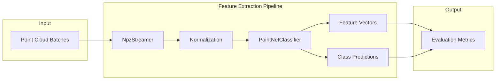
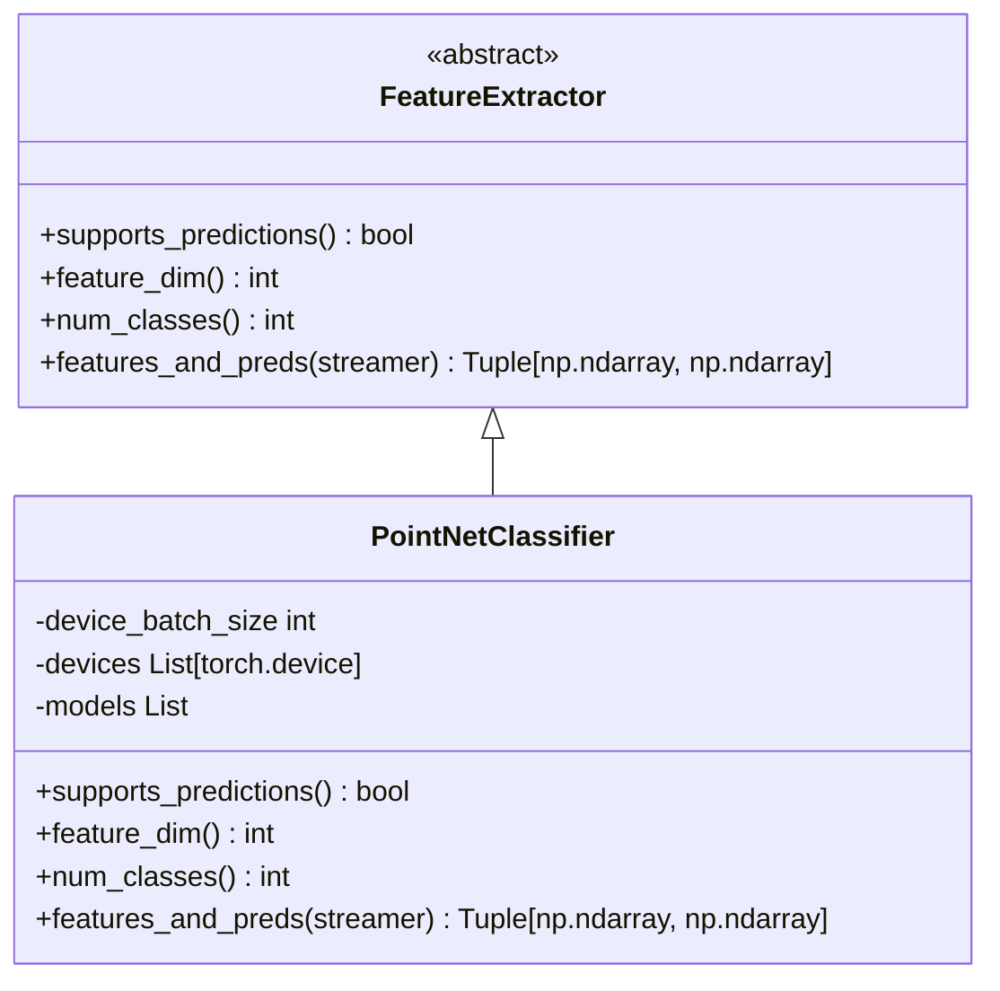
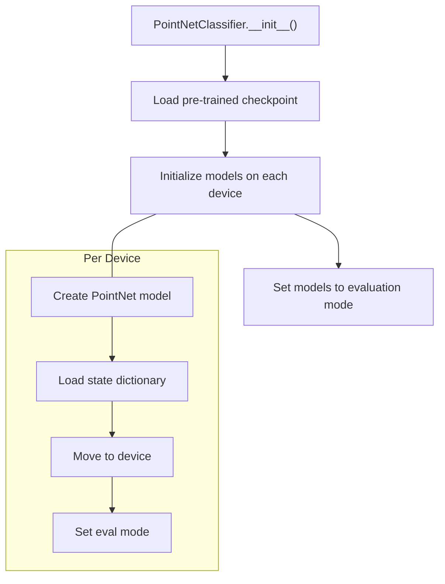
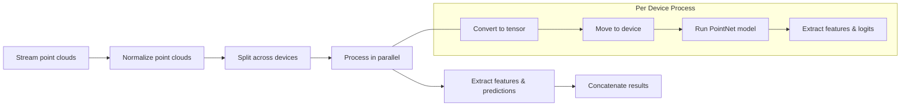
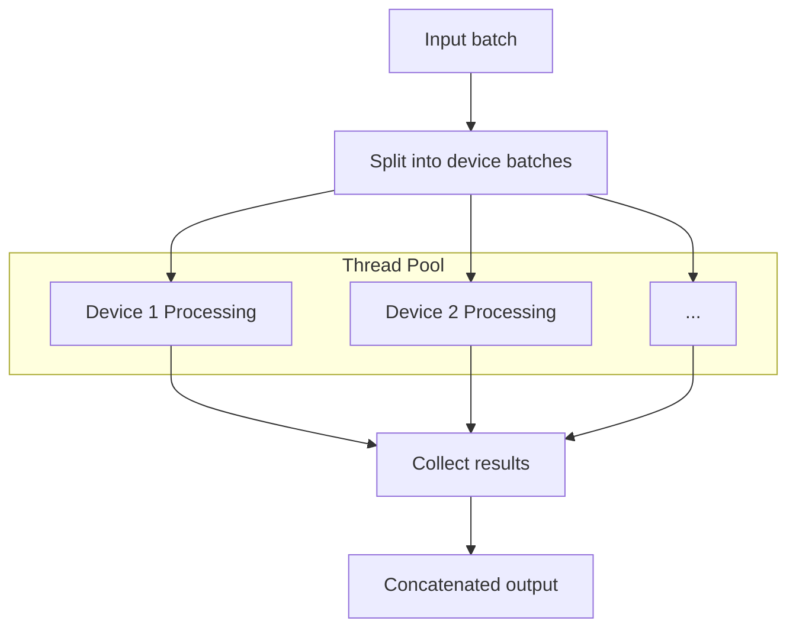
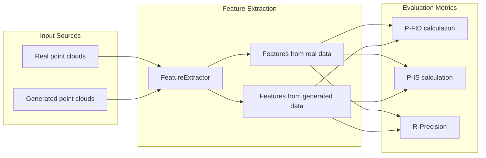

<!-- source: DeepWiki mcp.deepwiki.com · repo openai/point-e · page 4.2 Feature Extraction · fetched 2026-10-26 -->

# Feature Extraction

<details>
<summary>Relevant source files</summary>

The following files were used as context for generating this wiki page:

- [point_e/evals/feature_extractor.py](point_e/evals/feature_extractor.py)

</details>


## Purpose and Scope

This document describes the feature extraction system used for evaluation purposes in Point-E. Feature extraction is a critical component that transforms 3D point cloud data into feature vectors and class predictions, which are then used by various evaluation metrics. This page focuses on the implementation details of feature extractors, particularly the PointNet-based classifier. For information about how these extracted features are used in evaluation metrics like P-FID and P-IS, see [Evaluation Metrics](#4.1).

## Architecture Overview

The feature extraction system in Point-E is designed to process batches of point clouds and convert them into meaningful feature vectors that capture semantic information about the 3D shapes. These feature vectors enable quantitative evaluation of generated point clouds.



Sources: [point_e/evals/feature_extractor.py:21-49](), [point_e/evals/feature_extractor.py:84-111]()

## Feature Extractor Interface

The feature extraction system is built around an abstract base class `FeatureExtractor` that defines the common interface for all feature extractors. This design allows for different feature extraction models to be used interchangeably.



The abstract interface requires implementing:
- `supports_predictions`: Whether the extractor can provide class predictions
- `feature_dim`: The dimensionality of extracted feature vectors
- `num_classes`: Number of classes for predictions
- `features_and_preds`: Main method to process point clouds and return features and predictions

Sources: [point_e/evals/feature_extractor.py:21-49]()

## PointNetClassifier Implementation

The `PointNetClassifier` is the primary feature extractor implementation, utilizing a pre-trained PointNet model to extract features from point clouds.

### Key Characteristics

| Property | Value | Description |
|----------|-------|-------------|
| Feature Dimension | 256 | The size of each extracted feature vector |
| Number of Classes | 40 | The number of object classes the model can predict |
| Model Architecture | PointNet | A deep neural network designed for point cloud classification |
| Supported Devices | CUDA/CPU | Can utilize multiple GPUs or fall back to CPU |

Sources: [point_e/evals/feature_extractor.py:51-82]()

### Initialization Process



The PointNetClassifier loads a pre-trained model checkpoint and initializes it across all available devices (GPUs or CPU) for parallel processing.

Sources: [point_e/evals/feature_extractor.py:52-70]()

### Feature Extraction Process

The feature extraction process involves:

1. Streaming batches of point clouds
2. Normalizing each point cloud
3. Distributing batches across available devices
4. Running the PointNet model on each batch
5. Extracting feature vectors and class predictions
6. Combining results from all devices



Sources: [point_e/evals/feature_extractor.py:84-111]()

## Point Cloud Normalization

Before feature extraction, point clouds undergo normalization to ensure consistent processing regardless of their original scale and position:

1. Center the point cloud by subtracting the centroid
2. Scale the point cloud to fit within a unit sphere


Sources: [point_e/evals/feature_extractor.py:114-119]()

## Multi-device Processing

The feature extraction system efficiently utilizes available hardware by distributing computation across multiple devices:



The system:
1. Detects available CUDA devices or falls back to CPU
2. Splits input batches according to device batch size
3. Uses a ThreadPool to parallelize processing across devices
4. Collects and concatenates results from all devices

Sources: [point_e/evals/feature_extractor.py:14-18](), [point_e/evals/feature_extractor.py:91-110]()

## Integration with Evaluation Pipeline

Feature extraction serves as a critical component in the evaluation pipeline, enabling metrics such as P-FID (Point cloud Fréchet Inception Distance) and P-IS (Point cloud Inception Score) to assess the quality of generated point clouds.



The extracted features provide a semantic representation of point clouds that allows comparing the distribution of generated samples with real data, yielding quantitative measures of generation quality.

Sources: [point_e/evals/feature_extractor.py:37-48]()

## Usage Example

To use the feature extractor in an evaluation context:

1. Initialize the PointNetClassifier with appropriate devices
2. Create an NpzStreamer for the point cloud data
3. Call features_and_preds() to extract features and predictions
4. Use these features for downstream evaluation metrics

```python
# Example usage (not actual code)
devices = get_torch_devices()
extractor = PointNetClassifier(devices=devices, device_batch_size=64)
streamer = NpzStreamer(...)
features, predictions = extractor.features_and_preds(streamer)
# Use features for evaluation metrics
```

Sources: [point_e/evals/feature_extractor.py:84-111]()

---

