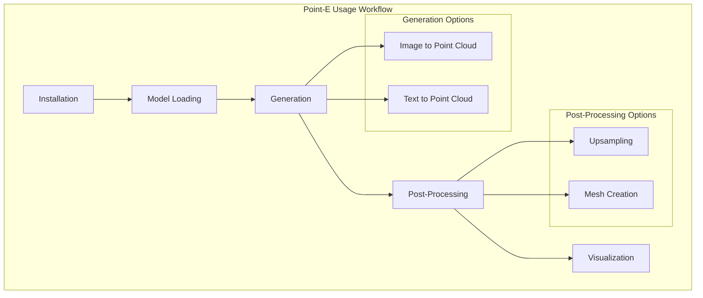
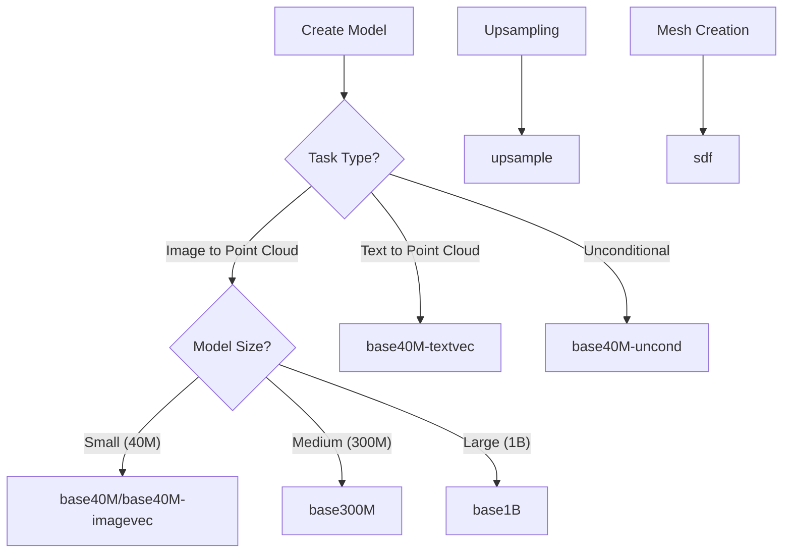
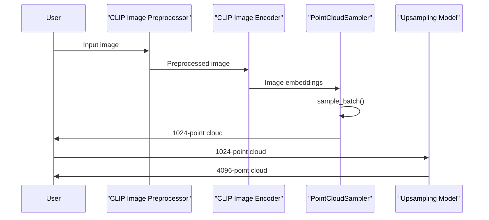
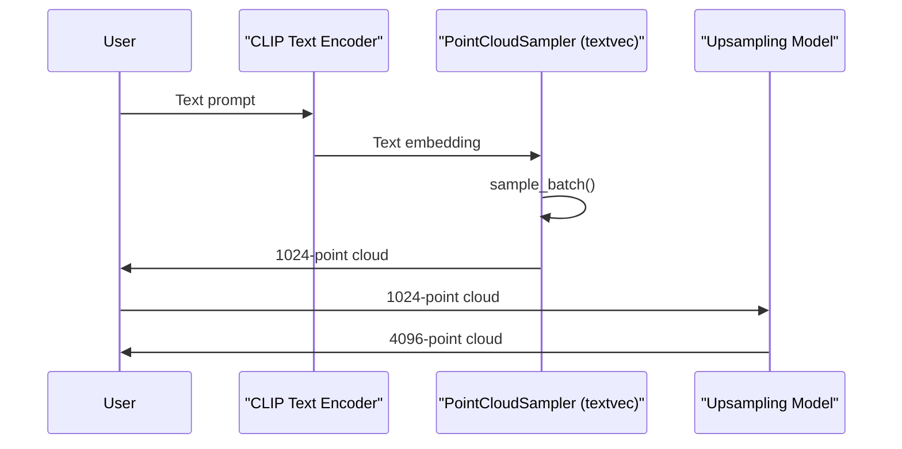
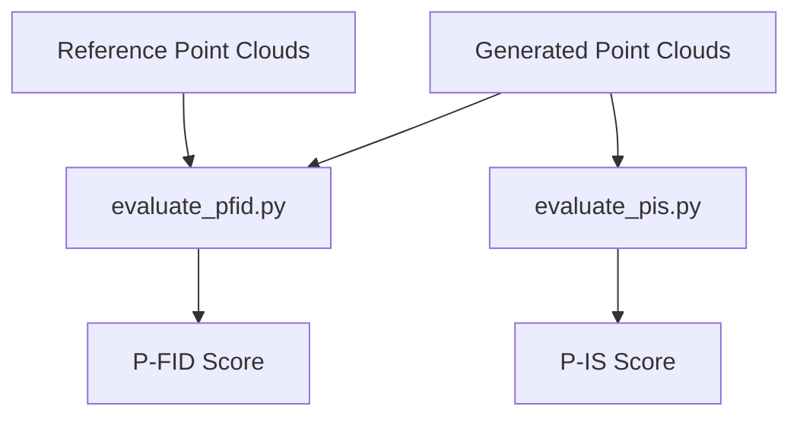
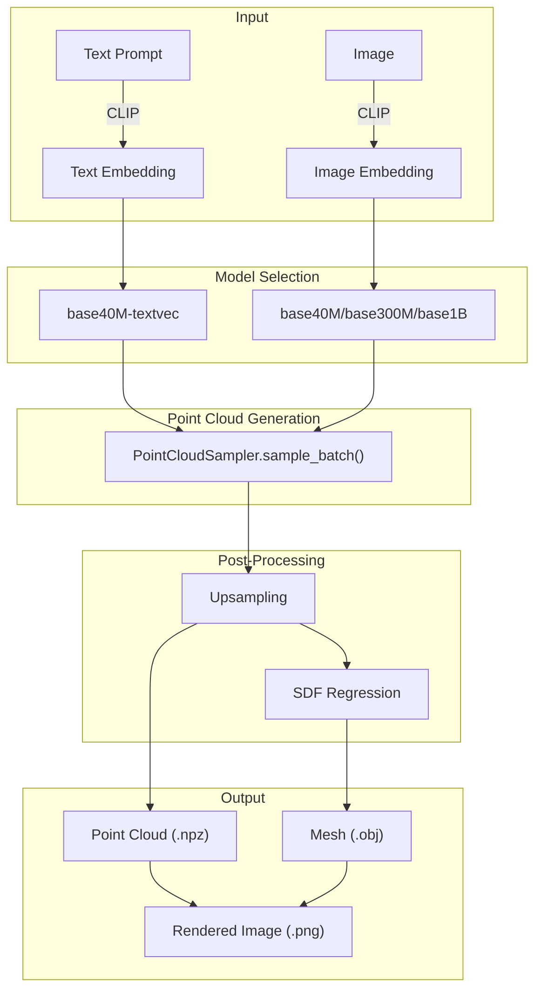

<!-- source: DeepWiki mcp.deepwiki.com · repo openai/point-e · page 5 Usage Guide · fetched 2026-10-26 -->

# Usage Guide

<details>
<summary>Relevant source files</summary>

The following files were used as context for generating this wiki page:

- [README.md](README.md)
- [model-card.md](model-card.md)

</details>


This guide provides comprehensive instructions for using the Point-E system to generate 3D point clouds from images or text, and to convert these point clouds into meshes. For information about the system architecture and model details, see [Model Architecture](#2) and [Available Models](#3).



Sources: [README.md:7-22]()

## Installation

To install Point-E and its dependencies, use pip:

```
pip install -e .
```

This installs the package in development mode, allowing you to modify the code while using it.

### System Requirements

Point-E requires:
- Python 3.7+
- PyTorch 1.10+
- Access to GPU is recommended for faster sampling

Sources: [README.md:9]()

## Model Loading

Point-E provides several pre-trained models for different tasks. The following diagram shows the model selection process:



Loading models is done through the `create_model_and_diffusion` function with the appropriate model name:

```python
from point_e.diffusion.model_util import create_model_and_diffusion
from point_e.diffusion.configs import DIFFUSION_CONFIGS

# Select model configuration
model_config = DIFFUSION_CONFIGS['base300M']  # or any other model name

# Create model and diffusion objects
model, diffusion = create_model_and_diffusion(**model_config)

# Load checkpoint
device = torch.device('cuda' if torch.cuda.is_available() else 'cpu')
model.load_state_dict(torch.load('path/to/base300M.pt', map_location=device))
model.to(device)
model.eval()
```

Sources: [model-card.md:16-26]()

## Image-to-Point Cloud Generation

To generate a point cloud from an image:

1. Load the image-to-point cloud model and upsampler
2. Prepare the input image using CLIP's preprocessing
3. Create a sampler for the model
4. Run the sampler to generate a point cloud
5. Optionally upsample the result



Example workflow:

```python
# Load models
base_model, base_diffusion = create_model_and_diffusion(**DIFFUSION_CONFIGS['base300M'])
base_model.load_state_dict(torch.load('base300M.pt'))
base_model.to(device)
base_model.eval()

upsampler_model, upsampler_diffusion = create_model_and_diffusion(**DIFFUSION_CONFIGS['upsample'])
upsampler_model.load_state_dict(torch.load('upsample.pt'))
upsampler_model.to(device)
upsampler_model.eval()

# Create samplers
sampler = PointCloudSampler(
    device=device,
    models=[base_model],
    diffusions=[base_diffusion],
    num_points=[1024],
    aux_channels=['R', 'G', 'B'],
    guidance_scale=[3.0]
)

upsampler = PointCloudSampler(
    device=device,
    models=[upsampler_model],
    diffusions=[upsampler_diffusion],
    num_points=[4096],
    aux_channels=['R', 'G', 'B'],
    guidance_scale=[3.0]
)

# Prepare image
image = load_image('example.jpg')
clip_image = clip_preprocess(image).unsqueeze(0).to(device)

# Generate point cloud
pc = sampler.sample_batch_progressive(
    batch_size=1,
    model_kwargs={'images': clip_image}
)

# Upsample point cloud
upsampled_pc = upsampler.sample_batch_progressive(
    batch_size=1,
    model_kwargs={
        'images': clip_image,
        'low_res_pc': pc
    }
)
```

Sources: [README.md:13]()

## Text-to-Point Cloud Generation

To generate a point cloud from text:

1. Load the text-to-point cloud model
2. Encode the text prompt using CLIP's text encoder
3. Create a sampler for the model
4. Run the sampler to generate a point cloud
5. Optionally upsample the result



Example workflow:

```python
# Load models
base_model, base_diffusion = create_model_and_diffusion(**DIFFUSION_CONFIGS['base40M-textvec'])
base_model.load_state_dict(torch.load('base40M-textvec.pt'))
base_model.to(device)
base_model.eval()

# Load CLIP text encoder
clip_model = clip.load('ViT-L/14', device=device)[0]

# Create sampler
sampler = PointCloudSampler(
    device=device,
    models=[base_model],
    diffusions=[base_diffusion],
    num_points=[1024],
    aux_channels=['R', 'G', 'B'],
    guidance_scale=[3.0]
)

# Encode text
text = "a red chair"
text_tokens = clip.tokenize([text]).to(device)
text_embedding = clip_model.encode_text(text_tokens)

# Generate point cloud
pc = sampler.sample_batch_progressive(
    batch_size=1,
    model_kwargs={'texts': text_embedding}
)
```

Sources: [README.md:14]()

## Point Cloud-to-Mesh Conversion

Point-E can convert generated point clouds to meshes using the signed distance function (SDF) regression model:

1. Load the SDF model
2. Create a mesh converter
3. Feed the point cloud to the converter to generate a mesh


Example workflow:

```python
# Load SDF model
sdf_model = load_sdf_model('sdf.pt', device)

# Create mesh converter with specific parameters
mesh_converter = MeshConverter(
    sdf_model=sdf_model,
    device=device,
    batch_size=4096,  # Process this many points at once
    grid_size=32,     # Resolution of the marching cubes grid
)

# Convert point cloud to mesh
mesh = mesh_converter.convert_pc_to_mesh(pc)

# Save mesh
with open('output.obj', 'w') as f:
    mesh.write_obj(f)
```

Sources: [README.md:15]()

## Visualization

Point-E provides several visualization options for both point clouds and meshes.

### In-notebook Visualization

For quick visualization in Jupyter notebooks, you can use the built-in rendering functions:

```python
# Visualize point cloud
render_point_cloud(pc, camera_position=[1.5, 1.5, 1.5])

# Visualize mesh
render_mesh(mesh, camera_position=[1.5, 1.5, 1.5])
```

### Blender Rendering

For higher quality rendering, Point-E includes a Blender script:


Example usage:

```
blender --background --python point_e/evals/scripts/blender_script.py -- \
    --input output.obj \
    --output render.png \
    --resolution 512 \
    --samples 128
```

Sources: [README.md:22]()

## Evaluation

Point-E includes evaluation metrics for assessing the quality of generated point clouds:

1. P-FID (Point Fréchet Inception Distance) - measures the distribution similarity between real and generated point clouds
2. P-IS (Point Inception Score) - measures the quality and diversity of generated point clouds



Example usage:

```
python -m point_e.evals.scripts.evaluate_pfid \
    --generated_path generated_pcs.npz \
    --reference_path reference_pcs.npz

python -m point_e.evals.scripts.evaluate_pis \
    --input_path generated_pcs.npz
```

Sources: [README.md:17-20]()

## Practical Workflow

The following diagram shows a complete workflow from input to final output:



Sources: [README.md:11-22]()

## Common Issues and Tips

- **Memory Usage**: Larger models (base300M, base1B) require more VRAM. If you encounter out-of-memory errors, try using smaller models or reducing batch size.

- **Generation Speed**: Point cloud generation can be slow, especially with larger models. Using a GPU significantly improves performance.

- **Model Quality Tradeoffs**:
  - base40M: Fastest but lowest quality
  - base300M: Good balance of quality and speed
  - base1B: Highest quality but slowest and most VRAM-intensive

- **Text Model Limitations**: The text-to-point cloud model (base40M-textvec) works best with simple prompts describing common objects and colors, and has limited understanding of complex concepts.

- **Mesh Quality**: The SDF regression model may produce meshes with artifacts, especially for complex shapes. Adjusting the grid size parameter can help balance detail and artifacts.

Sources: [model-card.md:38-61]()

---

