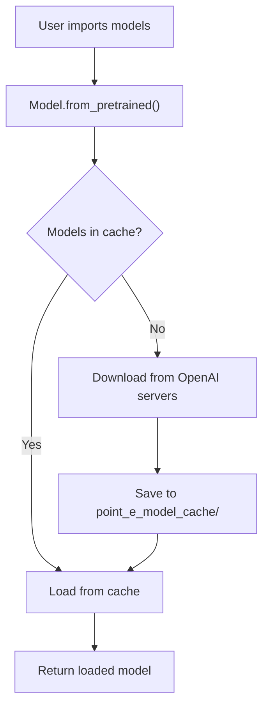
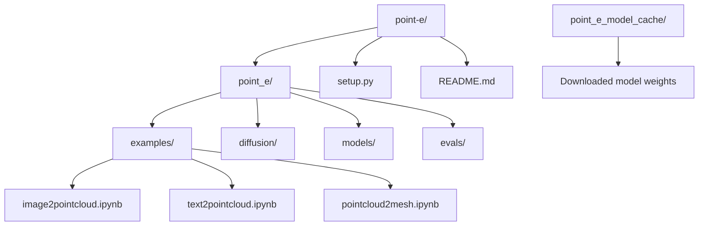
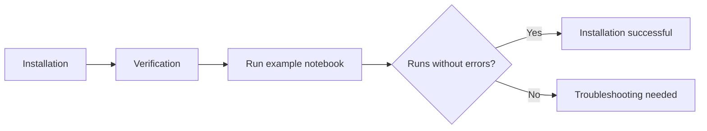

<!-- source: DeepWiki mcp.deepwiki.com · repo openai/point-e · page 5.1 Installation · fetched 2026-10-26 -->

# Installation

<details>
<summary>Relevant source files</summary>

The following files were used as context for generating this wiki page:

- [.gitignore](.gitignore)
- [README.md](README.md)

</details>


This document provides detailed instructions on how to install the Point-E system on your machine. Point-E is a system for generating 3D point clouds from complex text or image prompts. For information about actually using the system after installation, see [Image-to-Point Cloud Generation](#5.2), [Text-to-Point Cloud Generation](#5.3), and [Point Cloud-to-Mesh Conversion](#5.4).

## System Requirements

Before installing Point-E, ensure your system meets the following requirements:

- Python 3.7 or higher
- Sufficient disk space for model weights (at least 5GB recommended)
- CUDA-compatible GPU (recommended for faster inference)

Sources: [README.md:9-9]()

## Installation Methods

Point-E can be installed using pip, which is the recommended method. The installation process will set up the necessary Python environment and dependencies.

### Installing via pip

The simplest way to install Point-E is directly from the repository using pip:

```bash
# Clone the repository
git clone https://github.com/openai/point-e.git

# Navigate to the point-e directory
cd point-e

# Install the package in development mode
pip install -e .
```

The `-e` flag installs the package in "editable" mode, which means changes to the source code will be immediately reflected without requiring reinstallation.

Sources: [README.md:9-9]()

## Model Caching

When you first use Point-E, the system will automatically download the required model weights and cache them locally. The default cache location is the `point_e_model_cache/` directory in your working directory.



Sources: [.gitignore:3-3]()

## Directory Structure After Installation

After installation, your directory structure will look like this:



The `point_e_model_cache/` directory will be created automatically when you first run one of the example notebooks.

Sources: [README.md:11-15](), [.gitignore:3-3]()

## Verification of Installation

To verify that Point-E has been installed correctly, you can try running one of the provided example notebooks:

1. Navigate to the `point_e/examples/` directory
2. Start Jupyter Notebook or Jupyter Lab
3. Open one of the example notebooks:
   - `image2pointcloud.ipynb` - for image to point cloud generation
   - `text2pointcloud.ipynb` - for text to point cloud generation
   - `pointcloud2mesh.ipynb` - for point cloud to mesh conversion



Sources: [README.md:11-15]()

## Installation Dependencies

Point-E depends on several Python packages which will be automatically installed during the setup process:

| Dependency | Purpose |
|------------|---------|
| torch      | Deep learning framework used for model inference |
| numpy      | Numerical computing for point cloud manipulations |
| tqdm       | Progress bars for model downloads and inference |
| matplotlib | Visualization of point clouds |
| Pillow     | Image processing for input images |
| clip       | OpenAI's CLIP model for text/image understanding |

## Downloading Sample Data

Point-E provides sample data that you can download to experiment with:

1. Banner point clouds: Contains seed images and corresponding point clouds used in the paper banner.
   ```bash
   wget https://openaipublic.azureedge.net/main/point-e/banner_pcs.zip
   unzip banner_pcs.zip
   ```

2. COCO images: Contains seed images used for COCO CLIP R-Precision evaluations.
   ```bash
   wget https://openaipublic.azureedge.net/main/point-e/coco_images.zip
   unzip coco_images.zip
   ```

Sources: [README.md:26-28]()

## Troubleshooting

Here are some common issues you might encounter during installation and how to resolve them:

1. **CUDA issues**: If you encounter CUDA-related errors, ensure your PyTorch installation matches your CUDA version.

2. **Model download failures**: If automatic model downloads fail, check your internet connection and try again. You can also try to manually download the models and place them in the `point_e_model_cache/` directory.

3. **ImportError**: If you encounter import errors when running the examples, ensure you have installed the package with `pip install -e .` from the root directory of the repository.

4. **Memory errors**: 3D generation can be memory-intensive. If you encounter out-of-memory errors, try reducing batch sizes or using a machine with more RAM/VRAM.

## Next Steps

After successful installation, you can:

- Generate point clouds from images using [Image-to-Point Cloud Generation](#5.2)
- Generate point clouds from text using [Text-to-Point Cloud Generation](#5.3)
- Convert point clouds to meshes using [Point Cloud-to-Mesh Conversion](#5.4)
- Visualize results using techniques described in [Visualization](#5.5)

Sources: [README.md:11-15]()

---

