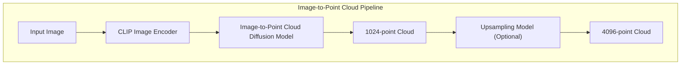
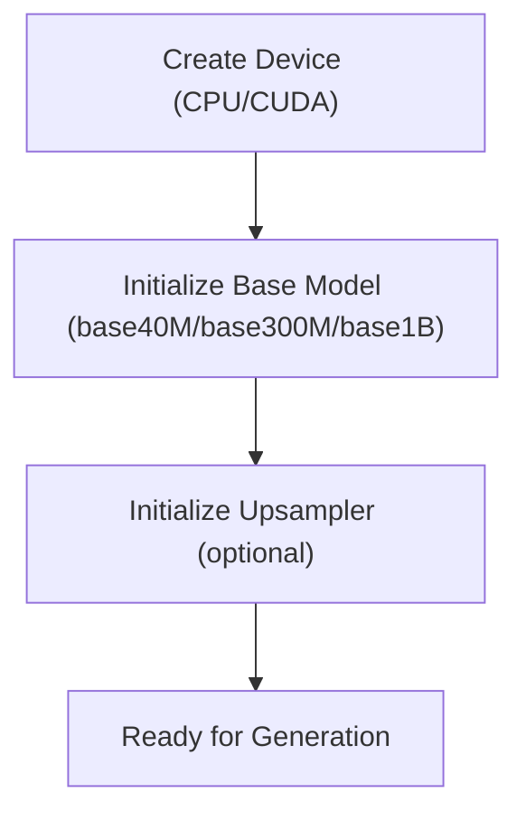
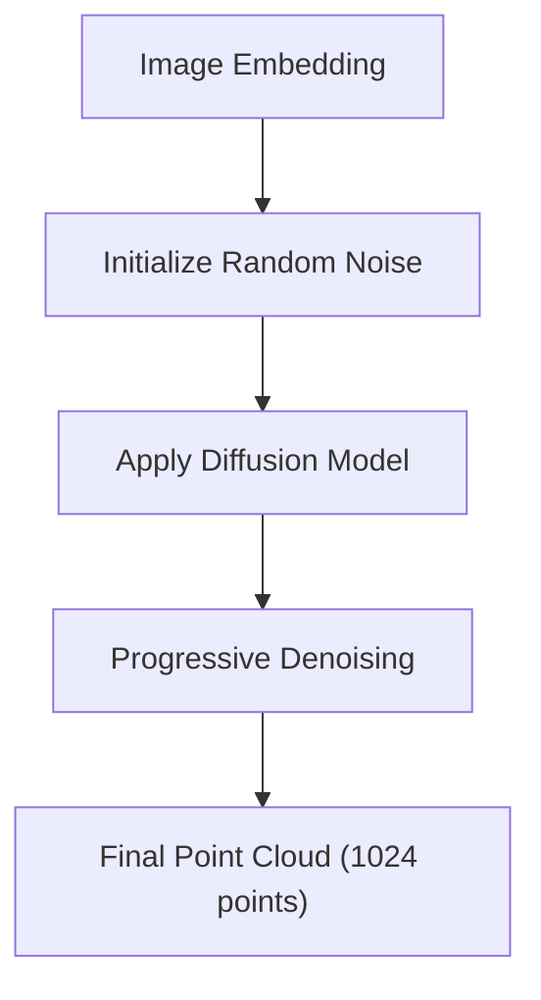
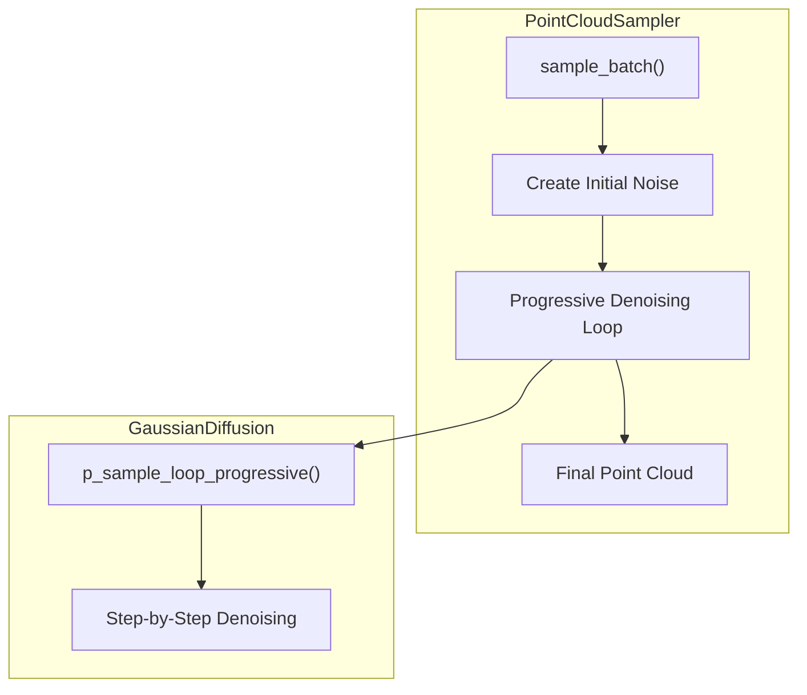
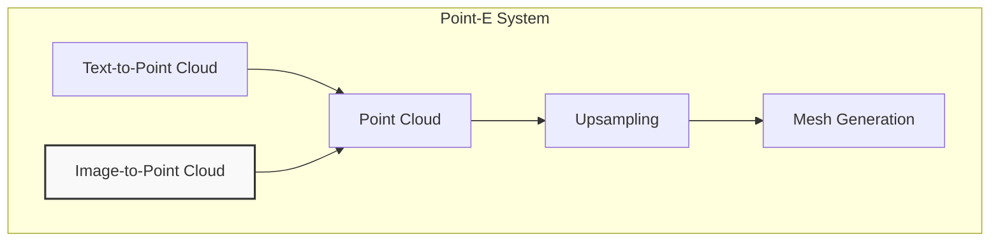

<!-- source: DeepWiki mcp.deepwiki.com · repo openai/point-e · page 5.2 Image-to-Point Cloud Generation · fetched 2026-10-26 -->

# Image-to-Point Cloud Generation

<details>
<summary>Relevant source files</summary>

The following files were used as context for generating this wiki page:

- [README.md](README.md)
- [model-card.md](model-card.md)

</details>


This page provides a detailed guide on using Point-E to generate 3D point clouds from input images. This process leverages diffusion models to transform a 2D image into a 3D point cloud representation. For generating point clouds from text prompts, see [Text-to-Point Cloud Generation](#5.3). For converting point clouds to meshes, see [Point Cloud-to-Mesh Conversion](#5.4).

## Overview

Image-to-point cloud generation is one of the primary capabilities of Point-E. The system uses a diffusion-based approach to generate a 3D point cloud (typically 1024 points) from a single 2D rendering of an object. The resulting point cloud can be optionally upsampled to a higher resolution (4096 points) and further processed to create a mesh.



Sources: README.md, model-card.md

## Available Models

Point-E offers several image-to-point cloud models with different parameter sizes and capabilities:

| Model Name | Parameters | Conditioning | Description |
|------------|------------|--------------|-------------|
| base40M-imagevec | 40M | CLIP ViT-L/14 image vector | Conditions on a single CLIP image vector, suitable for simple generations |
| base40M | 40M | CLIP ViT-L/14 latent grid | Conditions on the latent grid, better quality than imagevec variant |
| base300M | 300M | CLIP ViT-L/14 latent grid | Larger model with improved quality |
| base1B | 1B | CLIP ViT-L/14 latent grid | Largest model with best generation quality |
| upsample | 40M | Original point cloud + optional image | Upsamples from 1024 to 4096 points |

Sources: model-card.md

## Model Architecture

The image-to-point cloud models use a diffusion-based architecture that progressively denoises a randomly initialized point cloud into a coherent 3D structure guided by image features.

```mermaid
classDiagram
    class "Image-to-Point Cloud System" {
        +process_image()
        +generate_point_cloud()
        +upsample_point_cloud()
    }
    
    class "ClipImagePreprocessor" {
        +preprocess(image)
        +encode_image(preprocessed_image)
    }
    
    class "PointCloudSampler" {
        +diffusion: GaussianDiffusion
        +model: DiffusionModel
        +sample_batch()
        +sample_batch_progressive()
    }
    
    class "GaussianDiffusion" {
        +betas
        +p_sample_loop_progressive()
    }
    
    class "UpsamplingPointCloudSampler" {
        +sample(base_pc, image_embed)
    }
    
    "Image-to-Point Cloud System" --> "ClipImagePreprocessor" : uses
    "Image-to-Point Cloud System" --> "PointCloudSampler" : uses
    "Image-to-Point Cloud System" --> "UpsamplingPointCloudSampler" : uses
    "PointCloudSampler" --> "GaussianDiffusion" : uses
```

Sources: model-card.md

## Step-by-Step Usage Guide

### 1. Setting Up the Environment

Before generating point clouds, ensure you have installed Point-E:

```bash
pip install -e .
```

### 2. Loading Required Models

First, load the necessary models for image-to-point cloud generation:



The model loading process looks like this:

1. Create device
2. Load CLIP model for image processing
3. Load image-to-point cloud diffusion model
4. Optionally load upsampling model

### 3. Processing Input Images

Images need to be preprocessed to be compatible with the CLIP encoder:


Sources: README.md

### 4. Generating Point Clouds

The point cloud generation process uses diffusion sampling:



Sources: model-card.md

### 5. Upsampling (Optional)

To increase the resolution of the generated point cloud:


Sources: model-card.md

## Example Workflow

Below is a simplified version of the complete workflow for generating a point cloud from an image:

1. Import required dependencies
2. Load models
3. Process input image
4. Generate point cloud
5. Optionally upsample the point cloud
6. Visualize or save the result

For a complete example, see the `image2pointcloud.ipynb` notebook in the examples directory.

Sources: README.md

## Sample Generation Process

The core of the image-to-point cloud generation is a diffusion-based approach that progressively removes noise:



Sources: model-card.md

## Model Performance and Limitations

The image-to-point cloud models have certain limitations to be aware of:

1. **Occlusion Handling**: Models may generate incorrect geometry for parts of objects that are occluded in the input image.

2. **Consistency Issues**: Sometimes the generated geometry may be inconsistent with visible parts of the rendering.

3. **Resolution and Quality**: The resulting point clouds are relatively low-resolution and may contain noise, outliers, or cracks.

4. **Style Bias**: Since the training dataset contains many simplistic, cartoonish 3D objects, the models tend to generate results in this style.

For best results:
- Use images with clear, well-defined objects
- Prefer views that show distinctive features of the object
- Be aware that complex or unusual objects may produce less accurate results

Sources: model-card.md

## Related Systems

Image-to-point cloud generation is just one part of the overall Point-E ecosystem:



This page focuses on the Image-to-Point Cloud component (highlighted). For other components, see the related wiki pages.

Sources: README.md, model-card.md

## Conclusion

Image-to-point cloud generation in Point-E provides a powerful way to create 3D representations from 2D images. While the results may have limitations in terms of resolution and accuracy, they offer a useful starting point for creating 3D content from images. For higher quality results, consider using the larger models (base300M or base1B) and the upsampling model.

---

