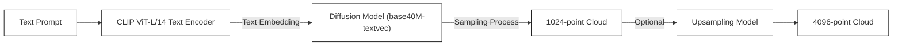
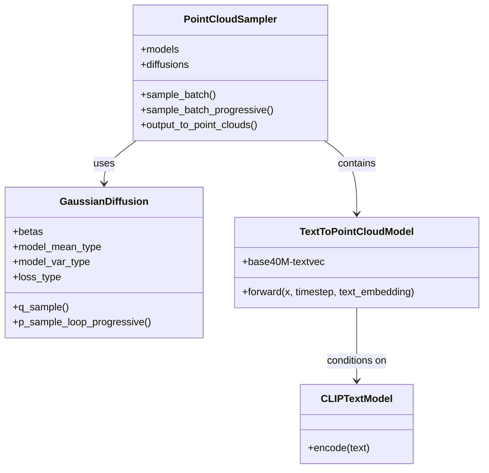
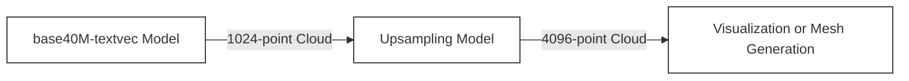

<!-- source: DeepWiki mcp.deepwiki.com · repo openai/point-e · page 5.3 Text-to-Point Cloud Generation · fetched 2026-10-26 -->

# Text-to-Point Cloud Generation

<details>
<summary>Relevant source files</summary>

The following files were used as context for generating this wiki page:

- [README.md](README.md)
- [model-card.md](model-card.md)

</details>


This page provides a detailed guide on generating 3D point clouds directly from textual descriptions using Point-E's text-conditional model. This feature allows users to create 3D objects by simply describing them in natural language, without requiring any intermediate image generation. For generating point clouds from images, see [Image-to-Point Cloud Generation](#5.2), and for converting the resulting point clouds to meshes, see [Point Cloud-to-Mesh Conversion](#5.4).

## System Overview

The text-to-point cloud generation pipeline converts natural language descriptions into 3D point clouds through a diffusion-based generative process. The system uses a pre-trained CLIP text encoder to convert text prompts into embeddings, which then condition a diffusion model to generate 3D point clouds.



**Text-to-Point Cloud Generation Pipeline**

Sources: README.md, model-card.md

## Model Architecture

The text-to-point cloud system uses the `base40M-textvec` model, which is a 40 million parameter diffusion model that conditions on CLIP text embeddings. The architecture integrates with Point-E's diffusion framework to progressively denoise random points into coherent 3D structures.



**Text-to-Point Cloud Model Architecture**

Sources: model-card.md

## Basic Usage

To generate point clouds from text, you'll need to load the text-to-point cloud model and create a sampler. Below is the basic workflow:

1. Load the necessary models
2. Create a device for computation
3. Initialize the sampler
4. Generate point clouds from text prompts

The primary entry point is through the `text2pointcloud.ipynb` notebook provided in the repository.

### Example Workflow

1. First, install the package:
   ```
   pip install -e .
   ```

2. Then follow this basic pattern to generate a point cloud from text:

   ```python
   # Load models
   device = torch.device('cuda' if torch.cuda.is_available() else 'cpu')
   
   # Load the text-to-point-cloud model
   model = load_model('base40M-textvec', device=device)
   
   # Load the diffusion model
   diffusion = diffusion_from_config(configs['base40M-textvec'])
   
   # Create a sampler
   sampler = PointCloudSampler(
       device=device,
       models=[model],
       diffusions=[diffusion],
       num_points=1024,
       kwargs=[{}],
   )
   
   # Generate a point cloud from a text prompt
   prompt = "a red chair"
   samples = None
   for x in tqdm(sampler.sample_batch_progressive(batch_size=1, model_kwargs=dict(texts=[prompt]))):
       samples = x
   
   pc = sampler.output_to_point_clouds(samples)[0]
   ```

Sources: README.md

## Advanced Usage Options

### Upsampling Generated Point Clouds

After generating a base point cloud, you can upsample it to increase resolution:



**Upsampling Pipeline**

To upsample a point cloud:

```python
# Load the upsampling model
upsample_model = load_model('upsample', device=device)
upsample_diffusion = diffusion_from_config(configs['upsample'])

# Create an upsampling sampler
upsample_sampler = PointCloudSampler(
    device=device,
    models=[upsample_model],
    diffusions=[upsample_diffusion],
    num_points=4096,
    kwargs=[dict(model_kwargs=dict(low_res_pc=pc))]
)

# Upsample the point cloud
up_samples = None
for x in tqdm(upsample_sampler.sample_batch_progressive(batch_size=1)):
    up_samples = x

up_pc = upsample_sampler.output_to_point_clouds(up_samples)[0]
```

Sources: README.md

### Converting to Meshes

After generating a point cloud, you can convert it to a mesh using the SDF regression model. For detailed instructions, see [Point Cloud-to-Mesh Conversion](#5.4).

## Model Capabilities and Limitations

The `base40M-textvec` model has specific strengths and limitations that users should be aware of:

| Capability | Description |
|------------|-------------|
| Simple objects | Works reasonably well with basic shapes and common objects |
| Basic colors | Can understand and render simple color descriptions |
| Simple categories | Recognizes common object categories |

| Limitation | Description |
|------------|-------------|
| Complex prompts | Struggles with detailed or multi-object descriptions |
| Unusual objects | Limited ability to generate rare or uncommon objects |
| Quality | Generally lower quality than image-conditional models |
| Resolution | Produces relatively low-resolution point clouds (1024 points) |
| Style | Tends to produce simplistic, cartoonish 3D objects reflecting the training data |

The text-conditional model is primarily intended for research purposes and simple demonstrations rather than production use. For more complex or higher-quality 3D models, consider using the image-conditional pipeline with a text-to-image model as an intermediate step.

Sources: model-card.md

## Visualization

To visualize the generated point clouds, you can use the provided rendering utilities or export to common 3D formats for use in external tools:

```python
# Simple visualization in notebook
fig = render_point_cloud(pc, camera_position=(0.5, -1, 0.5))

# For more advanced visualization options, see Visualization page
```

For more comprehensive visualization options, including Blender rendering, see [Visualization](#5.5).

Sources: README.md

## Example Prompts

Below are examples of text prompts that work reasonably well with the text-to-point cloud model:

- "a red chair"
- "a blue car"
- "a small table"
- "a simple house"
- "a green potted plant"

When formulating prompts, keep them simple and focused on a single object with basic attributes to achieve the best results.

Sources: model-card.md

---

