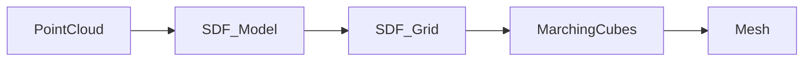
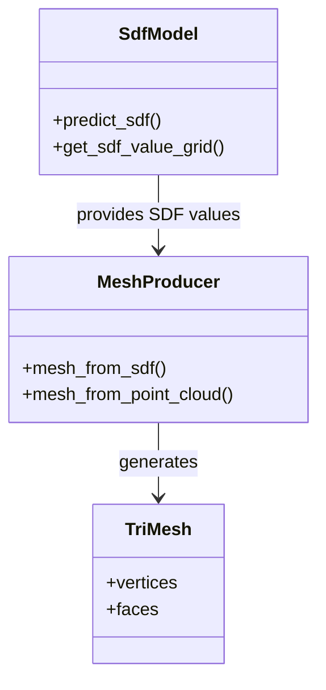
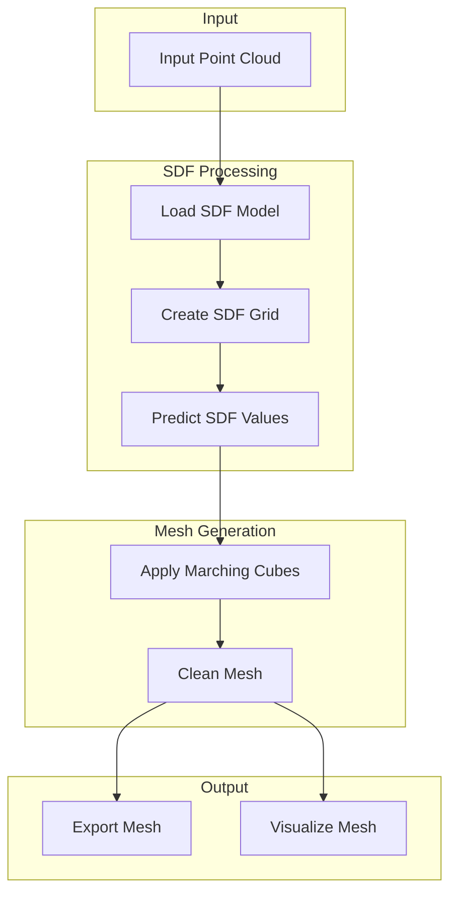
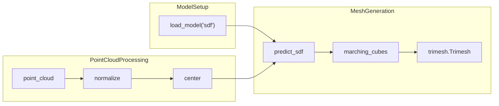

<!-- source: DeepWiki mcp.deepwiki.com · repo openai/point-e · page 5.4 Point Cloud-to-Mesh Conversion · fetched 2026-10-26 -->

# Point Cloud-to-Mesh Conversion

<details>
<summary>Relevant source files</summary>

The following files were used as context for generating this wiki page:

- [README.md](README.md)
- [model-card.md](model-card.md)

</details>


## Introduction

This documentation describes how to convert point clouds generated by Point-E models into 3D meshes. While point clouds are useful 3D representations, they consist only of discrete points in space without connectivity information. Meshes, on the other hand, define continuous surfaces through connected vertices, making them more suitable for rendering, 3D printing, and other applications.

This guide covers the Signed Distance Function (SDF) regression model in Point-E that enables this conversion process. For information about generating point clouds from images or text, see [Image-to-Point Cloud Generation](#5.2) and [Text-to-Point Cloud Generation](#5.3).

Sources: README.md, model-card.md

## Understanding SDF-based Mesh Generation

Point-E uses a Signed Distance Function (SDF) approach to convert point clouds to meshes. An SDF is a continuous function that, for any point in 3D space, returns the signed distance to the nearest surface—negative inside the object, positive outside, and zero on the surface.

### SDF to Mesh Conversion Workflow



The Point-E SDF regression model takes a point cloud as input and predicts SDF values across a 3D grid. The Marching Cubes algorithm then extracts the zero-level isosurface from this grid to create a triangular mesh.

Sources: model-card.md

## Point-E's SDF Model Architecture

The `sdf` model in Point-E is a specialized neural network designed to predict signed distance functions from 3D point clouds. This model was trained on a filtered dataset of manifold (watertight) meshes to ensure high-quality output.

### SDF Model in Code Architecture



The SDF model is designed to work with upsampled point clouds (typically containing 4096 points) from Point-E's upsampling model, rather than the base diffusion model outputs which only contain 1024 points.

Sources: model-card.md

## Using the SDF Model

The SDF model can be loaded and used through the Point-E model loading utilities. The conversion process typically involves:

1. Loading a pre-trained point cloud model
2. Generating a point cloud
3. Upsampling the point cloud if needed
4. Loading the SDF model
5. Converting the point cloud to a mesh

### Conversion Workflow



Point-E provides a dedicated example notebook `pointcloud2mesh.ipynb` that demonstrates the complete workflow for converting point clouds to meshes.

Sources: README.md

## Implementation Details

### Loading the SDF Model

The SDF model can be loaded using the model loading utilities in Point-E:

```python
from point_e.models.download import load_model
sdf_model = load_model('sdf')
```

### Generating a Mesh from a Point Cloud

The SDF model can be used to generate a mesh from a point cloud through these steps:

1. Create a 3D grid where SDF values will be computed
2. Predict SDF values at each grid point
3. Use Marching Cubes to extract the mesh from the SDF field

### Example Setup



The mesh generation process typically happens at a specified resolution which determines the detail level of the final mesh. Higher resolutions produce more detailed meshes but require more computation.

Sources: README.md

## Visualization and Export

Once generated, meshes can be:

1. Visualized directly in a Jupyter notebook
2. Exported to standard 3D formats (OBJ, STL, etc.)
3. Rendered using Blender for high-quality images

Point-E includes a Blender script (`blender_script.py`) that can be used to create high-quality renderings of the generated meshes.

Sources: README.md

## Limitations and Considerations

When using the SDF regression model, be aware of these limitations:

1. **Quality Dependence**: The quality of the generated mesh directly depends on the quality of the input point cloud. Noisy or incomplete point clouds may produce poor meshes.

2. **Resolution Trade-offs**: Higher resolution meshes capture more detail but require more memory and computation time.

3. **Training Limitations**: The SDF model was trained only on manifold (watertight) meshes, which may limit its ability to represent certain types of geometry.

4. **Mesh Defects**: The generated meshes might contain artifacts such as outliers, cracks, or incorrect topology in complex areas.

The model card notes that the current capabilities are limited, and the resulting point clouds (and thus meshes) are relatively low-resolution and may contain defects.

Sources: model-card.md

## Conclusion

The SDF regression model in Point-E provides a straightforward way to convert generated point clouds into meshes. While the results have limitations in terms of resolution and quality, they enable the use of Point-E's 3D generation capabilities in workflows that require mesh representations.

For practical usage examples, refer to the `pointcloud2mesh.ipynb` notebook included in the repository.

Sources: README.md, model-card.md

---

