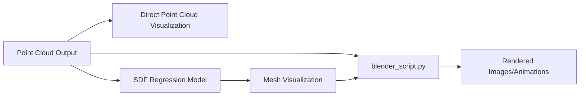
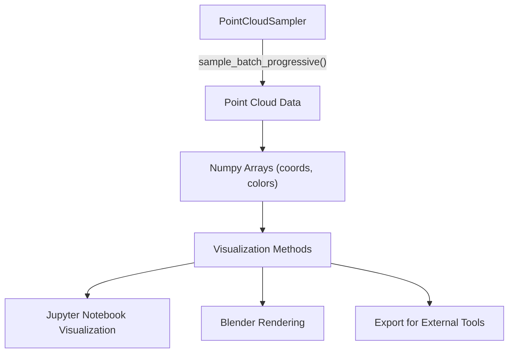
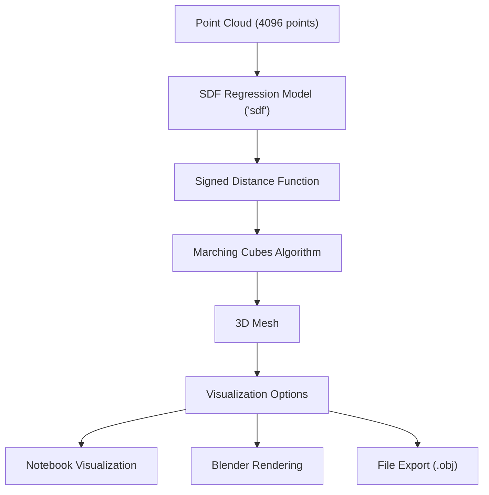
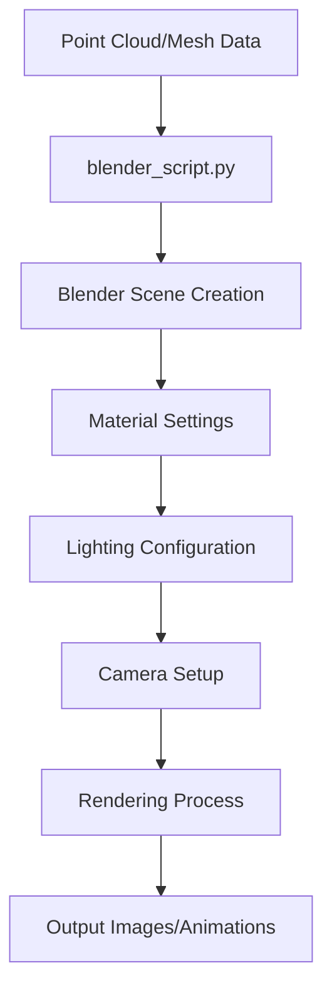
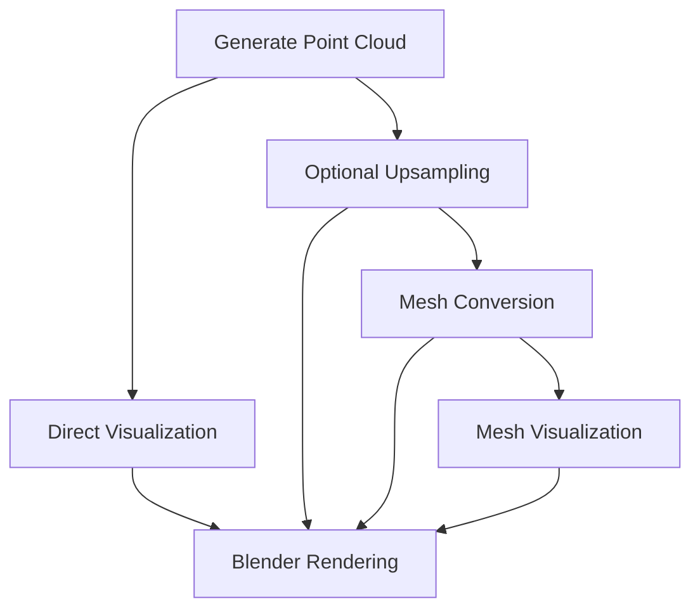

<!-- source: DeepWiki mcp.deepwiki.com · repo openai/point-e · page 5.5 Visualization · fetched 2026-10-26 -->

# Visualization

<details>
<summary>Relevant source files</summary>

The following files were used as context for generating this wiki page:

- [README.md](README.md)
- [model-card.md](model-card.md)

</details>


This page documents the methods and tools available in Point-E for visualizing generated 3D point clouds and meshes. For information about generating point clouds from images or text, see [Image-to-Point Cloud Generation](#5.2) and [Text-to-Point Cloud Generation](#5.3). For converting point clouds to meshes, see [Point Cloud-to-Mesh Conversion](#5.4).

## Visualization Options in Point-E

Point-E provides three primary methods for visualizing the generated 3D content:

1. Direct visualization of point clouds in notebook environments
2. Mesh-based visualization (after converting point clouds to meshes via the SDF model)
3. High-quality rendering using Blender via the provided script



Sources: [README.md](README.md), [model-card.md](model-card.md)

## Point Cloud Visualization

Point-E generates point clouds with either 1024 points (base models) or 4096 points (when using the upsampling model). These point clouds can be visualized directly in Python notebook environments.



The example notebooks (`image2pointcloud.ipynb` and `text2pointcloud.ipynb`) demonstrate how to visualize the generated point clouds directly within the notebook environment. Point clouds are typically rendered as scattered points in 3D space, with each point potentially having color information.

Sources: [README.md](README.md)

## Mesh-Based Visualization

For improved visualization quality, Point-E provides the SDF regression model (`sdf`) to convert point clouds to meshes with continuous surfaces.



The `pointcloud2mesh.ipynb` notebook demonstrates this workflow in detail. Meshes provide more continuous surfaces compared to point clouds, resulting in more visually appealing renders and the ability to apply advanced rendering techniques like material properties and lighting effects.

Sources: [README.md](README.md)

## Blender Rendering

Point-E includes a Blender scripting interface in `blender_script.py` for creating high-quality renders of both point clouds and meshes.



The Blender script enables:
- Professional-quality rendering with realistic lighting and materials
- Multiple camera angles and viewpoints
- Animation capabilities (e.g., rotating the object)
- Consistent visualization for evaluation purposes

Sources: [README.md](README.md)

## Visualization Parameters

When using the various visualization methods in Point-E, these key parameters can be adjusted:

| Parameter | Description | Typical Use |
|-----------|-------------|-------------|
| Point Size | Controls the size of each point in point cloud visualization | Adjust based on point cloud density |
| Point Color | Determines how points are colored | Can be uniform or based on position/normals |
| Mesh Resolution | Controls the detail level when extracting meshes | Higher values for more detailed meshes |
| Camera Position | Sets the viewpoint for renders | Multiple angles recommended for complete view |
| Lighting Setup | Configures light sources for rendering | Critical for proper shape perception |
| Background | Defines the background for renders | Typically neutral for clear object visibility |

Adjusting these parameters appropriately can significantly improve the clarity and information content of the visualizations.

Sources: [README.md](README.md)

## Technical Integration with Point-E Components

The visualization tools in Point-E integrate with the core components as shown:

```mermaid
classDiagram
    class "PointCloudSampler" {
        +sample_batch()
        +sample_batch_progressive()
        +output_to_point_clouds()
    }
    
    class "PointCloud" {
        +coords: np.ndarray
        +colors: np.ndarray
    }
    
    class "SDFModel" {
        +predict_sdf()
        +sdf_to_mesh()
    }
    
    class "BlenderScript" {
        +render_point_cloud()
        +render_mesh()
        +render_animation()
    }
    
    "PointCloudSampler" --> "PointCloud" : generates
    "PointCloud" --> "SDFModel" : input to
    "SDFModel" --> "Mesh" : produces
    "PointCloud" --> "BlenderScript" : visualizes
    "Mesh" --> "BlenderScript" : visualizes
```

This diagram illustrates how the visualization components connect with the model outputs and processing pipeline.

Sources: [README.md](README.md), [model-card.md](model-card.md)

## Sample Data and Reference Visualizations

Point-E provides sample point clouds that can be used as reference for visualization:

- Banner point clouds: These can be downloaded from the link provided in the README.md and used to test visualization methods.
- COCO seed images: These can be used to generate point clouds for visualization testing.

These samples can be useful for comparing different visualization methods and settings.

Sources: [README.md](README.md)

## Visualization Workflow Example

A typical end-to-end workflow for visualizing Point-E outputs includes these steps:

1. Generate a point cloud using one of the Point-E models (base40M, base300M, base1B, or the text model)
2. Optionally upsample the point cloud from 1024 to 4096 points using the upsample model
3. Visualize the point cloud directly in the notebook for initial inspection
4. Convert to a mesh using the SDF model if higher quality visualization is needed
5. Use Blender for final high-quality renders of either the point cloud or mesh

This workflow provides flexibility between quick visualization for development and high-quality renders for presentation.



Sources: [README.md](README.md)

## Limitations and Considerations

When visualizing Point-E outputs, be aware of these limitations:

- Point clouds are relatively low-resolution (1024 or 4096 points)
- Point clouds may contain noise, outliers, or structural defects
- Meshes generated from the SDF model inherit any flaws in the point cloud
- Visualization quality is highly dependent on proper parameter settings

Understanding these limitations helps set appropriate expectations for the visualization results.

Sources: [model-card.md](model-card.md)

---

