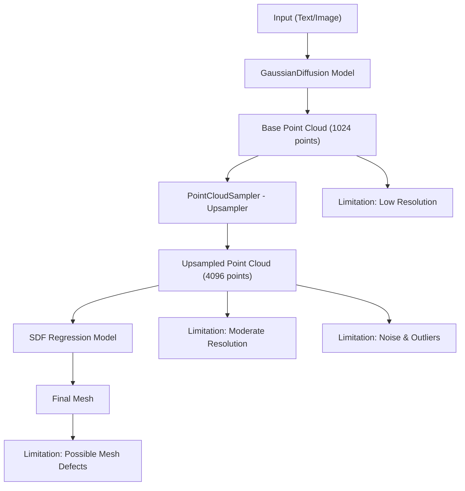
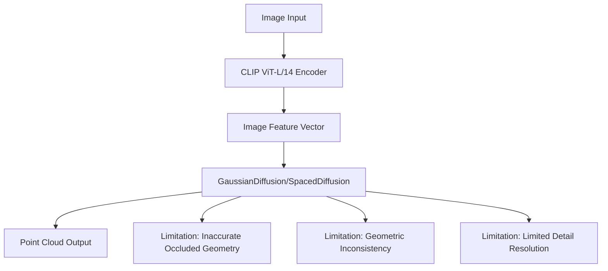
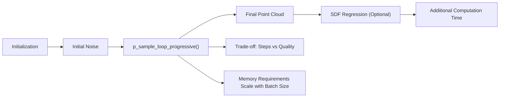
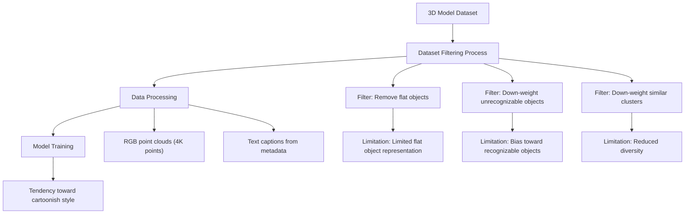
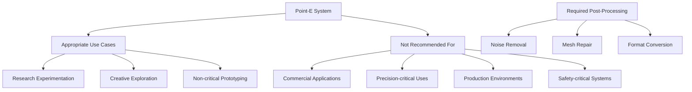

<!-- source: DeepWiki mcp.deepwiki.com · repo openai/point-e · page 6 System Limitations · fetched 2026-10-26 -->

# System Limitations

Relevant source files

The following files were used as context for generating this wiki page:

- [README.md](README.md)
- [model-card.md](model-card.md)

## Purpose and Scope

This document details the technical, practical, and ethical limitations of the Point-E system. Understanding these constraints is essential for effectively using the system and recognizing its capabilities and boundaries. For information about model architecture and capabilities, see [Model Architecture](#2), and for usage guidance, see [Usage Guide](#5).

## Technical Quality Limitations

Point-E generates 3D point clouds and meshes with several inherent quality constraints that affect usability and fidelity.

| Quality Issue | Description | Applicable Models |
|---------------|-------------|------------------|
| Resolution | Base models limited to 1024 points; upsampled to only 4096 points | All models |
| Noise & Outliers | Point clouds often contain floating points and discontinuities | All point cloud models |
| Cracks & Holes | Structural defects in generated geometry | All models |
| Surface Quality | Meshes may have topological inconsistencies | SDF model |

Sources: [model-card.md:9-10](), [model-card.md:46-47]()

## Model-Specific Limitations

### Image-to-Point Cloud Models

The image-conditional models (base40M, base300M, base1B) have several significant limitations:

- **Occlusion Handling**: Models struggle to infer correct geometry for parts of objects not visible in the input image
- **Geometric Consistency**: Often produces geometry inconsistent with the visible parts of the input image
- **Quality Issues**: Outputs are noisy with defects (outliers, cracks) despite increasing model size

Sources: [model-card.md:9-10](), [model-card.md:46-47]()

### Text-to-Point Cloud Model

The text-conditional model (base40M-textvec) has significant limitations compared to image-conditional models:

- **Limited Prompt Understanding**: Only works well with simple, common object categories and descriptions
- **Poor Generalization**: Fails to generalize to complex prompts or unusual objects
- **Lower Quality**: Generally produces lower quality outputs than image-conditional models

Sources: [model-card.md:10-11](), [model-card.md:48-49]()

### Point Cloud-to-Mesh Model

The SDF regression model for mesh generation has its own constraints:

- **Input Dependency**: Quality heavily depends on the input point cloud's quality
- **Manifold Requirement**: Training limited to watertight, manifold meshes
- **Detail Loss**: May smooth out fine details present in the point cloud
- **Topology Problems**: Struggles with thin structures and complex topologies

Sources: [model-card.md:25](), [model-card.md:35-36]()

## Sampling and Computational Constraints

| Model | Parameters | Memory Requirements | Hardware Recommendation |
|-------|------------|---------------------|-------------------------|
| base40M | 40M | Low-Moderate | Consumer GPU (≥4GB VRAM) |
| base300M | 300M | Moderate | Gaming/Workstation GPU (≥8GB VRAM) |
| base1B | 1B | High | Professional GPU (≥16GB VRAM) |

- **Diffusion Sampling Time**: Higher quality results require more sampling steps (typically 64-1000)
- **Resource Intensity**: Larger models (base300M, base1B) require substantial GPU memory
- **Multi-Stage Pipeline**: Complete pipeline (image→point cloud→upsampling→mesh) compounds computation time

Sources: [model-card.md:17-26]()

## Training Data Limitations

The training dataset introduces inherent biases and limitations in the models:

- **Dataset Filtering**: Flat objects were removed, limiting the system's ability to generate certain categories
- **Representation Bias**: Dataset filtered to favor recognizable objects over abstract ones
- **Stylistic Bias**: The dataset contains many simplistic, cartoonish 3D objects, causing models to mimic this style
- **SDF Training Subset**: The SDF regression model was trained only on manifold (watertight) meshes, limiting its applicability

Sources: [model-card.md:32-36](), [model-card.md:55-56]()

## Ethical Considerations and Biases

Several ethical concerns and biases exist in the models:

- **Gender Biases**: Models can produce 3D models of people that exhibit gender stereotypes (e.g., differences in body proportions)
- **Potential for Harmful Content**: Models can sometimes produce violent objects (guns, tanks), though they are generally low-quality
- **Inherited Biases**: Image-conditional models inherit biases from the text-to-image models used to produce synthetic views
- **Dual-Use Concerns**: Combined with 3D printing, models could potentially be used to prototype dangerous objects

Sources: [model-card.md:52-54](), [model-card.md:57-61]()

## Practical Usage Constraints

For practical applications, users should be aware of:

- **Not Recommended for Commercial Use**: Models are released for research purposes only
- **Precision Limitations**: Not suitable for applications requiring high precision or accuracy
- **Post-Processing Requirements**: Outputs typically require significant cleaning and processing for practical use
- **Limited Integration**: May require custom solutions to integrate with standard 3D software pipelines

Sources: [model-card.md:38-41](), [model-card.md:59-61]()

## Model Resolution Comparison

| Model Type | Base Resolution | Upsampled Resolution | Quality Level |
|------------|-----------------|----------------------|---------------|
| Image-to-Point Cloud | 1024 points | 4096 points | Moderate-High (depends on model size) |
| Text-to-Point Cloud | 1024 points | 4096 points | Low-Moderate |
| Point Cloud-to-Mesh | Depends on input | N/A | Variable (depends on input) |

Sources: [model-card.md:17-26]()