# Page: Point-E Overview

# Point-E Overview

<details>
<summary>Relevant source files</summary>

The following files were used as context for generating this wiki page:

- [README.md](README.md)
- [model-card.md](model-card.md)

</details>


## Purpose and Scope

Point-E is a system designed to generate 3D point clouds from complex prompts. This overview document serves as an introduction to the Point-E repository, explaining its purpose, architecture, and key capabilities. It covers the high-level components of the system and how they interact to generate 3D content from text or images.

For detailed information about specific components, refer to the following pages:
- For model architecture details, see [Model Architecture](#2)
- For available pre-trained models, see [Available Models](#3)
- For evaluation metrics, see [Evaluation System](#4)
- For usage instructions, see [Usage Guide](#5)

Sources: [README.md:1-5](), [model-card.md:1-4]()

## System Overview

Point-E is a system that enables the generation of 3D point clouds from either text descriptions or image inputs, with the ability to further convert these point clouds into 3D meshes. The system leverages diffusion models trained on a dataset of several million 3D models to progressively generate coherent 3D structures.

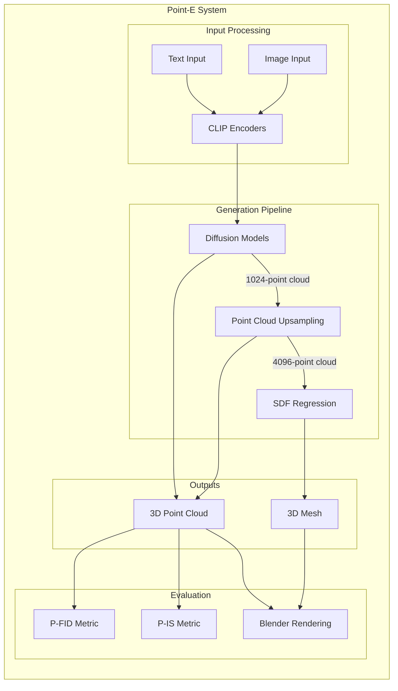

Sources: [README.md:5-22](), [model-card.md:8-11](), [model-card.md:38-49]()

## Core Capabilities

Point-E provides three primary capabilities:

1. **Image-to-Point Cloud Generation**: Convert a single rendered image into a coherent 3D point cloud
2. **Text-to-Point Cloud Generation**: Generate 3D point clouds directly from text descriptions
3. **Point Cloud-to-Mesh Conversion**: Transform point clouds into 3D meshes using SDF regression

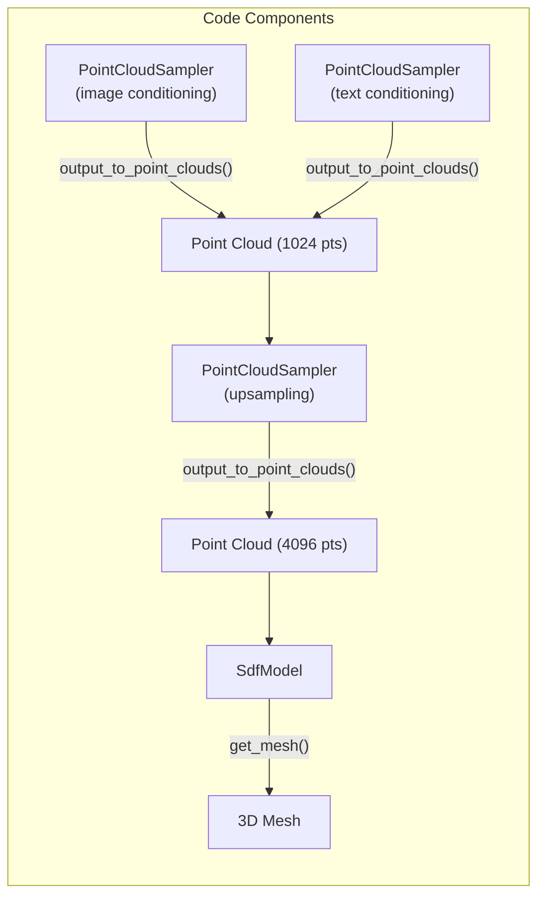

Sources: [README.md:11-15](), [model-card.md:38-45]()

## Model Variants and Architecture

Point-E comprises multiple model variants with different parameter sizes and conditioning capabilities:

| Model Name | Parameters | Purpose | Conditioning |
|------------|------------|---------|-------------|
| base40M-imagevec | 40M | Image to point cloud | CLIP ViT-L/14 image vector |
| base40M-textvec | 40M | Text to point cloud | CLIP ViT-L/14 text vector |
| base40M | 40M | Image to point cloud | CLIP ViT-L/14 latent grid |
| base300M | 300M | Image to point cloud | CLIP ViT-L/14 latent grid |
| base1B | 1B | Image to point cloud | CLIP ViT-L/14 latent grid |
| upsample | 40M | Point cloud upsampling | Optional image conditioning |
| sdf | Small | Signed distance function | 3D point cloud |

The model architecture is built on diffusion models that progressively transform noise into structured 3D point clouds:

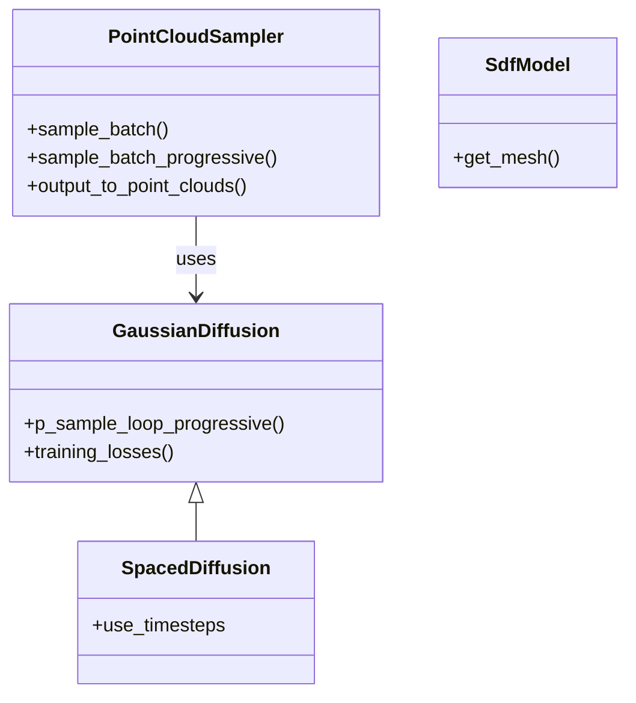

Sources: [model-card.md:16-26]()

## Data Flow and Processing Pipeline

Point-E processes inputs through a series of steps to generate 3D outputs:

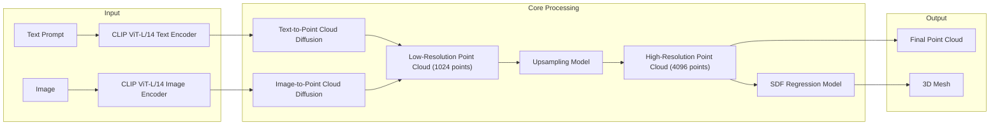

Sources: [README.md:11-15](), [model-card.md:38-45]()

## User Workflow

The typical workflow for using Point-E involves:

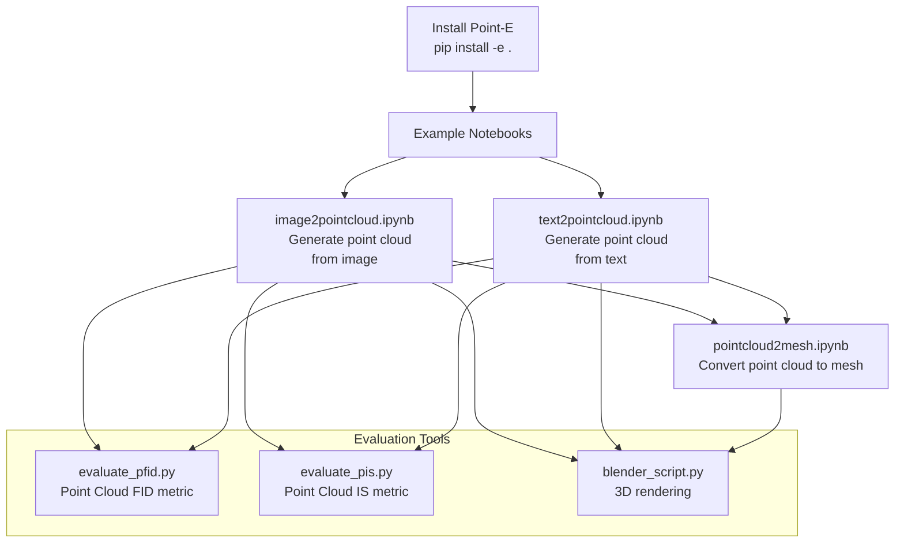

Sources: [README.md:7-22]()

## Limitations

The current Point-E models have several limitations to be aware of:

1. **Image-conditional models**:
   - May produce incorrect geometry in occluded areas
   - Can generate geometry inconsistent with visible parts of the rendering
   - Output relatively low-resolution point clouds (4096 points)
   - Point clouds may contain defects like outliers or cracks

2. **Text-conditional model**:
   - Works best with simple prompts
   - Limited generalization to complex descriptions or unusual objects
   - May exhibit biases from the training data

3. **Output quality**:
   - Point clouds are often noisy
   - The system tends to produce simplistic, cartoonish 3D objects reflecting the training data

Sources: [model-card.md:46-52](), [model-card.md:54-56]()

## Code Structure

The repository is organized as follows:

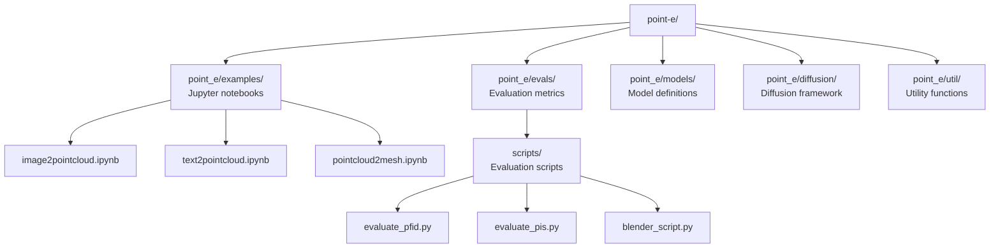

Sources: [README.md:11-22]()

---

# Page: Model Architecture

# Model Architecture

<details>
<summary>Relevant source files</summary>

The following files were used as context for generating this wiki page:

- [README.md](README.md)
- [model-card.md](model-card.md)
- [point_e/diffusion/gaussian_diffusion.py](point_e/diffusion/gaussian_diffusion.py)

</details>


This document provides a technical overview of the core architecture and components that make up the Point-E system. Point-E is a framework for generating 3D point clouds from text or image inputs, with additional capability to convert point clouds to meshes. For specific details about available pre-trained models, see [Available Models](#3), and for usage instructions, see [Usage Guide](#5).

## System Overview

Point-E employs a multi-stage pipeline architecture based on diffusion models. The system can be conceptualized as having three main components:

1. **Input Encoders** - Process text or image inputs using CLIP embeddings
2. **Diffusion Models** - Generate point clouds through iterative denoising
3. **Post-Processing** - Convert point clouds to meshes and perform visualization

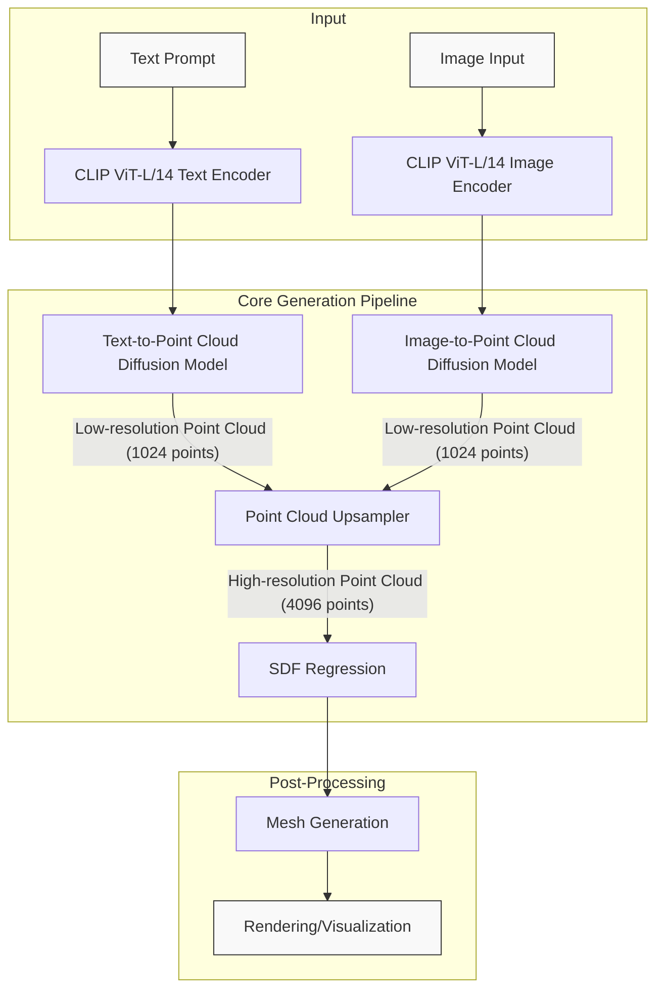

Sources: [README.md:1-29](), [model-card.md:1-62]()

## Diffusion Framework

The Point-E system is built on a diffusion-based generative framework. Diffusion models work by gradually adding noise to data and then learning to reverse this process to generate new samples. The core implementation is found in the `GaussianDiffusion` class.

### Gaussian Diffusion Process

The diffusion process consists of forward and reverse processes:

1. **Forward Process**: Gradually adds Gaussian noise to the original data
2. **Reverse Process**: Learns to predict and remove noise to generate new samples

```mermaid
graph LR
    subgraph "Forward Process (Training)"
        X0["x₀ (Clean Point Cloud)"] --> X1["x₁ (Slightly Noisy)"]
        X1 --> X2["x₂"]
        X2 --> Xt["xₜ (Pure Noise)"]

        style X0 fill:#f9f9f9,stroke:#333
        style X1 fill:#f9f9f9,stroke:#333
        style X2 fill:#f9f9f9,stroke:#333
        style Xt fill:#f9f9f9,stroke:#333
    end
    
    subgraph "Reverse Process (Sampling)"
        Y0["x₀ (Generated Point Cloud)"] <-- "Predict & Remove Noise" --- Y1["x₁"]
        Y1 <-- "Predict & Remove Noise" --- Y2["x₂"]
        Y2 <-- "Predict & Remove Noise" --- Yt["xₜ (Pure Noise)"]
        
        style Y0 fill:#f9f9f9,stroke:#333
        style Y1 fill:#f9f9f9,stroke:#333
        style Y2 fill:#f9f9f9,stroke:#333
        style Yt fill:#f9f9f9,stroke:#333
    end
```

Sources: [point_e/diffusion/gaussian_diffusion.py:126-198]()

### GaussianDiffusion Class

The `GaussianDiffusion` class is the core implementation that handles both training and sampling of diffusion models. It calculates the necessary parameters for the forward and reverse diffusion processes.

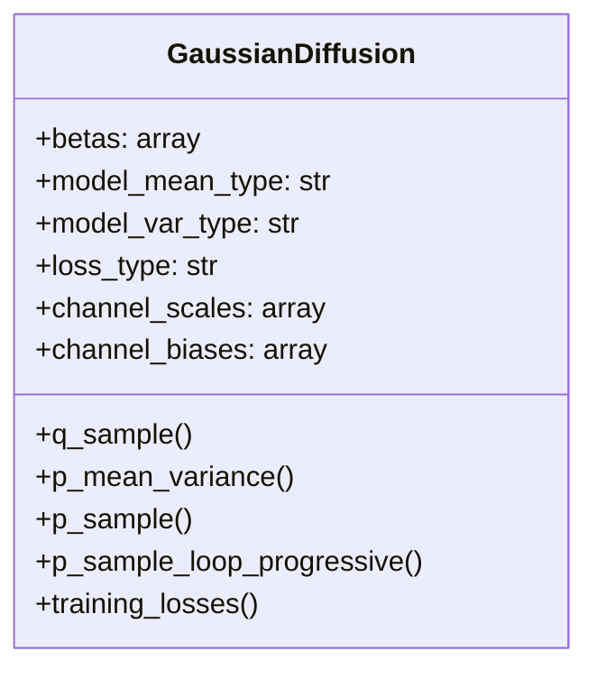

Key methods in the `GaussianDiffusion` class:

- `q_sample`: Adds noise to samples according to the forward process
- `p_mean_variance`: Calculates predicted mean and variance for the reverse process
- `p_sample`: Samples a single step in the reverse process
- `p_sample_loop_progressive`: Implements the full sampling loop with intermediate results
- `training_losses`: Calculates training objectives for the diffusion model

Sources: [point_e/diffusion/gaussian_diffusion.py:127-949]()

### SpacedDiffusion

`SpacedDiffusion` extends `GaussianDiffusion` to allow for more efficient sampling by skipping steps in the diffusion process:

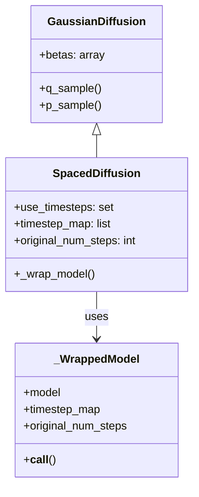

`SpacedDiffusion` is used for faster inference by selecting a subset of diffusion timesteps while maintaining generation quality.

Sources: [point_e/diffusion/gaussian_diffusion.py:952-1003]()

## Sampling Methods

Point-E implements multiple sampling strategies for point cloud generation:

### Standard Diffusion Sampling

The standard approach involves iteratively denoising from random noise:

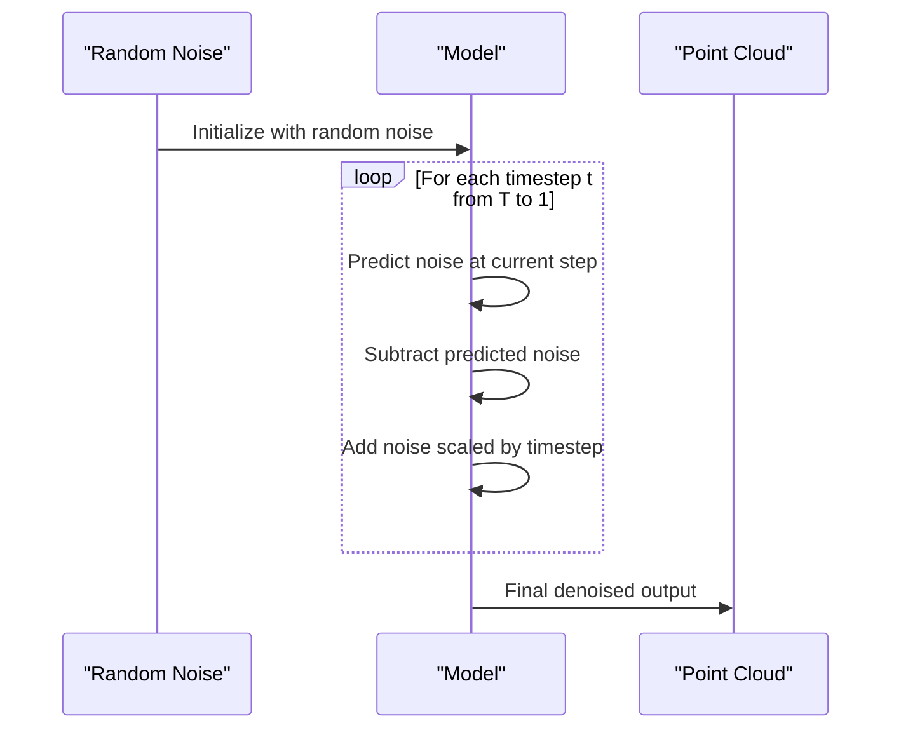

Sources: [point_e/diffusion/gaussian_diffusion.py:407-548]()

### DDIM Sampling

Point-E also includes Denoising Diffusion Implicit Models (DDIM) sampling for faster generation with fewer steps:

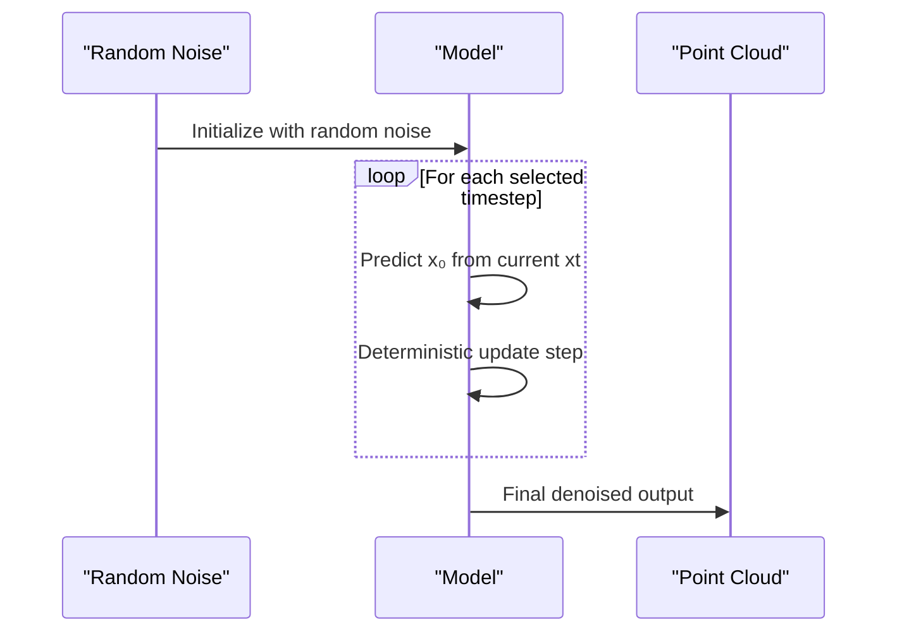

Sources: [point_e/diffusion/gaussian_diffusion.py:550-724]()

## Model Configuration System

Point-E uses a configuration-based approach to initialize and customize diffusion models:

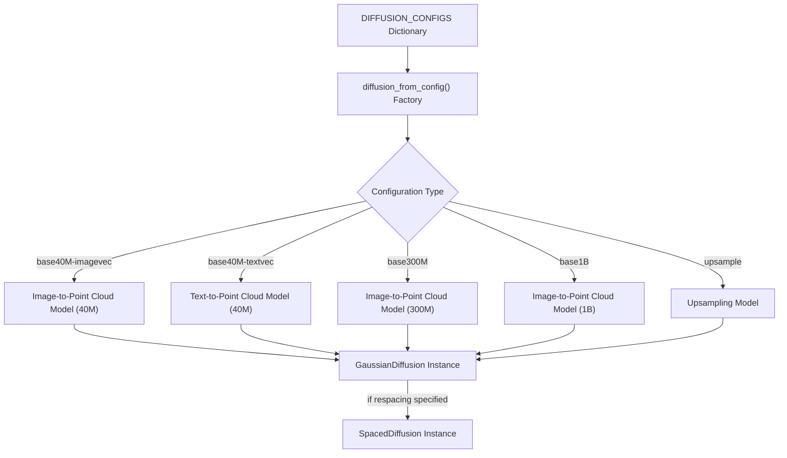

This system allows for easy switching between different model types and sizes while maintaining a consistent interface.

Sources: [model-card.md:17-26]()

## Multi-Model Pipeline Flow

The complete pipeline often involves multiple models working together:

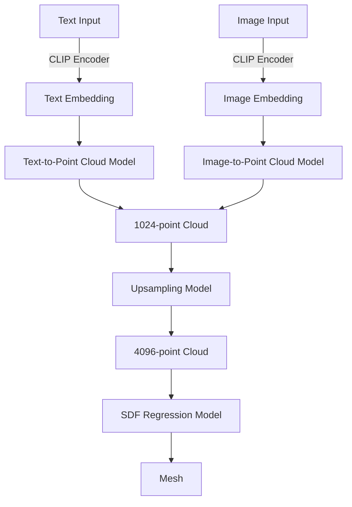

This multi-stage approach allows for:
1. Initial content generation (text/image to point cloud)
2. Resolution enhancement (upsampling)
3. Surface reconstruction (point cloud to mesh)

The largest models (base1B) tend to produce the highest quality point clouds, but at increased computational cost.

Sources: [model-card.md:1-62](), [README.md:1-29]()

## Model Variants and Parameter Counts

Point-E includes several model variants with different parameter counts and capabilities:

| Model | Parameters | Input Type | Output | Purpose |
|-------|------------|------------|--------|---------|
| base40M-imagevec | 40M | Image vector | 1024-point cloud | Image to point cloud (basic) |
| base40M-textvec | 40M | Text vector | 1024-point cloud | Text to point cloud |
| base40M | 40M | Image grid | 1024-point cloud | Image to point cloud |
| base300M | 300M | Image grid | 1024-point cloud | Image to point cloud (better) |
| base1B | 1B | Image grid | 1024-point cloud | Image to point cloud (best) |
| upsample | 40M | Point cloud + optional image | 4096-point cloud | Resolution enhancement |
| sdf | Small | Point cloud | Signed distance field | Mesh generation |

Sources: [model-card.md:17-26]()

## Technology Stack Integration

Point-E integrates with several key technologies:

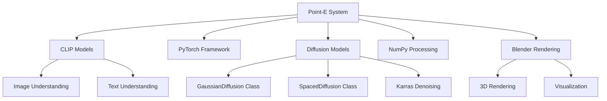

Sources: [README.md:1-29]()

## Key Distinctions Between Model Types

The architecture accommodates multiple input modalities and model types:

1. **Image-conditional models** take a rendered image as input and produce a corresponding 3D point cloud
2. **Text-conditional models** generate point clouds directly from text descriptions
3. **Upsampling models** increase the resolution of a point cloud from 1024 to 4096 points
4. **SDF regression models** convert point clouds to meshes via signed distance function prediction

Each model type shares the diffusion framework but differs in its conditioning mechanism and network architecture.

Sources: [model-card.md:8-11](), [model-card.md:17-26]()

---

# Page: Diffusion Models

# Diffusion Models

<details>
<summary>Relevant source files</summary>

The following files were used as context for generating this wiki page:

- [model-card.md](model-card.md)
- [point_e/diffusion/configs.py](point_e/diffusion/configs.py)
- [point_e/diffusion/gaussian_diffusion.py](point_e/diffusion/gaussian_diffusion.py)

</details>


This page documents the diffusion model framework used in Point-E, which forms the foundation of the 3D point cloud generation system. It covers the Gaussian diffusion process implementation, the configuration system for different model variants, and the mathematical principles underlying the generation process. For information about how point clouds are sampled using these diffusion models, see [Point Cloud Sampling](#2.3).

## Overview of Diffusion Models in Point-E

Diffusion models are a class of generative models that work by gradually adding noise to data through a forward process, then learning to reverse this process to generate new samples. In Point-E, diffusion models are used to generate 3D point clouds from either text or image inputs.

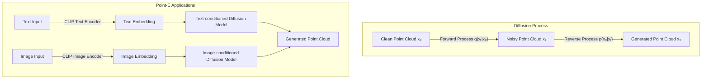

Sources: [point_e/diffusion/gaussian_diffusion.py:127-349]()

## Core Implementation: GaussianDiffusion

The `GaussianDiffusion` class is the central implementation of the diffusion process in Point-E. It provides utilities for both training diffusion models and sampling from them. The class implements both the forward noising process and the reverse denoising process.

### Mathematical Foundation

The diffusion process in Point-E is based on a Markovian process that gradually adds Gaussian noise to data according to a variance schedule defined by a sequence of betas (β₁, β₂, ..., βₜ).

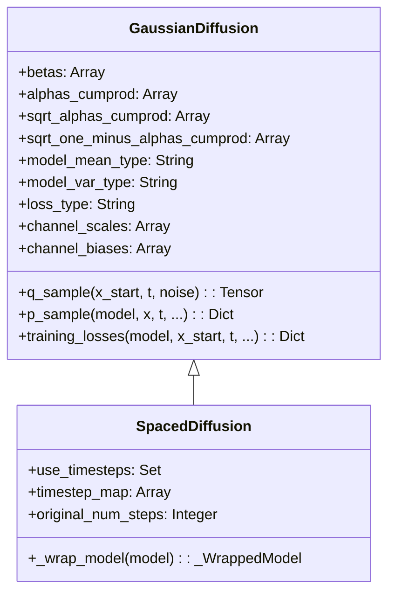

Sources: [point_e/diffusion/gaussian_diffusion.py:127-132](), [point_e/diffusion/gaussian_diffusion.py:144-162]()

### Key Methods

The `GaussianDiffusion` class has several important methods:

1. **Forward Process**:
   - `q_sample`: Adds noise to the input data according to the diffusion schedule
   - `q_mean_variance`: Computes the mean and variance of the distribution q(x_t | x_0)

2. **Reverse Process**:
   - `p_sample`: Samples x_{t-1} from the model at the given timestep
   - `p_sample_loop`: Generates samples from the model by iteratively applying `p_sample`
   - `ddim_sample`: Implements the DDIM sampling method for more efficient inference

3. **Training**:
   - `training_losses`: Computes loss terms for training the diffusion model

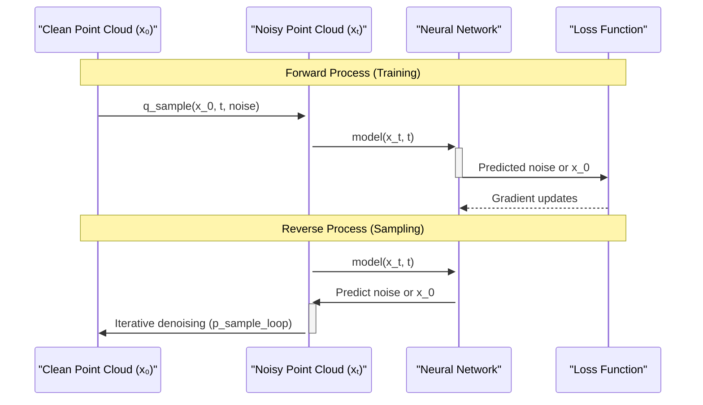

Sources: [point_e/diffusion/gaussian_diffusion.py:214-231](), [point_e/diffusion/gaussian_diffusion.py:407-498](), [point_e/diffusion/gaussian_diffusion.py:762-847]()

## Diffusion Model Configuration

Point-E uses a configuration system to define different diffusion model variants. These configurations specify parameters like noise schedules, channel scaling, and mean prediction types.

### Configuration Dictionary

The `DIFFUSION_CONFIGS` dictionary contains configurations for different model variants, including both base models and upsampling models:

```
BASE_DIFFUSION_CONFIG = {
    "channel_biases": [0.0, 0.0, 0.0, -1.0, -1.0, -1.0],
    "channel_scales": [2.0, 2.0, 2.0, 0.007843137255, 0.007843137255, 0.007843137255],
    "mean_type": "epsilon",
    "schedule": "cosine",
    "timesteps": 1024,
}

DIFFUSION_CONFIGS = {
    "base40M-imagevec": BASE_DIFFUSION_CONFIG,
    "base40M-textvec": BASE_DIFFUSION_CONFIG,
    "base40M-uncond": BASE_DIFFUSION_CONFIG,
    "base40M": BASE_DIFFUSION_CONFIG,
    "base300M": BASE_DIFFUSION_CONFIG,
    "base1B": BASE_DIFFUSION_CONFIG,
    "upsample": {
        "channel_biases": [0.0, 0.0, 0.0, -1.0, -1.0, -1.0],
        "channel_scales": [2.0, 2.0, 2.0, 0.007843137255, 0.007843137255, 0.007843137255],
        "mean_type": "epsilon",
        "schedule": "linear",
        "timesteps": 1024,
    },
}
```

Sources: [point_e/diffusion/configs.py:16-38]()

### Configuration Parameters

The key configuration parameters include:

| Parameter | Description | Typical Values |
|-----------|-------------|----------------|
| `channel_biases` | Bias values applied to each channel | `[0.0, 0.0, 0.0, -1.0, -1.0, -1.0]` |
| `channel_scales` | Scale factors applied to each channel | `[2.0, 2.0, 2.0, 0.007843137255, ...]` |
| `mean_type` | Method to predict mean in the diffusion process | `"epsilon"` or `"x_start"` |
| `schedule` | Type of noise schedule to use | `"cosine"` or `"linear"` |
| `timesteps` | Number of diffusion steps | `1024` |
| `respacing` | Optional parameter for efficiency (SpacedDiffusion) | Typically not specified |

Sources: [point_e/diffusion/configs.py:41-64]()

### Creating Diffusion Models from Configurations

The `diffusion_from_config` function converts a configuration dictionary into a `GaussianDiffusion` or `SpacedDiffusion` instance:

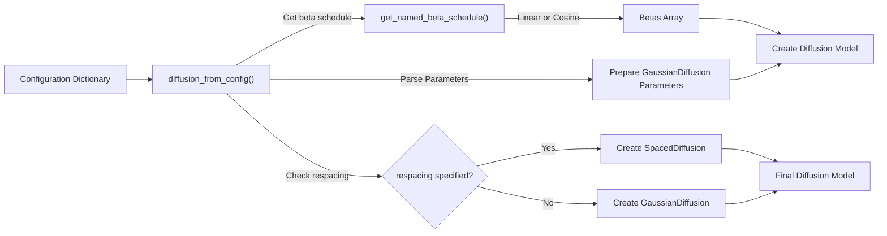

Sources: [point_e/diffusion/configs.py:41-64](), [point_e/diffusion/gaussian_diffusion.py:26-51]()

## Beta Schedules

The noise schedule (sequence of β values) is critical to the diffusion process. Point-E supports two main schedules:

1. **Linear schedule**: Implements a linearly increasing noise level
2. **Cosine schedule**: Uses a cosine function to create a smoother schedule that maintains signal longer

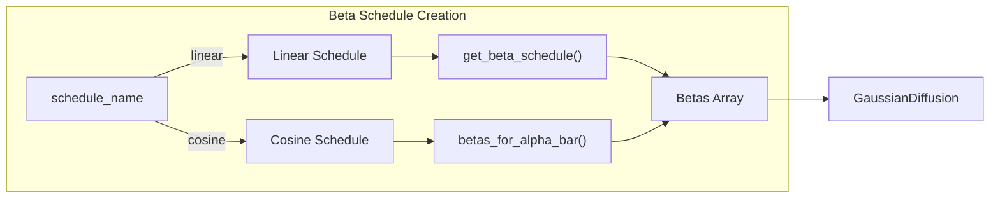

Sources: [point_e/diffusion/gaussian_diffusion.py:26-71]()

## SpacedDiffusion for Efficient Sampling

The `SpacedDiffusion` class extends `GaussianDiffusion` to support skipping steps in the diffusion process. This allows for faster sampling without significantly compromising quality.

```mermaid
flowchart TD
    A["Original Timesteps (1024)"] --> B["SpacedDiffusion"]
    C["use_timesteps (e.g., [0,100,200,...])"] --> B
    
    B --> D["Compute New Betas"]
    D --> E["Create Modified Diffusion Process"]
    
    F["Model"] --> G["_WrappedModel"]
    G --> H["Map Reduced Timesteps to Original"]
    
    E --> I["Faster Sampling"]
```

Sources: [point_e/diffusion/gaussian_diffusion.py:952-1003](), [point_e/diffusion/gaussian_diffusion.py:74-124]()

### Timestep Selection

The `space_timesteps` function provides various strategies for selecting a subset of timesteps from the original process:

1. Uniform spacing (e.g., every nth step)
2. Section-based spacing (different densities in different parts)
3. DDIM-style spacing

Sources: [point_e/diffusion/gaussian_diffusion.py:74-124]()

## Training and Sampling Processes

### Forward Process (Training)

During training, the forward process adds noise to the input data and the model learns to predict either the added noise or the original clean data:

1. Scale input data using `channel_scales` and `channel_biases`
2. Add noise to the input using `q_sample`
3. Pass the noisy data to the model
4. Compute loss between model output and target (either noise or clean data)

Sources: [point_e/diffusion/gaussian_diffusion.py:762-847]()

### Reverse Process (Sampling)

During sampling, the model iteratively denoises random noise to generate new samples:

1. Start with random Gaussian noise
2. For each timestep (from T to 0):
   - Predict the denoised data or the noise component
   - Apply the predicted information to take one step of denoising
   - Optionally apply conditioning information

```mermaid
flowchart TD
    A["Random Noise xT"] --> B["Initialize t = T"]
    B --> C["Model Prediction"]
    C --> D["Compute p(x_{t-1} | x_t)"]
    D --> E["Sample x_{t-1}"]
    E --> F["Decrement t"]
    F -->|"t > 0"| C
    F -->|"t = 0"| G["Final Generated Sample x_0"]
```

Sources: [point_e/diffusion/gaussian_diffusion.py:407-498](), [point_e/diffusion/gaussian_diffusion.py:499-549]()

### DDIM Sampling

Point-E also supports Denoising Diffusion Implicit Models (DDIM) sampling, which enables more efficient sampling with fewer steps:

```mermaid
flowchart LR
    A["Random Noise xT"] --> B["DDIM Sampling Process"]
    B --> C["ddim_sample() Method"]
    C --> D["Deterministic or Stochastic Path"]
    D --> E["Final Sample x0"]
    
    F["eta Parameter"] -->|"Controls Stochasticity"| D
    F -->|"eta=0"| G["Deterministic"]
    F -->|"eta=1"| H["Stochastic (like DDPM)"]
```

Sources: [point_e/diffusion/gaussian_diffusion.py:550-723]()

## Summary

The diffusion model implementation in Point-E provides a flexible framework for generating 3D point clouds. The key components are:

1. The `GaussianDiffusion` class, which implements the core diffusion process
2. The configuration system, which allows for different model variants
3. Beta schedules, which control the noise addition process
4. Sampling methods, including standard diffusion sampling and DDIM
5. The `SpacedDiffusion` class for more efficient sampling

Together, these components enable the generation of high-quality 3D point clouds from text or image inputs, which form the foundation of the Point-E system.

---

# Page: Karras Sampling

# Karras Sampling

<details>
<summary>Relevant source files</summary>

The following files were used as context for generating this wiki page:

- [point_e/diffusion/k_diffusion.py](point_e/diffusion/k_diffusion.py)

</details>


This document details the Karras sampling methodology implemented in Point-E for generating high-quality samples from diffusion models. For information about the general diffusion model framework, see [Diffusion Models](#2.1). For details on how point clouds are specifically sampled, see [Point Cloud Sampling](#2.3).

## Purpose and Significance

Karras sampling refers to a specialized sampling strategy for diffusion models introduced by Karras et al. in their paper "Elucidating the Design Space of Diffusion-Based Generative Models" (2022). It offers improved sample quality and efficiency compared to standard diffusion sampling methods, particularly important for generating detailed 3D point clouds.

```mermaid
flowchart TD
    A["Karras Sampling"] --> B["Optimized Noise Schedule"]
    A --> C["Advanced Sampling Methods"]
    A --> D["Guided Sampling Support"]
    
    B --> B1["get_sigmas_karras()"]
    C --> C1["Heun Sampler"]
    C --> C2["DPM Sampler"]
    C --> C3["Euler Ancestral Sampler"]
    D --> D1["Classifier-Free Guidance"]
```

Sources: [point_e/diffusion/k_diffusion.py:194-200]()

## Core Components

The Karras sampling implementation in Point-E consists of several key classes and functions:

```mermaid
classDiagram
    class KarrasDenoiser {
        +sigma_data: float
        +get_scalings(sigma)
        +denoise(model, x_t, sigmas, **model_kwargs)
    }
    
    class GaussianToKarrasDenoiser {
        +model
        +diffusion
        +sigma_to_t(sigma)
        +denoise(x_t, sigmas, ...)
    }
    
    class SamplingFunctions {
        +karras_sample()
        +karras_sample_progressive()
        +get_sigmas_karras()
        +sample_heun()
        +sample_dpm()
        +sample_euler_ancestral()
    }
    
    KarrasDenoiser --> SamplingFunctions: used by
    GaussianToKarrasDenoiser --> SamplingFunctions: used by
```

Sources: [point_e/diffusion/k_diffusion.py:31-76](), [point_e/diffusion/k_diffusion.py:79-108]()

### KarrasDenoiser

The `KarrasDenoiser` class provides a native implementation of the Karras denoising process. It parameterizes the denoising process using sigma values (noise levels) rather than timesteps as in traditional diffusion models.

Key methods:
- `get_scalings`: Computes scaling factors for the input, output, and skip connections
- `denoise`: Performs the actual denoising step by applying these scalings

Sources: [point_e/diffusion/k_diffusion.py:31-76]()

### GaussianToKarrasDenoiser

This adapter class allows models trained with the standard Gaussian diffusion approach to be used with Karras sampling. It provides a conversion mechanism between sigma values and diffusion timesteps.

Key methods:
- `sigma_to_t`: Converts sigma values to equivalent timesteps
- `denoise`: Adapts the Gaussian diffusion model to work with the Karras sampling process

Sources: [point_e/diffusion/k_diffusion.py:79-108]()

## Sampling Methods

Point-E implements three primary sampling methods that can be used with Karras denoising:

```mermaid
flowchart LR
    A["karras_sample_progressive()"] --> D{sampler parameter}
    D -->|"heun"| E["sample_heun()"]
    D -->|"dpm"| F["sample_dpm()"]
    D -->|"ancestral"| G["sample_euler_ancestral()"]
    
    E --> H["Heun's Method: Second-order\naccurate ODE solver"]
    F --> I["DPM-Solver-2 inspired\nwith midpoint method"]
    G --> J["Euler method with\nadded noise (ancestral)"]
```

Sources: [point_e/diffusion/k_diffusion.py:111-115](), [point_e/diffusion/k_diffusion.py:118-191]()

### Heun Sampler

The Heun sampler (`sample_heun`) implements Algorithm 2 from Karras et al. (2022). It's a second-order accurate numerical ODE solver that improves sample quality over first-order methods:

1. First computes a preliminary estimate using Euler's method
2. Then refines the estimate using both the initial and preliminary values

```python
# First step (Euler)
x_2 = x + d * dt

# Second step (refinement)
denoised_2 = denoiser(x_2, sigmas[i + 1] * s_in)
d_2 = to_d(x_2, sigmas[i + 1], denoised_2)
d_prime = (d + d_2) / 2
x = x + d_prime * dt
```

Sources: [point_e/diffusion/k_diffusion.py:238-279]()

### DPM Sampler

The DPM sampler (`sample_dpm`) is inspired by DPM-Solver-2 with adaptations from Karras et al. (2022). It uses a midpoint method where the midpoint is chosen according to a rho=3 Karras schedule:

```python
# Calculate midpoint using a rho=3 Karras schedule
sigma_mid = ((sigma_hat ** (1 / 3) + sigmas[i + 1] ** (1 / 3)) / 2) ** 3
```

Sources: [point_e/diffusion/k_diffusion.py:282-320]()

### Euler Ancestral Sampler

The Euler ancestral sampler (`sample_euler_ancestral`) combines Euler steps with added noise, similar to the approach in traditional diffusion models:

```python
# Calculate noise levels
sigma_down, sigma_up = get_ancestral_step(sigmas[i], sigmas[i + 1])

# Euler step
dt = sigma_down - sigmas[i]
x = x + d * dt

# Add noise
x = x + th.randn_like(x) * sigma_up
```

Sources: [point_e/diffusion/k_diffusion.py:216-235]()

## Optimized Noise Schedule

The Karras sampling approach uses a specialized noise schedule that allocates sampling steps more efficiently than the uniform or geometric schedules commonly used in diffusion models:

```python
def get_sigmas_karras(n, sigma_min, sigma_max, rho=7.0, device="cpu"):
    """Constructs the noise schedule of Karras et al. (2022)."""
    ramp = th.linspace(0, 1, n)
    min_inv_rho = sigma_min ** (1 / rho)
    max_inv_rho = sigma_max ** (1 / rho)
    sigmas = (max_inv_rho + ramp * (min_inv_rho - max_inv_rho)) ** rho
    return append_zero(sigmas).to(device)
```

The parameter `rho` (default: 7.0) controls the distribution of steps, with higher values allocating more steps to lower noise levels.

Sources: [point_e/diffusion/k_diffusion.py:194-200]()

## Advanced Features

### Classifier-Free Guidance

Karras sampling in Point-E supports classifier-free guidance through the `guidance_scale` parameter:

```mermaid
flowchart LR
    A["Input x_t"] --> B["Split into two copies"]
    B --> C["Conditional\ndenoising"]
    B --> D["Unconditional\ndenoising"]
    C --> E["cond_x_0"]
    D --> F["uncond_x_0"]
    E --> G["Combine with guidance scale:\nuncond_x_0 + guidance_scale * (cond_x_0 - uncond_x_0)"]
    F --> G
    G --> H["Guided output x_0"]
```

This approach allows for controllable generation by enhancing the difference between conditional and unconditional predictions.

Sources: [point_e/diffusion/k_diffusion.py:168-178]()

### Stochastic Sampling

To improve sample diversity, Karras sampling supports stochastic sampling through these parameters:
- `s_churn`: Controls the amount of additional noise
- `s_tmin` and `s_tmax`: Define the sigma range where additional noise is applied
- `s_noise`: Scaling factor for the added noise

```python
gamma = min(s_churn / (len(sigmas) - 1), 2**0.5 - 1) if s_tmin <= sigmas[i] <= s_tmax else 0.0
eps = th.randn_like(x) * s_noise
sigma_hat = sigmas[i] * (gamma + 1)
if gamma > 0:
    x = x + eps * (sigma_hat**2 - sigmas[i] ** 2) ** 0.5
```

Sources: [point_e/diffusion/k_diffusion.py:258-264]()

## Usage Example

To use Karras sampling in Point-E, you can call either `karras_sample` (for the final result only) or `karras_sample_progressive` (to access intermediate results):

```python
# Single result
final_sample = karras_sample(
    diffusion,
    model,
    shape=(batch_size, *model_shape),
    steps=40,
    clip_denoised=True,
    model_kwargs=model_kwargs,
    device=device,
    sampler="heun"  # Choose from "heun", "dpm", or "ancestral"
)

# Progressive results
for sample_data in karras_sample_progressive(
    diffusion,
    model,
    shape=(batch_size, *model_shape),
    steps=40,
    progress=True,
    model_kwargs=model_kwargs,
    sampler="heun"
):
    # Process intermediate results
    current_x = sample_data["x"]
    current_step = sample_data["i"]
```

Sources: [point_e/diffusion/k_diffusion.py:111-191]()

## Advantages Over Standard Diffusion Sampling

Karras sampling offers several advantages over traditional diffusion sampling approaches:

1. **Improved sample quality** with the same number of steps
2. **Better computational efficiency** by focusing steps where they matter most
3. **More accurate ODE solutions** through higher-order numerical methods like Heun's method
4. **Flexible noise schedule** controlled by the `rho` parameter

Sources: [point_e/diffusion/k_diffusion.py]()

---

# Page: Point Cloud Sampling

# Point Cloud Sampling

<details>
<summary>Relevant source files</summary>

The following files were used as context for generating this wiki page:

- [model-card.md](model-card.md)
- [point_e/diffusion/sampler.py](point_e/diffusion/sampler.py)

</details>


This document describes the point cloud sampling system in Point-E, which is responsible for generating 3D point clouds using diffusion models. The sampling system enables generation from text prompts, images, or through unconditional sampling, and supports multi-stage pipelines that combine different models. For information about specific diffusion methods used, see [Diffusion Models](#2.1) and [Karras Sampling](#2.2).

## Overview

The Point-E sampling system provides a flexible framework for generating point clouds through one or more diffusion models. The primary class implementing this functionality is `PointCloudSampler`, which orchestrates the sampling process and manages the transition between multiple models in a generation pipeline.

```mermaid
flowchart TD
    subgraph "Point Cloud Sampling Process"
        input["Input Conditioning"]
        sampling["PointCloudSampler"]
        stage1["Base Model Sampling"]
        stage2["Upsampling Model"]
        output["Final Point Cloud"]
        
        input --> sampling
        sampling --> stage1
        stage1 --> stage2
        stage2 --> output
    end
    
    subgraph "Sampling Methods"
        method1["Standard Diffusion Sampling"]
        method2["Karras Sampling"]
        
        sampling --- method1
        sampling --- method2
    end
    
    subgraph "Conditioning Types"
        cond1["Image (CLIP Embedding)"]
        cond2["Text (CLIP Embedding)"]
        cond3["Unconditional"]
        
        cond1 --> input
        cond2 --> input
        cond3 --> input
    end
```

Sources: [point_e/diffusion/sampler.py:1-26]()

## PointCloudSampler Architecture

The `PointCloudSampler` class is the central component for point cloud generation. It encapsulates one or more diffusion models and their respective sampling parameters.

```mermaid
classDiagram
    class PointCloudSampler {
        +models: Sequence[nn.Module]
        +diffusions: Sequence[GaussianDiffusion]
        +num_points: Sequence[int]
        +aux_channels: Sequence[str]
        +guidance_scale: Sequence[float]
        +use_karras: Sequence[bool]
        +sample_batch()
        +sample_batch_progressive()
        +output_to_point_clouds()
        +split_model_output()
    }
    
    class GaussianDiffusion {
        +p_sample_loop_progressive()
    }
    
    class KarrasSampling {
        +karras_sample_progressive()
    }
    
    PointCloudSampler --> GaussianDiffusion : uses
    PointCloudSampler --> KarrasSampling : may use
```

Sources: [point_e/diffusion/sampler.py:16-85]()

### Key Components

The `PointCloudSampler` is initialized with several key parameters:

| Parameter | Description |
|-----------|-------------|
| `models` | Sequence of neural network models for each stage |
| `diffusions` | Sequence of GaussianDiffusion objects corresponding to each model |
| `num_points` | Number of points to generate at each stage (e.g., 1024, 4096) |
| `aux_channels` | Channel names for auxiliary data (e.g., "R", "G", "B" for colors) |
| `guidance_scale` | Controls classifier-free guidance strength for conditional models |
| `use_karras` | Whether to use Karras sampling algorithm at each stage |
| `karras_steps` | Number of sampling steps when using Karras sampling |
| `sigma_min`, `sigma_max`, `s_churn` | Parameters for Karras sampling configuration |

Sources: [point_e/diffusion/sampler.py:26-85]()

## Sampling Process

The sampling process in Point-E can be performed in a single step or progressively, returning intermediate results during generation.

```mermaid
flowchart TD
    start["Start Sampling"] --> check{"Multiple\nStages?"}
    check -->|"Yes"| stage1["Base Model\n(1024 points)"]
    check -->|"No"| single["Single-Stage\nSampling"]
    stage1 --> stage2["Upsampling Model\n(4096 points)"]
    stage2 --> final["Final Point Cloud"]
    single --> final
    
    subgraph "Each Stage"
        sampling["Initialize Sample"] --> 
        noise["Add Noise"] -->
        denoise["Progressive Denoising"] -->
        result["Denoised Result"]
    end
```

Sources: [point_e/diffusion/sampler.py:90-169]()

### Standard Sampling

The standard sampling method uses the traditional diffusion reverse process, where noise is gradually removed from a randomly initialized point cloud. This is implemented through the `p_sample_loop_progressive` method of the `GaussianDiffusion` class.

```python
# Conceptual sampling process (simplified)
samples = diffusion.p_sample_loop_progressive(
    model,
    shape=(batch_size, channels, num_points),
    model_kwargs=conditioning,
    device=device,
    clip_denoised=clip_denoised,
)
```

Sources: [point_e/diffusion/sampler.py:156-162]()

### Karras Sampling

For higher quality results, Point-E supports Karras sampling, which follows an alternative sampling trajectory based on research by Karras et al. This method typically produces better results with fewer sampling steps.

```python
# Conceptual Karras sampling (simplified)
samples = karras_sample_progressive(
    diffusion=diffusion,
    model=model,
    shape=sample_shape,
    steps=karras_steps,
    sigma_min=sigma_min,
    sigma_max=sigma_max,
    s_churn=s_churn,
    guidance_scale=guidance_scale,
)
```

Sources: [point_e/diffusion/sampler.py:138-150]()

### Classifier-Free Guidance

Point-E implements classifier-free guidance to improve the quality of conditional samples. This technique combines conditional and unconditional predictions to enhance the influence of conditioning information.

```mermaid
flowchart LR
    input["Input x_t"] -->|"Split"| half["Half of Batch"]
    half -->|"Duplicate"| combined["Combined Batch"]
    combined --> model["Model"]
    model --> split["Split Output"]
    split --> cond["Conditional\nPrediction"]
    split --> uncond["Unconditional\nPrediction"]
    cond --> guidance["Apply Guidance:\nuncond + scale * (cond - uncond)"]
    uncond --> guidance
    guidance --> output["Guided Output"]
```

Sources: [point_e/diffusion/sampler.py:192-205]()

## Multi-Stage Sampling Pipeline

One of the key features of the Point-E sampling system is the ability to chain multiple models together in a pipeline, where each stage builds upon the output of the previous stage.

```mermaid
flowchart TD
    subgraph "Multi-Stage Point Cloud Generation"
        input["Conditioning Input\n(Image or Text)"] --> 
        base["Base Model\n(1024 points)"] --> 
        upsample["Upsampling Model\n(4096 points)"] -->
        output["Final Point Cloud"]
    end
    
    subgraph "PointCloudSampler Pipeline"
        stage1["Stage 1:\nsample_batch_progressive()"] -->
        save1["Intermediate Result"] -->
        stage2["Stage 2:\nsample_batch_progressive()"] -->
        save2["Final Result"]
    end
    
    input -.-> stage1
    base -.-> stage1
    save1 -.-> stage2
    upsample -.-> stage2
```

Sources: [point_e/diffusion/sampler.py:96-169]()

A typical two-stage pipeline might include:
1. A base model that generates 1024 points from an image or text prompt
2. An upsampling model that refines the result to 4096 points

For each stage, the sampler handles:
- Filtering relevant model keyword arguments
- Passing previous stage outputs as conditioning
- Applying classifier-free guidance if needed
- Progressively denoising using either standard or Karras sampling

Sources: [point_e/diffusion/sampler.py:96-169](), [model-card.md:17-25]()

## Output Processing

The output of the sampling process is a tensor containing both the 3D coordinates and any auxiliary features like RGB colors. The `PointCloudSampler` provides methods to process this output.

```mermaid
flowchart LR
    output["Raw Output Tensor\n(B, 3+aux_channels, N)"] --> 
    split["split_model_output()"] -->
    pos["XYZ Coordinates\n(B, 3, N)"]
    split --> aux["Auxiliary Channels\n(RGB, etc.)"]
    
    pos --> convert["output_to_point_clouds()"]
    aux --> convert
    convert --> pc["PointCloud Objects"]
```

Sources: [point_e/diffusion/sampler.py:207-237]()

The `split_model_output` method separates the positional coordinates from auxiliary channels:
```python
# Conceptual split (simplified)
pos, aux = output[:, :3], output[:, 3:]  # Split XYZ from auxiliary data
```

The `output_to_point_clouds` method converts tensor outputs to `PointCloud` objects, which provide a convenient interface for working with point cloud data and exporting to other formats.

Sources: [point_e/diffusion/sampler.py:207-237]()

## Combining Samplers

For advanced use cases, the `PointCloudSampler` supports combining multiple samplers into a single pipeline using the `combine` class method. This allows for more complex generation pipelines that may use different models or configurations at each stage.

```python
# Conceptual sampler combination (simplified)
combined_sampler = PointCloudSampler.combine(base_sampler, upsampling_sampler)
```

Sources: [point_e/diffusion/sampler.py:171-190]()

## Available Models for Sampling

Point-E provides several pre-trained models that can be used with the sampling system:

| Model | Description | Output Points |
|-------|-------------|--------------|
| `base40M`, `base300M`, `base1B` | Image-to-point cloud diffusion models | 1024 |
| `base40M-textvec` | Text-to-point cloud diffusion model | 1024 |
| `base40M-uncond` | Unconditional point cloud generation | 1024 |
| `upsample` | Point cloud upsampling model | 4096 |

Sources: [model-card.md:17-25]()

For more details about these models, see [Available Models](#3).

---

# Page: Available Models

# Available Models

<details>
<summary>Relevant source files</summary>

The following files were used as context for generating this wiki page:

- [README.md](README.md)
- [model-card.md](model-card.md)

</details>


This page provides a comprehensive overview of the pre-trained models available in the Point-E system. It covers the different model types, their parameters, capabilities, and intended use cases. For details on how these models are architecturally implemented, see [Model Architecture](#2) and for usage instructions, see [Usage Guide](#5).

## Model Categories

Point-E provides several categories of models that form a complete pipeline for 3D generation:

1. **Image-to-Point Cloud Models**: Generate 3D point clouds from input images
2. **Text-to-Point Cloud Models**: Generate 3D point clouds directly from text descriptions
3. **Point Cloud Upsampling Models**: Increase the resolution of point clouds
4. **Point Cloud-to-Mesh Models**: Convert point clouds to 3D meshes
5. **Evaluation Models**: Used for quality assessment metrics

```mermaid
flowchart TD
    A["Point-E Model Taxonomy"]
    A --> B["Generation Models"]
    A --> C["Post-Processing Models"]
    A --> D["Evaluation Models"]
    
    B --> B1["Image-to-Point Cloud Models"]
    B --> B2["Text-to-Point Cloud Models"]
    B --> B3["Unconditional Models"]
    
    C --> C1["Upsampling Models"]
    C --> C2["SDF Regression Models"]
    
    D --> D1["PointNet Classifier"]
    
    B1 --> B1a["base40M-imagevec"]
    B1 --> B1b["base40M"]
    B1 --> B1c["base300M"]
    B1 --> B1d["base1B"]
    
    B2 --> B2a["base40M-textvec"]
    
    B3 --> B3a["base40M-uncond"]
    
    C1 --> C1a["upsample"]
    
    C2 --> C2a["sdf"]
    
    D1 --> D1a["pointnet"]
```

Sources: [model-card.md:17-26]()

## Available Model Versions

The table below provides details on all pre-trained models available in Point-E:

| Model Name | Parameters | Type | Conditioning | Description | Performance |
|------------|------------|------|--------------|-------------|-------------|
| `base40M-imagevec` | 40M | Image-to-Point Cloud | CLIP ViT-L/14 image vector | Generates point clouds from rendered images | Lower quality than grid-based models |
| `base40M-textvec` | 40M | Text-to-Point Cloud | CLIP ViT-L/14 text vector | Generates point clouds directly from text | Works for simple prompts only |
| `base40M-uncond` | 40M | Unconditional | None | Generates unconditional point cloud samples | Baseline model only |
| `base40M` | 40M | Image-to-Point Cloud | CLIP ViT-L/14 latent grid | Generates point clouds from rendered images | Better than vector-based, worse than larger models |
| `base300M` | 300M | Image-to-Point Cloud | CLIP ViT-L/14 latent grid | Generates point clouds from rendered images | Slightly worse than base1B |
| `base1B` | 1B | Image-to-Point Cloud | CLIP ViT-L/14 latent grid | Generates point clouds from rendered images | Best image-conditional model |
| `upsample` | 40M | Point Cloud Upsampling | Optional image conditioning | Upsamples 1024-point clouds to 4096 points | Improves detail and density |
| `sdf` | Small | SDF Regression | None | Predicts signed distance functions from point clouds | Creates watertight meshes |
| `pointnet` | Small | Classification | None | Classifies point clouds | Used for P-FID and P-IS metrics |

Sources: [model-card.md:17-26](), [README.md:11-15]()

## Model Pipeline and Relationships

The models are designed to work together in a pipeline, with different models handling specific stages of the 3D generation process:

```mermaid
flowchart LR
    subgraph "Input"
        A1["Text Prompt"]
        A2["Image Input"]
    end
    
    subgraph "Base Point Cloud Generation"
        B1["base40M-textvec"]
        B2["base40M-imagevec/base40M/base300M/base1B"]
        B3["base40M-uncond"]
    end
    
    subgraph "Upsampling"
        C["upsample Model"]
    end
    
    subgraph "Mesh Generation"
        D["sdf Model"]
    end
    
    subgraph "Evaluation"
        E["pointnet Model"]
    end
    
    A1 --> B1
    A2 --> B2
    B3 --> |"Unconditional\nGeneration"| C
    
    B1 --> |"1024-point\nCloud"| C
    B2 --> |"1024-point\nCloud"| C
    
    C --> |"4096-point\nCloud"| D
    C --> |"For Evaluation"| E
    
    D --> |"3D Mesh"| F["Final Output"]
    E --> |"Quality Metrics"| G["P-FID, P-IS"]
```

Sources: [README.md:11-15](), [model-card.md:38-45]()

## Model Configuration and Loading

The models are accessed through a configuration system that manages loading and initialization. The code uses a registry of predefined model configurations:

```mermaid
classDiagram
    class ModelManager {
        +load_model()
        +create_sampler()
    }
    
    class DIFFUSION_CONFIGS {
        +base40M-imagevec
        +base40M-textvec
        +base40M-uncond
        +base40M
        +base300M
        +base1B
        +upsample
    }
    
    class MODEL_CONFIGS {
        +sdf
        +pointnet
    }
    
    ModelManager --> DIFFUSION_CONFIGS : uses
    ModelManager --> MODEL_CONFIGS : uses
    
    DIFFUSION_CONFIGS --> DiffusionModel : creates
    MODEL_CONFIGS --> SdfModel : creates
    MODEL_CONFIGS --> PointNetModel : creates
    
    DiffusionModel <|-- Base40M
    DiffusionModel <|-- Base300M
    DiffusionModel <|-- Base1B
    DiffusionModel <|-- Upsample
```

Sources: [model-card.md:17-26]()

## Model Selection Guide

Choosing the appropriate model depends on your specific use case:

1. **For image-to-point cloud generation**:
   - For highest quality: Use `base1B`
   - For balanced performance: Use `base300M` 
   - For faster inference with lower memory: Use `base40M`
   - For minimal resource usage: Use `base40M-imagevec`

2. **For text-to-point cloud generation**:
   - Use `base40M-textvec` (works best with simple prompts)

3. **For all point cloud generation**:
   - Follow with the `upsample` model to increase point cloud resolution to 4096 points

4. **For creating meshes**:
   - After generating and upsampling a point cloud, use the `sdf` model

5. **For evaluation**:
   - Use the `pointnet` model for computing quality metrics such as P-FID and P-IS

Sources: [model-card.md:37-49](), [README.md:11-20]()

## Model Limitations

It's important to be aware of the limitations of these models:

- Image-conditional models may produce incorrect geometry where the rendering is occluded
- Text-conditional model performs well only on simple prompts and common objects
- All models produce relatively low-resolution point clouds that may contain noise and defects
- Point clouds often exhibit a cartoonish style due to training data characteristics
- The SDF regression model works best on manifold (watertight) point clouds

Sources: [model-card.md:50-61]()

---

# Page: Image-to-Point Cloud Models

# Image-to-Point Cloud Models

<details>
<summary>Relevant source files</summary>

The following files were used as context for generating this wiki page:

- [README.md](README.md)
- [model-card.md](model-card.md)

</details>


This page documents the image-to-point cloud models in the Point-E system, which generate 3D point clouds from input images. For information about text-to-point cloud generation, see [Text-to-Point Cloud Models](#3.2). For converting point clouds to meshes, see [Point Cloud-to-Mesh Models](#3.3).

## Overview

Image-to-point cloud models form a core component of the Point-E system, enabling the generation of 3D point clouds from single 2D renderings of objects. These models leverage diffusion-based techniques to progressively transform random noise into coherent 3D point clouds that correspond to the input image.

Sources: [README.md:5-15](), [model-card.md:8-10]()

## Available Models

Point-E provides four image-to-point cloud models with varying parameter counts and capabilities:

| Model Name | Parameters | Conditioning | Description |
|------------|------------|--------------|------------|
| base40M-imagevec | 40 million | Single CLIP ViT-L/14 image vector | Basic image-to-point cloud functionality, but with lower quality than other models |
| base40M | 40 million | CLIP ViT-L/14 latent grid | Better quality than base40M-imagevec but not as good as larger models |
| base300M | 300 million | CLIP ViT-L/14 latent grid | High-quality output, slightly worse than base1B |
| base1B | 1 billion | CLIP ViT-L/14 latent grid | Highest quality image-to-point cloud model |

All models produce point clouds with 1,024 points, which can be further processed by the upsampling model to reach 4,096 points.

Sources: [model-card.md:16-26]()

## Architecture and Data Flow

### Image-to-Point Cloud Generation Pipeline

```mermaid
flowchart LR
    subgraph "Input"
        image["Input Image"]
    end

    subgraph "CLIP_Encoder"
        clip["CLIP ViT-L/14"]
        clip_vec["Image Vector\n(base40M-imagevec)"]
        clip_grid["Latent Grid\n(base40M, base300M, base1B)"]
        
        clip --> clip_vec
        clip --> clip_grid
    end

    subgraph "DiffusionModel"
        diffusion["GaussianDiffusion"]
        sampler["PointCloudSampler"]
        
        diffusion --> sampler
    end

    subgraph "Output"
        pc["Point Cloud\n(1024 points)"]
    end

    image --> clip
    clip_vec --> diffusion
    clip_grid --> diffusion
    sampler --> pc
```

The process begins with an input image that is encoded using CLIP ViT-L/14. Depending on the model variant, either a single image vector (base40M-imagevec) or a latent grid (base40M, base300M, base1B) is used as conditioning for the diffusion model. The diffusion model then generates a point cloud with 1,024 points.

Sources: [model-card.md:16-26]()

### Model Components and Implementation

```mermaid
classDiagram
    class ImagePointCloudModel {
        +model_ids
        +device
        +load_model()
        +load_diffusion()
        +load_sampler()
    }
    
    class PointCloudSampler {
        +models
        +diffusions
        +sample_batch()
        +sample_batch_progressive()
        +output_to_point_clouds()
    }
    
    class SpacedDiffusion {
        +use_timesteps
        +p_sample_loop_progressive()
        +q_sample()
    }
    
    class DiffusionModel {
        +forward()
        +parameters()
    }
    
    class CLIPEncoder {
        +encode_image()
        +process_images()
    }
    
    ImagePointCloudModel --> PointCloudSampler : creates
    ImagePointCloudModel --> SpacedDiffusion : configures
    ImagePointCloudModel --> DiffusionModel : loads
    PointCloudSampler --> DiffusionModel : uses
    PointCloudSampler --> SpacedDiffusion : uses
    ImagePointCloudModel --> CLIPEncoder : uses for conditioning
```

The image-to-point cloud system consists of several components:

1. `ImagePointCloudModel`: A high-level interface for loading and using the models
2. `PointCloudSampler`: Coordinates the sampling process from the diffusion model
3. `SpacedDiffusion`: Implements the diffusion process with configurable timestep scheduling
4. `DiffusionModel`: The neural network that predicts noise at each diffusion step
5. `CLIPEncoder`: Processes input images to create conditioning information

Sources: [model-card.md:16-26]()

## Model Performance and Quality

The image-to-point cloud models exhibit the following characteristics:

1. **Capabilities**:
   - Generate coherent 3D point clouds from single 2D renderings
   - Capture visible geometry from the input image

2. **Limitations**:
   - May produce incorrect geometry in occluded areas
   - Sometimes generates geometry inconsistent with visible parts
   - Output is relatively low-resolution (1,024 points)
   - Point clouds may contain noise, outliers, or cracks

3. **Quality Progression**:
   - base1B > base300M > base40M > base40M-imagevec (in order of decreasing quality)

Sources: [model-card.md:8-10](), [model-card.md:45-47]()

## Using the Image-to-Point Cloud Models

### Basic Usage Pattern

```mermaid
flowchart TD
    A["Load Model\n(base40M, base300M, or base1B)"] --> B["Load Image"]
    B --> C["Encode Image with CLIP"]
    C --> D["Sample Point Cloud"]
    D --> E["Post-Process (Optional)"]
    E --> F1["Visualize"]
    E --> F2["Upsample"]
    E --> F3["Convert to Mesh"]
    
    F2 --> G["High-Resolution Point Cloud\n(4096 points)"]
    F3 --> H["3D Mesh"]
```

The Point-E system provides easy access to these models through example notebooks. The `image2pointcloud.ipynb` notebook demonstrates how to use these models to generate point clouds from input images.

Sources: [README.md:11-15]()

### Parameter and Model Selection

When selecting an image-to-point cloud model, consider the following trade-offs:

| Model | Quality | Memory Usage | Inference Speed |
|-------|---------|--------------|----------------|
| base40M-imagevec | Lowest | Low | Fast |
| base40M | Low | Low | Fast |
| base300M | High | Medium | Medium |
| base1B | Highest | High | Slow |

For most applications, the base300M model provides a good balance between quality and computational requirements.

Sources: [model-card.md:16-26]()

## Evaluation

Image-to-point cloud models are evaluated using metrics such as:

1. P-FID (Point-cloud Fréchet Inception Distance)
2. P-IS (Point-cloud Inception Score)
3. CLIP R-Precision

These metrics assess the quality and fidelity of the generated point clouds compared to ground truth data. Evaluation scripts are available in the repository.

Sources: [README.md:17-20]()

## Integration with Other Components

The image-to-point cloud models integrate with other components in the Point-E system:

1. **Upsampling**: The generated 1,024-point clouds can be processed by the upsampling model to create higher-resolution 4,096-point clouds.

2. **Mesh Generation**: Point clouds can be converted to meshes using the SDF regression model.

3. **Visualization**: The Blender rendering code can be used to visualize the generated point clouds.

Sources: [README.md:11-15](), [model-card.md:24-25]()

## Conclusion

The image-to-point cloud models in Point-E represent a powerful set of tools for generating 3D content from 2D images. While they have limitations in terms of resolution and accuracy, they provide a solid foundation for 3D content creation from visual inputs. The range of model sizes allows users to choose the appropriate trade-off between quality and computational resources.

Sources: [model-card.md:8-10](), [model-card.md:45-47]()

---

# Page: Text-to-Point Cloud Models

# Text-to-Point Cloud Models

<details>
<summary>Relevant source files</summary>

The following files were used as context for generating this wiki page:

- [README.md](README.md)
- [model-card.md](model-card.md)

</details>


This document provides technical details about the text-to-point cloud models in the Point-E system. These models are designed to generate 3D point clouds directly from text descriptions without requiring any intermediate image generation. For information about image-to-point cloud models, see [Image-to-Point Cloud Models](#3.1), and for converting point clouds to meshes, see [Point Cloud-to-Mesh Models](#3.3).

## Overview

The text-to-point cloud functionality in Point-E is implemented through a specialized diffusion model that processes text embeddings from CLIP and generates corresponding 3D point clouds. While this model is more limited in capabilities compared to the image-conditional models, it provides a direct path from text descriptions to 3D representations.

```mermaid
flowchart LR
    subgraph "Text-to-Point Cloud Pipeline"
        A["Text Prompt"] --> B["CLIP Text Encoder"]
        B --> C["Text Embedding"]
        C --> D["Diffusion Model (base40M-textvec)"]
        D --> E["1024-point Cloud"]
        E --> F["Upsampling Model (optional)"]
        F --> G["4096-point Cloud"]
    end
```

Sources: [README.md:14-14](), [model-card.md:19-19]()

## Model Architecture

Point-E's text-to-point cloud model is a 40 million parameter diffusion model (`base40M-textvec`) that accepts conditioning from a CLIP ViT-L/14 text encoder. The model processes text descriptions into 3D point clouds containing 1,024 points, which can then be optionally upsampled to 4,096 points using the upsampling model.

```mermaid
classDiagram
    class TextToPointCloudModel {
        +CLIP_Text_Encoder
        +DiffusionModel
        +process_text()
        +generate_point_cloud()
    }
    
    class CLIPTextEncoder {
        +encode_text()
        +text_to_embedding()
    }
    
    class DiffusionModel {
        +model_parameters: 40M
        +conditioning_inputs
        +forward()
        +sample()
    }
    
    class PointCloudSampler {
        +models
        +diffusions
        +sample_batch()
        +output_to_point_clouds()
    }
    
    TextToPointCloudModel --> CLIPTextEncoder: uses
    TextToPointCloudModel --> DiffusionModel: contains
    TextToPointCloudModel --> PointCloudSampler: uses for sampling
```

Sources: [model-card.md:19-19]()

## Technical Implementation

The text-to-point cloud model utilizes the same diffusion framework as other models in Point-E, but with text embeddings as conditioning inputs instead of image features. The model has been trained to understand the relationship between textual descriptions and 3D shapes.

The model processes input text through these main steps:

1. Text processing via CLIP ViT-L/14 encoder to generate text embeddings
2. Conditioning the diffusion model with these text embeddings
3. Running the diffusion sampling process to generate point clouds
4. Optional upsampling to increase point cloud density

The model is accessed through the configuration system using the identifier `base40M-textvec`.

Sources: [model-card.md:19-19]()

## Capabilities and Limitations

The text-to-point cloud model has several notable capabilities and limitations:

| Capabilities | Limitations |
|--------------|-------------|
| Generates 3D point clouds directly from text | Works best with simple descriptions |
| Understands basic object categories | Limited generalization to complex prompts |
| Recognizes and applies color descriptions | Less effective with unusual objects |
| Can produce recognizable simple shapes | Lower quality than image-conditional models |
| Enables pure text-to-3D workflow | May exhibit biases present in training data |

The model performs best with straightforward descriptions of common objects with simple colors, such as "a red chair" or "a blue car." It struggles with complex spatial relationships, unusual objects, or detailed specifications.

Sources: [model-card.md:10-10](), [model-card.md:48-48]()

## Data Flow and Processing

The following diagram illustrates how text input flows through the system to generate a 3D point cloud:

```mermaid
flowchart TD
    A["Text Input (e.g., 'a red chair')"] --> B["CLIPTextEncoder.encode_text()"]
    B --> C["Text Embedding Vector"]
    
    C --> D["GaussianDiffusion.condition_mean()"]
    
    E["Random Noise"] --> F["Diffusion Sampling Process"]
    D --> F
    
    F --> G["DiffusionSampler.sample_batch()"]
    G --> H["1024-Point Cloud"]
    
    H --> I["Upsampler (Optional)"]
    I --> J["4096-Point Cloud"]
    
    H --> K["Visualization/Export"]
    J --> K
```

Sources: [README.md:14-14](), [model-card.md:19-19]()

## Usage Example

The primary way to use the text-to-point cloud model is through the `text2pointcloud.ipynb` notebook provided in the repository. This notebook demonstrates how to load the model, encode text prompts, generate point clouds, and visualize the results.

The basic workflow involves:

1. Loading the `base40M-textvec` model
2. Creating a point cloud sampler
3. Providing a text prompt
4. Running the sampling process
5. Visualizing or exporting the resulting point cloud

Sources: [README.md:14-14]()

## Model Training and Dataset

The text-to-point cloud model was trained on a dataset of several million 3D models and their associated text captions. The dataset was processed and filtered to focus on recognizable objects, with cluster weighting used to avoid overrepresentation of similar objects.

The model was trained to predict clean point clouds from noisy point clouds, conditioned on text embeddings from CLIP. This approach allows the model to learn the mapping between textual descriptions and 3D shapes.

Sources: [model-card.md:33-35]()

## Integration with Other Models

The text-to-point cloud model can be used as part of a larger pipeline within the Point-E system:

```mermaid
flowchart LR
    subgraph "Point-E Workflow Options"
        A["Text Input"] --> B["Text-to-Point Cloud Model"]
        C["Image Input"] --> D["Image-to-Point Cloud Model"]
        
        B --> E["Point Cloud (1024 points)"]
        D --> E
        
        E --> F["Upsampling Model"]
        F --> G["High-Res Point Cloud (4096 points)"]
        
        G --> H["SDF Regression Model"]
        H --> I["3D Mesh"]
    end
```

The output of the text-to-point cloud model can be:
1. Used directly for visualization or analysis
2. Upsampled to increase resolution
3. Converted to a mesh using the SDF regression model
4. Evaluated using metrics like P-FID or P-IS

Sources: [README.md:11-15](), [model-card.md:42-44]()

## Technical Implementation Details

The text-to-point cloud model implements a Gaussian diffusion process that iteratively denoises a randomly initialized point cloud based on conditioning from text embeddings. The model architecture is similar to other diffusion models in the Point-E system but with specific adaptations for text conditioning.

Key components involved in the text-to-point cloud generation pipeline include:

1. CLIP text encoder for embedding text descriptions
2. Diffusion model for generating point clouds from noise
3. Point cloud sampler for managing the sampling process
4. Optional upsampling model for increasing point density

The model is configured to output 1,024 points in 3D space, each with color information.

Sources: [model-card.md:19-19]()

## Conclusion

The text-to-point cloud model in Point-E provides a direct path from textual descriptions to 3D point clouds. While more limited than the image-conditional models, it offers a valuable tool for generating simple 3D shapes directly from text prompts. The model works best with straightforward descriptions of common objects and can be integrated with other components in the Point-E system to produce higher-resolution point clouds or meshes.

---

# Page: Point Cloud-to-Mesh Models

# Point Cloud-to-Mesh Models

<details>
<summary>Relevant source files</summary>

The following files were used as context for generating this wiki page:

- [README.md](README.md)
- [model-card.md](model-card.md)

</details>


This document describes the Point Cloud-to-Mesh conversion component in the Point-E system, focusing on the SDF (Signed Distance Function) regression model. This component represents the final stage in the 3D generation pipeline, transforming point clouds into 3D meshes suitable for visualization and fabrication. For information about generating the initial point clouds, see [Image-to-Point Cloud Models](#3.1) or [Text-to-Point Cloud Models](#3.2).

## SDF Regression Approach

The Point-E system employs a specialized SDF regression model for converting point clouds into 3D meshes. Unlike raw point clouds, meshes provide continuous surface representations with several advantages:

- Better visual quality and surface continuity
- Compatibility with standard 3D software and rendering tools
- Support for physical fabrication (3D printing)
- Improved surface normal estimation

### SDF Regression Process

```mermaid
graph LR
    PC["Input: Point Cloud<br>(4096 points)"] --> SDF["sdf model<br>SDF Regression"]
    SDF --> SDFG["Output: SDF Grid"]
    SDFG --> MC["Marching Cubes<br>Algorithm"]
    MC --> Mesh["Final Output:<br>3D Mesh"]
```

The conversion process follows these steps:
1. The model takes a point cloud (typically 4096 points) as input
2. It predicts signed distance values on a 3D grid (negative inside object, positive outside)
3. The Marching Cubes algorithm extracts a mesh surface at the zero-level set of the SDF
4. The result is a triangulated mesh representing the object surface

Sources: model-card.md

## Integration in Point-E Pipeline

The SDF regression model represents the final stage in the complete Point-E 3D generation pipeline.

```mermaid
flowchart TD
    subgraph "Input"
        Text["Text Prompt"]
        Image["Input Image"]
    end
    
    subgraph "Point Cloud Generation"
        TextModel["base40M-textvec<br>Text-to-Point Cloud"]
        ImageModel["base40M/300M/1B<br>Image-to-Point Cloud"]
        Upsampler["upsample model<br>Point Cloud Upsampling"]
    end
    
    subgraph "Mesh Generation"
        SDFModel["sdf model<br>SDF Regression"]
        MarchingCubes["Marching Cubes<br>Algorithm"]
    end
    
    Text --> TextModel
    Image --> ImageModel
    
    TextModel --> |"1024-point cloud"| Upsampler
    ImageModel --> |"1024-point cloud"| Upsampler
    
    Upsampler --> |"4096-point cloud"| SDFModel
    SDFModel --> MarchingCubes
    MarchingCubes --> Mesh["3D Mesh"]
```

The following table summarizes the models involved in the end-to-end pipeline:

| Stage | Model Name | Input | Output | Purpose |
|-------|------------|-------|--------|---------|
| Initial Generation | base40M-textvec | Text | 1024-point cloud | Text-to-point cloud conversion |
| Initial Generation | base40M/300M/1B | Image | 1024-point cloud | Image-to-point cloud conversion |
| Upsampling | upsample | 1024-point cloud | 4096-point cloud | Increase point cloud resolution |
| Mesh Generation | sdf | 4096-point cloud | 3D mesh | Convert point cloud to mesh |

Sources: README.md, model-card.md

## Model Training

The SDF regression model is described as "a small model for predicting signed distance functions from 3D point clouds" in the model card. Its training differs from the other Point-E models in an important way:

```mermaid
flowchart LR
    Data["Full Training Dataset<br>Several Million 3D Models"] --> Filtering["Manifold Filtering"]
    Filtering --> SDFData["SDF Training Data<br>Watertight Meshes Only"]
    SDFData --> Training["Model Training"]
    Training --> SDFModel["sdf model"]
```

Key characteristics of the training process:
- The model was trained only on manifold (watertight and free of singularities) 3D meshes
- This restriction ensures the SDF is well-defined throughout the volume
- Well-formed SDFs are crucial for reliable mesh extraction

Sources: model-card.md

## Usage Example

The Point-E repository includes a dedicated notebook for point cloud to mesh conversion: `pointcloud2mesh.ipynb`. This notebook demonstrates the practical application of the SDF regression model.

```mermaid
graph TD
    A["Load/Generate<br>Point Cloud"] --> B["Load SDF<br>Model"]
    B --> C["Apply SDF<br>Regression"]
    C --> D["Extract Mesh<br>via Marching Cubes"]
    D --> E1["Visualize<br>Mesh"]
    D --> E2["Export<br>Mesh"]
```

The basic workflow involves:
1. Obtaining a point cloud (ideally 4096 points from the upsampling model)
2. Loading the pre-trained SDF regression model
3. Applying the model to predict SDF values
4. Extracting a mesh using Marching Cubes
5. Visualizing or exporting the resulting mesh

Sources: README.md

## Implementation Details

While specific implementation details are limited in the provided information, the SDF model follows a neural network architecture designed to process point clouds and predict signed distance values.

```mermaid
classDiagram
    class SDFModel {
        +predict_sdf_values()
        +generate_sdf_grid()
        +extract_mesh()
    }
    
    class MarchingCubes {
        +create_surface()
    }
    
    SDFModel --> MarchingCubes: uses for mesh extraction
```

The model provides functionality to:
- Process input point clouds (typically 4096 points)
- Predict SDF values at query points in 3D space
- Generate a complete SDF grid at configurable resolution
- Extract a mesh using the Marching Cubes algorithm

Sources: model-card.md

## Limitations and Considerations

When using the Point Cloud-to-Mesh conversion, several factors should be considered:

1. **Input quality dependence**: The quality of the generated mesh heavily depends on the density and distribution of points in the input point cloud. Upsampled 4096-point clouds generally produce better results than the initial 1024-point outputs.

2. **Resolution trade-offs**: Higher resolution SDF grids capture more detail but require significantly more computation time and memory.

3. **Mesh artifacts**: Generated meshes may contain artifacts such as holes, disconnected components, or noisy surfaces, particularly in areas with sparse point coverage.

4. **Training limitations**: Since the model was trained only on manifold meshes, it may struggle with complex, thin, or non-manifold structures.

5. **Computational requirements**: The mesh generation process is more computationally intensive than working directly with point clouds.

Sources: model-card.md

This wiki page provides a technical overview of the Point Cloud-to-Mesh conversion capabilities in Point-E. For implementation details and practical usage, refer to the `pointcloud2mesh.ipynb` notebook in the repository.

---

# Page: Upsampling Models

# Upsampling Models

<details>
<summary>Relevant source files</summary>

The following files were used as context for generating this wiki page:

- [README.md](README.md)
- [model-card.md](model-card.md)

</details>


## Purpose and Scope

The upsampling models in Point-E are dedicated to increasing the resolution of point clouds, specifically taking point clouds with 1024 points and upsampling them to 4096 points. This document covers the purpose, architecture, and usage of the upsampling models within the Point-E framework. For information about the base point cloud generation models, see [Image-to-Point Cloud Models](#3.1) and [Text-to-Point Cloud Models](#3.2). For details on converting the upsampled point clouds to meshes, see [Point Cloud-to-Mesh Models](#3.3).

Sources: model-card.md

## Position in the Pipeline

The upsampling model serves as a critical intermediate step in the Point-E generation pipeline, enhancing the resolution of coarse point clouds before optional mesh conversion.

```mermaid
flowchart LR
    subgraph "Input Methods"
        text["Text Input"]
        image["Image Input"]
    end

    subgraph "Base Models"
        text_model["Text-to-Point Cloud Model"]
        image_model["Image-to-Point Cloud Model"]
    end

    subgraph "Resolution Enhancement"
        upsample["Upsampling Model (upsample)"]
    end

    subgraph "Optional Conversion"
        sdf["SDF Regression Model"]
        mesh["Mesh Generation"]
    end

    text --> text_model
    image --> image_model
    
    text_model --> |"Low-res (1024 points)"| upsample
    image_model --> |"Low-res (1024 points)"| upsample
    
    upsample --> |"High-res (4096 points)"| sdf
    upsample --> |"High-res (4096 points)"| output["Final Point Cloud"]
    
    sdf --> mesh
```

Sources: model-card.md

## Model Specifications

The upsampling model has the following characteristics:

| Parameter | Value |
|-----------|-------|
| Model ID | `upsample` |
| Parameter Count | 40 million |
| Input Size | 1024 points |
| Output Size | 4096 points |
| Conditioning | Optionally image-conditioned |
| Model Type | Diffusion model |

Sources: model-card.md

## Technical Implementation

The upsampling model is implemented as a diffusion model, similar to the base point cloud generation models. It is configured through the `DIFFUSION_CONFIGS` dictionary and created using the diffusion factory system.

```mermaid
classDiagram
    class PointCloudSampler {
        +models
        +diffusions
        +sample_batch()
        +sample_batch_progressive()
        +output_to_point_clouds()
    }
    
    class UpsampleModel {
        +forward()
        +conditioning_inputs
    }
    
    class GaussianDiffusion {
        +betas
        +model_mean_type
        +model_var_type
        +loss_type
        +p_sample_loop_progressive()
    }
    
    class UpsampledPointCloud {
        +coords (4096, 3)
        +features (optional)
    }
    
    PointCloudSampler --> GaussianDiffusion: uses
    PointCloudSampler --> UpsampleModel: uses
    PointCloudSampler --> UpsampledPointCloud: produces
    UpsampleModel --> GaussianDiffusion: used by
```

Sources: model-card.md

## Model Configuration

The upsampling model is configured with specific diffusion parameters optimized for the task of increasing point cloud resolution while maintaining geometric fidelity.

```mermaid
flowchart TD
    config["DIFFUSION_CONFIGS['upsample']"] --> factory["diffusion_from_config()"]
    factory --> diffusion["GaussianDiffusion/SpacedDiffusion"]
    
    subgraph "Upsampling Process"
        input["Input Point Cloud (1024 points)"] --> sampler["PointCloudSampler"]
        optional["Optional Image Conditioning"] --> sampler
        sampler --> output["Output Point Cloud (4096 points)"]
    end
    
    diffusion --> sampler
```

Sources: model-card.md

## Usage in the Point-E Pipeline

The upsampling model is typically used after generating a base point cloud from either text or image input. It significantly improves the resolution and detail of the point cloud before optional mesh conversion.

```mermaid
sequenceDiagram
    participant User
    participant BaseModel as "Base Model (text/image)"
    participant Upsampler as "Upsampling Model"
    participant SDFModel as "SDF Regression (optional)"
    
    User->>BaseModel: Generate base point cloud
    BaseModel->>Upsampler: Low-res point cloud (1024 points)
    Note over Upsampler: Optional image conditioning
    Upsampler->>User: High-res point cloud (4096 points)
    opt Mesh Conversion
        User->>SDFModel: Send upsampled point cloud
        SDFModel->>User: Return 3D mesh
    end
```

Sources: model-card.md

## Integration with Notebooks

The upsampling model is integrated into the example notebooks provided in the Point-E repository, allowing users to easily apply upsampling to their generated point clouds.

| Notebook | Upsampling Usage |
|----------|------------------|
| image2pointcloud.ipynb | Upsamples image-conditional point clouds |
| text2pointcloud.ipynb | Upsamples text-conditional point clouds |
| pointcloud2mesh.ipynb | Uses upsampled point clouds for better mesh generation |

Sources: README.md

## Model Limitations

While the upsampling model significantly improves point cloud resolution, it inherits some limitations:

1. The upsampled point clouds may still contain noise and artifacts
2. The model may struggle with complex geometries or fine details
3. Performance is dependent on the quality of the base point cloud
4. The upsampling process can amplify existing errors in the base point cloud

Sources: model-card.md

## Model Loading and Inference

The upsampling model is loaded and used similarly to other models in the Point-E framework:

```mermaid
flowchart LR
    subgraph "Model Loading"
        create_model["create_model()"] --> upsample_model["UpsampleModel"]
        diffusion_config["DIFFUSION_CONFIGS['upsample']"] --> diffusion["create_gaussian_diffusion()"]
    end
    
    subgraph "Inference Pipeline"
        sampler["PointCloudSampler"] --> |"sample_batch()"| inference
        upsample_model --> sampler
        diffusion --> sampler
        base_pc["BasePointCloud"] --> sampler
        inference --> upsampled_pc["UpsampledPointCloud"]
    end
```

Sources: model-card.md

The upsampling model plays a crucial role in the Point-E pipeline by bridging the gap between the lower-resolution outputs of base models and the higher-resolution inputs needed for quality mesh generation and visualization.

---

# Page: Evaluation System

# Evaluation System

<details>
<summary>Relevant source files</summary>

The following files were used as context for generating this wiki page:

- [README.md](README.md)
- [point_e/evals/__init__.py](point_e/evals/__init__.py)
- [point_e/evals/feature_extractor.py](point_e/evals/feature_extractor.py)

</details>


The Point-E evaluation system provides a framework for assessing the quality of generated 3D point clouds. This page covers the core components, metrics, and tools used to evaluate point cloud quality within the Point-E codebase. For information on generating point clouds from text or images, see [Available Models](#3).

## Overview

The evaluation system consists of feature extraction capabilities, quality metrics, and visualization tools that enable quantitative and qualitative assessment of generated point clouds.

```mermaid
flowchart TD
    subgraph "Evaluation System Components"
        A["FeatureExtractor"] --> |abstract base class| B["PointNetClassifier"]
        C["Evaluation Metrics"] --> D["P-FID"]
        C --> E["P-IS"]
        F["Evaluation Scripts"] --> G["evaluate_pfid.py"]
        F --> H["evaluate_pis.py"]
        I["Visualization"] --> J["blender_script.py"]
        
        B --> D
        B --> E
    end
```

Sources: [point_e/evals/feature_extractor.py:21-49]()(Feature Extractor), [README.md:17-22]()

## Feature Extraction Framework

The feature extraction framework serves as the foundation for point cloud evaluation, providing a consistent way to extract meaningful features from 3D point clouds.

### FeatureExtractor Abstract Class

This abstract base class defines the interface for feature extractors in the Point-E system:

```mermaid
classDiagram
    class FeatureExtractor {
        <<abstract>>
        +supports_predictions() bool
        +feature_dim() int
        +num_classes() int
        +features_and_preds(streamer) Tuple[np.ndarray, np.ndarray]
    }
    
    class PointNetClassifier {
        -models[]
        -devices[]
        -device_batch_size int
        +supports_predictions() bool
        +feature_dim() int
        +num_classes() int
        +features_and_preds(streamer) Tuple[np.ndarray, np.ndarray]
    }
    
    FeatureExtractor <|-- PointNetClassifier
```

The `FeatureExtractor` defines:
- Abstract properties for determining if the extractor supports predictions, feature dimensions, and number of classes
- An abstract method `features_and_preds()` for computing feature vectors and class predictions from point cloud batches

Sources: [point_e/evals/feature_extractor.py:21-49]()

### PointNetClassifier Implementation

`PointNetClassifier` implements the `FeatureExtractor` interface using PointNet architecture:

- Loads a pre-trained PointNet model with 40 classes
- Operates on multiple devices in parallel using a ThreadPool for efficient processing
- Returns a 256-dimensional feature vector and class predictions for each point cloud

Key implementation aspects:
- Supports multi-device processing for better throughput
- Normalizes point clouds before feature extraction
- Returns both feature vectors and class probabilities

Sources: [point_e/evals/feature_extractor.py:51-111]()

## Evaluation Metrics

Point-E uses two primary metrics to assess the quality of generated point clouds:

```mermaid
flowchart LR
    A["Generated Point Clouds"] --> B["Feature Extraction"]
    C["Reference Point Clouds"] --> B
    
    B --> D["P-FID Calculation"]
    B --> E["P-IS Calculation"]
    
    D --> F["Quality Assessment"]
    E --> F
```

### P-FID (Pointcloud Fréchet Inception Distance)

P-FID is an adaptation of the Fréchet Inception Distance (FID) metric for point clouds. It measures the similarity between the distribution of generated point clouds and a reference distribution:

1. Extract features from both generated and reference point clouds using PointNetClassifier
2. Calculate the mean and covariance of the feature distributions
3. Compute the Fréchet distance between the distributions

Lower P-FID values indicate higher quality and closer similarity to the reference distribution.

Sources: [README.md:17-19]()

### P-IS (Pointcloud Inception Score)

P-IS is an adaptation of the Inception Score (IS) for point clouds, measuring both quality and diversity:

1. Extract features and class predictions from generated point clouds
2. Compute the KL divergence between the conditional class distribution and the marginal class distribution
3. P-IS is calculated as the exponential of the average KL divergence

Higher P-IS values indicate higher quality and diversity in the generated point clouds.

Sources: [README.md:17-20]()

## Evaluation Pipeline

The evaluation pipeline shows how point clouds move from creation to quality assessment:

```mermaid
flowchart TD
    A["Generated Point Clouds"] --> B["NpzStreamer"]
    B --> C["PointNetClassifier"]
    C --> D["Feature Vectors"] & E["Class Predictions"]
    
    D --> F["P-FID Calculation"]
    D & E --> G["P-IS Calculation"]
    
    H["Reference Point Clouds"] --> I["NpzStreamer"]
    I --> J["PointNetClassifier"]
    J --> K["Reference Features"]
    
    K --> F
    
    F --> L["Quality Metrics"]
    G --> L
```

Sources: [point_e/evals/feature_extractor.py:84-111]()

## Implementation Details

### Feature Extraction Process

The feature extraction process in `PointNetClassifier` is optimized for batch processing across multiple devices:

1. Point clouds are normalized to be centered around origin and scaled to unit sphere
2. The data is split into batches across available devices (GPU/CPU)
3. A ThreadPool processes batches in parallel
4. Features (256-dim) and class predictions (40 classes) are computed for each point cloud

```mermaid
sequenceDiagram
    participant S as NpzStreamer
    participant P as PointNetClassifier
    participant N as normalize_point_clouds
    participant M as PointNet Models
    
    S->>P: stream point clouds
    loop For each batch
        P->>N: normalize_point_clouds(batch)
        N->>P: normalized point clouds
        P->>P: split across devices
        
        par For each device
            P->>M: compute_features(batch)
            M->>P: return logits, features
        end
    end
    
    P->>P: concatenate results
    P->>Caller: return features, predictions
```

Sources: [point_e/evals/feature_extractor.py:84-111](), [point_e/evals/feature_extractor.py:114-119]()

### Point Cloud Normalization

Point clouds are normalized before feature extraction to ensure consistent scale and position:

```python
def normalize_point_clouds(pc: np.ndarray) -> np.ndarray:
    # Center point clouds at origin
    centroids = np.mean(pc, axis=1, keepdims=True)
    pc = pc - centroids
    
    # Scale to unit sphere
    m = np.max(np.sqrt(np.sum(pc**2, axis=-1, keepdims=True)), axis=1, keepdims=True)
    pc = pc / m
    
    return pc
```

This normalization ensures that the feature extraction is invariant to the scale and position of the point clouds.

Sources: [point_e/evals/feature_extractor.py:114-119]()

## Evaluation Scripts

Point-E provides specific scripts for evaluating generated point clouds:

| Script | Purpose | Location |
|--------|---------|----------|
| `evaluate_pfid.py` | Calculates P-FID between generated and reference point clouds | point_e/evals/scripts/evaluate_pfid.py |
| `evaluate_pis.py` | Calculates P-IS for generated point clouds | point_e/evals/scripts/evaluate_pis.py |
| `blender_script.py` | Renders point clouds and meshes for visual inspection | point_e/evals/scripts/blender_script.py |

These scripts can be used to quantitatively and qualitatively assess the quality of point clouds generated by the Point-E models.

Sources: [README.md:17-22]()

## Hardware Utilization

The evaluation system is designed to efficiently utilize available hardware:

```mermaid
flowchart LR
    A["get_torch_devices()"] -->|CUDA available| B["Use all GPU devices"]
    A -->|CUDA unavailable| C["Use CPU"]
    
    B --> D["Parallel processing"]
    C --> D
    
    D --> E["Efficient batch processing"]
```

The `get_torch_devices()` function automatically detects available CUDA devices and falls back to CPU if no GPUs are available. This allows the evaluation system to scale with available hardware resources.

Sources: [point_e/evals/feature_extractor.py:14-18]()

## Integration with Point-E System

The evaluation system is a key component of the Point-E framework, allowing for quality assessment of generated point clouds:

```mermaid
flowchart TD
    A["Text Prompt"] --> B["Text-to-Point Cloud Model"]
    C["Image Input"] --> D["Image-to-Point Cloud Model"]
    
    B --> E["Generated Point Cloud"]
    D --> E
    
    E --> F["Evaluation System"]
    F --> G["P-FID"]
    F --> H["P-IS"]
    F --> I["Visual Rendering"]
    
    E --> J["Point Cloud-to-Mesh Model"]
    J --> K["3D Mesh"]
    K --> I
```

The evaluation system integrates with the broader Point-E system to provide quality metrics for generated point clouds, whether they're created from text or image inputs.

Sources: [README.md:11-22]()

## Summary

The Point-E evaluation system provides a comprehensive framework for assessing the quality of generated point clouds:

1. **Feature Extraction**: Using PointNet architecture to extract meaningful features
2. **Quality Metrics**: P-FID and P-IS for quantitative assessment
3. **Visualization**: Blender-based rendering for qualitative assessment
4. **Optimization**: Multi-device parallel processing for efficient evaluation

This system allows users to objectively measure the quality of point clouds generated by Point-E models and compare different models or generation approaches.

---

# Page: Evaluation Metrics

# Evaluation Metrics

<details>
<summary>Relevant source files</summary>

The following files were used as context for generating this wiki page:

- [README.md](README.md)
- [model-card.md](model-card.md)
- [point_e/evals/feature_extractor.py](point_e/evals/feature_extractor.py)

</details>


This document outlines the evaluation metrics used in the Point-E system to assess the quality of generated 3D point clouds. Point-E's evaluation framework includes several quantitative metrics that measure the fidelity and diversity of generated point clouds, as well as their alignment with text prompts when applicable. For details about how these metrics are extracted and processed, see [Feature Extraction](#4.2).

## Overview of Point-E Evaluation System

Point-E uses several established metrics adapted specifically for point cloud evaluation:

1. **P-FID (Point Fréchet Inception Distance)** - Measures the similarity between generated and real point cloud distributions
2. **P-IS (Point Inception Score)** - Evaluates the quality and diversity of generated point clouds
3. **CLIP R-Precision** - Assesses text-to-point cloud alignment

These metrics are implemented using a PointNet classifier for feature extraction and are accessible through dedicated evaluation scripts.

```mermaid
flowchart TD
    subgraph "Point-E Evaluation System"
        A["Generated Point Cloud"] --> B["PointNetClassifier"]
        B --> C["Feature Vectors"]
        C --> D1["P-FID Calculator"]
        C --> D2["P-IS Calculator"]
        E["Text Prompt"] --> F["CLIP Encoder"]
        F --> G["CLIP Embeddings"]
        A --> H["Rendered Views"]
        H --> G
        G --> D3["CLIP R-Precision"]
        
        D1 --> R["Evaluation Results"]
        D2 --> R
        D3 --> R
    end
```

Sources: [README.md:17-20](), [point_e/evals/feature_extractor.py:51-111]()

## Feature Extraction Pipeline

At the core of Point-E's evaluation system is the feature extraction pipeline, which processes point clouds to extract meaningful features for metric calculation.

```mermaid
classDiagram
    class FeatureExtractor {
        <<abstract>>
        +supports_predictions() bool
        +feature_dim() int
        +num_classes() int
        +features_and_preds(streamer) tuple
    }
    
    class PointNetClassifier {
        +devices List
        +device_batch_size int
        +models List
        +supports_predictions() bool
        +feature_dim() int
        +num_classes() int
        +features_and_preds(streamer) tuple
    }
    
    class NpzStreamer {
        +stream() iterator
    }
    
    FeatureExtractor <|-- PointNetClassifier
    PointNetClassifier --> NpzStreamer: processes
```

The PointNetClassifier:
- Uses a pre-trained PointNet model with 40 classes
- Outputs 256-dimensional feature vectors
- Normalizes point clouds before processing
- Can distribute computation across multiple devices

Sources: [point_e/evals/feature_extractor.py:21-49](), [point_e/evals/feature_extractor.py:51-111]()

## P-FID (Point Fréchet Inception Distance)

P-FID adapts the Fréchet Inception Distance metric for point cloud evaluation. It measures the distance between the distribution of features extracted from real and generated point clouds.

### How P-FID Works

1. Extract features from a batch of real point clouds using PointNetClassifier
2. Extract features from a batch of generated point clouds
3. Calculate the mean and covariance of each feature distribution
4. Compute the Fréchet distance between the two distributions:

FD = ||μ₁ - μ₂||² + Tr(Σ₁ + Σ₂ - 2√(Σ₁Σ₂))

Where:
- μ₁, μ₂ are the feature means for real and generated point clouds
- Σ₁, Σ₂ are the feature covariances for real and generated point clouds

Lower P-FID values indicate better quality and more realistic point clouds.

### Usage

Point-E provides a script to calculate P-FID scores:

```
python -m point_e.evals.scripts.evaluate_pfid
```

Sources: [README.md:17-19]()

## P-IS (Point Inception Score)

P-IS adapts the Inception Score concept to point clouds. It measures both the quality and diversity of generated point clouds.

### How P-IS Works

1. Extract class predictions for generated point clouds using PointNetClassifier
2. Calculate the KL divergence between:
   - The conditional class distribution for each sample
   - The marginal class distribution across all samples

The formula is:
IS = exp(𝔼ₓ[KL(p(y|x) || p(y))])

Where:
- p(y|x) is the predicted class distribution for a point cloud x
- p(y) is the average class distribution across all point clouds

Higher P-IS values indicate better quality and diversity.

### Usage

Point-E provides a script to calculate P-IS scores:

```
python -m point_e.evals.scripts.evaluate_pis
```

Sources: [README.md:17-20]()

## CLIP R-Precision

CLIP R-Precision measures how well generated point clouds align with their conditioning text prompts or images. This metric leverages CLIP's multimodal understanding to assess semantic alignment.

### How CLIP R-Precision Works

1. Generate point clouds from text prompts or images
2. Render the point clouds from multiple viewpoints
3. Compute CLIP embeddings for:
   - The original text prompts or images
   - The rendered views of generated point clouds
4. Calculate the retrieval precision by:
   - Matching each text/image prompt to the closest rendered point cloud view
   - Computing the percentage of correct matches

Higher R-Precision indicates better text/image-to-point-cloud alignment.

### Dataset

Point-E uses COCO images for CLIP R-Precision evaluation, as mentioned in the README:

```
You can download the seed images used for COCO CLIP R-Precision evaluations [here](https://openaipublic.azureedge.net/main/point-e/coco_images.zip).
```

Sources: [README.md:26-28]()

## Feature Extraction Implementation Details

The PointNetClassifier implements the feature extraction process necessary for all evaluation metrics:

```python
# Key properties of PointNetClassifier
feature_dim = 256  # Dimension of extracted feature vectors
num_classes = 40   # Number of object classes in the classifier
```

The feature extraction process:

1. Normalize point clouds by:
   - Centering them at the origin
   - Scaling to unit size
2. Process point clouds in batches across available devices
3. Extract both feature vectors and class predictions
4. Return feature vectors for P-FID and class predictions for P-IS

Sources: [point_e/evals/feature_extractor.py:73-83](), [point_e/evals/feature_extractor.py:84-111](), [point_e/evals/feature_extractor.py:114-119]()

## Practical Usage of Evaluation Metrics

To evaluate generated point clouds using Point-E's metrics:

1. Generate a batch of point clouds using Point-E's generation models
2. Use the evaluation scripts to calculate P-FID and P-IS:

```bash
# For P-FID evaluation
python -m point_e.evals.scripts.evaluate_pfid \
    --gen_dir path/to/generated/point_clouds \
    --ref_dir path/to/reference/point_clouds

# For P-IS evaluation
python -m point_e.evals.scripts.evaluate_pis \
    --gen_dir path/to/generated/point_clouds
```

For CLIP R-Precision, you would need to:
1. Generate point clouds from text prompts or images
2. Render these point clouds using the Blender script
3. Calculate the CLIP similarity between original prompts and renderings

Sources: [README.md:17-22]()

## Summary

The evaluation metrics in Point-E provide quantitative measures to assess:

1. **Quality and realism** of generated point clouds (P-FID)
2. **Diversity and class separability** of generated samples (P-IS)
3. **Semantic alignment** with text prompts or images (CLIP R-Precision)

These metrics rely on feature extraction using a PointNet classifier and provide complementary perspectives on model performance. When evaluating Point-E models, it's recommended to consider all these metrics together for a comprehensive assessment.

---

# Page: Feature Extraction

# Feature Extraction

<details>
<summary>Relevant source files</summary>

The following files were used as context for generating this wiki page:

- [point_e/evals/feature_extractor.py](point_e/evals/feature_extractor.py)

</details>


## Purpose and Scope

This document describes the feature extraction system used for evaluation purposes in Point-E. Feature extraction is a critical component that transforms 3D point cloud data into feature vectors and class predictions, which are then used by various evaluation metrics. This page focuses on the implementation details of feature extractors, particularly the PointNet-based classifier. For information about how these extracted features are used in evaluation metrics like P-FID and P-IS, see [Evaluation Metrics](#4.1).

## Architecture Overview

The feature extraction system in Point-E is designed to process batches of point clouds and convert them into meaningful feature vectors that capture semantic information about the 3D shapes. These feature vectors enable quantitative evaluation of generated point clouds.

```mermaid
flowchart LR
    subgraph "Input"
        PC["Point Cloud Batches"]
    end

    subgraph "Feature Extraction Pipeline"
        NPZ["NpzStreamer"] --> NORM["Normalization"]
        NORM --> PNET["PointNetClassifier"]
        PNET --> FEAT["Feature Vectors"]
        PNET --> PRED["Class Predictions"]
    end

    subgraph "Output"
        FEAT --> EVAL["Evaluation Metrics"]
        PRED --> EVAL
    end

    PC --> NPZ
```

Sources: [point_e/evals/feature_extractor.py:21-49](), [point_e/evals/feature_extractor.py:84-111]()

## Feature Extractor Interface

The feature extraction system is built around an abstract base class `FeatureExtractor` that defines the common interface for all feature extractors. This design allows for different feature extraction models to be used interchangeably.

```mermaid
classDiagram
    class FeatureExtractor {
        <<abstract>>
        +supports_predictions() bool
        +feature_dim() int
        +num_classes() int
        +features_and_preds(streamer) Tuple[np.ndarray, np.ndarray]
    }
    
    class PointNetClassifier {
        -device_batch_size int
        -devices List[torch.device]
        -models List
        +supports_predictions() bool
        +feature_dim() int
        +num_classes() int
        +features_and_preds(streamer) Tuple[np.ndarray, np.ndarray]
    }
    
    FeatureExtractor <|-- PointNetClassifier
```

The abstract interface requires implementing:
- `supports_predictions`: Whether the extractor can provide class predictions
- `feature_dim`: The dimensionality of extracted feature vectors
- `num_classes`: Number of classes for predictions
- `features_and_preds`: Main method to process point clouds and return features and predictions

Sources: [point_e/evals/feature_extractor.py:21-49]()

## PointNetClassifier Implementation

The `PointNetClassifier` is the primary feature extractor implementation, utilizing a pre-trained PointNet model to extract features from point clouds.

### Key Characteristics

| Property | Value | Description |
|----------|-------|-------------|
| Feature Dimension | 256 | The size of each extracted feature vector |
| Number of Classes | 40 | The number of object classes the model can predict |
| Model Architecture | PointNet | A deep neural network designed for point cloud classification |
| Supported Devices | CUDA/CPU | Can utilize multiple GPUs or fall back to CPU |

Sources: [point_e/evals/feature_extractor.py:51-82]()

### Initialization Process

```mermaid
flowchart TB
    INIT["PointNetClassifier.__init__()"] --> LOAD["Load pre-trained checkpoint"]
    LOAD --> DEV["Initialize models on each device"]
    DEV --> EVAL["Set models to evaluation mode"]
    
    subgraph "Per Device"
        M1["Create PointNet model"]
        M2["Load state dictionary"]
        M3["Move to device"]
        M4["Set eval mode"]
        
        M1 --> M2 --> M3 --> M4
    end
    
    DEV --- M1
```

The PointNetClassifier loads a pre-trained model checkpoint and initializes it across all available devices (GPUs or CPU) for parallel processing.

Sources: [point_e/evals/feature_extractor.py:52-70]()

### Feature Extraction Process

The feature extraction process involves:

1. Streaming batches of point clouds
2. Normalizing each point cloud
3. Distributing batches across available devices
4. Running the PointNet model on each batch
5. Extracting feature vectors and class predictions
6. Combining results from all devices

```mermaid
flowchart LR
    STREAM["Stream point clouds"] --> NORM["Normalize point clouds"]
    NORM --> SPLIT["Split across devices"]
    SPLIT --> PROCESS["Process in parallel"]
    PROCESS --> EXTRACT["Extract features & predictions"]
    EXTRACT --> CONCAT["Concatenate results"]
    
    subgraph "Per Device Process"
        P1["Convert to tensor"]
        P2["Move to device"]
        P3["Run PointNet model"]
        P4["Extract features & logits"]
        
        P1 --> P2 --> P3 --> P4
    end
    
    PROCESS --- P1
```

Sources: [point_e/evals/feature_extractor.py:84-111]()

## Point Cloud Normalization

Before feature extraction, point clouds undergo normalization to ensure consistent processing regardless of their original scale and position:

1. Center the point cloud by subtracting the centroid
2. Scale the point cloud to fit within a unit sphere

```mermaid
flowchart LR
    PC["Input point cloud"] --> CENT["Calculate centroid"]
    CENT --> SUB["Subtract centroid"]
    SUB --> SCALE["Calculate scale factor"]
    SCALE --> DIV["Divide by scale factor"]
    DIV --> NORM["Normalized point cloud"]
```

Sources: [point_e/evals/feature_extractor.py:114-119]()

## Multi-device Processing

The feature extraction system efficiently utilizes available hardware by distributing computation across multiple devices:

```mermaid
flowchart TB
    INPUT["Input batch"] --> SPLIT["Split into device batches"]
    
    subgraph "Thread Pool"
        DEV1["Device 1 Processing"]
        DEV2["Device 2 Processing"]
        DEV3["..."]
    end
    
    SPLIT --> DEV1 & DEV2 & DEV3
    DEV1 & DEV2 & DEV3 --> COLLECT["Collect results"]
    COLLECT --> OUTPUT["Concatenated output"]
```

The system:
1. Detects available CUDA devices or falls back to CPU
2. Splits input batches according to device batch size
3. Uses a ThreadPool to parallelize processing across devices
4. Collects and concatenates results from all devices

Sources: [point_e/evals/feature_extractor.py:14-18](), [point_e/evals/feature_extractor.py:91-110]()

## Integration with Evaluation Pipeline

Feature extraction serves as a critical component in the evaluation pipeline, enabling metrics such as P-FID (Point cloud Fréchet Inception Distance) and P-IS (Point cloud Inception Score) to assess the quality of generated point clouds.

```mermaid
flowchart LR
    subgraph "Input Sources"
        REAL["Real point clouds"]
        GEN["Generated point clouds"]
    end
    
    subgraph "Feature Extraction"
        FE["FeatureExtractor"]
        FE_REAL["Features from real data"]
        FE_GEN["Features from generated data"]
    end
    
    subgraph "Evaluation Metrics"
        PFID["P-FID calculation"]
        PIS["P-IS calculation"]
        RPREC["R-Precision"]
    end
    
    REAL --> FE
    GEN --> FE
    FE --> FE_REAL & FE_GEN
    FE_REAL & FE_GEN --> PFID & PIS & RPREC
```

The extracted features provide a semantic representation of point clouds that allows comparing the distribution of generated samples with real data, yielding quantitative measures of generation quality.

Sources: [point_e/evals/feature_extractor.py:37-48]()

## Usage Example

To use the feature extractor in an evaluation context:

1. Initialize the PointNetClassifier with appropriate devices
2. Create an NpzStreamer for the point cloud data
3. Call features_and_preds() to extract features and predictions
4. Use these features for downstream evaluation metrics

```python
# Example usage (not actual code)
devices = get_torch_devices()
extractor = PointNetClassifier(devices=devices, device_batch_size=64)
streamer = NpzStreamer(...)
features, predictions = extractor.features_and_preds(streamer)
# Use features for evaluation metrics
```

Sources: [point_e/evals/feature_extractor.py:84-111]()

---

# Page: Usage Guide

# Usage Guide

<details>
<summary>Relevant source files</summary>

The following files were used as context for generating this wiki page:

- [README.md](README.md)
- [model-card.md](model-card.md)

</details>


This guide provides comprehensive instructions for using the Point-E system to generate 3D point clouds from images or text, and to convert these point clouds into meshes. For information about the system architecture and model details, see [Model Architecture](#2) and [Available Models](#3).

```mermaid
flowchart TD
    subgraph "Point-E Usage Workflow"
        A["Installation"] --> B["Model Loading"]
        B --> C["Generation"]
        C --> D["Post-Processing"]
        D --> E["Visualization"]
        
        subgraph "Generation Options"
            C1["Image to Point Cloud"]
            C2["Text to Point Cloud"]
        end
        
        subgraph "Post-Processing Options"
            D1["Upsampling"]
            D2["Mesh Creation"]
        end
        
        C --> C1
        C --> C2
        D --> D1
        D --> D2
    end
```

Sources: [README.md:7-22]()

## Installation

To install Point-E and its dependencies, use pip:

```
pip install -e .
```

This installs the package in development mode, allowing you to modify the code while using it.

### System Requirements

Point-E requires:
- Python 3.7+
- PyTorch 1.10+
- Access to GPU is recommended for faster sampling

Sources: [README.md:9]()

## Model Loading

Point-E provides several pre-trained models for different tasks. The following diagram shows the model selection process:

```mermaid
flowchart TD
    A["Create Model"] --> B{"Task Type?"}
    
    B -->|"Image to Point Cloud"| C{"Model Size?"}
    B -->|"Text to Point Cloud"| D["base40M-textvec"]
    B -->|"Unconditional"| E["base40M-uncond"]
    
    C -->|"Small (40M)"| F["base40M/base40M-imagevec"]
    C -->|"Medium (300M)"| G["base300M"]
    C -->|"Large (1B)"| H["base1B"]
    
    I["Upsampling"] --> J["upsample"]
    K["Mesh Creation"] --> L["sdf"]
```

Loading models is done through the `create_model_and_diffusion` function with the appropriate model name:

```python
from point_e.diffusion.model_util import create_model_and_diffusion
from point_e.diffusion.configs import DIFFUSION_CONFIGS

# Select model configuration
model_config = DIFFUSION_CONFIGS['base300M']  # or any other model name

# Create model and diffusion objects
model, diffusion = create_model_and_diffusion(**model_config)

# Load checkpoint
device = torch.device('cuda' if torch.cuda.is_available() else 'cpu')
model.load_state_dict(torch.load('path/to/base300M.pt', map_location=device))
model.to(device)
model.eval()
```

Sources: [model-card.md:16-26]()

## Image-to-Point Cloud Generation

To generate a point cloud from an image:

1. Load the image-to-point cloud model and upsampler
2. Prepare the input image using CLIP's preprocessing
3. Create a sampler for the model
4. Run the sampler to generate a point cloud
5. Optionally upsample the result

```mermaid
sequenceDiagram
    participant User
    participant CLIPProcessor as "CLIP Image Preprocessor"
    participant ImageEncoder as "CLIP Image Encoder"
    participant PointCloudSampler as "PointCloudSampler"
    participant UpsamplingModel as "Upsampling Model"
    
    User->>CLIPProcessor: Input image
    CLIPProcessor->>ImageEncoder: Preprocessed image
    ImageEncoder->>PointCloudSampler: Image embeddings
    PointCloudSampler->>PointCloudSampler: sample_batch()
    PointCloudSampler->>User: 1024-point cloud
    User->>UpsamplingModel: 1024-point cloud
    UpsamplingModel->>User: 4096-point cloud
```

Example workflow:

```python
# Load models
base_model, base_diffusion = create_model_and_diffusion(**DIFFUSION_CONFIGS['base300M'])
base_model.load_state_dict(torch.load('base300M.pt'))
base_model.to(device)
base_model.eval()

upsampler_model, upsampler_diffusion = create_model_and_diffusion(**DIFFUSION_CONFIGS['upsample'])
upsampler_model.load_state_dict(torch.load('upsample.pt'))
upsampler_model.to(device)
upsampler_model.eval()

# Create samplers
sampler = PointCloudSampler(
    device=device,
    models=[base_model],
    diffusions=[base_diffusion],
    num_points=[1024],
    aux_channels=['R', 'G', 'B'],
    guidance_scale=[3.0]
)

upsampler = PointCloudSampler(
    device=device,
    models=[upsampler_model],
    diffusions=[upsampler_diffusion],
    num_points=[4096],
    aux_channels=['R', 'G', 'B'],
    guidance_scale=[3.0]
)

# Prepare image
image = load_image('example.jpg')
clip_image = clip_preprocess(image).unsqueeze(0).to(device)

# Generate point cloud
pc = sampler.sample_batch_progressive(
    batch_size=1,
    model_kwargs={'images': clip_image}
)

# Upsample point cloud
upsampled_pc = upsampler.sample_batch_progressive(
    batch_size=1,
    model_kwargs={
        'images': clip_image,
        'low_res_pc': pc
    }
)
```

Sources: [README.md:13]()

## Text-to-Point Cloud Generation

To generate a point cloud from text:

1. Load the text-to-point cloud model
2. Encode the text prompt using CLIP's text encoder
3. Create a sampler for the model
4. Run the sampler to generate a point cloud
5. Optionally upsample the result

```mermaid
sequenceDiagram
    participant User
    participant CLIPTextEncoder as "CLIP Text Encoder"
    participant PointCloudSampler as "PointCloudSampler (textvec)"
    participant UpsamplingModel as "Upsampling Model"
    
    User->>CLIPTextEncoder: Text prompt
    CLIPTextEncoder->>PointCloudSampler: Text embedding
    PointCloudSampler->>PointCloudSampler: sample_batch()
    PointCloudSampler->>User: 1024-point cloud
    User->>UpsamplingModel: 1024-point cloud
    UpsamplingModel->>User: 4096-point cloud
```

Example workflow:

```python
# Load models
base_model, base_diffusion = create_model_and_diffusion(**DIFFUSION_CONFIGS['base40M-textvec'])
base_model.load_state_dict(torch.load('base40M-textvec.pt'))
base_model.to(device)
base_model.eval()

# Load CLIP text encoder
clip_model = clip.load('ViT-L/14', device=device)[0]

# Create sampler
sampler = PointCloudSampler(
    device=device,
    models=[base_model],
    diffusions=[base_diffusion],
    num_points=[1024],
    aux_channels=['R', 'G', 'B'],
    guidance_scale=[3.0]
)

# Encode text
text = "a red chair"
text_tokens = clip.tokenize([text]).to(device)
text_embedding = clip_model.encode_text(text_tokens)

# Generate point cloud
pc = sampler.sample_batch_progressive(
    batch_size=1,
    model_kwargs={'texts': text_embedding}
)
```

Sources: [README.md:14]()

## Point Cloud-to-Mesh Conversion

Point-E can convert generated point clouds to meshes using the signed distance function (SDF) regression model:

1. Load the SDF model
2. Create a mesh converter
3. Feed the point cloud to the converter to generate a mesh

```mermaid
flowchart LR
    A["4096-point Cloud"] --> B["SDF Regressor"]
    B --> C["Marching Cubes"]
    C --> D["3D Mesh (.obj)"]
```

Example workflow:

```python
# Load SDF model
sdf_model = load_sdf_model('sdf.pt', device)

# Create mesh converter with specific parameters
mesh_converter = MeshConverter(
    sdf_model=sdf_model,
    device=device,
    batch_size=4096,  # Process this many points at once
    grid_size=32,     # Resolution of the marching cubes grid
)

# Convert point cloud to mesh
mesh = mesh_converter.convert_pc_to_mesh(pc)

# Save mesh
with open('output.obj', 'w') as f:
    mesh.write_obj(f)
```

Sources: [README.md:15]()

## Visualization

Point-E provides several visualization options for both point clouds and meshes.

### In-notebook Visualization

For quick visualization in Jupyter notebooks, you can use the built-in rendering functions:

```python
# Visualize point cloud
render_point_cloud(pc, camera_position=[1.5, 1.5, 1.5])

# Visualize mesh
render_mesh(mesh, camera_position=[1.5, 1.5, 1.5])
```

### Blender Rendering

For higher quality rendering, Point-E includes a Blender script:

```mermaid
flowchart LR
    A["Point Cloud/Mesh"] --> B["blender_script.py"]
    B --> C["Blender"]
    C --> D["Rendered Image/Animation"]
```

Example usage:

```
blender --background --python point_e/evals/scripts/blender_script.py -- \
    --input output.obj \
    --output render.png \
    --resolution 512 \
    --samples 128
```

Sources: [README.md:22]()

## Evaluation

Point-E includes evaluation metrics for assessing the quality of generated point clouds:

1. P-FID (Point Fréchet Inception Distance) - measures the distribution similarity between real and generated point clouds
2. P-IS (Point Inception Score) - measures the quality and diversity of generated point clouds

```mermaid
flowchart TD
    A["Generated Point Clouds"] --> C["evaluate_pfid.py"]
    B["Reference Point Clouds"] --> C
    A --> D["evaluate_pis.py"]
    
    C --> E["P-FID Score"]
    D --> F["P-IS Score"]
```

Example usage:

```
python -m point_e.evals.scripts.evaluate_pfid \
    --generated_path generated_pcs.npz \
    --reference_path reference_pcs.npz

python -m point_e.evals.scripts.evaluate_pis \
    --input_path generated_pcs.npz
```

Sources: [README.md:17-20]()

## Practical Workflow

The following diagram shows a complete workflow from input to final output:

```mermaid
flowchart TD
    subgraph "Input"
        A1["Text Prompt"] -->|"CLIP"| B1["Text Embedding"]
        A2["Image"] -->|"CLIP"| B2["Image Embedding"]
    end
    
    subgraph "Model Selection"
        C1["base40M-textvec"]
        C2["base40M/base300M/base1B"]
    end
    
    subgraph "Point Cloud Generation"
        D["PointCloudSampler.sample_batch()"]
    end
    
    subgraph "Post-Processing"
        E["Upsampling"]
        F["SDF Regression"]
    end
    
    subgraph "Output"
        G["Point Cloud (.npz)"]
        H["Mesh (.obj)"]
        I["Rendered Image (.png)"]
    end
    
    B1 --> C1
    B2 --> C2
    C1 --> D
    C2 --> D
    D --> E
    E --> F
    E --> G
    F --> H
    G --> I
    H --> I
```

Sources: [README.md:11-22]()

## Common Issues and Tips

- **Memory Usage**: Larger models (base300M, base1B) require more VRAM. If you encounter out-of-memory errors, try using smaller models or reducing batch size.

- **Generation Speed**: Point cloud generation can be slow, especially with larger models. Using a GPU significantly improves performance.

- **Model Quality Tradeoffs**:
  - base40M: Fastest but lowest quality
  - base300M: Good balance of quality and speed
  - base1B: Highest quality but slowest and most VRAM-intensive

- **Text Model Limitations**: The text-to-point cloud model (base40M-textvec) works best with simple prompts describing common objects and colors, and has limited understanding of complex concepts.

- **Mesh Quality**: The SDF regression model may produce meshes with artifacts, especially for complex shapes. Adjusting the grid size parameter can help balance detail and artifacts.

Sources: [model-card.md:38-61]()

---

# Page: Installation

# Installation

<details>
<summary>Relevant source files</summary>

The following files were used as context for generating this wiki page:

- [.gitignore](.gitignore)
- [README.md](README.md)

</details>


This document provides detailed instructions on how to install the Point-E system on your machine. Point-E is a system for generating 3D point clouds from complex text or image prompts. For information about actually using the system after installation, see [Image-to-Point Cloud Generation](#5.2), [Text-to-Point Cloud Generation](#5.3), and [Point Cloud-to-Mesh Conversion](#5.4).

## System Requirements

Before installing Point-E, ensure your system meets the following requirements:

- Python 3.7 or higher
- Sufficient disk space for model weights (at least 5GB recommended)
- CUDA-compatible GPU (recommended for faster inference)

Sources: [README.md:9-9]()

## Installation Methods

Point-E can be installed using pip, which is the recommended method. The installation process will set up the necessary Python environment and dependencies.

### Installing via pip

The simplest way to install Point-E is directly from the repository using pip:

```bash
# Clone the repository
git clone https://github.com/openai/point-e.git

# Navigate to the point-e directory
cd point-e

# Install the package in development mode
pip install -e .
```

The `-e` flag installs the package in "editable" mode, which means changes to the source code will be immediately reflected without requiring reinstallation.

Sources: [README.md:9-9]()

## Model Caching

When you first use Point-E, the system will automatically download the required model weights and cache them locally. The default cache location is the `point_e_model_cache/` directory in your working directory.

```mermaid
flowchart TD
    A["User imports models"] --> B["Model.from_pretrained()"]
    B --> C{"Models in cache?"}
    C -->|"Yes"| D["Load from cache"]
    C -->|"No"| E["Download from OpenAI servers"]
    E --> F["Save to point_e_model_cache/"]
    F --> D
    D --> G["Return loaded model"]
```

Sources: [.gitignore:3-3]()

## Directory Structure After Installation

After installation, your directory structure will look like this:

```mermaid
flowchart TD
    A["point-e/"]
    A --> B["point_e/"]
    A --> C["setup.py"]
    A --> D["README.md"]
    B --> E["examples/"]
    B --> F["diffusion/"]
    B --> G["models/"]
    B --> H["evals/"]
    E --> I["image2pointcloud.ipynb"]
    E --> J["text2pointcloud.ipynb"]
    E --> K["pointcloud2mesh.ipynb"]
    L["point_e_model_cache/"] --> M["Downloaded model weights"]
```

The `point_e_model_cache/` directory will be created automatically when you first run one of the example notebooks.

Sources: [README.md:11-15](), [.gitignore:3-3]()

## Verification of Installation

To verify that Point-E has been installed correctly, you can try running one of the provided example notebooks:

1. Navigate to the `point_e/examples/` directory
2. Start Jupyter Notebook or Jupyter Lab
3. Open one of the example notebooks:
   - `image2pointcloud.ipynb` - for image to point cloud generation
   - `text2pointcloud.ipynb` - for text to point cloud generation
   - `pointcloud2mesh.ipynb` - for point cloud to mesh conversion

```mermaid
flowchart LR
    A["Installation"] --> B["Verification"]
    B --> C["Run example notebook"]
    C --> D{"Runs without errors?"}
    D -->|"Yes"| E["Installation successful"]
    D -->|"No"| F["Troubleshooting needed"]
```

Sources: [README.md:11-15]()

## Installation Dependencies

Point-E depends on several Python packages which will be automatically installed during the setup process:

| Dependency | Purpose |
|------------|---------|
| torch      | Deep learning framework used for model inference |
| numpy      | Numerical computing for point cloud manipulations |
| tqdm       | Progress bars for model downloads and inference |
| matplotlib | Visualization of point clouds |
| Pillow     | Image processing for input images |
| clip       | OpenAI's CLIP model for text/image understanding |

## Downloading Sample Data

Point-E provides sample data that you can download to experiment with:

1. Banner point clouds: Contains seed images and corresponding point clouds used in the paper banner.
   ```bash
   wget https://openaipublic.azureedge.net/main/point-e/banner_pcs.zip
   unzip banner_pcs.zip
   ```

2. COCO images: Contains seed images used for COCO CLIP R-Precision evaluations.
   ```bash
   wget https://openaipublic.azureedge.net/main/point-e/coco_images.zip
   unzip coco_images.zip
   ```

Sources: [README.md:26-28]()

## Troubleshooting

Here are some common issues you might encounter during installation and how to resolve them:

1. **CUDA issues**: If you encounter CUDA-related errors, ensure your PyTorch installation matches your CUDA version.

2. **Model download failures**: If automatic model downloads fail, check your internet connection and try again. You can also try to manually download the models and place them in the `point_e_model_cache/` directory.

3. **ImportError**: If you encounter import errors when running the examples, ensure you have installed the package with `pip install -e .` from the root directory of the repository.

4. **Memory errors**: 3D generation can be memory-intensive. If you encounter out-of-memory errors, try reducing batch sizes or using a machine with more RAM/VRAM.

## Next Steps

After successful installation, you can:

- Generate point clouds from images using [Image-to-Point Cloud Generation](#5.2)
- Generate point clouds from text using [Text-to-Point Cloud Generation](#5.3)
- Convert point clouds to meshes using [Point Cloud-to-Mesh Conversion](#5.4)
- Visualize results using techniques described in [Visualization](#5.5)

Sources: [README.md:11-15]()

---

# Page: Image-to-Point Cloud Generation

# Image-to-Point Cloud Generation

<details>
<summary>Relevant source files</summary>

The following files were used as context for generating this wiki page:

- [README.md](README.md)
- [model-card.md](model-card.md)

</details>


This page provides a detailed guide on using Point-E to generate 3D point clouds from input images. This process leverages diffusion models to transform a 2D image into a 3D point cloud representation. For generating point clouds from text prompts, see [Text-to-Point Cloud Generation](#5.3). For converting point clouds to meshes, see [Point Cloud-to-Mesh Conversion](#5.4).

## Overview

Image-to-point cloud generation is one of the primary capabilities of Point-E. The system uses a diffusion-based approach to generate a 3D point cloud (typically 1024 points) from a single 2D rendering of an object. The resulting point cloud can be optionally upsampled to a higher resolution (4096 points) and further processed to create a mesh.

```mermaid
flowchart LR
    subgraph "Image-to-Point Cloud Pipeline"
        direction LR
        A["Input Image"] --> B["CLIP Image Encoder"]
        B --> C["Image-to-Point Cloud Diffusion Model"]
        C --> D["1024-point Cloud"]
        D --> E["Upsampling Model (Optional)"]
        E --> F["4096-point Cloud"]
    end
```

Sources: README.md, model-card.md

## Available Models

Point-E offers several image-to-point cloud models with different parameter sizes and capabilities:

| Model Name | Parameters | Conditioning | Description |
|------------|------------|--------------|-------------|
| base40M-imagevec | 40M | CLIP ViT-L/14 image vector | Conditions on a single CLIP image vector, suitable for simple generations |
| base40M | 40M | CLIP ViT-L/14 latent grid | Conditions on the latent grid, better quality than imagevec variant |
| base300M | 300M | CLIP ViT-L/14 latent grid | Larger model with improved quality |
| base1B | 1B | CLIP ViT-L/14 latent grid | Largest model with best generation quality |
| upsample | 40M | Original point cloud + optional image | Upsamples from 1024 to 4096 points |

Sources: model-card.md

## Model Architecture

The image-to-point cloud models use a diffusion-based architecture that progressively denoises a randomly initialized point cloud into a coherent 3D structure guided by image features.

```mermaid
classDiagram
    class "Image-to-Point Cloud System" {
        +process_image()
        +generate_point_cloud()
        +upsample_point_cloud()
    }
    
    class "ClipImagePreprocessor" {
        +preprocess(image)
        +encode_image(preprocessed_image)
    }
    
    class "PointCloudSampler" {
        +diffusion: GaussianDiffusion
        +model: DiffusionModel
        +sample_batch()
        +sample_batch_progressive()
    }
    
    class "GaussianDiffusion" {
        +betas
        +p_sample_loop_progressive()
    }
    
    class "UpsamplingPointCloudSampler" {
        +sample(base_pc, image_embed)
    }
    
    "Image-to-Point Cloud System" --> "ClipImagePreprocessor" : uses
    "Image-to-Point Cloud System" --> "PointCloudSampler" : uses
    "Image-to-Point Cloud System" --> "UpsamplingPointCloudSampler" : uses
    "PointCloudSampler" --> "GaussianDiffusion" : uses
```

Sources: model-card.md

## Step-by-Step Usage Guide

### 1. Setting Up the Environment

Before generating point clouds, ensure you have installed Point-E:

```bash
pip install -e .
```

### 2. Loading Required Models

First, load the necessary models for image-to-point cloud generation:

```mermaid
flowchart TB
    A["Create Device (CPU/CUDA)"] --> B["Initialize Base Model (base40M/base300M/base1B)"]
    B --> C["Initialize Upsampler (optional)"]
    C --> D["Ready for Generation"]
```

The model loading process looks like this:

1. Create device
2. Load CLIP model for image processing
3. Load image-to-point cloud diffusion model
4. Optionally load upsampling model

### 3. Processing Input Images

Images need to be preprocessed to be compatible with the CLIP encoder:

```mermaid
flowchart LR
    A["Input Image"] --> B["Resize to 224x224"]
    B --> C["Normalize with CLIP parameters"]
    C --> D["Convert to Tensor"]
    D --> E["Process with CLIP"]
    E --> F["Image Embedding"]
```

Sources: README.md

### 4. Generating Point Clouds

The point cloud generation process uses diffusion sampling:

```mermaid
flowchart TB
    A["Image Embedding"] --> B["Initialize Random Noise"]
    B --> C["Apply Diffusion Model"]
    C --> D["Progressive Denoising"]
    D --> E["Final Point Cloud (1024 points)"]
```

Sources: model-card.md

### 5. Upsampling (Optional)

To increase the resolution of the generated point cloud:

```mermaid
flowchart LR
    A["Base Point Cloud (1024 points)"] --> B["Upsampling Model"]
    B --> C["High-Resolution Point Cloud (4096 points)"]
```

Sources: model-card.md

## Example Workflow

Below is a simplified version of the complete workflow for generating a point cloud from an image:

1. Import required dependencies
2. Load models
3. Process input image
4. Generate point cloud
5. Optionally upsample the point cloud
6. Visualize or save the result

For a complete example, see the `image2pointcloud.ipynb` notebook in the examples directory.

Sources: README.md

## Sample Generation Process

The core of the image-to-point cloud generation is a diffusion-based approach that progressively removes noise:

```mermaid
flowchart TB
    subgraph "PointCloudSampler"
        direction TB
        A["sample_batch()"] --> B["Create Initial Noise"]
        B --> C["Progressive Denoising Loop"]
        C --> D["Final Point Cloud"]
    end
    
    subgraph "GaussianDiffusion"
        direction TB
        E["p_sample_loop_progressive()"] --> F["Step-by-Step Denoising"]
    end
    
    C --> E
```

Sources: model-card.md

## Model Performance and Limitations

The image-to-point cloud models have certain limitations to be aware of:

1. **Occlusion Handling**: Models may generate incorrect geometry for parts of objects that are occluded in the input image.

2. **Consistency Issues**: Sometimes the generated geometry may be inconsistent with visible parts of the rendering.

3. **Resolution and Quality**: The resulting point clouds are relatively low-resolution and may contain noise, outliers, or cracks.

4. **Style Bias**: Since the training dataset contains many simplistic, cartoonish 3D objects, the models tend to generate results in this style.

For best results:
- Use images with clear, well-defined objects
- Prefer views that show distinctive features of the object
- Be aware that complex or unusual objects may produce less accurate results

Sources: model-card.md

## Related Systems

Image-to-point cloud generation is just one part of the overall Point-E ecosystem:

```mermaid
flowchart LR
    subgraph "Point-E System"
        direction LR
        A["Text-to-Point Cloud"] --> C["Point Cloud"]
        B["Image-to-Point Cloud"] --> C
        C --> D["Upsampling"]
        D --> E["Mesh Generation"]
    end
    
    style B fill:#f9f9f9,stroke:#333,stroke-width:2px
```

This page focuses on the Image-to-Point Cloud component (highlighted). For other components, see the related wiki pages.

Sources: README.md, model-card.md

## Conclusion

Image-to-point cloud generation in Point-E provides a powerful way to create 3D representations from 2D images. While the results may have limitations in terms of resolution and accuracy, they offer a useful starting point for creating 3D content from images. For higher quality results, consider using the larger models (base300M or base1B) and the upsampling model.

---

# Page: Text-to-Point Cloud Generation

# Text-to-Point Cloud Generation

<details>
<summary>Relevant source files</summary>

The following files were used as context for generating this wiki page:

- [README.md](README.md)
- [model-card.md](model-card.md)

</details>


This page provides a detailed guide on generating 3D point clouds directly from textual descriptions using Point-E's text-conditional model. This feature allows users to create 3D objects by simply describing them in natural language, without requiring any intermediate image generation. For generating point clouds from images, see [Image-to-Point Cloud Generation](#5.2), and for converting the resulting point clouds to meshes, see [Point Cloud-to-Mesh Conversion](#5.4).

## System Overview

The text-to-point cloud generation pipeline converts natural language descriptions into 3D point clouds through a diffusion-based generative process. The system uses a pre-trained CLIP text encoder to convert text prompts into embeddings, which then condition a diffusion model to generate 3D point clouds.

```mermaid
flowchart LR
    A["Text Prompt"] --> B["CLIP ViT-L/14 Text Encoder"]
    B --> |"Text Embedding"| C["Diffusion Model (base40M-textvec)"]
    C --> |"Sampling Process"| D["1024-point Cloud"]
    D --> |"Optional"| E["Upsampling Model"]
    E --> F["4096-point Cloud"]
    
    style A fill:white,stroke:black
    style B fill:white,stroke:black
    style C fill:white,stroke:black
    style D fill:white,stroke:black
    style E fill:white,stroke:black
    style F fill:white,stroke:black
```

**Text-to-Point Cloud Generation Pipeline**

Sources: README.md, model-card.md

## Model Architecture

The text-to-point cloud system uses the `base40M-textvec` model, which is a 40 million parameter diffusion model that conditions on CLIP text embeddings. The architecture integrates with Point-E's diffusion framework to progressively denoise random points into coherent 3D structures.

```mermaid
classDiagram
    class PointCloudSampler {
        +models
        +diffusions
        +sample_batch()
        +sample_batch_progressive()
        +output_to_point_clouds()
    }
    
    class GaussianDiffusion {
        +betas
        +model_mean_type
        +model_var_type
        +loss_type
        +q_sample()
        +p_sample_loop_progressive()
    }
    
    class CLIPTextModel {
        +encode(text)
    }
    
    class TextToPointCloudModel {
        +base40M-textvec
        +forward(x, timestep, text_embedding)
    }
    
    PointCloudSampler --> GaussianDiffusion : uses
    PointCloudSampler --> TextToPointCloudModel : contains
    TextToPointCloudModel --> CLIPTextModel : conditions on
```

**Text-to-Point Cloud Model Architecture**

Sources: model-card.md

## Basic Usage

To generate point clouds from text, you'll need to load the text-to-point cloud model and create a sampler. Below is the basic workflow:

1. Load the necessary models
2. Create a device for computation
3. Initialize the sampler
4. Generate point clouds from text prompts

The primary entry point is through the `text2pointcloud.ipynb` notebook provided in the repository.

### Example Workflow

1. First, install the package:
   ```
   pip install -e .
   ```

2. Then follow this basic pattern to generate a point cloud from text:

   ```python
   # Load models
   device = torch.device('cuda' if torch.cuda.is_available() else 'cpu')
   
   # Load the text-to-point-cloud model
   model = load_model('base40M-textvec', device=device)
   
   # Load the diffusion model
   diffusion = diffusion_from_config(configs['base40M-textvec'])
   
   # Create a sampler
   sampler = PointCloudSampler(
       device=device,
       models=[model],
       diffusions=[diffusion],
       num_points=1024,
       kwargs=[{}],
   )
   
   # Generate a point cloud from a text prompt
   prompt = "a red chair"
   samples = None
   for x in tqdm(sampler.sample_batch_progressive(batch_size=1, model_kwargs=dict(texts=[prompt]))):
       samples = x
   
   pc = sampler.output_to_point_clouds(samples)[0]
   ```

Sources: README.md

## Advanced Usage Options

### Upsampling Generated Point Clouds

After generating a base point cloud, you can upsample it to increase resolution:

```mermaid
flowchart LR
    A["base40M-textvec Model"] --> |"1024-point Cloud"| B["Upsampling Model"]
    B --> |"4096-point Cloud"| C["Visualization or Mesh Generation"]
    
    style A fill:white,stroke:black
    style B fill:white,stroke:black
    style C fill:white,stroke:black
```

**Upsampling Pipeline**

To upsample a point cloud:

```python
# Load the upsampling model
upsample_model = load_model('upsample', device=device)
upsample_diffusion = diffusion_from_config(configs['upsample'])

# Create an upsampling sampler
upsample_sampler = PointCloudSampler(
    device=device,
    models=[upsample_model],
    diffusions=[upsample_diffusion],
    num_points=4096,
    kwargs=[dict(model_kwargs=dict(low_res_pc=pc))]
)

# Upsample the point cloud
up_samples = None
for x in tqdm(upsample_sampler.sample_batch_progressive(batch_size=1)):
    up_samples = x

up_pc = upsample_sampler.output_to_point_clouds(up_samples)[0]
```

Sources: README.md

### Converting to Meshes

After generating a point cloud, you can convert it to a mesh using the SDF regression model. For detailed instructions, see [Point Cloud-to-Mesh Conversion](#5.4).

## Model Capabilities and Limitations

The `base40M-textvec` model has specific strengths and limitations that users should be aware of:

| Capability | Description |
|------------|-------------|
| Simple objects | Works reasonably well with basic shapes and common objects |
| Basic colors | Can understand and render simple color descriptions |
| Simple categories | Recognizes common object categories |

| Limitation | Description |
|------------|-------------|
| Complex prompts | Struggles with detailed or multi-object descriptions |
| Unusual objects | Limited ability to generate rare or uncommon objects |
| Quality | Generally lower quality than image-conditional models |
| Resolution | Produces relatively low-resolution point clouds (1024 points) |
| Style | Tends to produce simplistic, cartoonish 3D objects reflecting the training data |

The text-conditional model is primarily intended for research purposes and simple demonstrations rather than production use. For more complex or higher-quality 3D models, consider using the image-conditional pipeline with a text-to-image model as an intermediate step.

Sources: model-card.md

## Visualization

To visualize the generated point clouds, you can use the provided rendering utilities or export to common 3D formats for use in external tools:

```python
# Simple visualization in notebook
fig = render_point_cloud(pc, camera_position=(0.5, -1, 0.5))

# For more advanced visualization options, see Visualization page
```

For more comprehensive visualization options, including Blender rendering, see [Visualization](#5.5).

Sources: README.md

## Example Prompts

Below are examples of text prompts that work reasonably well with the text-to-point cloud model:

- "a red chair"
- "a blue car"
- "a small table"
- "a simple house"
- "a green potted plant"

When formulating prompts, keep them simple and focused on a single object with basic attributes to achieve the best results.

Sources: model-card.md

---

# Page: Point Cloud-to-Mesh Conversion

# Point Cloud-to-Mesh Conversion

<details>
<summary>Relevant source files</summary>

The following files were used as context for generating this wiki page:

- [README.md](README.md)
- [model-card.md](model-card.md)

</details>


## Introduction

This documentation describes how to convert point clouds generated by Point-E models into 3D meshes. While point clouds are useful 3D representations, they consist only of discrete points in space without connectivity information. Meshes, on the other hand, define continuous surfaces through connected vertices, making them more suitable for rendering, 3D printing, and other applications.

This guide covers the Signed Distance Function (SDF) regression model in Point-E that enables this conversion process. For information about generating point clouds from images or text, see [Image-to-Point Cloud Generation](#5.2) and [Text-to-Point Cloud Generation](#5.3).

Sources: README.md, model-card.md

## Understanding SDF-based Mesh Generation

Point-E uses a Signed Distance Function (SDF) approach to convert point clouds to meshes. An SDF is a continuous function that, for any point in 3D space, returns the signed distance to the nearest surface—negative inside the object, positive outside, and zero on the surface.

### SDF to Mesh Conversion Workflow

```mermaid
flowchart LR
    PC["PointCloud"] --> SDF["SDF_Model"]
    SDF --> GRID["SDF_Grid"]
    GRID --> MC["MarchingCubes"]
    MC --> MESH["Mesh"]
```

The Point-E SDF regression model takes a point cloud as input and predicts SDF values across a 3D grid. The Marching Cubes algorithm then extracts the zero-level isosurface from this grid to create a triangular mesh.

Sources: model-card.md

## Point-E's SDF Model Architecture

The `sdf` model in Point-E is a specialized neural network designed to predict signed distance functions from 3D point clouds. This model was trained on a filtered dataset of manifold (watertight) meshes to ensure high-quality output.

### SDF Model in Code Architecture

```mermaid
classDiagram
    class SdfModel {
        +predict_sdf()
        +get_sdf_value_grid()
    }
    
    class MeshProducer {
        +mesh_from_sdf()
        +mesh_from_point_cloud()
    }
    
    class TriMesh {
        +vertices
        +faces
    }
    
    SdfModel --> MeshProducer: provides SDF values
    MeshProducer --> TriMesh: generates
```

The SDF model is designed to work with upsampled point clouds (typically containing 4096 points) from Point-E's upsampling model, rather than the base diffusion model outputs which only contain 1024 points.

Sources: model-card.md

## Using the SDF Model

The SDF model can be loaded and used through the Point-E model loading utilities. The conversion process typically involves:

1. Loading a pre-trained point cloud model
2. Generating a point cloud
3. Upsampling the point cloud if needed
4. Loading the SDF model
5. Converting the point cloud to a mesh

### Conversion Workflow

```mermaid
flowchart TD
    subgraph Input
        PC["Input Point Cloud"]
    end
    
    subgraph "SDF Processing"
        SDF_LOAD["Load SDF Model"]
        SDF_GRID["Create SDF Grid"]
        SDF_PRED["Predict SDF Values"]
    end
    
    subgraph "Mesh Generation"
        MC["Apply Marching Cubes"]
        CLEAN["Clean Mesh"]
    end
    
    subgraph Output
        EXPORT["Export Mesh"]
        VIZ["Visualize Mesh"]
    end
    
    PC --> SDF_LOAD
    SDF_LOAD --> SDF_GRID
    SDF_GRID --> SDF_PRED
    SDF_PRED --> MC
    MC --> CLEAN
    CLEAN --> EXPORT
    CLEAN --> VIZ
```

Point-E provides a dedicated example notebook `pointcloud2mesh.ipynb` that demonstrates the complete workflow for converting point clouds to meshes.

Sources: README.md

## Implementation Details

### Loading the SDF Model

The SDF model can be loaded using the model loading utilities in Point-E:

```python
from point_e.models.download import load_model
sdf_model = load_model('sdf')
```

### Generating a Mesh from a Point Cloud

The SDF model can be used to generate a mesh from a point cloud through these steps:

1. Create a 3D grid where SDF values will be computed
2. Predict SDF values at each grid point
3. Use Marching Cubes to extract the mesh from the SDF field

### Example Setup

```mermaid
flowchart LR
    subgraph ModelSetup
        LOAD["load_model('sdf')"]
    end
    
    subgraph PointCloudProcessing
        PC["point_cloud"]
        NORM["normalize"]
        CENTER["center"]
    end
    
    subgraph MeshGeneration
        SDF["predict_sdf"]
        MC["marching_cubes"]
        MESH["trimesh.Trimesh"]
    end
    
    LOAD --> SDF
    PC --> NORM
    NORM --> CENTER
    CENTER --> SDF
    SDF --> MC
    MC --> MESH
```

The mesh generation process typically happens at a specified resolution which determines the detail level of the final mesh. Higher resolutions produce more detailed meshes but require more computation.

Sources: README.md

## Visualization and Export

Once generated, meshes can be:

1. Visualized directly in a Jupyter notebook
2. Exported to standard 3D formats (OBJ, STL, etc.)
3. Rendered using Blender for high-quality images

Point-E includes a Blender script (`blender_script.py`) that can be used to create high-quality renderings of the generated meshes.

Sources: README.md

## Limitations and Considerations

When using the SDF regression model, be aware of these limitations:

1. **Quality Dependence**: The quality of the generated mesh directly depends on the quality of the input point cloud. Noisy or incomplete point clouds may produce poor meshes.

2. **Resolution Trade-offs**: Higher resolution meshes capture more detail but require more memory and computation time.

3. **Training Limitations**: The SDF model was trained only on manifold (watertight) meshes, which may limit its ability to represent certain types of geometry.

4. **Mesh Defects**: The generated meshes might contain artifacts such as outliers, cracks, or incorrect topology in complex areas.

The model card notes that the current capabilities are limited, and the resulting point clouds (and thus meshes) are relatively low-resolution and may contain defects.

Sources: model-card.md

## Conclusion

The SDF regression model in Point-E provides a straightforward way to convert generated point clouds into meshes. While the results have limitations in terms of resolution and quality, they enable the use of Point-E's 3D generation capabilities in workflows that require mesh representations.

For practical usage examples, refer to the `pointcloud2mesh.ipynb` notebook included in the repository.

Sources: README.md, model-card.md

---

# Page: Visualization

# Visualization

<details>
<summary>Relevant source files</summary>

The following files were used as context for generating this wiki page:

- [README.md](README.md)
- [model-card.md](model-card.md)

</details>


This page documents the methods and tools available in Point-E for visualizing generated 3D point clouds and meshes. For information about generating point clouds from images or text, see [Image-to-Point Cloud Generation](#5.2) and [Text-to-Point Cloud Generation](#5.3). For converting point clouds to meshes, see [Point Cloud-to-Mesh Conversion](#5.4).

## Visualization Options in Point-E

Point-E provides three primary methods for visualizing the generated 3D content:

1. Direct visualization of point clouds in notebook environments
2. Mesh-based visualization (after converting point clouds to meshes via the SDF model)
3. High-quality rendering using Blender via the provided script

```mermaid
flowchart LR
    A["Point Cloud Output"] --> B["Direct Point Cloud Visualization"]
    A --> C["SDF Regression Model"]
    C --> D["Mesh Visualization"]
    A --> E["blender_script.py"]
    D --> E
    E --> F["Rendered Images/Animations"]
```

Sources: [README.md](README.md), [model-card.md](model-card.md)

## Point Cloud Visualization

Point-E generates point clouds with either 1024 points (base models) or 4096 points (when using the upsampling model). These point clouds can be visualized directly in Python notebook environments.

```mermaid
flowchart TD
    A["PointCloudSampler"] -->|"sample_batch_progressive()"| B["Point Cloud Data"]
    B --> C["Numpy Arrays (coords, colors)"]
    C --> D["Visualization Methods"]
    
    D --> E["Jupyter Notebook Visualization"]
    D --> F["Blender Rendering"]
    D --> G["Export for External Tools"]
```

The example notebooks (`image2pointcloud.ipynb` and `text2pointcloud.ipynb`) demonstrate how to visualize the generated point clouds directly within the notebook environment. Point clouds are typically rendered as scattered points in 3D space, with each point potentially having color information.

Sources: [README.md](README.md)

## Mesh-Based Visualization

For improved visualization quality, Point-E provides the SDF regression model (`sdf`) to convert point clouds to meshes with continuous surfaces.

```mermaid
flowchart TD
    A["Point Cloud (4096 points)"] --> B["SDF Regression Model ('sdf')"]
    B --> C["Signed Distance Function"]
    C --> D["Marching Cubes Algorithm"]
    D --> E["3D Mesh"]
    E --> F["Visualization Options"]
    
    F --> G["Notebook Visualization"]
    F --> H["Blender Rendering"]
    F --> I["File Export (.obj)"]
```

The `pointcloud2mesh.ipynb` notebook demonstrates this workflow in detail. Meshes provide more continuous surfaces compared to point clouds, resulting in more visually appealing renders and the ability to apply advanced rendering techniques like material properties and lighting effects.

Sources: [README.md](README.md)

## Blender Rendering

Point-E includes a Blender scripting interface in `blender_script.py` for creating high-quality renders of both point clouds and meshes.

```mermaid
flowchart TD
    A["Point Cloud/Mesh Data"] --> B["blender_script.py"]
    B --> C["Blender Scene Creation"]
    C --> D["Material Settings"]
    D --> E["Lighting Configuration"] 
    E --> F["Camera Setup"]
    F --> G["Rendering Process"]
    G --> H["Output Images/Animations"]
```

The Blender script enables:
- Professional-quality rendering with realistic lighting and materials
- Multiple camera angles and viewpoints
- Animation capabilities (e.g., rotating the object)
- Consistent visualization for evaluation purposes

Sources: [README.md](README.md)

## Visualization Parameters

When using the various visualization methods in Point-E, these key parameters can be adjusted:

| Parameter | Description | Typical Use |
|-----------|-------------|-------------|
| Point Size | Controls the size of each point in point cloud visualization | Adjust based on point cloud density |
| Point Color | Determines how points are colored | Can be uniform or based on position/normals |
| Mesh Resolution | Controls the detail level when extracting meshes | Higher values for more detailed meshes |
| Camera Position | Sets the viewpoint for renders | Multiple angles recommended for complete view |
| Lighting Setup | Configures light sources for rendering | Critical for proper shape perception |
| Background | Defines the background for renders | Typically neutral for clear object visibility |

Adjusting these parameters appropriately can significantly improve the clarity and information content of the visualizations.

Sources: [README.md](README.md)

## Technical Integration with Point-E Components

The visualization tools in Point-E integrate with the core components as shown:

```mermaid
classDiagram
    class "PointCloudSampler" {
        +sample_batch()
        +sample_batch_progressive()
        +output_to_point_clouds()
    }
    
    class "PointCloud" {
        +coords: np.ndarray
        +colors: np.ndarray
    }
    
    class "SDFModel" {
        +predict_sdf()
        +sdf_to_mesh()
    }
    
    class "BlenderScript" {
        +render_point_cloud()
        +render_mesh()
        +render_animation()
    }
    
    "PointCloudSampler" --> "PointCloud" : generates
    "PointCloud" --> "SDFModel" : input to
    "SDFModel" --> "Mesh" : produces
    "PointCloud" --> "BlenderScript" : visualizes
    "Mesh" --> "BlenderScript" : visualizes
```

This diagram illustrates how the visualization components connect with the model outputs and processing pipeline.

Sources: [README.md](README.md), [model-card.md](model-card.md)

## Sample Data and Reference Visualizations

Point-E provides sample point clouds that can be used as reference for visualization:

- Banner point clouds: These can be downloaded from the link provided in the README.md and used to test visualization methods.
- COCO seed images: These can be used to generate point clouds for visualization testing.

These samples can be useful for comparing different visualization methods and settings.

Sources: [README.md](README.md)

## Visualization Workflow Example

A typical end-to-end workflow for visualizing Point-E outputs includes these steps:

1. Generate a point cloud using one of the Point-E models (base40M, base300M, base1B, or the text model)
2. Optionally upsample the point cloud from 1024 to 4096 points using the upsample model
3. Visualize the point cloud directly in the notebook for initial inspection
4. Convert to a mesh using the SDF model if higher quality visualization is needed
5. Use Blender for final high-quality renders of either the point cloud or mesh

This workflow provides flexibility between quick visualization for development and high-quality renders for presentation.

```mermaid
flowchart TD
    A["Generate Point Cloud"] --> B["Direct Visualization"]
    A --> C["Optional Upsampling"]
    C --> D["Mesh Conversion"]
    D --> E["Mesh Visualization"]
    B & C & D & E --> F["Blender Rendering"]
```

Sources: [README.md](README.md)

## Limitations and Considerations

When visualizing Point-E outputs, be aware of these limitations:

- Point clouds are relatively low-resolution (1024 or 4096 points)
- Point clouds may contain noise, outliers, or structural defects
- Meshes generated from the SDF model inherit any flaws in the point cloud
- Visualization quality is highly dependent on proper parameter settings

Understanding these limitations helps set appropriate expectations for the visualization results.

Sources: [model-card.md](model-card.md)

---

# Page: System Limitations

# System Limitations

<details>
<summary>Relevant source files</summary>

The following files were used as context for generating this wiki page:

- [README.md](README.md)
- [model-card.md](model-card.md)

</details>


## Purpose and Scope

This document details the technical, practical, and ethical limitations of the Point-E system. Understanding these constraints is essential for effectively using the system and recognizing its capabilities and boundaries. For information about model architecture and capabilities, see [Model Architecture](#2), and for usage guidance, see [Usage Guide](#5).

## Technical Quality Limitations

Point-E generates 3D point clouds and meshes with several inherent quality constraints that affect usability and fidelity.

```mermaid
flowchart TD
    Input["Input (Text/Image)"] --> Diffusion["GaussianDiffusion Model"]
    Diffusion --> BasePC["Base Point Cloud (1024 points)"]
    BasePC --> Upsampler["PointCloudSampler - Upsampler"]
    Upsampler --> UpsampledPC["Upsampled Point Cloud (4096 points)"]
    UpsampledPC --> SDF["SDF Regression Model"]
    SDF --> Mesh["Final Mesh"]
    
    BasePC --> L1["Limitation: Low Resolution"]
    UpsampledPC --> L2["Limitation: Moderate Resolution"]
    UpsampledPC --> L3["Limitation: Noise & Outliers"]
    Mesh --> L4["Limitation: Possible Mesh Defects"]
```

| Quality Issue | Description | Applicable Models |
|---------------|-------------|------------------|
| Resolution | Base models limited to 1024 points; upsampled to only 4096 points | All models |
| Noise & Outliers | Point clouds often contain floating points and discontinuities | All point cloud models |
| Cracks & Holes | Structural defects in generated geometry | All models |
| Surface Quality | Meshes may have topological inconsistencies | SDF model |

Sources: [model-card.md:9-10](), [model-card.md:46-47]()

## Model-Specific Limitations

### Image-to-Point Cloud Models

The image-conditional models (base40M, base300M, base1B) have several significant limitations:

```mermaid
flowchart TD
    Image["Image Input"] --> CLIP["CLIP ViT-L/14 Encoder"]
    CLIP --> ImgVec["Image Feature Vector"]
    ImgVec --> DiffusionModel["GaussianDiffusion/SpacedDiffusion"]
    DiffusionModel --> Output["Point Cloud Output"]
    
    DiffusionModel --> L1["Limitation: Inaccurate Occluded Geometry"]
    DiffusionModel --> L2["Limitation: Geometric Inconsistency"]
    DiffusionModel --> L3["Limitation: Limited Detail Resolution"]
```

- **Occlusion Handling**: Models struggle to infer correct geometry for parts of objects not visible in the input image
- **Geometric Consistency**: Often produces geometry inconsistent with the visible parts of the input image
- **Quality Issues**: Outputs are noisy with defects (outliers, cracks) despite increasing model size

Sources: [model-card.md:9-10](), [model-card.md:46-47]()

### Text-to-Point Cloud Model

The text-conditional model (base40M-textvec) has significant limitations compared to image-conditional models:

- **Limited Prompt Understanding**: Only works well with simple, common object categories and descriptions
- **Poor Generalization**: Fails to generalize to complex prompts or unusual objects
- **Lower Quality**: Generally produces lower quality outputs than image-conditional models

Sources: [model-card.md:10-11](), [model-card.md:48-49]()

### Point Cloud-to-Mesh Model

The SDF regression model for mesh generation has its own constraints:

- **Input Dependency**: Quality heavily depends on the input point cloud's quality
- **Manifold Requirement**: Training limited to watertight, manifold meshes
- **Detail Loss**: May smooth out fine details present in the point cloud
- **Topology Problems**: Struggles with thin structures and complex topologies

Sources: [model-card.md:25](), [model-card.md:35-36]()

## Sampling and Computational Constraints

```mermaid
flowchart LR
    Start["Initialization"] --> Noise["Initial Noise"]
    Noise --> DiffusionSampling["p_sample_loop_progressive()"]
    DiffusionSampling --> PointCloud["Final Point Cloud"]
    PointCloud --> MeshConversion["SDF Regression (Optional)"]
    
    DiffusionSampling --> TimeQualityTradeoff["Trade-off: Steps vs Quality"]
    DiffusionSampling --> MemoryConstraint["Memory Requirements Scale with Batch Size"]
    MeshConversion --> AdditionalTime["Additional Computation Time"]
```

| Model | Parameters | Memory Requirements | Hardware Recommendation |
|-------|------------|---------------------|-------------------------|
| base40M | 40M | Low-Moderate | Consumer GPU (≥4GB VRAM) |
| base300M | 300M | Moderate | Gaming/Workstation GPU (≥8GB VRAM) |
| base1B | 1B | High | Professional GPU (≥16GB VRAM) |

- **Diffusion Sampling Time**: Higher quality results require more sampling steps (typically 64-1000)
- **Resource Intensity**: Larger models (base300M, base1B) require substantial GPU memory
- **Multi-Stage Pipeline**: Complete pipeline (image→point cloud→upsampling→mesh) compounds computation time

Sources: [model-card.md:17-26]()

## Training Data Limitations

The training dataset introduces inherent biases and limitations in the models:

```mermaid
flowchart TD
    Dataset["3D Model Dataset"] --> Filtering["Dataset Filtering Process"]
    Filtering --> DataProcessing["Data Processing"]
    DataProcessing --> ModelTraining["Model Training"]
    
    Filtering --> Filter1["Filter: Remove flat objects"]
    Filtering --> Filter2["Filter: Down-weight unrecognizable objects"]
    Filtering --> Filter3["Filter: Down-weight similar clusters"]
    
    Filter1 --> L1["Limitation: Limited flat object representation"]
    Filter2 --> L2["Limitation: Bias toward recognizable objects"]
    Filter3 --> L3["Limitation: Reduced diversity"]
    
    DataProcessing --> Process1["RGB point clouds (4K points)"]
    DataProcessing --> Process2["Text captions from metadata"]
    ModelTraining --> Style["Tendency toward cartoonish style"]
```

- **Dataset Filtering**: Flat objects were removed, limiting the system's ability to generate certain categories
- **Representation Bias**: Dataset filtered to favor recognizable objects over abstract ones
- **Stylistic Bias**: The dataset contains many simplistic, cartoonish 3D objects, causing models to mimic this style
- **SDF Training Subset**: The SDF regression model was trained only on manifold (watertight) meshes, limiting its applicability

Sources: [model-card.md:32-36](), [model-card.md:55-56]()

## Ethical Considerations and Biases

Several ethical concerns and biases exist in the models:

- **Gender Biases**: Models can produce 3D models of people that exhibit gender stereotypes (e.g., differences in body proportions)
- **Potential for Harmful Content**: Models can sometimes produce violent objects (guns, tanks), though they are generally low-quality
- **Inherited Biases**: Image-conditional models inherit biases from the text-to-image models used to produce synthetic views
- **Dual-Use Concerns**: Combined with 3D printing, models could potentially be used to prototype dangerous objects

Sources: [model-card.md:52-54](), [model-card.md:57-61]()

## Practical Usage Constraints

For practical applications, users should be aware of:

```mermaid
flowchart TD
    PointE["Point-E System"] --> ResearchUse["Appropriate Use Cases"]
    PointE --> NotRecommended["Not Recommended For"]
    
    ResearchUse --> R1["Research Experimentation"]
    ResearchUse --> R2["Creative Exploration"]
    ResearchUse --> R3["Non-critical Prototyping"]
    
    NotRecommended --> N1["Commercial Applications"]
    NotRecommended --> N2["Precision-critical Uses"]
    NotRecommended --> N3["Production Environments"]
    NotRecommended --> N4["Safety-critical Systems"]
    
    PostProcessing["Required Post-Processing"] --> P1["Noise Removal"]
    PostProcessing --> P2["Mesh Repair"]
    PostProcessing --> P3["Format Conversion"]
```

- **Not Recommended for Commercial Use**: Models are released for research purposes only
- **Precision Limitations**: Not suitable for applications requiring high precision or accuracy
- **Post-Processing Requirements**: Outputs typically require significant cleaning and processing for practical use
- **Limited Integration**: May require custom solutions to integrate with standard 3D software pipelines

Sources: [model-card.md:38-41](), [model-card.md:59-61]()

## Model Resolution Comparison

| Model Type | Base Resolution | Upsampled Resolution | Quality Level |
|------------|-----------------|----------------------|---------------|
| Image-to-Point Cloud | 1024 points | 4096 points | Moderate-High (depends on model size) |
| Text-to-Point Cloud | 1024 points | 4096 points | Low-Moderate |
| Point Cloud-to-Mesh | Depends on input | N/A | Variable (depends on input) |

Sources: [model-card.md:17-26]()