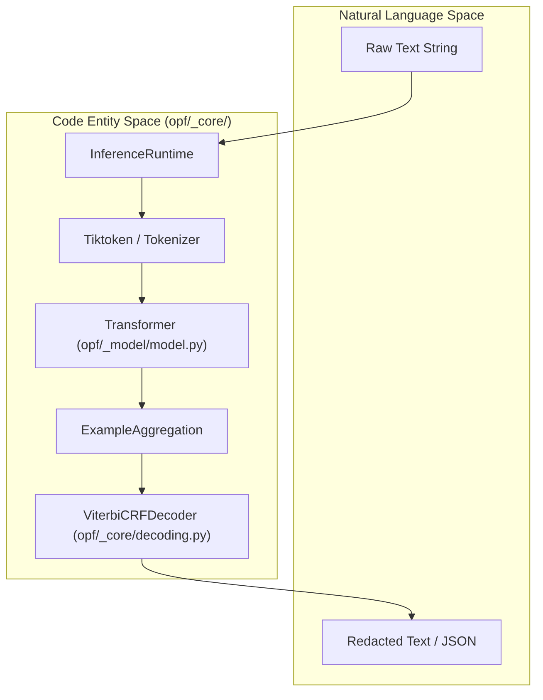
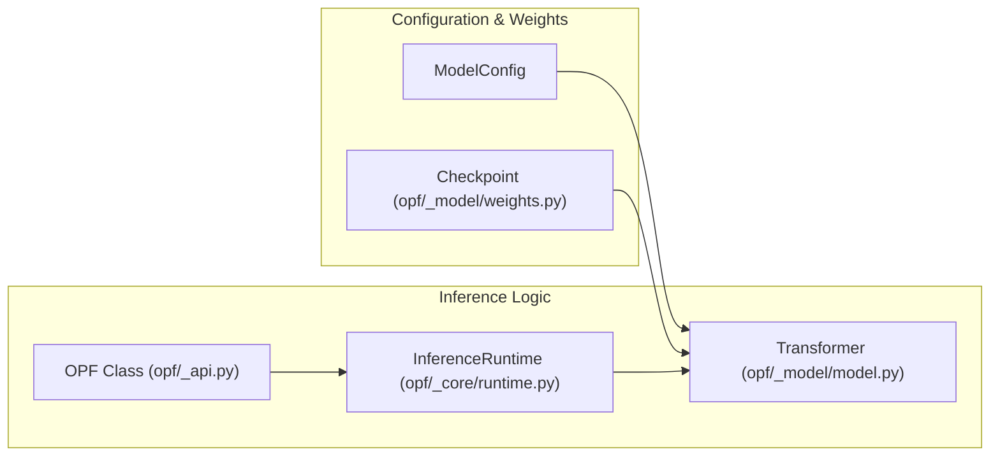

<!-- source: DeepWiki mcp.deepwiki.com · repo openai/privacy-filter · page 1 Overview · fetched 2026-10-26 -->

# Overview

Relevant source files

The following files were used as context for generating this wiki page:

- [.gitignore](.gitignore)
- [LICENSE](LICENSE)
- [README.md](README.md)
- [SECURITY.md](SECURITY.md)

The OpenAI Privacy Filter (OPF) is a specialized bidirectional token-classification system designed for high-throughput detection and redaction of personally identifiable information (PII) [README.md:1-5](). Unlike standard autoregressive models that generate text, OPF labels an entire input sequence in a single forward pass and decodes coherent spans using a constrained Viterbi procedure [README.md:5-6]().

The system is built on a 1.5B parameter transformer architecture with a sparse Mixture-of-Experts (MoE) backbone, where only 50M parameters are active per token [README.md:10-11](). It is released under the Apache 2.0 license for on-premises deployment and fine-tuning [README.md:9-12]().

## Key Capabilities

*   **Bidirectional Context:** Uses bidirectional banded attention (window size 128) to consider both preceding and succeeding context for every token [README.md:103-105]().
*   **Privacy Taxonomy:** Detects 8 core categories: `account_number`, `private_address`, `private_email`, `private_person`, `private_phone`, `private_url`, `private_date`, and `secret` [README.md:123-132]().
*   **High Throughput:** Single-pass labeling and sparse MoE layers enable fast inference on both GPU and CPU [README.md:10-12, 119-121]().
*   **Flexible Deployment:** Supports a CLI for file processing, a Python API for integration, and a fine-tuning pipeline for domain adaptation [README.md:29-84]().

## System Architecture at a Glance

The following diagram illustrates how the high-level privacy filtering request flows through the core code entities.

### Text to Redacted Span Flow

Sources: [README.md:87-93](), [opf/_core/runtime.py:1-50](), [opf/_core/decoding.py:1-20]()

## Core Components

The repository is organized into several functional modules that handle the lifecycle of a privacy model, from weight loading to final span post-processing.

| Module | Responsibility | Key Code Entities |
| :--- | :--- | :--- |
| **Model** | Transformer architecture & MoE | `Transformer`, `MLPBlock`, `AttentionBlock` |
| **Core** | Runtime & Sequence Decoding | `InferenceRuntime`, `ViterbiCRFDecoder`, `predict_text` |
| **CLI** | User interface & Rendering | `opf redact`, `opf eval`, `opf train` |
| **Common** | Shared logic & Taxonomy | `label_space.py`, `BIOES` markers |

### Model & Runtime Relationship
This diagram bridges the system configuration to the specific implementation classes used during inference.

Sources: [README.md:93-94](), [opf/_model/model.py:1-100](), [opf/_api.py:1-30]()

## Navigating the Wiki

This wiki is structured to guide you from basic usage to deep technical customization:

*   **[Getting Started](#1.1)**: Instructions for installing the package via `pip`, managing the `OPF_CHECKPOINT` environment variable, and running your first redaction command [README.md:23-55]().
*   **[Repository Structure](#1.2)**: A detailed map of the directory tree, explaining the purpose of internal modules like `opf/_core` and `opf/_model` [README.md:86-98]().
*   **Model Architecture**: Deep dive into the transformer implementation, including the bidirectional banded attention and the Triton-optimized MoE kernels.
*   **Inference Pipeline**: Detailed walkthrough of how text is windowed, scored, and decoded using Viterbi constraints.
*   **Label Space and Taxonomy**: Explanation of the BIOES (Begin, Inside, Outside, End, Single) labeling scheme and how to define custom categories [README.md:109-110, 134-135]().
*   **CLI and Python API**: Reference for the `opf` command-line tool and the `OPF` Python class for programmatic use [README.md:87-89]().
*   **Evaluation**: How to measure model performance using the `opf eval` suite and synthetic datasets [README.md:67-75]().
*   **Fine-tuning**: Guide to the supervised fine-tuning pipeline for adapting the model to your specific data [README.md:77-84]().

Sources: [README.md:15-100]()

---

