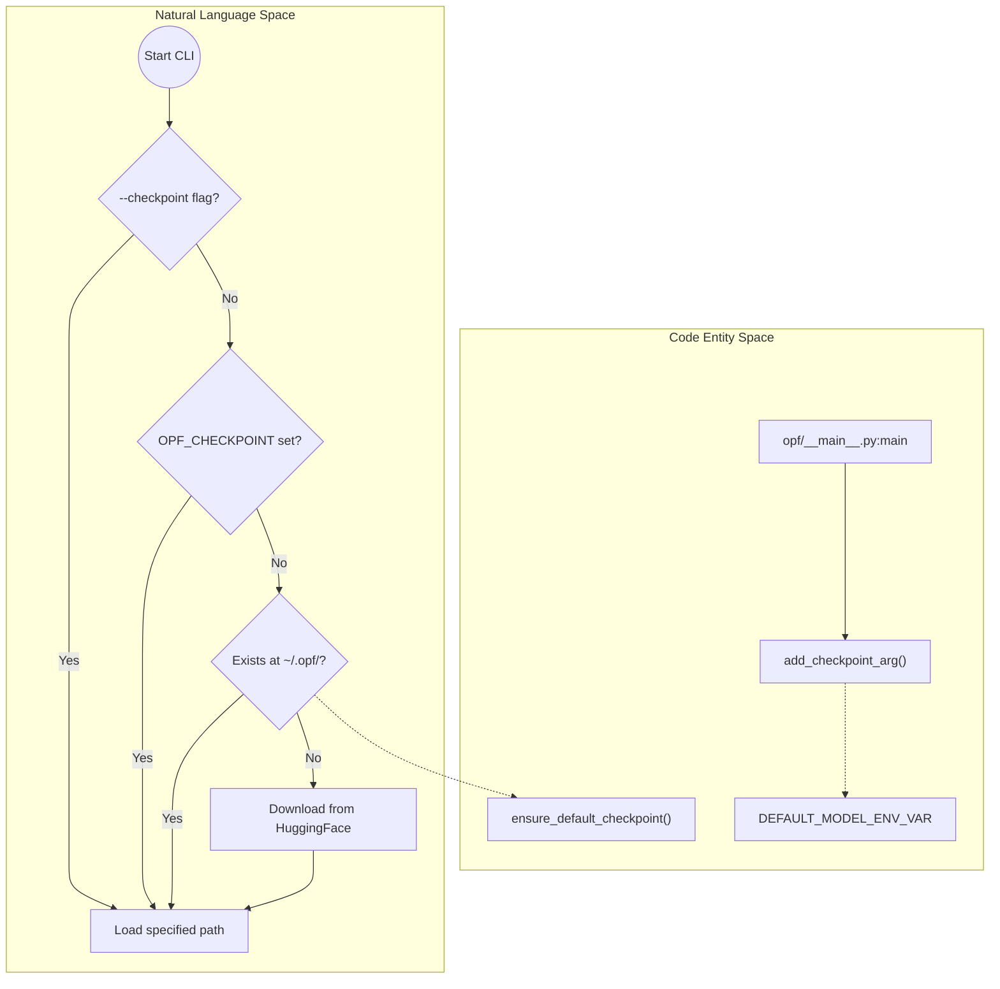
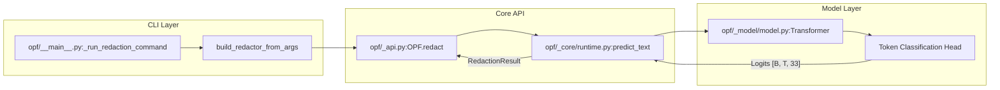

<!-- source: DeepWiki mcp.deepwiki.com · repo openai/privacy-filter · page 1.1 Getting Started · fetched 2026-10-26 -->

# Getting Started

<details>
<summary>Relevant source files</summary>

The following files were used as context for generating this wiki page:

- [README.md](README.md)
- [opf/__main__.py](opf/__main__.py)
- [opf/_common/checkpoint_download.py](opf/_common/checkpoint_download.py)
- [opf/_common/constants.py](opf/_common/constants.py)
- [opf/_common/env.py](opf/_common/env.py)
- [pyproject.toml](pyproject.toml)

</details>


The OpenAI Privacy Filter (OPF) is a bidirectional token-classification system designed for high-throughput PII detection and masking. This page covers the initial setup, installation, and first-run procedures for both the CLI and Python interfaces.

## Installation and Hardware Requirements

OPF is designed to be lightweight, running efficiently on both consumer laptops and server-grade hardware.

### Hardware Requirements
*   **Memory**: The model contains approximately 1.5B total parameters but uses a Sparse Mixture-of-Experts (MoE) architecture with only 50M active parameters per token [README.md:10-10]().
*   **Compute**: Supports both **CPU** and **GPU** (CUDA) execution [README.md:39-43]().
*   **Python Version**: Requires Python >= 3.10 [pyproject.toml:10-10]().

### Pip Install
Install the package in editable mode to make the `opf` command available in your environment:

```bash
pip install -e .
```

This registers the `opf` entry point [pyproject.toml:21-21]() which maps to the `main` function in `opf/__main__.py` [opf/__main__.py:186-209]().

**Sources:** [README.md:10-43](), [pyproject.toml:10-21](), [opf/__main__.py:186-209]()

---

## Checkpoint Management

OPF requires a model checkpoint directory containing `config.json` and `.safetensors` weight files [opf/_common/checkpoint_download.py:27-38]().

### Environment Variables and Paths
The system resolves the model location using the following priority:
1.  The `--checkpoint` CLI flag [README.md:45-49]().
2.  The `OPF_CHECKPOINT` environment variable [opf/_common/constants.py:7-8]().
3.  The default local path: `~/.opf/privacy_filter` [opf/_common/constants.py:10-11]().

### Automatic Download Behavior
If no checkpoint is found at the default path, OPF attempts to download the official weights from HuggingFace (`openai/privacy-filter`) [opf/_common/checkpoint_download.py:11-11]().

**Download Flow:**
1.  **Detection**: `ensure_default_checkpoint()` checks for the existence of the directory [opf/_common/checkpoint_download.py:90-95]().
2.  **Download**: Uses `huggingface_hub.snapshot_download` to fetch the `original/` subtree [opf/_common/checkpoint_download.py:116-121]().
3.  **Promotion**: Moves files from the `original/` subdirectory up to the root checkpoint folder via `_promote_original_subtree()` [opf/_common/checkpoint_download.py:72-87]().

### Checkpoint Resolution Logic
The following diagram illustrates how the `opf` CLI determines which model to load.

**Model Discovery Flow**


**Sources:** [README.md:31-49](), [opf/_common/checkpoint_download.py:11-133](), [opf/_common/constants.py:7-11](), [opf/__main__.py:55-55]()

---

## First-Run Examples

The `opf` CLI supports three primary subcommands: `redact` (default), `eval`, and `train` [opf/__main__.py:14-25]().

### Basic Redaction
To redact a single string:
```bash
opf "Contact Alice at alice@example.com"
```

### Input Methods
The CLI provides flexible ways to ingest data via `iter_inputs()` [opf/_cli/args.py:10-10]():
*   **Positional Argument**: `opf "text"` [opf/__main__.py:50-54]().
*   **File Input**: `opf -f document.txt` [opf/__main__.py:68-77]().
*   **Standard Input (Pipe)**: `cat file.txt | opf` [README.md:59-61]().
*   **Interactive Mode**: Running `opf` without arguments starts a REPL session [README.md:63-63]().

### Redaction Output Modes
The model supports two primary output formats via the `--format` flag [opf/__main__.py:62-67]():

| Format | Output Type | Use Case |
| :--- | :--- | :--- |
| `text` | Plain String | Quick CLI pipes and human reading. |
| `json` | Structured Object | Programmatic integration; includes `detected_spans` and `latency_ms`. |

**Sources:** [README.md:31-63](), [opf/__main__.py:14-82](), [opf/_common/constants.py:13-14]()

---

## Execution Pipeline

When a redaction command is issued, the system initializes an `OPF` API instance and processes the text through the runtime stack.

**Data Flow: CLI to Model**


**Sources:** [opf/__main__.py:96-160](), [README.md:100-134](), [opf/_api.py:88-118]()

---

