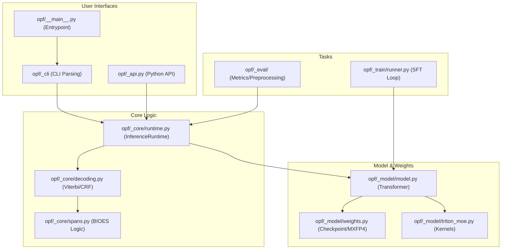
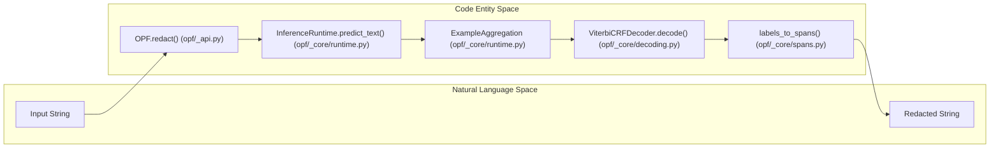

<!-- source: DeepWiki mcp.deepwiki.com · repo openai/privacy-filter · page 1.2 Repository Structure · fetched 2026-10-26 -->

# Repository Structure

Relevant source files

The following files were used as context for generating this wiki page:

- [README.md](README.md)
- [examples/data/README.md](examples/data/README.md)
- [examples/scripts/README.md](examples/scripts/README.md)
- [opf/__init__.py](opf/__init__.py)

This page provides a technical map of the `openai/privacy-filter` repository. It outlines the modular organization of the codebase, detailing how specific directories and modules interact to facilitate inference, evaluation, and fine-tuning of the Privacy Filter model.

## Purpose and Scope

The repository is structured to separate the core transformer implementation from the high-level runtime logic and the CLI interfaces. This separation allows developers to use the Privacy Filter as a standalone library (`opf._api`), a command-line tool (`opf._cli`), or a training framework (`opf._train`). The architecture follows a "core-out" design where `_core` and `_model` contain the fundamental logic, while other modules build upon them.

## Top-Level Structure

The following diagram illustrates the relationship between the major modules and the data flow from input text to redacted output or training artifacts.

**System Architecture and Module Interaction**

**Sources:** [README.md:86-98](), [opf/__init__.py:1-43]()

---

## Core Modules

### `opf/_model`
This module contains the structural definition of the Privacy Filter transformer. It is a bidirectional token-classification model derived from an autoregressive base.

*   **`model.py`**: Defines the `Transformer` class and its constituent blocks: `AttentionBlock` (supporting bidirectional banded attention) and `MLPBlock` (implementing the Sparse MoE). [opf/_model/model.py:1-10]().
*   **`weights.py`**: Handles the `Checkpoint` class, which manages loading `safetensors` and dequantizing weights from MXFP4 format. [opf/_model/weights.py:1-20]().
*   **`triton_moe.py`**: Contains optimized Triton kernels for the Mixture-of-Experts (MoE) layers, specifically `grouped_matmul` and `grouped_swiglu`. [opf/_model/triton_moe.py:1-15]().

### `opf/_core`
The "glue" layer that manages the inference lifecycle and sequence decoding.

*   **`runtime.py`**: Implements the `InferenceRuntime`. This class is responsible for loading the model and tokenizer, and executing the `predict_text` method which handles windowed inference and score aggregation via `ExampleAggregation`. [opf/_core/runtime.py:1-50]().
*   **`decoding.py`**: Contains the `ViterbiCRFDecoder`. It enforces BIOES constraints on the model's logit outputs to ensure coherent span detection. [opf/_core/decoding.py:1-30]().
*   **`spans.py`**: Provides utilities for converting raw token-level labels into `DetectedSpan` objects, including character offset mapping and overlapping span resolution. [opf/_core/spans.py:1-40]().

**Sources:** [README.md:90-93](), [opf/_core/runtime.py:1-50]()

---

## Task-Specific Modules

### `opf/_eval`
The evaluation suite for measuring model performance on labeled datasets.

*   **`data.py` & `preprocess.py`**: Handle loading JSONL datasets and converting them into `PreparedTokenizedExample` formats suitable for the model. [opf/_eval/preprocess.py:1-25]().
*   **`metrics.py`**: Implements `compute_metrics()`, calculating precision, recall, and F1/F2 scores at both the token and span levels. [opf/_eval/metrics.py:1-35]().

### `opf/_train`
The Supervised Fine-Tuning (SFT) implementation.

*   **`runner.py`**: Contains the main training loop (`_train_one_epoch`). It supports remapping the output head for custom label spaces via `_rebuild_output_head_for_target_labels` and manages AdamW optimization. [opf/_train/runner.py:1-60]().

**Sources:** [README.md:91-92](), [opf/_train/runner.py:1-60]()

---

## User Interfaces and Examples

### `opf/_cli` and `opf/_api.py`
The package provides two primary ways to interact with the model:
1.  **CLI**: Managed by `opf/_cli/` and invoked via `opf/__main__.py`. It supports `redact`, `eval`, and `train` subcommands. [README.md:29-84]().
2.  **Python API**: The `OPF` class in `opf/_api.py` provides a high-level interface for developers to integrate redaction into their own Python applications. [opf/__init__.py:24-42]().

### `examples/` Tree
The `examples/` directory provides resources for testing and demonstrating fine-tuning capabilities.

*   **`examples/data/`**: Contains synthetic `.jsonl` files for evaluation and training demos. [examples/data/README.md:1-12]().
*   **`examples/scripts/finetuning/`**: Includes shell scripts like `finetune_secret_demo.sh` and `finetune_custom_label_demo.sh` which serve as end-to-end templates for adapting the model to new data or taxonomies. [examples/scripts/README.md:1-19]().

**Sources:** [README.md:94-98](), [examples/scripts/README.md:1-19]()

---

## Code Entity Mapping

The following diagram maps the logical operations of the system to specific classes and functions within the repository.

**Inference Logic to Code Entity Map**

**Sources:** [opf/_api.py:1-50](), [opf/_core/runtime.py:1-100](), [opf/_core/decoding.py:1-50](), [opf/_core/spans.py:1-50]()

---

