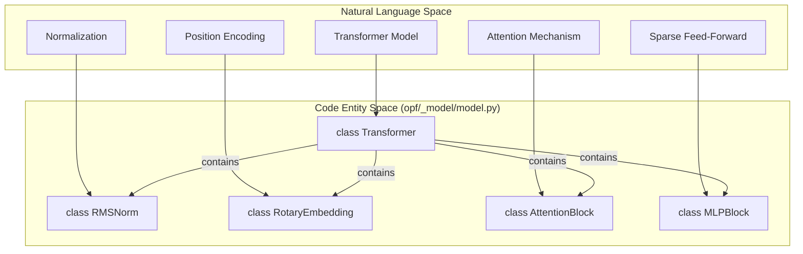
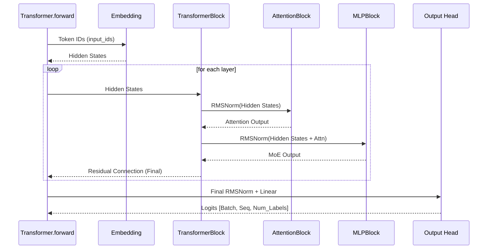

<!-- source: DeepWiki mcp.deepwiki.com · repo openai/privacy-filter · page 2.1 Transformer Implementation · fetched 2026-10-26 -->

# Transformer Implementation

Relevant source files

The following files were used as context for generating this wiki page:

- [opf/_model/__init__.py](opf/_model/__init__.py)
- [opf/_model/model.py](opf/_model/model.py)

The OpenAI Privacy Filter (OPF) utilizes a specialized Transformer architecture designed for high-throughput token classification. The implementation in `opf/_model/model.py` features a bidirectional banded attention mechanism and a sparse Mixture of Experts (MoE) feed-forward network.

## Architecture Overview

The model is a transformer-based encoder that processes token sequences to produce logit distributions over privacy labels (e.g., BIOES tags). It deviates from standard causal transformers by employing bidirectional context within a fixed sliding window.

### Code-to-System Mapping

The following diagram maps the high-level transformer components to their specific class implementations within `opf/_model/model.py`.

**Transformer Entity Map**

**Sources:** [opf/_model/model.py:209-668]()

---

## Model Configuration

The `ModelConfig` dataclass defines the structural hyperparameters of the model. It includes standard transformer parameters (layers, heads, hidden size) alongside MoE-specific and attention-window settings.

| Parameter | Description |
| :--- | :--- |
| `num_hidden_layers` | Total number of transformer blocks. |
| `num_experts` | Total number of experts in the MoE layers. |
| `experts_per_token` | Number of experts active per token (Top-K routing). |
| `sliding_window` | The total attention bandwidth (left + right + 1). |
| `bidirectional_context` | Must be `True` for OPF checkpoints. |
| `param_dtype` | Resolved via `_resolve_param_dtype` (typically `bf16`). |

**Sources:** [opf/_model/model.py:209-247](), [opf/_model/model.py:33-40]()

---

## Core Components

### RMSNorm
The model uses Root Mean Square Layer Normalization (`RMSNorm`) to stabilize activations. It applies a learnable weight `self.weight` to the normalized input.
**Sources:** [opf/_model/model.py:284-301]()

### Rotary Embedding (YaRN Scaling)
The `RotaryEmbedding` class implements position information using Rotary Positional Embeddings (RoPE). It supports **YaRN (Yet another RoPE extensioN)** scaling to handle long context lengths by interpolating frequencies based on `rope_scaling_factor`, `rope_ntk_alpha`, and `rope_ntk_beta`.
**Sources:** [opf/_model/model.py:304-368]()

### AttentionBlock (GQA & Banded Attention)
The `AttentionBlock` implements Grouped-Query Attention (GQA) and a bidirectional sliding window.

*   **GQA:** Uses `num_attention_heads` for queries and a smaller `num_key_value_heads` for keys/values to reduce memory overhead.
*   **Banded Attention:** Instead of a full $N \times N$ matrix, it computes attention within a window defined by `bidirectional_left_context` and `bidirectional_right_context`.
*   **Sink Logits:** A unique feature where a "sink" logit is prepended to the attention scores, allowing tokens to "attend to nothing" if the context is irrelevant.

**Sources:** [opf/_model/model.py:371-512]()

### MLPBlock (Sparse MoE)
The `MLPBlock` provides the sparse feed-forward capacity.

1.  **Routing:** A `gate` linear layer projects the input to expert logits. `torch.topk` selects the top `experts_per_token`.
2.  **Activation:** Uses **SwiGLU** (or GeGLU if configured).
3.  **Kernels:** If `OPF_MOE_TRITON` is enabled, it uses `grouped_matmul` and `grouped_swiglu_w2` for high-performance execution. Otherwise, it falls back to a pure PyTorch `_batched_linear_with_parity` implementation.

**Sources:** [opf/_model/model.py:515-603](), [opf/_model/model.py:53-67]()

---

## Transformer Forward Pass

The `Transformer` class coordinates the data flow from raw token IDs to label logits.

**Data Flow Diagram**

### Implementation Details
*   **Embedding:** Token IDs are mapped via `self.tok_embeddings` [opf/_model/model.py:648]().
*   **Layer Loop:** The model iterates through `self.layers`, where each `TransformerBlock` encapsulates one `AttentionBlock` and one `MLPBlock` [opf/_model/model.py:651-654]().
*   **Output Head:** The final hidden state is normalized and projected to the label space using `self.output` [opf/_model/model.py:663-668]().

**Sources:** [opf/_model/model.py:606-668]()

---

## Checkpoint Loading
The `Transformer.from_checkpoint` method facilitates model instantiation. It:
1.  Loads the `config.json` and validates it against the `REQUIRED_ENCODER_CONFIG_KEYS`.
2.  Initializes the `Transformer` on the `meta` device to save memory.
3.  Uses the `Checkpoint` class to load and dequantize (if necessary) weights into the model.

**Sources:** [opf/_model/model.py:612-642](), [opf/_model/model.py:106-161]()

---

