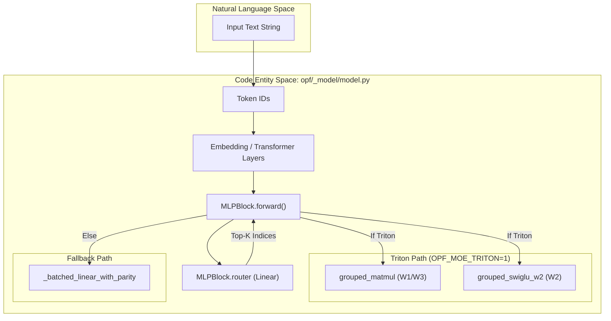
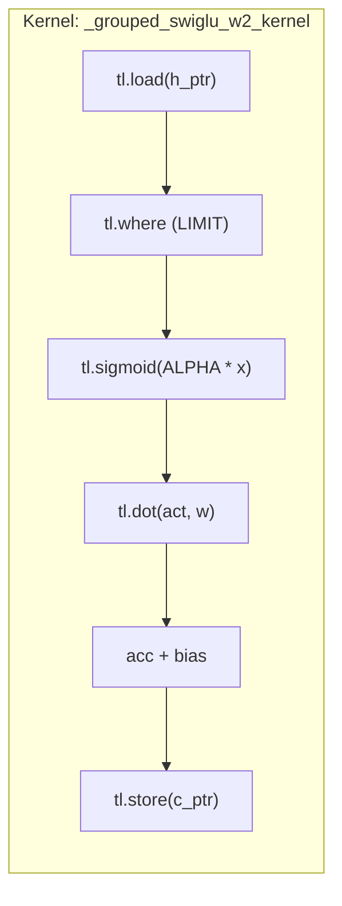

<!-- source: DeepWiki mcp.deepwiki.com · repo openai/privacy-filter · page 2.2 Triton MoE Kernels · fetched 2026-10-26 -->

# Triton MoE Kernels

Relevant source files

The following files were used as context for generating this wiki page:

- [opf/_model/model.py](opf/_model/model.py)
- [opf/_model/triton_moe.py](opf/_model/triton_moe.py)

The OpenAI Privacy Filter (OPF) uses a Sparse Mixture of Experts (MoE) architecture. To optimize the performance of these MoE layers on NVIDIA GPUs, the codebase provides optional high-performance kernels written in Triton. These kernels specifically target the bottleneck of MoE inference: performing many small, expert-specific matrix multiplications on non-contiguous token assignments.

## Overview and Activation

The Triton kernels are defined in `opf/_model/triton_moe.py` and are used within the `MLPBlock` of the transformer. They are activated only when the environment variable `OPF_MOE_TRITON` is set to `true` [opf/_model/model.py:284-285]().

If Triton is unavailable (e.g., the `triton` package is not installed or the environment variable is not set), the model transparently falls back to a pure-PyTorch implementation using `torch.bmm` [opf/_model/model.py:53-67]().

### Data Flow: Natural Language to Kernel Space

The following diagram illustrates how input tokens are routed through the MoE system into the specialized Triton kernels.

**MoE Kernel Execution Path**

**Sources:** [opf/_model/model.py:247-320](), [opf/_model/triton_moe.py:1-9]()

---

## Grouped Matrix Multiplication (`grouped_matmul`)

The `grouped_matmul` kernel handles the first stage of the MoE projection (weights $W_1$ and $W_3$). In a standard transformer, this would be a single large GEMM. In MoE, tokens are scattered across different experts. This kernel avoids the memory overhead of padding or the latency of launching hundreds of individual CUDA kernels by processing all experts in a single "grouped" launch.

### Implementation Details
- **Function:** `grouped_matmul(a_packed, weights, offsets, lengths, ...)` [opf/_model/triton_moe.py:82-89]()
- **Input `a_packed`**: A 2D tensor `[M, K]` containing the tokens assigned to all experts, sorted/packed by expert ID [opf/_model/triton_moe.py:91]().
- **Weights**: A 3D tensor `[E, K, N]` where $E$ is the number of experts [opf/_model/triton_moe.py:97]().
- **Tiling**: The kernel uses a 3D grid `(BLOCK_M, BLOCK_N, E)` where the third dimension corresponds to the expert ID [opf/_model/triton_moe.py:119]().

**Sources:** [opf/_model/triton_moe.py:11-80](), [opf/_model/triton_moe.py:82-142]()

---

## Fused SwiGLU Kernel (`grouped_swiglu_w2`)

The `grouped_swiglu_w2` kernel is a specialized fusion. In the Privacy Filter architecture, the MoE block uses a SwiGLU activation. This kernel performs three operations in one:
1. **SwiGLU Activation**: Applies $x \cdot \text{sigmoid}(\alpha \cdot x) \cdot (y + 1)$ to the intermediate expert outputs [opf/_model/triton_moe.py:221]().
2. **Clamping**: Limits activation values based on `swiglu_limit` to maintain numerical stability [opf/_model/triton_moe.py:215-217]().
3. **Output Projection ($W_2$)**: Multiplies the activated values by the expert's $W_2$ weight matrix [opf/_model/triton_moe.py:235]().

### Kernel Logic Association

**Sources:** [opf/_model/triton_moe.py:146-246]()

---

## Integration in `MLPBlock`

The `MLPBlock` class in `opf/_model/model.py` manages the transition between PyTorch tensors and these Triton kernels.

### Execution Logic
1. **Routing**: The router determines which tokens go to which experts [opf/_model/model.py:269-270]().
2. **Packing**: Tokens are grouped by expert.
3. **Kernel Dispatch**:
    - If `use_triton` is true, it calls `grouped_matmul` for the up-projection and `grouped_swiglu_w2` for the combined activation and down-projection [opf/_model/model.py:287-302]().
    - It uses `alpha=1.702` (standard for GeGLU/SwiGLU variants in this model) and a `swiglu_limit` (default `7.0`) [opf/_model/model.py:220](), [opf/_model/triton_moe.py:256]().

| Feature | Triton Path | Fallback Path |
| :--- | :--- | :--- |
| **Activation** | Fused in `grouped_swiglu_w2` | Manual `F.silu` or `F.gelu` [opf/_model/model.py:311]() |
| **MatMul** | Grouped Kernel [opf/_model/triton_moe.py:82]() | `torch.bmm` [opf/_model/model.py:64]() |
| **Memory** | Efficient (Packed) | Requires expert-dimension expansion [opf/_model/model.py:62-63]() |

**Sources:** [opf/_model/model.py:247-320](), [opf/_model/triton_moe.py:248-260]()

---

