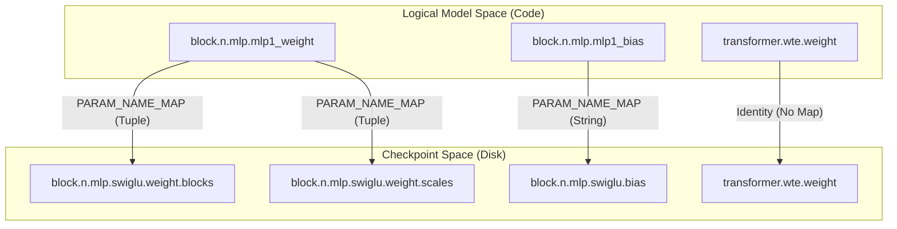
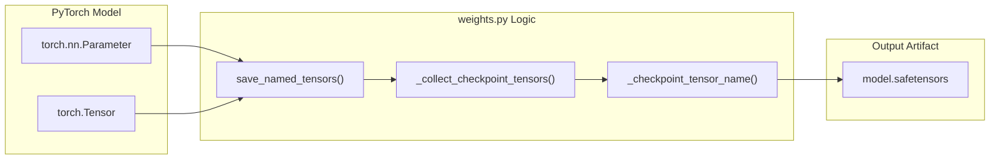

<!-- source: DeepWiki mcp.deepwiki.com · repo openai/privacy-filter · page 2.3 Checkpoint Loading and Weight Serialization · fetched 2026-10-26 -->

# Checkpoint Loading and Weight Serialization

Relevant source files

The following files were used as context for generating this wiki page:

- [opf/_model/model.py](opf/_model/model.py)
- [opf/_model/weights.py](opf/_model/weights.py)

The OpenAI Privacy Filter (OPF) uses the `safetensors` format for high-performance, memory-mapped weight loading and serialization. The system supports both standard `bfloat16`/`float32` tensors and a specialized **MXFP4** dequantization path for compressed model weights.

## The Checkpoint Class

The `Checkpoint` class in `opf/_model/weights.py` serves as the primary interface for accessing model parameters from disk. It abstracts away the physical sharding of `.safetensors` files and handles the translation between logical model parameter names and their serialized counterparts [opf/_model/weights.py:97-101]().

### Initialization and Indexing
Upon initialization, the class scans the provided directory for all files with the `.safetensors` extension [opf/_model/weights.py:110-114](). It builds a global mapping of tensor names to their respective file paths to support efficient retrieval [opf/_model/weights.py:116-128]().

### Parameter Resolution Logic
When `get(name)` is called, the class follows a specific resolution hierarchy:
1. **Name Mapping**: It checks `PARAM_NAME_MAP` to see if the logical name requires translation [opf/_model/weights.py:132]().
2. **Hybrid Loading**: If a parameter is mapped to a tuple (indicating a potential MXFP4 quantized pair), it first looks for a fused `bf16` version on disk. If absent, it triggers the `_get_mxfp4_tensor` dequantization routine [opf/_model/weights.py:133-140]().
3. **Direct Loading**: If no mapping exists or it is a simple string mapping, it loads the raw tensor via `safe_open` [opf/_model/weights.py:155-163]().

**Sources:** [opf/_model/weights.py:97-163]()

## Weight Translation (PARAM_NAME_MAP)

The OPF model implementation uses a standardized naming convention (e.g., `block.N.mlp.mlp1_weight`), but the on-disk checkpoints often use different keys, particularly for Mixture-of-Experts (MoE) layers and quantized formats.

`PARAM_NAME_MAP` defines these translations:
* **MLP Biases**: Logical `mlp1_bias` maps to `swiglu.bias` and `mlp2_bias` maps to `out.bias` [opf/_model/weights.py:33-41]().
* **Quantized Weights**: Logical weights like `mlp1_weight` are mapped to a tuple containing `.blocks` and `.scales` keys [opf/_model/weights.py:35-48]().

### Logical to Physical Name Mapping
Title: Weight Name Translation Flow

**Sources:** [opf/_model/weights.py:32-49](), [opf/_model/weights.py:52-59]()

## MXFP4 Dequantization

OPF supports loading weights compressed using Microscaling Formats (MX). Specifically, it implements dequantization for 4-bit floating point values (FP4) with shared exponents.

### Dequantization Process
The `_get_mxfp4_tensor` method reconstructs dense tensors from two components:
1. **Blocks**: The 4-bit nibbles packed into bytes.
2. **Scales**: Exponents used to scale the blocks [opf/_model/weights.py:181-182]().

The implementation uses a Look-Up Table (LUT) defined in `FP4_VALUES` to map 4-bit indices to their floating-point representatives [opf/_model/weights.py:12-29](). The process involves:
* Bit-shifting to extract high and low nibbles [opf/_model/weights.py:206-207]().
* Applying the formula: `value = LUT[nibble] * 2^scale` [opf/_model/weights.py:209-210]().
* Chunked processing to manage memory overhead during reconstruction [opf/_model/weights.py:198-212]().

**Sources:** [opf/_model/weights.py:12-29](), [opf/_model/weights.py:165-212]()

## Serialization and Saving

The serialization path is used primarily during fine-tuning to save updated model weights. This is handled by `save_named_tensors`.

### Data Flow for Saving
1. **Collection**: `_collect_checkpoint_tensors` iterates through the model's `named_parameters()` [opf/_model/weights.py:68-69]().
2. **Name Translation**: It uses `_checkpoint_tensor_name` to revert logical names back to the expected on-disk keys [opf/_model/weights.py:70]().
3. **Normalization**: Tensors are detached, converted to the target `dtype` (usually `bf16`), made contiguous, and moved to CPU [opf/_model/weights.py:71-74]().
4. **Validation**: It ensures no two logical tensors collide on the same checkpoint key [opf/_model/weights.py:75-81]().
5. **Persistence**: The resulting dictionary is written to a single `.safetensors` file using `safetensors.torch.save_file` [opf/_model/weights.py:94]().

### Serialization Entity Mapping
Title: Serialization Data Flow

**Sources:** [opf/_model/weights.py:52-60](), [opf/_model/weights.py:62-82](), [opf/_model/weights.py:85-94]()

## Integration with Model Loading

The `Transformer` class in `opf/_model/model.py` utilizes the `Checkpoint` class during its `from_checkpoint` factory method.

1. **Config Validation**: The `config.json` is first validated against the `REQUIRED_ENCODER_CONFIG_KEYS` [opf/_model/model.py:106-162]().
2. **Weight Assignment**: For every module in the transformer (Attention, MLP, MoE), the model calls `checkpoint.get(name)` to retrieve the tensor and loads it into the allocated PyTorch parameters [opf/_model/model.py:1255-1280]().
3. **Dtype Handling**: The `param_dtype` specified in the config determines whether weights are loaded as `bfloat16` or `float32` [opf/_model/model.py:25-40]().

**Sources:** [opf/_model/model.py:25-40](), [opf/_model/model.py:71-94](), [opf/_model/model.py:1255-1280]()

---

