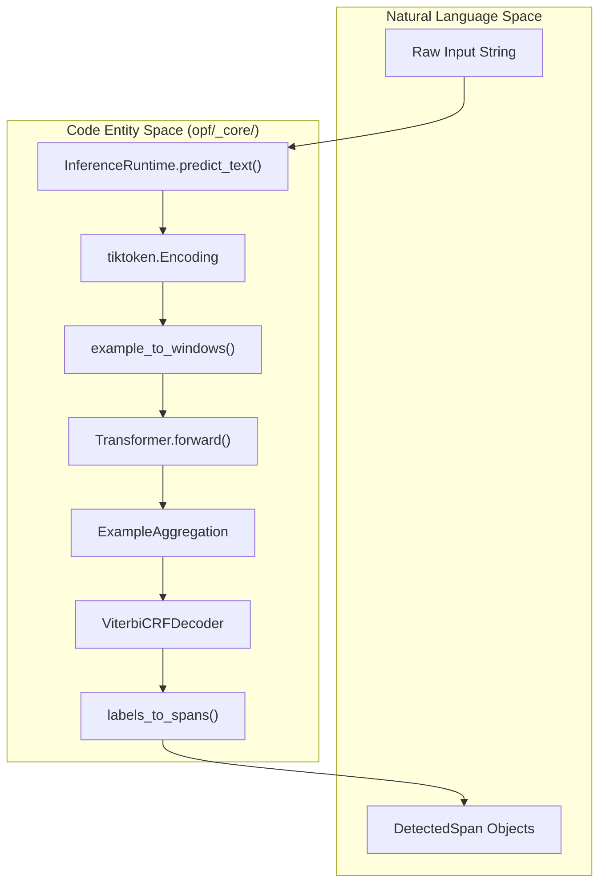
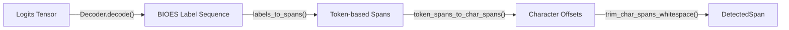

<!-- source: DeepWiki mcp.deepwiki.com · repo openai/privacy-filter · page 3 Inference Pipeline · fetched 2026-10-26 -->

# Inference Pipeline

Relevant source files

The following files were used as context for generating this wiki page:

- [opf/_core/__init__.py](opf/_core/__init__.py)
- [opf/_core/runtime.py](opf/_core/runtime.py)

The inference pipeline in the OpenAI Privacy Filter (OPF) transforms raw text strings into structured redaction results. This process involves a windowed transformer forward pass, logit aggregation across overlapping segments, and a decoding stage that converts token-level predictions back into character-level spans.

### Pipeline Overview

The pipeline is managed by the `InferenceRuntime` class, which orchestrates the transition from "Natural Language Space" (raw text) to "Code Entity Space" (tensor operations and span objects).

#### High-Level Flow
1.  **Tokenization**: The input text is converted into a sequence of token IDs using `tiktoken`.
2.  **Windowing**: The sequence is sliced into overlapping windows to fit the model's context length (`n_ctx`).
3.  **Forward Pass**: The `Transformer` model generates logits for each token in each window.
4.  **Aggregation**: Logits from overlapping windows are merged back into a single sequence using `ExampleAggregation`.
5.  **Decoding**: A decoder (typically `ViterbiCRFDecoder`) converts logits into a sequence of BIOES labels.
6.  **Span Reconstruction**: Labels are mapped back to character offsets in the original text to produce `DetectedSpan` objects.

### System Architecture: Text to Spans

The following diagram illustrates how internal code entities interact to process a single text input.

**Diagram: Inference Execution Flow**

Sources: [opf/_core/runtime.py:43-59](), [opf/_core/runtime.py:236-258](), [opf/_core/sequence_labeling.py:33-38]()

### Runtime and Prediction
The `InferenceRuntime` dataclass serves as the primary entry point for inference. It encapsulates the loaded `Transformer` model, the `tiktoken` encoding, and the `LabelInfo` which defines the target taxonomy (e.g., v4, v7).

When `predict_text` is called, the system performs a windowed inference loop. Because the model uses bidirectional context, windows are typically overlapped to ensure that tokens at the edges of a window benefit from surrounding context. The `ExampleAggregation` class manages these overlapping predictions, ensuring that logits are correctly averaged or selected before decoding begins.

For details, see [Runtime and Prediction](#3.1).

Sources: [opf/_core/runtime.py:43-59](), [opf/_core/runtime.py:236-285](), [opf/_core/sequence_labeling.py:165-192]()

### Sequence Decoding
Once aggregated logits are produced, they must be converted into a discrete sequence of labels (e.g., `B-PERSON`, `I-PERSON`, `O`). The pipeline supports two main decoding modes:
*   **Argmax**: A simple per-token maximum likelihood selection.
*   **Viterbi CRF**: A more robust method that uses transition scores to enforce BIOES constraints (e.g., an `I-` tag cannot follow an `O` tag).

The `ViterbiCRFDecoder` utilizes a `viterbi_calibration.json` file to apply specific biases to start, end, and transition probabilities, allowing the model to be tuned for specific precision/recall operating points.

For details, see [Sequence Decoding](#3.2).

Sources: [opf/_core/decoding.py:100-140](), [opf/_core/runtime.py:261-275]()

### Span Utilities and Offsets
The final stage of the pipeline translates token-level labels back into character-level offsets. This is a non-trivial task due to the way `tiktoken` handles byte-level UTF-8 sequences. 

The `labels_to_spans` function implements a state machine to group BIOES tokens into coherent entities. These are then passed through `token_spans_to_char_spans`, which uses byte-to-character mapping to ensure the redaction spans align perfectly with the original user input, even in the presence of multi-byte characters or whitespace trimming requirements.

For details, see [Span Utilities and Character Offsets](#3.3).

**Diagram: Span Reconstruction Logic**

Sources: [opf/_core/spans.py:48-60](), [opf/_core/spans.py:134-150](), [opf/_core/runtime.py:287-305]()

### Inference Configuration Summary

| Component | Responsibility | Key Class/Function |
| :--- | :--- | :--- |
| **Runtime** | Model loading & loop orchestration | `InferenceRuntime` |
| **Windowing** | Splitting long text into chunks | `example_to_windows` |
| **Aggregation** | Merging logits from overlaps | `ExampleAggregation` |
| **Decoding** | Constrained sequence prediction | `ViterbiCRFDecoder` |
| **Alignment** | Mapping tokens to UTF-8 characters | `decode_text_with_offsets` |

Sources: [opf/_core/runtime.py:205-234](), [opf/_core/sequence_labeling.py:132-150](), [opf/_core/spans.py:236-250]()

---

