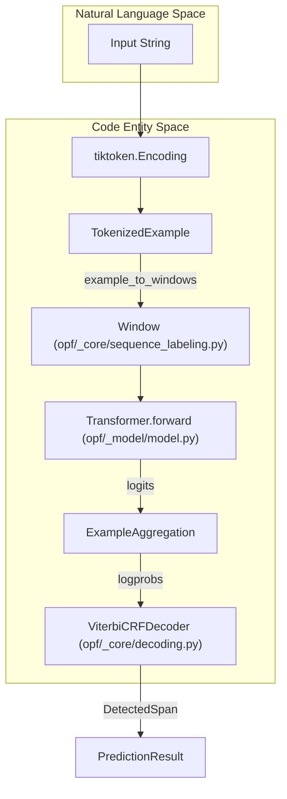
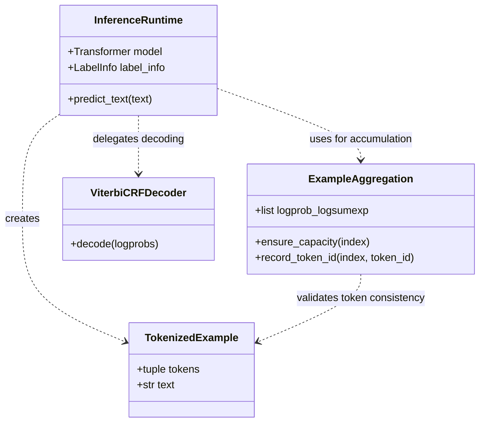

<!-- source: DeepWiki mcp.deepwiki.com · repo openai/privacy-filter · page 3.1 Runtime and Prediction · fetched 2026-10-26 -->

# Runtime and Prediction

Relevant source files

The following files were used as context for generating this wiki page:

- [opf/_core/runtime.py](opf/_core/runtime.py)
- [opf/_core/sequence_labeling.py](opf/_core/sequence_labeling.py)

The Runtime and Prediction module provides the core execution engine for the OpenAI Privacy Filter. It manages the lifecycle of the model, from loading checkpoints and resolving label spaces to performing windowed inference on arbitrary text strings.

## Overview

The primary entry point for inference is `predict_text`, which coordinates tokenization, windowed model passes, and result aggregation. The runtime state is encapsulated in the `InferenceRuntime` dataclass, which ensures that model configurations, tokenizers, and label taxonomies remain synchronized during the prediction process.

### Key Data Structures

| Class | Description | File |
| :--- | :--- | :--- |
| `InferenceRuntime` | A frozen dataclass containing the loaded `Transformer` model, `tiktoken` encoding, and `LabelInfo` metadata. | [opf/_core/runtime.py:43-59]() |
| `DetectedSpan` | Represents a single identified entity with character offsets, label, and a display placeholder. | [opf/_core/runtime.py:62-70]() |
| `PredictionResult` | The final output of a prediction call, containing the original text and a tuple of `DetectedSpan` objects. | [opf/_core/runtime.py:73-79]() |
| `ExampleAggregation` | A helper class used to accumulate log-probabilities and token metadata across overlapping inference windows. | [opf/_core/sequence_labeling.py:51-58]() |

**Sources:** [opf/_core/runtime.py:42-80](), [opf/_core/sequence_labeling.py:50-59]()

---

## Runtime Initialization

Loading the runtime involves validating the checkpoint directory, resolving the transformer configuration, and setting up the label space.

### Checkpoint Validation and Loading
The `load_inference_runtime` function performs the following steps:
1. **Directory Validation**: Ensures `config.json` and at least one `.safetensors` file exist [opf/_core/runtime.py:166-179]().
2. **Context Resolution**: Determines `n_ctx` by checking the override, then the checkpoint config fields (`default_n_ctx`, `initial_context_length`, or `max_position_embeddings`), defaulting to 4096 [opf/_core/runtime.py:133-163]().
3. **Label Space Resolution**: Calls `resolve_label_space_from_config` to map the model's output head to BIOES categories [opf/_core/runtime.py:230-234]().
4. **Model Instantiation**: Initializes the `Transformer` architecture and loads weights using the `Checkpoint` utility [opf/_core/runtime.py:237-250]().

### Label Space Resolution
The `LabelInfo` object is constructed via `build_label_info`. This function parses the list of class names (e.g., `B-person`, `I-person`, `O`) and builds lookup tables for boundary tags and span classifications [opf/_core/sequence_labeling.py:81-127](). It strictly enforces that the background label `O` is present and that all BIOES prefixes are accounted for [opf/_core/sequence_labeling.py:107-116]().

**Sources:** [opf/_core/runtime.py:121-267](), [opf/_core/sequence_labeling.py:81-127]()

---

## Prediction Pipeline

The prediction flow transforms raw text into structured spans through a multi-stage pipeline.

### Inference Data Flow
The following diagram illustrates the transition from Natural Language Space (text) to Code Entity Space (tensors and spans).

**Text to Span Data Flow**

**Sources:** [opf/_core/runtime.py:270-366](), [opf/_core/sequence_labeling.py:130-169]()

### Windowed Inference
Since input text can exceed the model's context window (`n_ctx`), the runtime employs a windowing strategy:
1. **Tokenization**: Text is converted to tokens, and a `TokenizedExample` is created [opf/_core/runtime.py:302-308]().
2. **Windowing**: `example_to_windows` splits the sequence into chunks of size `n_ctx` [opf/_core/sequence_labeling.py:130-169]().
3. **Forward Pass**: Each window is processed by `Transformer.forward`. Log-probabilities are extracted using `F.log_softmax` [opf/_core/runtime.py:330-335]().
4. **Aggregation**: `ExampleAggregation` stores the log-probabilities for every token position. If windows overlap, scores are combined via `torch.logsumexp` [opf/_core/runtime.py:336-342]().

### Decoding and Post-processing
Once all windows are aggregated, the sequence of log-probabilities is decoded:
1. **Viterbi Decoding**: The `ViterbiCRFDecoder` (or a simple argmax fallback) determines the most likely sequence of BIOES tags [opf/_core/runtime.py:349-355]().
2. **Span Extraction**: `labels_to_spans` converts the tag sequence into token-level spans, which are then mapped to character offsets via `token_spans_to_char_spans` [opf/_core/runtime.py:358-361]().
3. **Refinement**: Spans are optionally trimmed of whitespace and overlapping predictions are discarded using a left-to-right greedy selection in `_select_non_overlapping_spans` [opf/_core/runtime.py:188-202]().
4. **Output Mode**: If `output_mode` is set to `"redacted"`, all specific labels (e.g., `EMAIL_ADDRESS`) are replaced with a generic `REDACTED` label and placeholder [opf/_core/runtime.py:99-118]().

### Implementation Class Diagram
This diagram maps the logical components of the prediction loop to their implementation classes.

**Prediction Logic Class Map**

**Sources:** [opf/_core/runtime.py:43-59](), [opf/_core/sequence_labeling.py:29-36](), [opf/_core/sequence_labeling.py:51-58](), [opf/_core/decoding.py:126-138]()

**Sources:** [opf/_core/runtime.py:188-202](), [opf/_core/runtime.py:270-366](), [opf/_core/sequence_labeling.py:130-169]()

---

