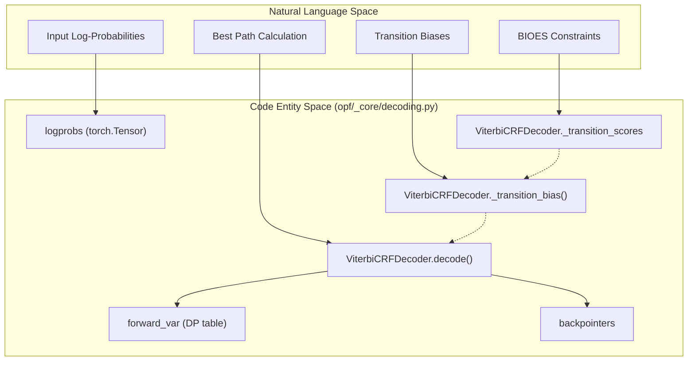
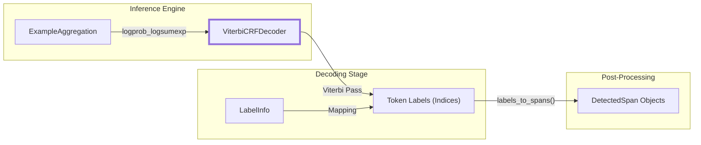

<!-- source: DeepWiki mcp.deepwiki.com · repo openai/privacy-filter · page 3.2 Sequence Decoding · fetched 2026-10-26 -->

# Sequence Decoding

<details>
<summary>Relevant source files</summary>

The following files were used as context for generating this wiki page:

- [opf/_core/decoding.py](opf/_core/decoding.py)
- [opf/_core/sequence_labeling.py](opf/_core/sequence_labeling.py)

</details>


The sequence decoding stage converts raw token-level log-probabilities into a coherent sequence of BIOES (Begin, Inside, Outside, End, Single) labels. This process ensures that the output spans adhere to logical boundary constraints (e.g., an "Inside" tag cannot follow an "Outside" tag) and allows for the adjustment of precision/recall trade-offs via transition biases.

## ViterbiCRFDecoder

The `ViterbiCRFDecoder` class is the primary engine for sequence decoding in OPF. It implements a Viterbi algorithm that combines model emission scores with a transition matrix to find the most likely valid sequence of labels [[opf/_core/decoding.py:132-134]]().

### Transition Constraints and BIOES Enforcement

During initialization, the decoder precomputes transition, start, and end score tables based on the provided `LabelInfo` [[opf/_core/decoding.py:144-150]](). It enforces strict BIOES logic by assigning a large negative penalty (`_NEG_INF`) to impossible transitions [[opf/_core/decoding.py:15-15, 172-180]]().

The following table summarizes the transition logic implemented in `_is_valid_transition` [[opf/_core/decoding.py:221-255]]():

| Current Tag | Valid Next Tag(s) | Description |
| :--- | :--- | :--- |
| **O** (Background) | O, B, S | Can stay background, start a multi-token span, or emit a single-token span. |
| **B** (Begin) | I, E | Must be followed by an Inside or End tag of the same category. |
| **I** (Inside) | I, E | Must continue the span or end it. |
| **E** (End) | O, B, S | Must return to background or immediately start a new span. |
| **S** (Single) | O, B, S | Must return to background or start a new span. |

### Transition Bias Parameters

The decoder supports six parameters to bias the transitions, allowing fine-grained control over the model's behavior [[opf/_core/decoding.py:18-25, 136-141]]():

1.  `transition_bias_background_stay`: Bias for staying in the 'O' state.
2.  `transition_bias_background_to_start`: Bias for moving from 'O' to 'B' or 'S'.
3.  `transition_bias_inside_to_continue`: Bias for staying in 'I' or moving from 'B' to 'I'.
4.  `transition_bias_inside_to_end`: Bias for moving to 'E' or 'S'.
5.  `transition_bias_end_to_background`: Bias for moving from 'E' or 'S' to 'O'.
6.  `transition_bias_end_to_start`: Bias for moving from 'E' or 'S' to a new 'B' or 'S'.

Sources: `[opf/_core/decoding.py:15-25](), [opf/_core/decoding.py:132-190](), [opf/_core/decoding.py:221-255]()`

## Calibration and Operating Points

The decoder can be configured using a `viterbi_calibration.json` file. This artifact defines "operating points" that contain pre-tuned bias values for specific performance targets.

### Viterbi Calibration Format

The artifact follows a nested structure where the `default` operating point is used to resolve biases [[opf/_core/decoding.py:95-128]]().

```json
{
  "operating_points": {
    "default": {
      "biases": {
        "transition_bias_background_stay": 0.0,
        "transition_bias_background_to_start": -1.5,
        "transition_bias_inside_to_continue": 0.5,
        "transition_bias_inside_to_end": 0.0,
        "transition_bias_end_to_background": 0.0,
        "transition_bias_end_to_start": -2.0
      }
    }
  }
}
```

### Bias Resolution Flow

The `resolve_viterbi_biases_from_calibration_path` function parses this JSON and validates that all required keys are present before returning a dictionary of floats to the `ViterbiCRFDecoder` [[opf/_core/decoding.py:84-128]]().

Sources: `[opf/_core/decoding.py:26-26](), [opf/_core/decoding.py:84-128]()`

## Decoding Implementation

### Viterbi Algorithm (Batched CUDA)

The `decode` method performs the Viterbi pass. It is optimized for PyTorch and can run on CUDA devices. It processes a batch of log-probabilities (shape `[batch, seq_len, num_labels]`) and returns the most likely sequence of token indices [[opf/_core/decoding.py:314-368]]().

**Natural Language to Code Space: Viterbi Logic**


### Argmax Fallback

If no Viterbi calibration is provided and a simple decoding is requested, the system can fallback to a standard `argmax` operation over the token log-probabilities, though this does not guarantee BIOES consistency [[opf/_core/decoding.py:371-378]]().

Sources: `[opf/_core/decoding.py:314-368](), [opf/_core/decoding.py:371-378]()`

## Data Flow: From Scores to Spans

The decoding process is a bridge between the model's raw output and the high-level span detection.

**System Data Flow**


1.  **Aggregation**: `ExampleAggregation` provides the averaged log-probabilities from overlapping inference windows [[opf/_core/sequence_labeling.py:51-58]]().
2.  **Decoding**: `ViterbiCRFDecoder.decode` processes these scores using the transition matrix to produce a sequence of label indices [[opf/_core/decoding.py:314-320]]().
3.  **Mapping**: The `LabelInfo` object provides the metadata necessary to interpret these indices (e.g., which index corresponds to `B-PER`) [[opf/_core/sequence_labeling.py:16-25]]().
4.  **Span Extraction**: The resulting labels are passed to utilities (described in Page 3.3) to form discrete character-level spans.

Sources: `[opf/_core/decoding.py:132-141](), [opf/_core/sequence_labeling.py:16-25](), [opf/_core/sequence_labeling.py:51-58]()`

---

