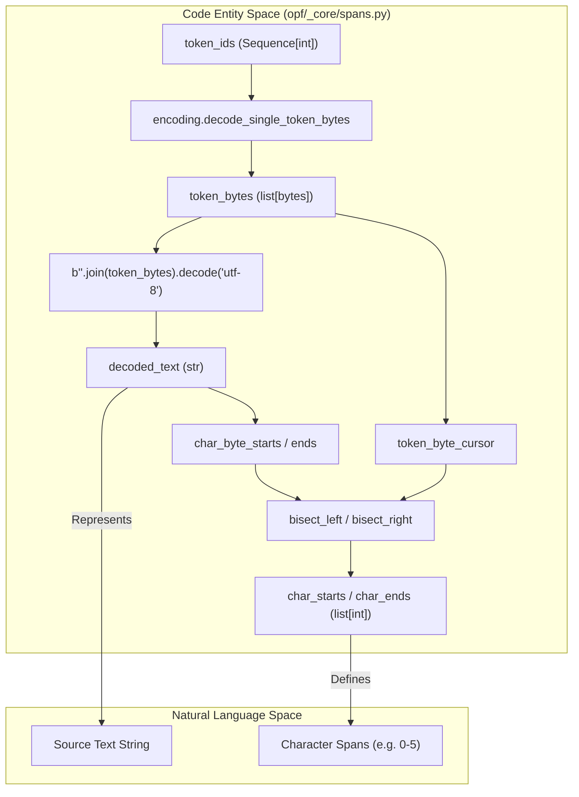
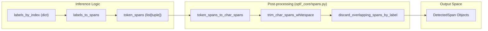

<!-- source: DeepWiki mcp.deepwiki.com · repo openai/privacy-filter · page 3.3 Span Utilities and Character Offsets · fetched 2026-10-26 -->

# Span Utilities and Character Offsets

Relevant source files

The following files were used as context for generating this wiki page:

- [opf/_core/sequence_labeling.py](opf/_core/sequence_labeling.py)
- [opf/_core/spans.py](opf/_core/spans.py)

This page details the utilities in `opf/_core/spans.py` responsible for converting raw model predictions (token-level labels) into human-readable character offsets and spans. It covers the BIOES state machine, whitespace normalization, and the byte-level UTF-8 mapping required to align `tiktoken` outputs with source text.

## Token-to-Character Alignment

Because the OPF uses `tiktoken` (BPE), a single token may represent a fragment of a character or multiple characters. To ensure redaction occurs at precise character boundaries, the system performs byte-level offset mapping.

### Offset Mapping Logic
The core function `_decode_text_and_token_char_ranges` maps token IDs to character offsets within the resulting string [opf/_core/spans.py:10-43]().

1.  **Byte Decoding**: Each token is decoded into its raw bytes using `encoding.decode_single_token_bytes` [opf/_core/spans.py:14-16]().
2.  **UTF-8 Reconstruction**: The bytes are joined and decoded as UTF-8. The system tracks the byte-length of each character in the final string to build a `char_byte_starts` index [opf/_core/spans.py:17-27]().
3.  **Binary Search Alignment**: Using `bisect_right` and `bisect_left`, the system finds which character indices correspond to the start and end byte positions of each token [opf/_core/spans.py:31-41]().

### Data Flow: Text Reconstruction
The following diagram illustrates how raw token IDs from the model are mapped back to the "Natural Language Space" of character offsets.

**Token to Character Offset Mapping**

Sources: [opf/_core/spans.py:10-43](), [opf/_core/spans.py:49-80]()

## Span Reconstruction (BIOES State Machine)

The model predicts labels in BIOES format (Begin, Inside, Outside, End, Single). The `labels_to_spans` function implements a state machine to group these contiguous token labels into discrete entity spans [opf/_core/spans.py:124-210]().

### Transition Logic
The state machine iterates through sorted token indices and evaluates the `boundary_tag` (B, I, O, E, S) provided by the `LabelInfo` [opf/_core/spans.py:134-137]().

| Tag | Action |
| :--- | :--- |
| **S (Single)** | Immediately closes any open span and creates a new 1-token span [opf/_core/spans.py:158-167](). |
| **B (Begin)** | Closes any open span and starts a new `current_label` tracking [opf/_core/spans.py:168-176](). |
| **I (Inside)** | Continues the current span if the label matches; otherwise, it treats it as a new start [opf/_core/spans.py:177-186](). |
| **E (End)** | Closes the current span at the current token index [opf/_core/spans.py:187-205](). |
| **O (Outside)** | Closes the current span and resets the state [opf/_core/spans.py:149-156](). |

### Discontinuity Handling
If there is a gap in the token indices (e.g., due to windowing or filtering), the state machine automatically closes the active span before proceeding [opf/_core/spans.py:139-144]().

Sources: [opf/_core/spans.py:124-210](), [opf/_core/sequence_labeling.py:81-127]()

## Span Post-processing

Once spans are identified, they undergo several refinement steps to ensure high-quality redaction.

### Whitespace Trimming
`trim_char_spans_whitespace` adjusts character offsets to exclude leading or trailing whitespace [opf/_core/spans.py:228-245](). This prevents redaction marks (like `[NAME]`) from "eating" the spaces between words, which maintains the original document's formatting.

### Overlap Resolution
The system handles overlapping predictions via `discard_overlapping_spans_by_label` [opf/_core/spans.py:83-110]().
1.  Spans are grouped by their label ID [opf/_core/spans.py:89-91]().
2.  Within each label, spans are sorted by start position (ascending) and length (descending) [opf/_core/spans.py:95-97]().
3.  The algorithm performs a greedy selection: if a span overlaps with a previously "kept" span of the same label, it is discarded [opf/_core/spans.py:99-106]().

**Span Processing Pipeline**

Sources: [opf/_core/spans.py:83-110](), [opf/_core/spans.py:213-225](), [opf/_core/spans.py:228-245]()

## Key Functions Reference

| Function | Description |
| :--- | :--- |
| `decode_text_with_offsets` | Decodes token IDs and returns both the text and the character range for every token [opf/_core/spans.py:248-255](). |
| `token_char_ranges_for_text` | Maps token IDs to offsets within a *pre-existing* source string, validating that the tokens match the text prefix [opf/_core/spans.py:49-80](). |
| `token_spans_to_char_spans` | Converts `(label, token_start, token_end)` to `(label, char_start, char_end)` using pre-calculated ranges [opf/_core/spans.py:213-225](). |

Sources: [opf/_core/spans.py:49-80](), [opf/_core/spans.py:213-225](), [opf/_core/spans.py:248-255]()

---

