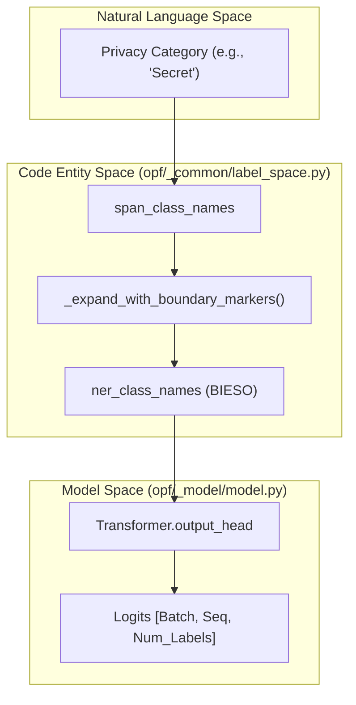
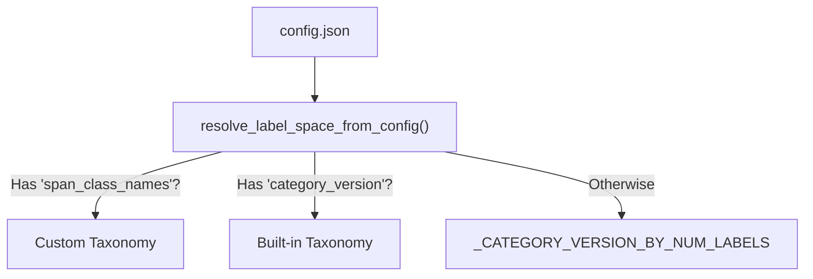

<!-- source: DeepWiki mcp.deepwiki.com · repo openai/privacy-filter · page 4 Label Space and Taxonomy · fetched 2026-10-26 -->

# Label Space and Taxonomy

Relevant source files

The following files were used as context for generating this wiki page:

- [opf/_common/constants.py](opf/_common/constants.py)
- [opf/_common/label_space.py](opf/_common/label_space.py)

The OpenAI Privacy Filter (OPF) uses a structured taxonomy to categorize sensitive information. This system maps high-level privacy concepts (e.g., "Personal Name") to specific token-level labels used by the transformer model for classification. The label space is versioned to support evolving privacy policies and can be extended with custom ontologies for specific use cases.

## Overview of Taxonomy Resolution

At runtime, the `InferenceRuntime` must determine which label space a checkpoint uses to correctly interpret the model's output logits. This resolution follows a specific hierarchy:
1.  **Explicit Configuration**: If `config.json` contains `span_class_names` or `ner_class_names`, a custom label space is used.
2.  **Version Field**: If `category_version` is present in the config, it selects a built-in taxonomy (e.g., `v2`, `v4`, `v7`).
3.  **Inference by Shape**: If no version is specified, the system infers the version based on the number of output labels in the model's head.

### Label Space Entity Mapping

The following diagram illustrates how natural language privacy categories are transformed into the code entities used for inference and training.

**Diagram: From Policy to Token Labels**

Sources: [opf/_common/label_space.py:16-73](), [opf/_common/label_space.py:77-85](), [opf/_model/model.py:270-285]()

---

## Built-in Category Versions

OPF provides several "built-in" taxonomies that have evolved over time. These are defined in `opf/_common/label_space.py`.

*   **v2**: The legacy baseline including categories like `account_number`, `private_person`, and `secret`.
*   **v4**: An expanded set that introduces the distinction between "personal" and "other" entities (e.g., `personal_email` vs `other_email`).
*   **v7**: The current standard, providing highly granular PII categories such as `personal_gov_id`, `personal_health_id`, and `personal_vehicle_id`.

Each version defines a set of `SPAN_CLASS_NAMES`. These are then expanded into `NER_CLASS_NAMES` using the **BIOES** (Begin, Inside, Outside, End, Single) boundary format. For example, the span class `secret` becomes `B-secret`, `I-secret`, `E-secret`, and `S-secret` at the token level.

For details on specific class names and the expansion logic, see **[Built-in Category Versions (#4.1)]**.

Sources: [opf/_common/label_space.py:16-73](), [opf/_common/label_space.py:88-92](), [opf/_common/label_space.py:10-11]()

---

## Custom Label Spaces

Users can define their own ontologies without modifying the OPF source code. This is primarily used during fine-tuning to adapt the model to domain-specific PII or internal data policies.

Custom label spaces are defined in a `label_space.json` file or directly within the checkpoint's `config.json`. The system enforces strict validation rules:
*   The **Background Label** (`O`) must always be the first element (index 0).
*   All token labels must follow the `<Boundary>-<Label>` format.
*   A complete set of BIOES boundaries must exist for every span class.

**Diagram: Custom Label Resolution Logic**

Sources: [opf/_common/label_space.py:195-215](), [opf/_common/label_space.py:143-157](), [opf/_common/label_space.py:160-192]()

For instructions on implementing custom ontologies, see **[Custom Label Spaces (#4.2)]**.

---

## Taxonomy Resolution Summary

| Component | Role | File Reference |
| :--- | :--- | :--- |
| `SPAN_CLASS_NAMES_BY_CATEGORY_VERSION` | Maps version string (v2/v4/v7) to span labels. | [opf/_common/label_space.py:16-73]() |
| `NER_CLASS_NAMES_BY_CATEGORY_VERSION` | Maps version string to token-level BIESO labels. | [opf/_common/label_space.py:88-92]() |
| `_expand_with_boundary_markers` | Function that converts span labels to BIESO labels. | [opf/_common/label_space.py:77-85]() |
| `resolve_label_space_from_config` | Logic for determining label space at runtime. | [opf/_common/label_space.py:227-258]() |
| `REDACTED_OUTPUT_LABEL` | Fallback label used when collapsing categories. | [opf/_common/constants.py:19-20]() |

Sources: [opf/_common/label_space.py:1-258](), [opf/_common/constants.py:1-24]()

---

