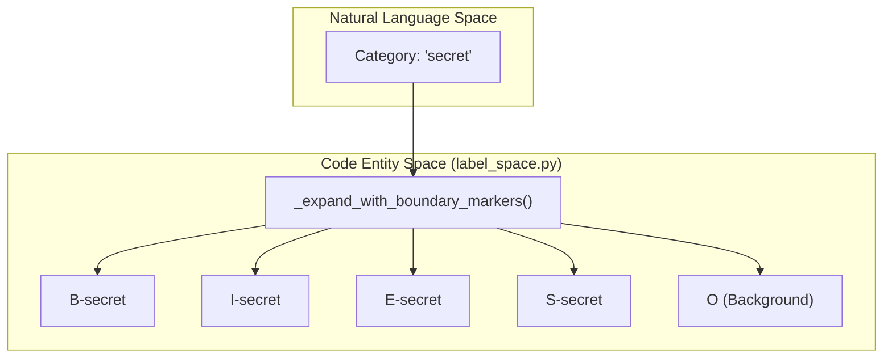
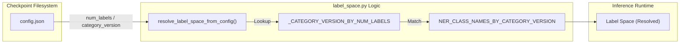

<!-- source: DeepWiki mcp.deepwiki.com · repo openai/privacy-filter · page 4.1 Built-in Category Versions · fetched 2026-10-26 -->

# Built-in Category Versions

Relevant source files

The following files were used as context for generating this wiki page:

- [opf/_common/constants.py](opf/_common/constants.py)
- [opf/_common/label_space.py](opf/_common/label_space.py)

The OpenAI Privacy Filter (OPF) uses a versioned taxonomy system to define privacy categories. These taxonomies, referred to as "Category Versions," dictate the specific types of sensitive information the model is trained to detect (e.g., names, email addresses, or secrets). This page documents the implementation of these versions, the expansion logic from span-level categories to token-level labels, and the resolution mechanism used during model loading.

## Taxonomy Definitions

The system maintains three primary built-in taxonomies: **v2**, **v4**, and **v7**. Each version represents a different level of granularity and classification scope.

### Span Class Names
The `SPAN_CLASS_NAMES_BY_CATEGORY_VERSION` mapping defines the high-level categories for each version [opf/_common/label_space.py:16-73]().

| Version | Description | Key Categories |
| :--- | :--- | :--- |
| **v2** | Legacy/Standard | `account_number`, `private_address`, `private_email`, `private_person`, `secret` |
| **v4** | Split-Ownership | Distinguishes between `personal_*` and `other_*` (e.g., `personal_email` vs `other_email`) |
| **v7** | Granular ID | Extensive list of specific ID types: `personal_gov_id`, `personal_fin_id`, `personal_health_id`, etc. |

All versions include a background label `O` (defined as `BACKGROUND_CLASS_LABEL`) to represent non-sensitive tokens [opf/_common/label_space.py:7-8]().

### Sources:
- [opf/_common/label_space.py:7-73]()

---

## BIOES Expansion Logic

While users and evaluation scripts often interact with span-level labels (e.g., `private_person`), the transformer model performs token-level classification. OPF uses the **BIOES** (Begin, Inside, End, Single) tagging scheme to represent span boundaries.

### Boundary Markers
The system uses four boundary prefixes [opf/_common/label_space.py:10-11]():
- **B**: Beginning of a multi-token span.
- **I**: Inside a multi-token span.
- **E**: End of a multi-token span.
- **S**: A single-token span.

### The `_expand_with_boundary_markers` Function
This function transforms a list of span classes into a full NER (Named Entity Recognition) label space [opf/_common/label_space.py:77-85](). 
1. The background label `O` remains a single entry at index 0 [opf/_common/label_space.py:79-82]().
2. For every other category, four token-level labels are generated by prepending the boundary markers (e.g., `B-secret`, `I-secret`, `E-secret`, `S-secret`) [opf/_common/label_space.py:83-84]().

**Entity Space Mapping Diagram**
The following diagram illustrates how natural language categories are transformed into the code-level label space used by the model head.

### Sources:
- [opf/_common/label_space.py:10-11]()
- [opf/_common/label_space.py:77-85]()

---

## Label Space Resolution

When an OPF model is loaded via `load_inference_runtime`, the system must determine which category version the model's weights correspond to. This is handled by `resolve_label_space_from_config` [opf/_common/label_space.py:228-261]().

### Resolution Priority
The system resolves the label space using the following logic:

1.  **Explicit Custom Definition**: If `span_class_names` or `ner_class_names` are present in the `config.json`, the model uses a custom label space [opf/_common/label_space.py:201-205]().
2.  **Explicit Version Field**: If a `category_version` string (e.g., "v7") is present in the config, that version is used [opf/_common/label_space.py:243-247]().
3.  **Inference by Label Count**: If no version is specified, the system calculates the version based on the number of labels in the model's output head (`num_labels`) [opf/_common/label_space.py:252-257]().

### Inference Mapping
The mapping `_CATEGORY_VERSION_BY_NUM_LABELS` associates the length of the expanded NER list with the version name [opf/_common/label_space.py:94-97]():
- **33 labels** $\rightarrow$ v2
- **57 labels** $\rightarrow$ v4
- **105 labels** $\rightarrow$ v7

**Data Flow: Config to Label Space**
This diagram shows how `resolve_label_space_from_config` processes the `config.json` file from a checkpoint.

### Sources:
- [opf/_common/label_space.py:94-97]()
- [opf/_common/label_space.py:228-261]()
- [opf/_core/runtime.py:49-62]() (Context: usage in `load_inference_runtime`)

---

## Validation and Normalization

To ensure consistency, several internal utilities validate label spaces during both training and inference:

-   **`_ensure_unique`**: Checks for duplicate labels in the taxonomy [opf/_common/label_space.py:124-142]().
-   **`_normalize_span_class_names`**: Ensures that the background label `O` is always at index 0 [opf/_common/label_space.py:143-157]().
-   **`_parse_ner_class_names`**: Validates that if a custom NER space is provided, it contains all four BIOES boundaries for every base label [opf/_common/label_space.py:160-192]().

### Sources:
- [opf/_common/label_space.py:124-192]()

---

