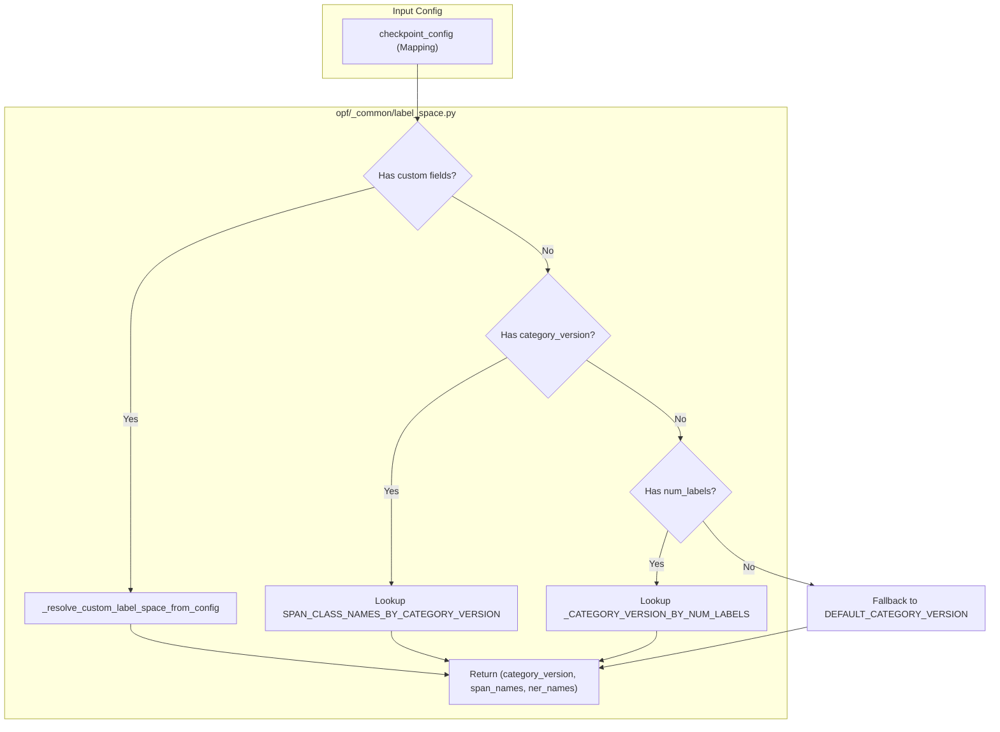
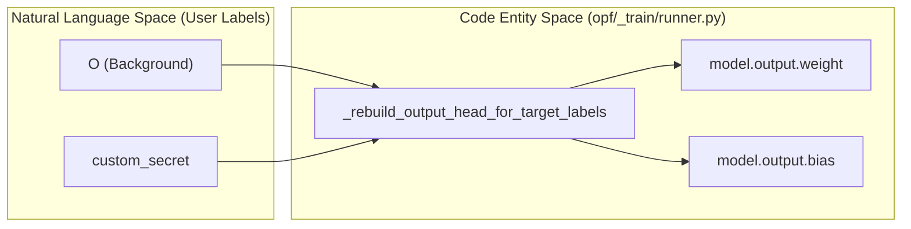

<!-- source: DeepWiki mcp.deepwiki.com · repo openai/privacy-filter · page 4.2 Custom Label Spaces · fetched 2026-10-26 -->

# Custom Label Spaces

Relevant source files

The following files were used as context for generating this wiki page:

- [examples/data/finetuning_custom_label_demo/README.md](examples/data/finetuning_custom_label_demo/README.md)
- [examples/data/finetuning_custom_label_demo/label_space.json](examples/data/finetuning_custom_label_demo/label_space.json)
- [opf/_common/label_space.py](opf/_common/label_space.py)

The OpenAI Privacy Filter (OPF) allows users to extend or replace the default privacy taxonomies with custom ontologies. This is primarily achieved through a `label_space.json` file or by embedding label definitions within a checkpoint's `config.json`. Custom label spaces enable the model to be fine-tuned for domain-specific entities (e.g., "internal_project_code" or "custom_secret") while maintaining the structural integrity required by the BIOES sequence decoding logic.

### Label Space Resolution Logic

When the system loads a model, it must determine the mapping between the output logits of the transformer head and the human-readable labels. This resolution is handled by `resolve_label_space_from_config` [opf/_common/label_space.py:246-278]().

The resolution follows a strict hierarchy:
1.  **Explicit Custom Payload**: If `span_class_names` or `ner_class_names` are present in the configuration, the system validates and uses these custom definitions [opf/_common/label_space.py:195-231]().
2.  **Explicit Version**: If a `category_version` (e.g., "v7") is specified, it loads the corresponding built-in taxonomy [opf/_common/label_space.py:254-257]().
3.  **Inference by Dimension**: If neither is present, the system attempts to infer the version based on the `num_labels` in the model's output head [opf/_common/label_space.py:259-272]().

#### Data Flow: From Config to Label Space
The following diagram illustrates how `resolve_label_space_from_config` processes different inputs to produce the final label sets.

**Label Space Resolution Flow**

Sources: [opf/_common/label_space.py:195-278]()

### Defining a Custom Ontology

Users define custom ontologies via a `label_space.json` file, typically placed in the dataset directory for fine-tuning [examples/data/finetuning_custom_label_demo/README.md:19-19]().

#### Schema of label_space.json
A standard custom label space file contains:
*   **`category_version`**: A unique string identifier for the custom taxonomy (e.g., `"custom_v1"`) [examples/data/finetuning_custom_label_demo/label_space.json:2-2]().
*   **`span_class_names`**: A list of high-level entity names. The background label `"O"` must be included [examples/data/finetuning_custom_label_demo/label_space.json:3-7]().

#### Validation Rules
The system enforces several constraints during parsing in `opf/_common/label_space.py`:
1.  **The "O" Rule**: The background label `O` (defined as `BACKGROUND_CLASS_LABEL`) must be present. If it is not at index 0, the system will force it to the first position during normalization [opf/_common/label_space.py:143-157]().
2.  **BIOES Completeness**: If providing raw `ner_class_names`, every span class (except `O`) must have all four boundary markers: `B-`, `I-`, `E-`, and `S-` [opf/_common/label_space.py:185-192]().
3.  **Expansion**: If only `span_class_names` are provided, the system automatically generates the token-level BIOES labels using `_expand_with_boundary_markers` [opf/_common/label_space.py:77-85]().

| Feature | Requirement | Code Reference |
| :--- | :--- | :--- |
| **Background Label** | Must be `"O"` | [opf/_common/label_space.py:7-7]() |
| **Boundary Markers** | `B`, `I`, `E`, `S` | [opf/_common/label_space.py:10-10]() |
| **Uniqueness** | No duplicate names allowed | [opf/_common/label_space.py:124-141]() |

Sources: [opf/_common/label_space.py:7-192](), [examples/data/finetuning_custom_label_demo/label_space.json:1-8]()

### Integration in Fine-tuning

During fine-tuning, the `TrainingRunner` uses the resolved label space to configure the model's output head. If the custom label space differs from the base checkpoint's label space, the system performs an "Output Head Rebuild."

#### Output Head Remapping
The function `_rebuild_output_head_for_target_labels` in `opf/_train/runner.py` manages this transition:
1.  It identifies overlapping labels between the base model and the custom space.
2.  It copies the weights for shared labels to preserve existing knowledge.
3.  It initializes new weights for novel labels (like `custom_secret`) [examples/data/finetuning_custom_label_demo/README.md:7-7]().

**Entity Mapping during Fine-tuning**

Sources: [opf/_train/runner.py:382-427](), [examples/data/finetuning_custom_label_demo/label_space.json:1-8]()

### Example: Custom Secret Demo
The `finetuning_custom_label_demo` provides a concrete implementation of a custom label space.

1.  **Label Definition**: The `label_space.json` defines `custom_v1` with labels `["O", "custom_secret"]` [examples/data/finetuning_custom_label_demo/label_space.json:1-8]().
2.  **Token-level Expansion**: The system expands this into: `["O", "B-custom_secret", "I-custom_secret", "E-custom_secret", "S-custom_secret"]` via `_expand_with_boundary_markers` [opf/_common/label_space.py:77-85]().
3.  **Result**: The model is trained to recognize `custom_secret` spans, and the `ViterbiCRFDecoder` uses these custom labels to enforce valid BIOES transitions during inference [opf/_core/decoding.py:14-25]().

Sources: [examples/data/finetuning_custom_label_demo/README.md:1-20](), [opf/_common/label_space.py:77-85]()

---

