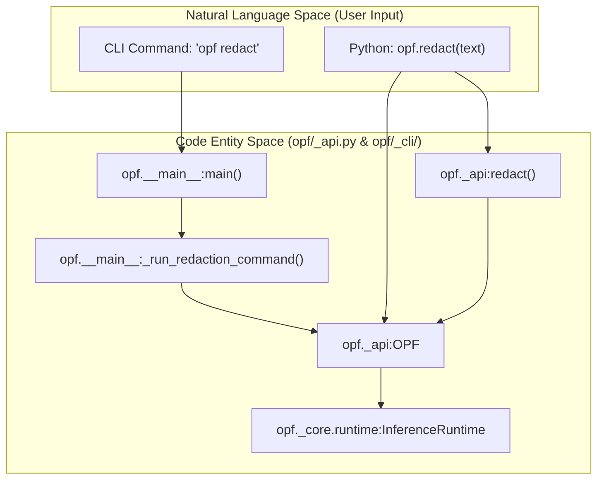
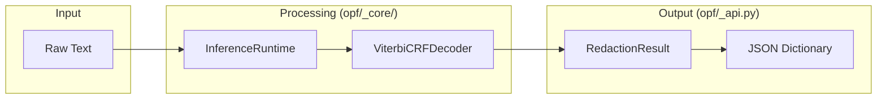

<!-- source: DeepWiki mcp.deepwiki.com · repo openai/privacy-filter · page 5 CLI and Python API · fetched 2026-10-26 -->

# CLI and Python API

<details>
<summary>Relevant source files</summary>

The following files were used as context for generating this wiki page:

- [opf/__main__.py](opf/__main__.py)
- [opf/_api.py](opf/_api.py)
- [opf/_cli/__init__.py](opf/_cli/__init__.py)

</details>


The OpenAI Privacy Filter (OPF) provides three primary interfaces for interacting with the redaction engine: a unified command-line tool (`opf`), a high-level Python class (`OPF`), and a functional convenience wrapper (`redact()`). These interfaces abstract the complexities of tokenization, windowed inference, and Viterbi decoding into simple "text-in, redacted-text-out" workflows.

### Interface Overview

The following diagram maps the user-facing interfaces to their underlying implementation entities in the codebase.

**Interface to Code Mapping**


**Sources:** [opf/__main__.py:186-200](), [opf/_api.py:184-215](), [opf/_api.py:440-455]()

---

### 1. The `opf` CLI
The command-line interface is the primary tool for local redaction, evaluation, and fine-tuning. It uses a subcommand pattern similar to `git` or `docker`.

*   **`redact`**: The default mode. Used for processing text strings or files. It supports interactive mode, JSON output, and ANSI color-coded terminal rendering of detected PII.
*   **`eval`**: Used to benchmark model performance against ground-truth datasets, producing metrics like F1 and Precision.
*   **`train`**: The entry point for supervised fine-tuning on custom datasets or new label taxonomies.

For detailed argument references and usage examples, see **[CLI: Redact Mode](#5.1)**.

**Sources:** [opf/__main__.py:14-25](), [opf/__main__.py:162-184]()

---

### 2. Python API: The `OPF` Class
The `OPF` class in `opf._api.py` is the recommended way to integrate privacy filtering into Python applications. It manages the lifecycle of the `InferenceRuntime`, including model loading and device management.

**Key Features:**
*   **State Management**: Loads the transformer model once and keeps it in memory for repeated calls.
*   **Fluent Interface**: Provides setter methods like `.set_device()` or `.set_output_mode()` to update settings without re-initializing the model.
*   **Structured Results**: Returns `RedactionResult` objects containing the redacted text, a list of `DetectedSpan` objects (with character offsets), and a summary of the operation.

For class documentation and method signatures, see **[Python API: OPF Class](#5.2)**.

**Sources:** [opf/_api.py:184-215](), [opf/_api.py:334-342](), [opf/_api.py:378-400]()

---

### 3. Functional API: `redact()`
For simple scripts or one-off tasks, the module-level `redact()` function provides a stateless interface. It internally manages a cached `OPF` instance to avoid the overhead of reloading weights on every call when used within the same process.

```python
from opf import redact

# Simple functional call
result = redact("Contact me at 555-0199", output_mode="redacted")
print(result.redacted_text)
```

**Sources:** [opf/_api.py:440-465]()

---

### Data Flow and Schemas
All interfaces eventually converge on a standardized output schema. Whether you are using the CLI with `--format json` or the Python API's `.to_dict()` method, the structure remains consistent to ensure interoperability between the CLI and downstream automated systems.

**Standardized Output Flow**



| Interface | Primary Return Type | Serialization |
| :--- | :--- | :--- |
| **CLI** | Stdout (Text/JSON) | `json.dumps()` |
| **OPF Class** | `RedactionResult` | `.to_json()` / `.to_dict()` |
| **Functional** | `RedactionResult` | `.to_json()` / `.to_dict()` |

For details on the specific fields (e.g., `detected_spans`, `schema_version`), see **[Output Schemas](#5.3)**.

**Sources:** [opf/_api.py:34-42](), [opf/_api.py:44-69](), [opf/__main__.py:143-150]()

---

