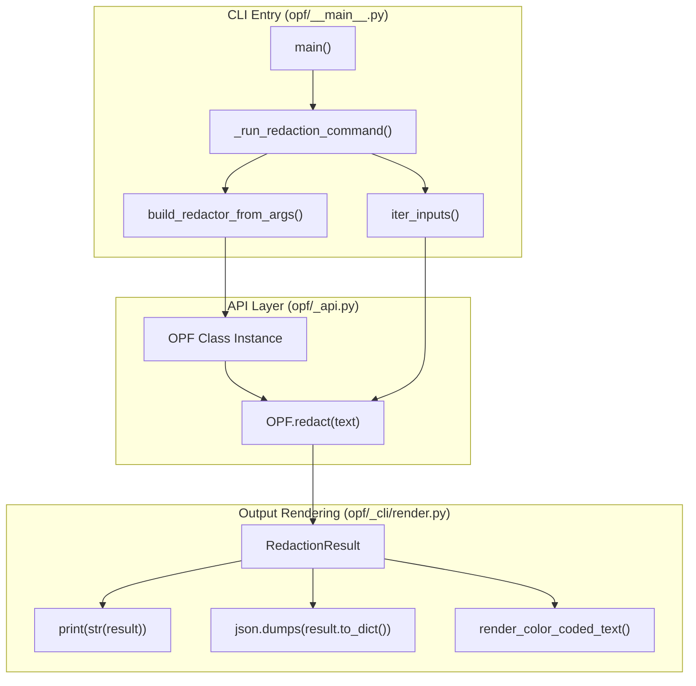
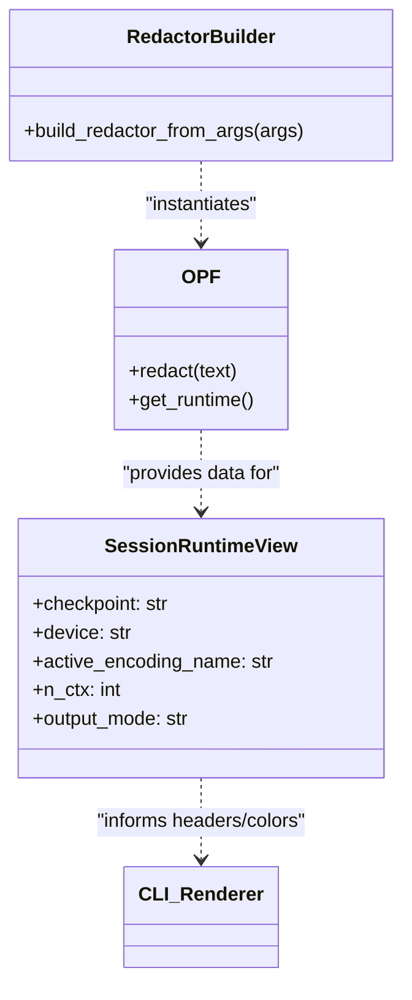

<!-- source: DeepWiki mcp.deepwiki.com · repo openai/privacy-filter · page 5.1 CLI: Redact Mode · fetched 2026-10-26 -->

# CLI: Redact Mode

Relevant source files

The following files were used as context for generating this wiki page:

- [opf/__main__.py](opf/__main__.py)
- [opf/_cli/args.py](opf/_cli/args.py)
- [opf/_cli/common.py](opf/_cli/common.py)
- [opf/_cli/render.py](opf/_cli/render.py)
- [opf/_common/terminal_colors.py](opf/_common/terminal_colors.py)

The `opf redact` command (often invoked simply as `opf`) is the primary interface for local text anonymization. It supports processing single strings, multiple files, piped stdin, and an interactive REPL mode. The CLI handles model initialization, inference orchestration, and formatting of results into either plain text or structured JSON.

## Implementation Overview

The redaction CLI is managed by `opf/__main__.py`, which dispatches commands to `_run_redaction_command`. It utilizes `argparse` groups to organize the extensive configuration surface area.

### Data Flow Diagram: CLI Execution
The following diagram illustrates how a user command flows from the shell through the argument parser into the core `OPF` API and finally to the terminal output.

**CLI to API Bridge**

**Sources:** [opf/__main__.py:186-215](), [opf/_cli/render.py:109-129]()

---

## Argument Groups

The CLI categorizes flags into four functional groups to manage the inference pipeline:

### 1. Input / Source
Determines where the text to be redacted originates.
*   **Positional Text**: `opf redact "Hello world"` treats the first positional argument as input [opf/__main__.py:50-54]().
*   **Text File (`-f`, `--text-file`)**: Reads one or more files as individual examples [opf/__main__.py:68-77]().
*   **Stdin**: If no text or files are provided and stdin is not a TTY, the CLI reads lines from stdin [opf/_cli/args.py:101-107]().
*   **Interactive Mode**: Triggered when no input is provided and the session is a TTY [opf/_cli/args.py:125-127]().

### 2. Model / Runtime
Configures the underlying transformer and hardware.
*   **`--checkpoint`**: Path to the model directory. Defaults to the `OPF_CHECKPOINT` environment variable or a standard local path [opf/_cli/common.py:43-51]().
*   **`--device`**: Target hardware (e.g., `cuda`, `cpu`, `mps`). Defaults to `cuda` [opf/_cli/common.py:53-60]().
*   **`--n-ctx`**: Overrides the context window length (e.g., 2048) [opf/_cli/common.py:63-70]().

### 3. Decode
Controls how token-level probabilities are converted into spans.
*   **`--decode-mode`**: Chooses between `viterbi` (default) and `argmax` [opf/_cli/common.py:73-80]().
*   **`--viterbi-calibration-path`**: Path to a `viterbi_calibration.json` file for fine-tuning transition biases [opf/_cli/common.py:122-133]().
*   **`--trim-whitespace`**: Ensures character spans do not start or end with spaces (default: True) [opf/_cli/common.py:92-109]().

### 4. Output
Controls the format and verbosity of the results.
*   **`--output-mode`**: `typed` (keep PII categories) vs `redacted` (collapse all to a generic label) [opf/_cli/common.py:112-119]().
*   **`--format`**: `text` (returns only the string) vs `json` (returns the full schema) [opf/__main__.py:62-67]().
*   **`--json-indent`**: Sets the indentation level for JSON output (default: 2) [opf/_cli/args.py:63-68]().

**Sources:** [opf/__main__.py:46-61](), [opf/_cli/args.py:43-76](), [opf/_cli/common.py:43-134]()

---

## Interactive Mode

When `opf redact` is run without input arguments in a terminal, it enters an interactive REPL.

*   **Implementation**: Uses `input()` in a loop within `iter_inputs` [opf/_cli/args.py:111-123]().
*   **Line Editing**: Attempts to import the `readline` module to enable history and advanced line editing. If unavailable, it falls back to plain input with a stderr warning [opf/_cli/args.py:35-42]().
*   **Commands**: Users can exit using `/exit`, `quit`, or `Ctrl+D` [opf/_cli/args.py:118-119]().

**Sources:** [opf/_cli/args.py:84-127]()

---

## Output Formats and Rendering

The CLI supports two primary output formats, determined by the `--format` flag.

### Text vs. JSON
| Format | Logic | Behavior |
| :--- | :--- | :--- |
| **Text** | `print(str(result))` | Outputs only the redacted string. |
| **JSON** | `result.to_dict()` | Outputs a structured object containing `detected_spans`, `redacted_text`, and a `summary`. |

**Sources:** [opf/__main__.py:138-150]()

### ANSI Color-Coded Output
When `--format json` is used, the CLI can also print a color-coded version of the source text to the terminal to visualize detected spans.
*   **Label Mapping**: `build_label_color_map` assigns colors from a 10-color palette (`COLOR_PALETTE`) to unique labels [opf/_common/terminal_colors.py:12-40]().
*   **Rendering**: `render_color_coded_text` iterates through `DetectedSpan` objects and wraps the corresponding text slices in ANSI escape codes [opf/_cli/render.py:15-46]().
*   **Legend**: A color legend is printed above the text using `render_color_legend` [opf/_cli/render.py:69-82]().

**Sources:** [opf/_cli/render.py:15-46](), [opf/_common/terminal_colors.py:1-57]()

### Summary Line (stderr)
For every inference, a summary line is printed to `stderr` via `run_summary_line`. This ensures that if the output is redirected to a file, the performance and metadata are still visible to the user.

**Format:**
`summary: output_mode=<mode> spans=<count> by_label=<counts> latency_ms=<ms> decoded_mismatch=<yes/no>`

**Sources:** [opf/_cli/render.py:85-107](), [opf/__main__.py:143-149]()

---

## Internal Components

### Runtime Session View
The CLI uses a `SimpleNamespace` called the "session runtime view" to store metadata about the active model and hardware for the duration of the process.

**CLI Component Association**

**Sources:** [opf/_cli/render.py:109-143]()

---

