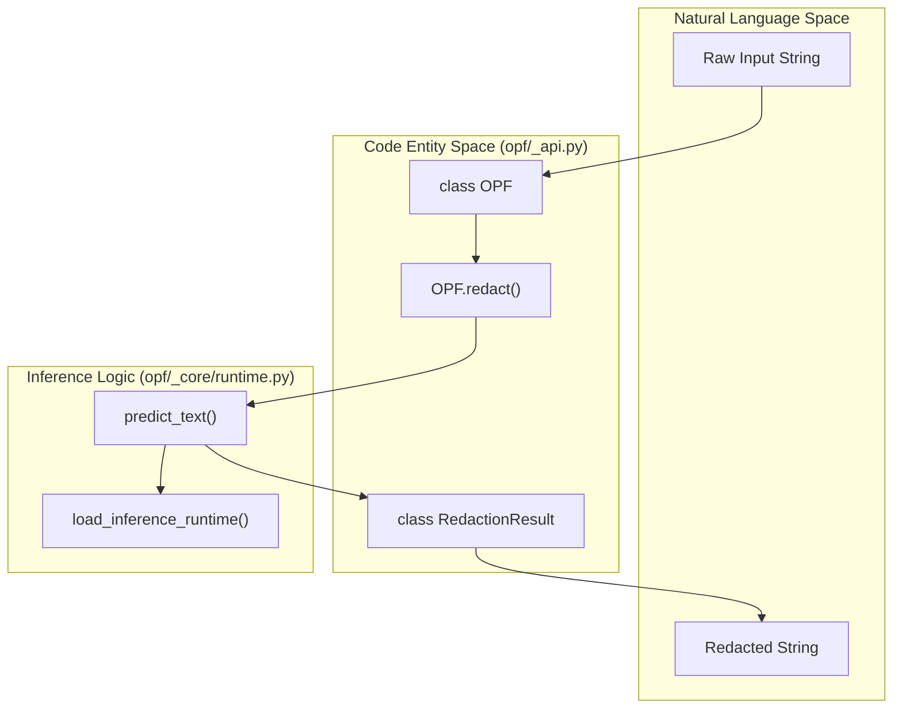
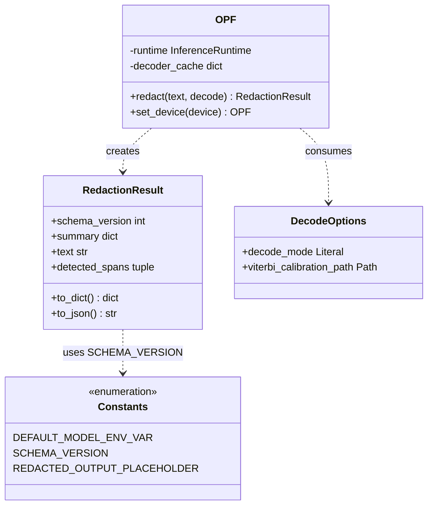

<!-- source: DeepWiki mcp.deepwiki.com · repo openai/privacy-filter · page 5.2 Python API: OPF Class · fetched 2026-10-26 -->

# Python API: OPF Class

<details>
<summary>Relevant source files</summary>

The following files were used as context for generating this wiki page:

- [opf/_api.py](opf/_api.py)
- [opf/_common/constants.py](opf/_common/constants.py)

</details>


The `OPF` class serves as the primary high-level entry point for programmatic interaction with the OpenAI Privacy Filter. It encapsulates the loading of model weights, tokenizer configuration, and inference runtime, providing a fluent interface for text redaction and span detection.

## The OPF Class

The `OPF` class manages the lifecycle of an inference session. It handles checkpoint resolution (including automatic downloads), device management, and decoding strategy configuration.

### Constructor and Initialization
The constructor initializes the underlying `InferenceRuntime` and sets default behaviors for redaction.

| Parameter | Type | Description |
| :--- | :--- | :--- |
| `model` | `str | Path | None` | Path to checkpoint. Defaults to `OPF_CHECKPOINT` env var or `~/.opf/privacy_filter` [[opf/_api.py:190-203]](). |
| `device` | `"cpu" | "cuda"` | Target hardware for inference [[opf/_api.py:193-193]](). |
| `output_mode` | `"typed" | "redacted"` | Whether to use specific labels (e.g., `PHONE_NUMBER`) or generic `<REDACTED>` [[opf/_api.py:194-194]](). |
| `decode_mode` | `"viterbi" | "argmax"` | Sequence decoding strategy [[opf/_api.py:195-195]](). |
| `trim_whitespace` | `bool` | If `True`, removes leading/trailing whitespace from detected spans [[opf/_api.py:192-192]](). |

### Fluent Setter Methods
The class provides several "setter" methods that return `self`, allowing for a fluent configuration style:
* `set_device(device)` [[opf/_api.py:255-263]]()
* `set_output_mode(mode)` [[opf/_api.py:265-274]]()
* `set_decode_mode(mode)` [[opf/_api.py:276-285]]()
* `set_viterbi_decoder(calibration_path)` [[opf/_api.py:287-302]]()

### The redact() Method
The core functionality is exposed via `redact(text, decode=None)`. This method performs the following flow:
1. Resolves `DecodeOptions` by merging per-call overrides with instance defaults [[opf/_api.py:321-321]]().
2. Retrieves or builds a cached `ViterbiCRFDecoder` or argmax decoder [[opf/_api.py:322-322]]().
3. Executes `predict_text` via the internal `InferenceRuntime` [[opf/_api.py:324-333]]().
4. Constructs a `RedactionResult` containing the original text, detected spans, and the processed string [[opf/_api.py:335-343]]().

**Sources:**
* `OPF` Class Definition: [opf/_api.py:184-184]()
* Constructor: [opf/_api.py:187-234]()
* `redact` Method: [opf/_api.py:307-344]()

---

## Data Flow: Text to RedactionResult

The following diagram illustrates how the `OPF` class bridges the "Natural Language Space" (raw text) to the "Code Entity Space" (structured results).

**Text Processing Pipeline**

**Sources:**
* `RedactionResult` Definition: [opf/_api.py:34-42]()
* `predict_text` call: [opf/_api.py:324-333]()
* `_redact_text` implementation: [opf/_api.py:117-128]()

---

## Decoding and Overrides

The API uses a specific pattern for handling per-call configuration without mutating the global state of the `OPF` instance.

### DecodeOptions and INHERIT
The `DecodeOptions` dataclass allows users to override the decoding strategy for a single `redact()` call [[opf/_api.py:88-97]]().
* **`INHERIT` Sentinel**: A special object `INHERIT` is used to signify that the call should use the value currently configured on the `OPF` instance [[opf/_api.py:29-29]]().
* **`_merge_decoder_config`**: An internal utility that resolves the final settings by checking if a field is `INHERIT` or a concrete value [[opf/_api.py:141-167]]().

### Decoder Caching
To avoid the overhead of rebuilding the `ViterbiCRFDecoder` (which involves loading calibration JSON files), the `OPF` class maintains an internal cache [[opf/_api.py:233-233]](). The `_get_decoder` method uses a `_DecoderConfig` key to retrieve existing decoders [[opf/_api.py:346-357]]().

**Sources:**
* `DecodeOptions`: [opf/_api.py:88-97]()
* `INHERIT` sentinel: [opf/_api.py:22-29]()
* `_merge_decoder_config`: [opf/_api.py:141-167]()
* `_get_decoder`: [opf/_api.py:346-357]()

---

## Output Structures

### RedactionResult
The result of a redaction operation is encapsulated in the `RedactionResult` dataclass.

| Method | Description |
| :--- | :--- |
| `to_dict()` | Converts the result into a JSON-serializable dictionary including `schema_version`, `summary`, `text`, `detected_spans`, and `redacted_text` [[opf/_api.py:44-69]](). |
| `to_json(indent=2)` | Serializes the dictionary to a JSON string [[opf/_api.py:71-84]](). |

### Component Association

The following diagram maps the high-level API components to the underlying runtime and common constants.

**API Component Mapping**


**Sources:**
* `RedactionResult`: [opf/_api.py:34-42]()
* `SCHEMA_VERSION`: [opf/_common/constants.py:16-17]()
* `REDACTED_OUTPUT_PLACEHOLDER`: [opf/_common/constants.py:22-23]()

---

## Module-Level Shortcut

For simple use cases where a persistent `OPF` instance is not required, the module provides a top-level `redact()` function.

```python
def redact(
    text: str,
    *,
    model: str | os.PathLike[str] | None = None,
    device: Literal["cpu", "cuda"] = "cuda",
    # ... other params
) -> RedactionResult:
```
This function instantiates a temporary `OPF` object and immediately calls its `redact()` method [[opf/_api.py:374-419]](). It is recommended for one-off scripts but is less efficient than reusing an `OPF` instance for multiple calls due to the overhead of loading the model weights.

**Sources:**
* Module-level `redact`: [opf/_api.py:374-419]()
* Checkpoint resolution: [opf/_api.py:107-114]()

---

