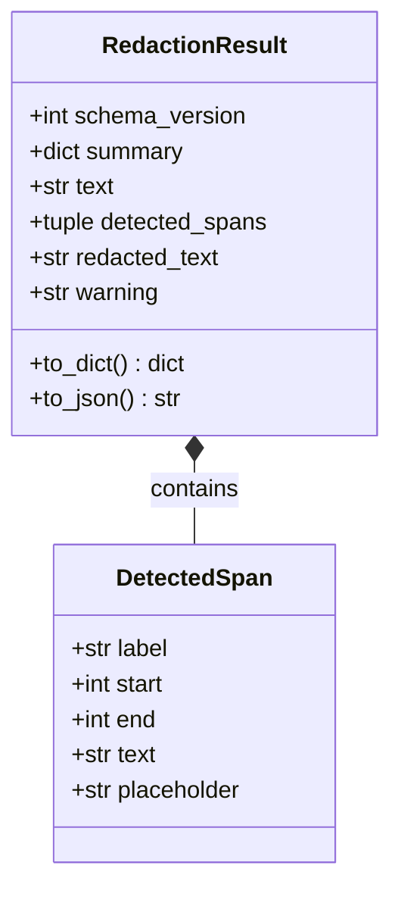
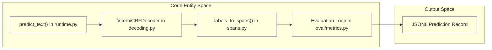
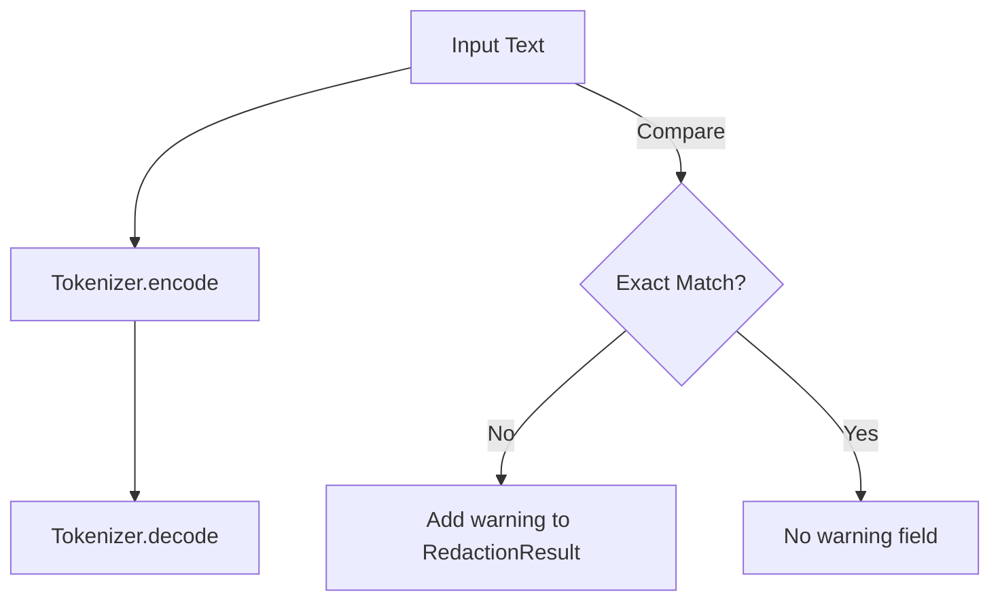

<!-- source: DeepWiki mcp.deepwiki.com · repo openai/privacy-filter · page 5.3 Output Schemas · fetched 2026-10-26 -->

# Output Schemas

Relevant source files

The following files were used as context for generating this wiki page:

- [EVAL_AND_OUTPUT_MODES.md](EVAL_AND_OUTPUT_MODES.md)
- [OUTPUT_SCHEMAS.md](OUTPUT_SCHEMAS.md)
- [opf/_api.py](opf/_api.py)

This page provides a detailed technical reference for the structured data formats produced by the OpenAI Privacy Filter (OPF). It covers the primary JSON output used for redaction tasks and the JSONL format used for model evaluation and error analysis.

## 1. Redaction Output Schema (`opf redact`)

When running the CLI with `opf redact` or using the `OPF.redact()` Python API, the system produces a structured JSON object. This schema is designed to provide both the transformed text and the metadata necessary to audit or programmatically process the redaction decisions.

### Schema Structure
The output is governed by a `schema_version` to ensure forward compatibility.

| Field | Type | Description |
| :--- | :--- | :--- |
| `schema_version` | `int` | Current version of the JSON schema (e.g., `1`). |
| `summary` | `dict` | Aggregated statistics about the redaction pass. |
| `text` | `string` | The original input text. |
| `detected_spans` | `list[dict]` | Array of objects describing each identified sensitive entity. |
| `redacted_text` | `string` | The final text with sensitive spans replaced by placeholders. |
| `warning` | `string?` | Optional field present if a tokenizer round-trip mismatch occurred. |

### Implementation Detail: RedactionResult
In the Python API, this schema is represented by the `RedactionResult` dataclass. The `to_dict()` method handles the conversion of internal `DetectedSpan` objects into the final JSON-serializable format.

Sources: [opf/_api.py:34-84](), [opf/_core/runtime.py:46-53]()

### Output Modes: Typed vs. Redacted
The content of the `detected_spans` and `redacted_text` fields changes based on the `--output-mode` (CLI) or `output_mode` (API) setting.

1.  **`typed`**: Preserves the specific subcategories predicted by the model (e.g., `private_person`, `private_phone_number`). Placeholders reflect these types (e.g., `<PRIVATE_PERSON>`).
2.  **`redacted`**: Collapses all labels into a single generic `redacted` category. All placeholders become `<REDACTED>`.

Sources: [EVAL_AND_OUTPUT_MODES.md:64-70](), [opf/_api.py:211-213]()

### Summary Object
The `summary` field is generated by `build_detection_summary` and contains:
*   `output_mode`: The mode used for the pass.
*   `span_count`: Total number of spans found.
*   `by_label`: A frequency map of detected categories.
*   `decoded_mismatch`: A boolean indicating if the tokenizer's decoded output differs from the raw input string.

Sources: [opf/_core/runtime.py:245-263](), [OUTPUT_SCHEMAS.md:10-18]()

---

## 2. Evaluation Predictions Schema (`opf eval`)

When evaluating model performance using `opf eval`, users can export raw predictions using the `--predictions-out` flag. This produces a **JSONL** (JSON Lines) file where each line is a standalone JSON object representing one example from the evaluation set.

### Prediction Entry Fields
| Field | Type | Description |
| :--- | :--- | :--- |
| `example_id` | `string` | The unique identifier from the source dataset. |
| `text` | `string` | The input text evaluated. |
| `predicted_spans` | `dict` | A map where keys are `label: text` and values are lists of `[start, end]` offsets. |
| `token_logprobs_topk` | `list?` | Optional: Per-token log-probabilities for the top-k candidates. |

### Data Flow: Inference to JSONL
The evaluation pipeline processes windows of text, aggregates scores, and then decodes them into spans. The `predicted_spans` field uses a compact representation to facilitate manual inspection of which specific text segments triggered which labels.

Sources: [OUTPUT_SCHEMAS.md:38-55](), [opf/_core/runtime.py:165-242](), [opf/_core/spans.py:16-52]()

---

## 3. Comparison of Evaluation and Output Modes

The system distinguishes between how labels are handled for *display* (output) versus how they are handled for *measurement* (evaluation).

### Mode Matrix
| Situation | Command | Mode | Outcome |
| :--- | :--- | :--- | :--- |
| Prediction (Display Detail) | `opf redact` | `--output-mode typed` | Specific labels (e.g., `private_address`) |
| Prediction (Anonymize) | `opf redact` | `--output-mode redacted` | All labels become `redacted` |
| Evaluation (Standard) | `opf eval` | `--eval-mode typed` | Category-level F1/Precision/Recall |
| Evaluation (Cross-Taxonomy) | `opf eval` | `--eval-mode untyped` | Span-level detection metrics only |

### The `untyped` Mode and `ground_truth_label_recall`
In `untyped` evaluation mode, the model's specific category labels are ignored. This is useful when the ground truth labels (e.g., `Given Name`) do not align with the model's taxonomy (e.g., `private_person`). 

The output schema for evaluation in this mode includes `ground_truth_label_recall`, which measures how much of the original ground truth span was covered by *any* predicted span, regardless of label name.

Sources: [EVAL_AND_OUTPUT_MODES.md:21-27](), [EVAL_AND_OUTPUT_MODES.md:86-99]()

---

## 4. Error and Warning Handling

### Tokenizer Round-trip Warnings
The OPF performs byte-level offset tracking to ensure that redaction placeholders are placed exactly where the sensitive text was located. However, certain tokenizers may not perfectly round-trip text (e.g., normalizing whitespace or Unicode characters).

If `decoded_mismatch` is detected in `PredictionResult`, a `warning` field is added to the JSON output. This alerts the user that the character offsets provided in `detected_spans` refer to the *tokenizer's decoded version* of the text, which may differ slightly from the original input string.

Sources: [opf/_api.py:131-139](), [opf/_core/runtime.py:51-53]()

---

