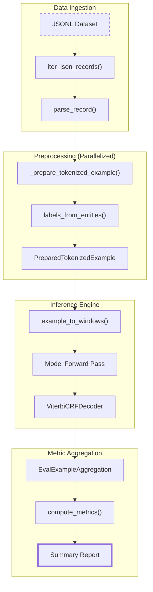
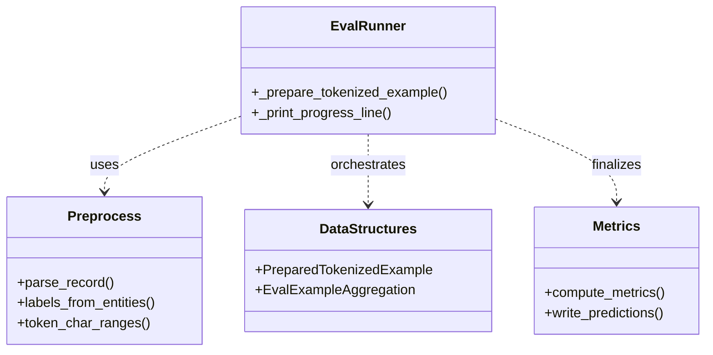

<!-- source: DeepWiki mcp.deepwiki.com · repo openai/privacy-filter · page 6 Evaluation · fetched 2026-10-26 -->

# Evaluation

Relevant source files

The following files were used as context for generating this wiki page:

- [EVAL_AND_OUTPUT_MODES.md](EVAL_AND_OUTPUT_MODES.md)
- [opf/_eval/__init__.py](opf/_eval/__init__.py)
- [opf/_eval/runner.py](opf/_eval/runner.py)

The OpenAI Privacy Filter (OPF) evaluation pipeline provides a comprehensive framework for measuring model performance against ground truth datasets. It handles the end-to-end lifecycle of an evaluation run: loading raw data, tokenizing and labeling, performing windowed inference, and computing both token-level and span-level metrics.

The evaluation logic is primarily contained within the `opf._eval` module [[opf/_eval/__init__.py:1-2]]().

### Evaluation Workflow

The evaluation process follows a structured pipeline managed by the runner in `opf/_eval/runner.py`.

**Sources:** [opf/_eval/runner.py:79-115](), [opf/_eval/preprocess.py:36-42](), [opf/_eval/metrics.py:25-26]()

### Data Loading and Preprocessing
The pipeline supports standard JSONL formats and a specific message-variant format for conversational data [[opf/_eval/data.py:21-24]](). Preprocessing is often the bottleneck, so OPF uses a `ProcessPoolExecutor` to parallelize tokenization and label alignment across multiple CPU cores [[opf/_eval/runner.py:10-11](), [opf/_eval/runner.py:57-66]]().

Key entities in this stage:
*   **`parse_record`**: Extracts text and entity spans from raw JSON [[opf/_eval/preprocess.py:40-40]]().
*   **`labels_from_entities`**: Maps character-level ground truth spans to token-level BIOES labels [[opf/_eval/preprocess.py:39-39]]().
*   **`PreparedTokenizedExample`**: A container holding the tokenized text, ground truth labels, and original span metadata [[opf/_eval/preprocess.py:38-38]]().

For details on dataset schemas and alignment logic, see [Eval Dataset Format and Preprocessing](#6.1).

### Inference and Windowing
Because the Privacy Filter uses a fixed-window bidirectional transformer, long documents are split into overlapping segments using `example_to_windows` [[opf/_core/sequence_labeling.py:34-34]](). During evaluation, the model generates log-probabilities for every token. These are then aggregated back into the original document context via `EvalExampleAggregation` [[opf/_eval/preprocess.py:37-37]]().

The final sequence of labels is determined by the `ViterbiCRFDecoder`, which enforces legal BIOES transitions to ensure valid span boundaries [[opf/_core/sequence_labeling.py:29-33]]().

### Metrics and Modes
OPF distinguishes between different evaluation "modes" based on whether the ground truth taxonomy matches the model's internal labels [[EVAL_AND_OUTPUT_MODES.md:5-17]]().

| Mode | Purpose | Key Metrics |
| :--- | :--- | :--- |
| **Typed** | Standard eval where labels match exactly. | Token Accuracy, Loss, Class-specific F1. |
| **Untyped** | Cross-taxonomy eval (e.g., "Person" vs "private_person"). | Span Detection P/R/F1, `ground_truth_label_recall`. |

**Sources:** [EVAL_AND_OUTPUT_MODES.md:74-85](), [opf/_eval/metrics.py:25-26]()

The `compute_metrics` function generates a detailed report including:
1.  **Detection Metrics**: How well the model found *any* sensitive span, regardless of type [[EVAL_AND_OUTPUT_MODES.md:83-83]]().
2.  **Ground Truth Label Recall**: For untyped evaluation, this measures what percentage of each original ground truth label was covered by model predictions [[EVAL_AND_OUTPUT_MODES.md:90-93]]().
3.  **Throughput**: Processing speed measured in tokens per second [[opf/_eval/runner.py:181-187]]().

For details on specific metric formulas and configuring eval modes, see [Metrics and Eval Modes](#6.2).

### Evaluation to Code Mapping

The following diagram maps high-level evaluation concepts to the specific classes and functions in the `opf._eval` package.

**Sources:** [opf/_eval/runner.py:1-42](), [opf/_eval/preprocess.py:36-42](), [opf/_eval/metrics.py:25-26]()

---

