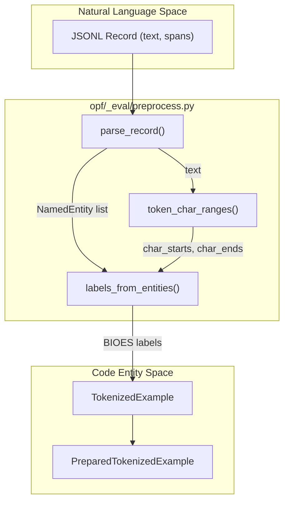
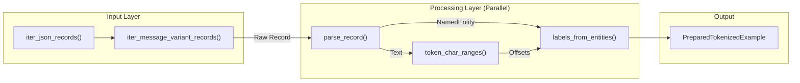

<!-- source: DeepWiki mcp.deepwiki.com · repo openai/privacy-filter · page 6.1 Eval Dataset Format and Preprocessing · fetched 2026-10-26 -->

# Eval Dataset Format and Preprocessing

<details>
<summary>Relevant source files</summary>

The following files were used as context for generating this wiki page:

- [examples/data/README.md](examples/data/README.md)
- [examples/data/sample_eval_five_examples.jsonl](examples/data/sample_eval_five_examples.jsonl)
- [examples/data/sample_eval_five_examples_alt_labels.jsonl](examples/data/sample_eval_five_examples_alt_labels.jsonl)
- [opf/_eval/args.py](opf/_eval/args.py)
- [opf/_eval/data.py](opf/_eval/data.py)
- [opf/_eval/preprocess.py](opf/_eval/preprocess.py)

</details>


This page documents the evaluation data pipeline for the OpenAI Privacy Filter (OPF). It covers the JSONL schema requirements, the extraction of message-level variants, and the transformation of raw text and character-level spans into token-level label sequences used for model evaluation and fine-tuning.

## Overview of Data Flow

The preprocessing pipeline bridges the gap between human-readable text annotations ("Natural Language Space") and the tensor-based requirements of the transformer model ("Code Entity Space").

### Data Transformation Pipeline

The following diagram illustrates how a raw JSONL record is processed into a `PreparedTokenizedExample` ready for inference or training.

**Preprocessing Data Flow**

Sources: `[opf/_eval/preprocess.py:74-157]()`, `[opf/_eval/preprocess.py:28-36]()`, `[opf/_eval/preprocess.py:183-195]()`

## Eval Dataset Schema

The OPF evaluation suite supports JSONL (JSON Lines) files, optionally compressed with GZIP. Each line must represent a single record mapping.

### 1. Spans Format (Standard)
The primary format uses a `spans` dictionary where keys are category names and values are lists of `[start, end]` character offsets.
*   **Key Structure**: Labels can be simple strings (e.g., `private_person`) or include the text snippet for readability (e.g., `private_person: Quindle Testwick`). The parser splits on `: ` to extract the category [opf/_eval/preprocess.py:91-91]().
*   **Offsets**: Must be integer character indices [opf/_eval/preprocess.py:62-71]().

**Example:**
```json
{
  "text": "Contact Edgar Alanpoe at e.alanpoe@openai.com",
  "spans": {
    "private_person: Edgar Alanpoe": [[8, 21]],
    "private_email": [[25, 45]]
  },
  "info": {"id": "example_01"}
}
```
Sources: `[examples/data/sample_eval_five_examples.jsonl:1-5]()`, `[opf/_eval/preprocess.py:84-127]()`

### 2. Labels Format (Alternative)
A secondary format uses a `label` field containing a list of objects with `category`, `start`, and `end` fields.

**Example:**
```json
{
  "text": "Contact Edgar Alanpoe",
  "label": [
    {"category": "private_person", "start": 8, "end": 21}
  ]
}
```
Sources: `[opf/_eval/preprocess.py:129-157]()`

## Dataset Variants and Message Extraction

The CLI supports a `--dataset-variant` flag [opf/_eval/args.py:173-178]().

### Message Variant
When `message` variant is selected, the pipeline uses `iter_message_variant_records` to split long chat transcripts into individual message records.
*   **Splitting**: It identifies `user:` and `assistant:` prefixes using `MESSAGE_PREFIX_RE` [opf/_eval/data.py:10-23]().
*   **Span Adjustment**: Character offsets for ground-truth spans are automatically recalculated relative to the start of the specific message [opf/_eval/data.py:54-57]().
*   **Metadata**: Adds a `message_index` to the `info` field of each resulting record [opf/_eval/data.py:61-67]().

Sources: `[opf/_eval/data.py:26-69]()`

## Preprocessing Implementation

### Record Parsing
The `parse_record` function acts as the entry point, normalizing various JSONL formats into a unified `(example_id, text, list[NamedEntity])` tuple [opf/_eval/preprocess.py:74-77](). It also generates a stable `example_id` by hashing the record content if one is not provided [opf/_eval/preprocess.py:48-59]().

### Token-to-Character Mapping
To align labels with tokens, the system must know exactly which character range each token covers.
*   **`token_char_ranges`**: Calls `token_char_ranges_for_text` to generate `char_starts` and `char_ends` arrays for the entire token sequence [opf/_eval/preprocess.py:173-181]().
*   **Validation**: It ensures every token in the sequence is successfully mapped to a range [opf/_eval/preprocess.py:178-179]().

### Label Projection (`labels_from_entities`)
This function projects character-level `NamedEntity` spans onto the token sequence:
1.  **Initialization**: All tokens start with the `background_token_label` (usually `O`) [opf/_eval/preprocess.py:194-194]().
2.  **Overlap Handling**: It resolves overlapping ground-truth spans by prioritizing the earliest and longest spans [opf/_eval/preprocess.py:160-170]().
3.  **BIOES Assignment**: It identifies which tokens fall within a span and assigns the appropriate `B-`, `I-`, `E-`, or `S-` prefix based on the token's position within the character range [opf/_core/spans.py]().

**Data Structure: PreparedTokenizedExample**
This dataclass caches all necessary information for evaluation:
*   `tokenized`: The `TokenizedExample` (tokens and label IDs) [opf/_eval/preprocess.py:31-31]().
*   `char_starts`/`char_ends`: Token boundary offsets [opf/_eval/preprocess.py:32-33]().
*   `original_gold_char_spans`: The raw spans before tokenization for final metric comparison [opf/_eval/preprocess.py:34-34]().

Sources: `[opf/_eval/preprocess.py:28-36]()`, `[opf/_eval/preprocess.py:183-195]()`

## Preprocessing Architecture

The following diagram shows the interaction between the data iteration logic and the preprocessing workers.

**Eval Data Ingestion Architecture**

Sources: `[opf/_eval/data.py:71-108]()`, `[opf/_eval/preprocess.py:74-77]()`, `[opf/_eval/preprocess.py:183-195]()`

---

