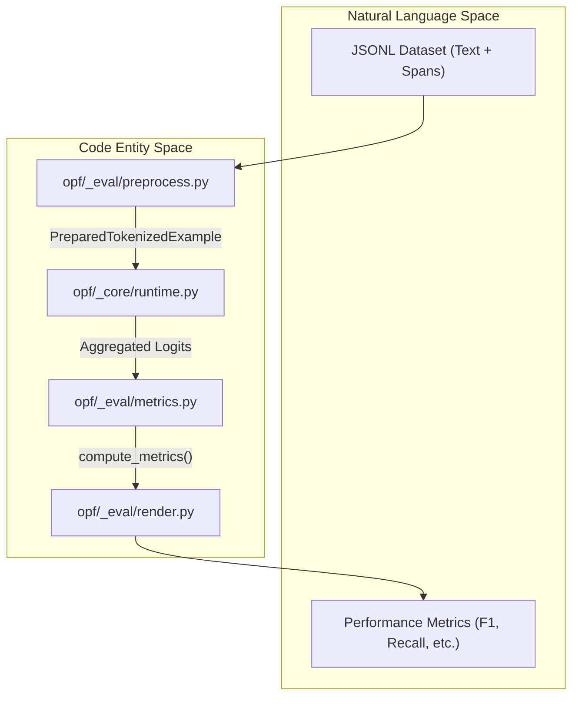
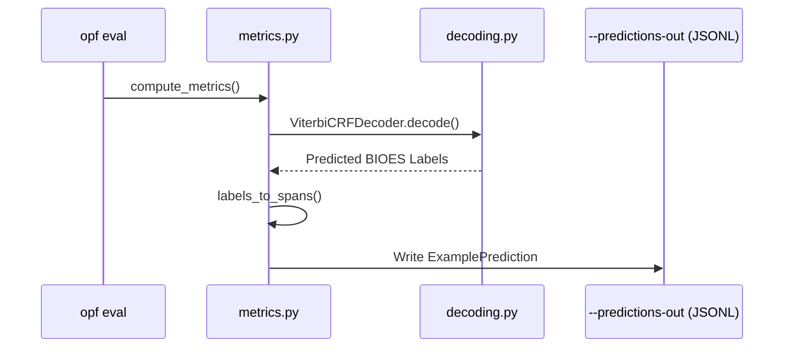

<!-- source: DeepWiki mcp.deepwiki.com · repo openai/privacy-filter · page 6.2 Metrics and Eval Modes · fetched 2026-10-26 -->

# Metrics and Eval Modes

Relevant source files

The following files were used as context for generating this wiki page:

- [EVAL_AND_OUTPUT_MODES.md](EVAL_AND_OUTPUT_MODES.md)
- [opf/_eval/metrics.py](opf/_eval/metrics.py)
- [opf/_eval/render.py](opf/_eval/render.py)

The OpenAI Privacy Filter (OPF) evaluation pipeline provides a framework for measuring model performance across different taxonomies and use cases. Evaluation is primarily handled by `opf eval`, which supports multiple modes to accommodate datasets that may or may not align with the model's native label space.

### Core Evaluation Concepts

OPF distinguishes between three primary modes for handling labels and predictions:

| Mode | Context | Purpose | Outcome |
| :--- | :--- | :--- | :--- |
| `typed` | `opf eval` | Compare predictions against gold labels using the same taxonomy. | Category-level metrics (e.g., `private_person`). |
| `untyped` | `opf eval` | Compare predictions against gold labels using a *different* taxonomy. | Span-level detection metrics + `ground_truth_label_recall`. |
| `redacted` | `opf` | Presentation only; not used for evaluation. | Collapses all categories into a generic `redacted` label. |

Sources: [EVAL_AND_OUTPUT_MODES.md:5-18](), [EVAL_AND_OUTPUT_MODES.md:21-27]()

---

### Evaluation Data Flow

The evaluation process involves aggregating windowed model scores, decoding them into spans, and comparing those spans against ground truth data.

#### System to Code Entity Map: Evaluation Pipeline

Sources: [opf/_eval/metrics.py:187-215](), [opf/_eval/render.py:9-19]()

---

### Metrics Computation (`compute_metrics`)

The core logic for evaluation resides in `compute_metrics()` within `opf/_eval/metrics.py`. This function calculates several tiers of performance data:

#### 1. Token-Level Metrics
When in `typed` mode, the system computes:
*   **Loss**: The cross-entropy loss over the sequence [opf/_eval/metrics.py:81-81]().
*   **Token Accuracy**: Percentage of tokens where the predicted BIOES tag matches the ground truth [opf/_eval/metrics.py:81-81]().

#### 2. Detection Metrics (Span-Level)
Detection metrics evaluate the model's ability to find sensitive spans, regardless of whether the category label matches perfectly (depending on `eval-mode`).
*   **Precision/Recall/F1/F2**: Calculated based on true positives, false positives, and false negatives at the span level [opf/_eval/metrics.py:75-77]().
*   **Span Matching Logic**: Spans are matched using containment logic (`pred_in_gold` or `gold_in_pred`) via `_match_spans_containment()` [opf/_eval/metrics.py:44-66]().

#### 3. Per-Class Breakdowns
For `typed` evaluation, metrics are broken down by each category defined in the taxonomy (e.g., `address`, `email_address`, `phone_number`) [opf/_eval/metrics.py:76-77]().

#### 4. Ground Truth Label Recall
In `untyped` mode, where the dataset taxonomy differs from the model's taxonomy, OPF uses `ground_truth_label_recall`. This answers: "For each original ground truth label, how much of the text was covered by *any* predicted span?" [EVAL_AND_OUTPUT_MODES.md:86-93]().

Sources: [opf/_eval/metrics.py:44-94](), [EVAL_AND_OUTPUT_MODES.md:78-85]()

---

### Evaluation Modes in Detail

#### Typed Mode
Used when ground truth labels match the OPF taxonomy. It provides the most granular feedback, including category-specific errors (e.g., confusing a `person` name for an `organization`).
*   **Command**: `opf eval DATASET --eval-mode typed` [EVAL_AND_OUTPUT_MODES.md:54-57]()

#### Untyped Mode
Used for cross-taxonomy evaluation. It treats all sensitive categories as a single "sensitive" class for matching purposes but preserves the original labels for recall reporting.
*   **Command**: `opf eval DATASET --eval-mode untyped` [EVAL_AND_OUTPUT_MODES.md:58-60]()
*   **Key Benefit**: Allows evaluating the model against legacy datasets or third-party benchmarks without re-labeling [EVAL_AND_OUTPUT_MODES.md:94-98]().

---

### Predictions Output Format

When running evaluation with the `--predictions-out` flag, the system generates a JSONL file containing detailed inference results for every example.

#### JSONL Schema
Each line in the output file contains:
*   `example_id`: Unique identifier for the text record.
*   `predicted_spans`: A list of spans in `[label_id, token_start, token_end]` format.
*   `token_logprobs_topk`: (Optional) Detailed log-probability distribution for the top-K labels at each token position.

#### Diagnostic Collection
The `_collect_token_logprobs_topk` function facilitates deep-dive analysis by recording the model's confidence and alternative label rankings for specific tokens [opf/_eval/metrics.py:125-184](). This is particularly useful for debugging Viterbi decoding transitions or "near-miss" detections.

#### Prediction Logic and Entity Map

Sources: [opf/_eval/metrics.py:24-31](), [opf/_eval/metrics.py:125-137](), [opf/_core/spans.py:15-21]()

---

### Visualization and Rendering

The `opf/_eval/render.py` module provides the `build_prediction_preview` function, which generates the ANSI-colored terminal output seen during `opf eval --preview`.

This includes:
1.  **Text Preview**: The source text with highlighted predicted spans [opf/_eval/render.py:52-57]().
2.  **Span Table**: A list of detected entities with their token and character offsets [opf/_eval/render.py:68-84]().
3.  **Token Tags**: A detailed view of every token, its ID, its character range, and the specific BIOES tag assigned by the decoder [opf/_eval/render.py:88-107]().

Sources: [opf/_eval/render.py:9-111]()

---

