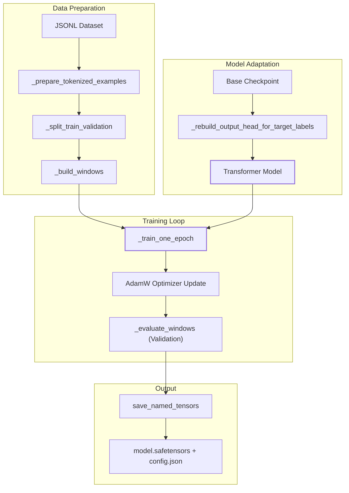
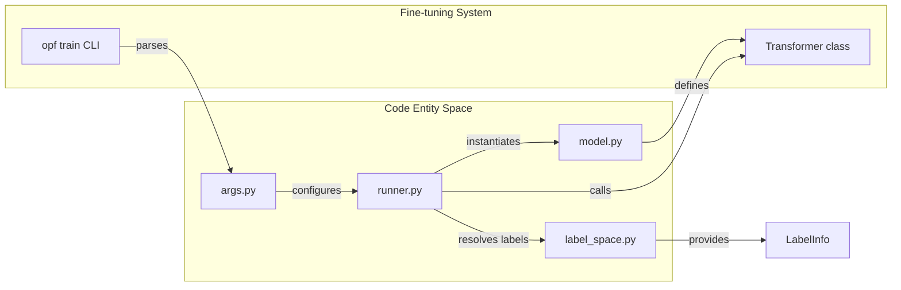

<!-- source: DeepWiki mcp.deepwiki.com · repo openai/privacy-filter · page 7 Fine-tuning · fetched 2026-10-26 -->

# Fine-tuning

Relevant source files

The following files were used as context for generating this wiki page:

- [FINETUNING.md](FINETUNING.md)
- [opf/_train/__init__.py](opf/_train/__init__.py)
- [opf/_train/args.py](opf/_train/args.py)
- [opf/_train/runner.py](opf/_train/runner.py)

The `opf train` command provides a supervised fine-tuning (SFT) pipeline designed to adapt the Privacy Filter model to specific organizational policies or entirely new label taxonomies. The pipeline consumes labeled JSONL datasets, handles output head remapping for custom label spaces, and executes a standard AdamW training loop with validation and checkpoint serialization.

## Training Pipeline Overview

The fine-tuning process follows a structured sequence from data ingestion to the production of a reusable checkpoint. The system is optimized for token classification (NER) tasks using the BIOES tagging scheme.

### Data Ingestion and Preprocessing
The pipeline supports the same JSONL schema used for evaluation, accepting either character-level spans or token-level labels.
- **Data Loading**: `_prepare_tokenized_examples` uses `tiktoken` to process text and aligns labels to token boundaries [opf/_train/runner.py:95-136]().
- **Windowing**: Since the model has a fixed context window (defined by `n_ctx`), long documents are chunked into overlapping windows via `example_to_windows` [opf/_train/runner.py:162-172]().
- **Dataset Variants**: Supports "full" record processing or "message" variants for conversation-style datasets [opf/_train/runner.py:84-93]().

### Training Workflow

**Sources:** [opf/_train/runner.py:95-136](), [opf/_train/runner.py:162-172](), [opf/_train/runner.py:348-403](), [opf/_train/runner.py:438-518]().

## Output Head Remapping

A core feature of the fine-tuning pipeline is the ability to change the label space (e.g., adding a new category like `SECRET` or moving from `v2` to `v4` taxonomy). When the target label space differs from the base checkpoint, the model's output head is surgically modified:

1.  **Exact Match**: Weights for labels present in both the old and new space are copied directly [opf/_train/runner.py:461-464]().
2.  **Fallback**: New labels are initialized using the weights of their corresponding base classes (e.g., `B-custom_id` might inherit from the base `B-ID` weights) to provide a better starting point than random initialization [opf/_train/runner.py:471-477]().

For details on implementation, see [Training Runner](#7.1).

## Training Runner

The `opf train` execution is managed by the logic in `opf/_train/runner.py`. It implements a robust training loop including:
- **Gradient Accumulation**: Allows for effectively larger batch sizes on memory-constrained hardware [opf/_train/runner.py:382-385]().
- **Optimization**: Uses `torch.optim.AdamW` with configurable learning rates and weight decay [opf/_train/runner.py:596-601]().
- **Validation**: Periodic evaluation on a held-out split to track `token_accuracy` and `loss` [opf/_train/runner.py:406-435]().

For details on the training loop and artifact layout, see [Training Runner](#7.1).

## Custom Label Spaces

Users can define a `label_space.json` to override the built-in taxonomies. This allows the model to be trained on niche categories not covered by the standard PII/PHI sets.

| Feature | Description |
| :--- | :--- |
| **Ontology Definition** | Defined via `span_class_names` in a JSON file [FINETUNING.md:37-44](). |
| **BIOES Expansion** | The system automatically expands categories into BIOES tokens (e.g., `O`, `B-CAT`, `I-CAT`, etc.) [opf/_common/label_space.py:100-112](). |
| **Validation** | The background class `O` must always be the first entry [FINETUNING.md:48](). |

For details and examples, see [Fine-tuning Demo Examples](#7.2).

## Entity Association Map

The following diagram maps the logical fine-tuning components to the specific classes and files in the codebase.

**Sources:** [opf/_train/args.py:14-33](), [opf/_train/runner.py:530-550](), [opf/_model/model.py:410-425](), [opf/_common/label_space.py:165-180]().

## Demo Examples

The repository includes two canonical demo scripts in `examples/scripts/finetuning/` to illustrate common workflows:
1.  **Policy Adaptation**: Relabeling existing categories (e.g., `account_number` to `secret`) [FINETUNING.md:62-63]().
2.  **New Taxonomy**: Training a model from scratch on a completely custom set of labels [FINETUNING.md:64-65]().

For walkthroughs of these scripts, see [Fine-tuning Demo Examples](#7.2).

**Sources:**
- [FINETUNING.md:1-78]()
- [opf/_train/args.py:1-177]()
- [opf/_train/runner.py:1-518]()
- [opf/_common/label_space.py:100-112]()

---

