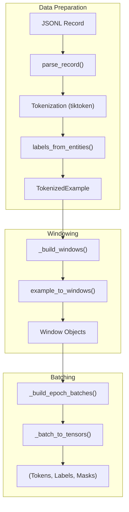
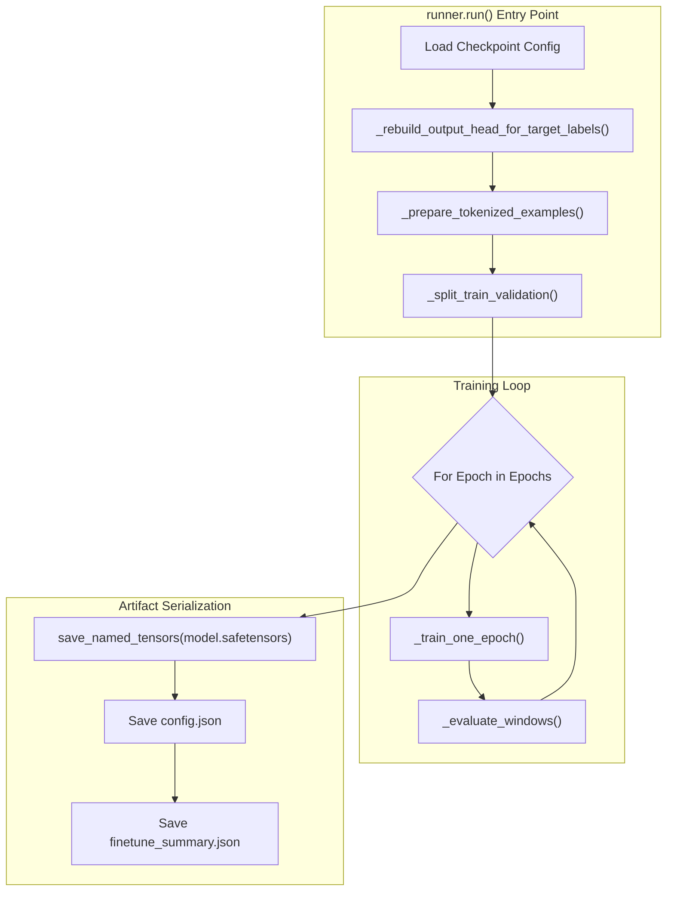

<!-- source: DeepWiki mcp.deepwiki.com · repo openai/privacy-filter · page 7.1 Training Runner · fetched 2026-10-26 -->

# Training Runner

Relevant source files

The following files were used as context for generating this wiki page:

- [opf/_train/args.py](opf/_train/args.py)
- [opf/_train/runner.py](opf/_train/runner.py)

The Training Runner is the core engine for supervised fine-tuning (SFT) within the OpenAI Privacy Filter (OPF) framework. It handles the end-to-end process of transforming labeled datasets into optimized model weights, including data preparation, windowing, gradient-based optimization, and artifact serialization.

## Data Preparation and Windowing

The training pipeline begins by converting raw JSONL records into tokenized sequences aligned with label IDs. Because the transformer has a fixed context length (`n_ctx`), long sequences are decomposed into overlapping windows to ensure full coverage of the input text.

### Tokenization Flow
The function `_prepare_tokenized_examples` [opf/_train/runner.py:95-136]() orchestrates the conversion of dataset records:
1.  **Parsing**: Records are read via `_iter_dataset_records` [opf/_train/runner.py:84-93](), which supports both standard and message-variant formats.
2.  **Encoding**: Text is converted to tokens using `tiktoken`.
3.  **Label Mapping**: Entities (spans) are mapped to BIOES label IDs using `labels_from_entities` [opf/_eval/preprocess.py:112-120](). This ensures that character-level offsets in the training data correctly align with token boundaries.

### Window Construction
The `_build_windows` [opf/_train/runner.py:162-172]() function transforms `TokenizedExample` objects into a list of `Window` objects. This process uses `example_to_windows` [opf/_core/sequence_labeling.py:29]() to handle sequences exceeding the model's context window. Each window includes:
*   **Tokens**: The integer IDs for the sub-sequence.
*   **Labels**: Corresponding BIOES target IDs.
*   **Mask**: A binary mask indicating which tokens should contribute to the loss (avoiding padding or overlapping segments where appropriate).

### Training Data Flow: Record to Tensors

**Sources:** [opf/_train/runner.py:95-136](), [opf/_train/runner.py:162-172](), [opf/_train/runner.py:191-224]()

---

## Training Loop Implementation

The primary training logic resides in `_train_one_epoch` [opf/_train/runner.py:260-333](). It implements a standard SFT loop with several critical features for stability and performance.

### Key Optimization Components
*   **Gradient Accumulation**: To simulate larger batch sizes on memory-constrained hardware, gradients are accumulated over `grad_accum_steps` before an optimizer update is performed [opf/_train/runner.py:311-316]().
*   **AdamW Optimizer**: The runner uses `torch.optim.AdamW` with configurable learning rate and weight decay [opf/_train/runner.py:441-447]().
*   **Gradient Clipping**: To prevent exploding gradients, `torch.nn.utils.clip_grad_norm_` is applied using the `--max-grad-norm` parameter [opf/_train/runner.py:312]().
*   **Progress Logging**: Real-time stats including loss, token accuracy, and estimated time remaining (ETA) are logged to stderr [opf/_train/runner.py:321-331]().

### Loss Calculation
Loss is calculated using `_masked_token_loss_and_accuracy` [opf/_train/runner.py:227-258](). It applies `F.cross_entropy` only to non-masked tokens. The mask ensures that padding tokens (used to align windows in a batch) do not influence the gradient updates.

| Feature | Implementation Detail |
| :--- | :--- |
| **Optimizer** | `AdamW` [opf/_train/runner.py:441]() |
| **Loss Function** | Cross Entropy with Masking [opf/_train/runner.py:241]() |
| **Batching** | Shuffled windows via `_build_epoch_batches` [opf/_train/runner.py:175]() |
| **Metrics** | Loss and Token-level Accuracy [opf/_train/runner.py:249-251]() |

**Sources:** [opf/_train/runner.py:260-333](), [opf/_train/runner.py:227-258]()

---

## Output Head Reconfiguration

When fine-tuning on a custom label space (e.g., adding a new category or changing taxonomies), the model's output head (`output.weight`) must be resized and re-initialized. This is handled by `_rebuild_output_head_for_target_labels` [opf/_train/runner.py:355-408]().

### Remapping Logic
The function attempts to preserve knowledge from the base model by copying rows for labels that exist in both the source and target spaces:
1.  **Exact Copying**: If a label name (e.g., `B-PERSON`) exists in both the checkpoint and the target label space, the corresponding row in the weight matrix is copied exactly [opf/_train/runner.py:388-392]().
2.  **Fallback Copying**: If a target label is new but shares a boundary type (e.g., a new `B-SECRET` label), it can optionally be initialized from a similar boundary type in the source (e.g., `B-MISC`) [opf/_train/runner.py:393-398]().
3.  **Stats Tracking**: The `OutputHeadRemapStats` dataclass tracks how many rows were initialized via each method [opf/_train/runner.py:49-58]().

**Sources:** [opf/_train/runner.py:355-408](), [opf/_train/runner.py:49-58]()

---

## Output Artifact Layout

Upon completion, the training runner serializes the fine-tuned model and metadata into the directory specified by `--output-dir`.

### Generated Files
1.  **`config.json`**: The model configuration, updated with the new `num_labels` and the target `label_space` (if custom) [opf/_train/runner.py:560-573]().
2.  **`model.safetensors`**: The trained weights saved in `safetensors` format. The runner uses `save_named_tensors` to ensure compatibility with the OPF runtime [opf/_train/runner.py:575-580]().
3.  **`finetune_summary.json`**: A detailed report of the training run, including:
    *   Final training and validation metrics (loss, accuracy).
    *   Hyperparameters used (learning rate, batch size, epochs).
    *   Output head remapping statistics.
    *   Environment details (device, timestamp) [opf/_train/runner.py:582-598]().

### Runner Execution Logic

**Sources:** [opf/_train/runner.py:411-602](), [opf/_train/runner.py:560-598]()

---

