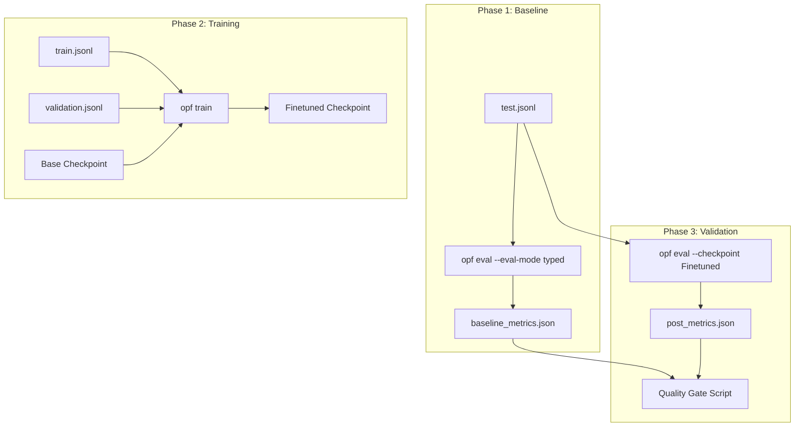
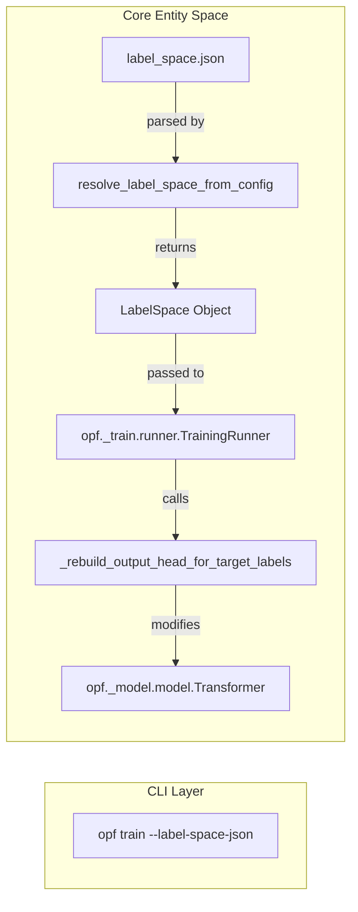

<!-- source: DeepWiki mcp.deepwiki.com · repo openai/privacy-filter · page 7.2 Fine-tuning Demo Examples · fetched 2026-10-26 -->

# Fine-tuning Demo Examples

<details>
<summary>Relevant source files</summary>

The following files were used as context for generating this wiki page:

- [FINETUNING.md](FINETUNING.md)
- [examples/data/finetuning_custom_label_demo/README.md](examples/data/finetuning_custom_label_demo/README.md)
- [examples/data/finetuning_custom_label_demo/test.jsonl](examples/data/finetuning_custom_label_demo/test.jsonl)
- [examples/data/finetuning_custom_label_demo/train.jsonl](examples/data/finetuning_custom_label_demo/train.jsonl)
- [examples/data/finetuning_custom_label_demo/validation.jsonl](examples/data/finetuning_custom_label_demo/validation.jsonl)
- [examples/data/finetuning_secret_demo/README.md](examples/data/finetuning_secret_demo/README.md)
- [examples/data/finetuning_secret_demo/test.jsonl](examples/data/finetuning_secret_demo/test.jsonl)
- [examples/data/finetuning_secret_demo/train.jsonl](examples/data/finetuning_secret_demo/train.jsonl)
- [examples/data/finetuning_secret_demo/validation.jsonl](examples/data/finetuning_secret_demo/validation.jsonl)
- [examples/scripts/finetuning/finetune_custom_label_demo.sh](examples/scripts/finetuning/finetune_custom_label_demo.sh)
- [examples/scripts/finetuning/finetune_secret_demo.sh](examples/scripts/finetuning/finetune_secret_demo.sh)

</details>


The OpenAI Privacy Filter (OPF) includes reproducible demo workflows to illustrate how the model can be adapted to new policies or entirely new label spaces. These demos are implemented as shell harness scripts that wrap the `opf train` and `opf eval` CLI commands, providing automated validation and quality gates.

## Demo 1: Policy Adaptation (`finetune_secret_demo`)

The `finetune_secret_demo` demonstrates **policy adaptation**. In this scenario, the baseline model may already recognize a specific pattern (e.g., an account number) but labels it under a standard category like `account_number`. The demo illustrates retraining the model so that these same spans are instead labeled as `secret` [FINETUNING.md:62-63]().

### Dataset Structure
The demo uses a synthetic dataset located in `examples/data/finetuning_secret_demo/` [examples/scripts/finetuning/finetune_secret_demo.sh:6](). It consists of three disjoint splits to prevent data leakage [examples/data/finetuning_secret_demo/README.md:31]():
*   `train.jsonl`: 1 example used for optimization.
*   `validation.jsonl`: 1 example used for model selection.
*   `test.jsonl`: 1 example used for final before/after comparison.

Each record follows the standard schema with `text` and `label` fields [examples/data/finetuning_secret_demo/README.md:15-18]().

### Workflow Data Flow
The harness script executes a sequence of evaluations and training steps to prove the effectiveness of the fine-tuning.

**Data Flow for Policy Adaptation Demo**

**Sources:** [examples/scripts/finetuning/finetune_secret_demo.sh:164-241]()

### Quality Gates
The script enforces specific metric improvements on the `test.jsonl` split [examples/scripts/finetuning/finetune_secret_demo.sh:38-41]():
*   `--min-delta`: Minimum required improvement in the F1 score for the `secret` category (default: 0.50) [examples/scripts/finetuning/finetune_secret_demo.sh:33]().
*   `--min-post-f1`: Minimum absolute F1 score required after training (default: 0.90) [examples/scripts/finetuning/finetune_secret_demo.sh:34]().

---

## Demo 2: Custom Label Space (`finetune_custom_label_demo`)

The `finetune_custom_label_demo` illustrates how to define a completely new ontology. It transitions the model from its default taxonomy to a minimal space containing only the background class (`O`) and a new `custom_secret` category [FINETUNING.md:64-65]().

### The `label_space.json` Configuration
To define a new label space, a JSON configuration file is provided to the `--label-space-json` argument [FINETUNING.md:28-33]().

**Example Ontology Definition**
```json
{
  "category_version": "custom_v1",
  "span_class_names": ["O", "custom_account_id", "custom_secret"]
}
```
**Sources:** [FINETUNING.md:40-44]()

### Implementation Details
When a custom label space is detected, the training runner (`opf/_train/runner.py`) performs the following:
1.  **Label Resolution**: Parses the `label_space.json` to create a new BIOES-expanded label map [FINETUNING.md:47-48]().
2.  **Head Re-initialization**: If the number of labels or the taxonomy changes, the model's output head is rebuilt. The runner attempts to map existing weights for shared classes (like `O`) and randomly initializes weights for new classes like `custom_secret` [opf/_train/runner.py:300-350]().

### Code Entity Bridge: Custom Training
The following diagram maps the CLI execution to the internal Python classes and data structures involved in custom label adaptation.

**Custom Label Space Execution Bridge**

**Sources:** [FINETUNING.md:28-35](), [opf/_train/runner.py:100-150](), [opf/_train/runner.py:300-310]()

---

## Harness Script Reference

Both demos utilize a shell harness that manages environment variables, logging, and progress visualization.

### Key Harness Features
| Feature | Description |
| :--- | :--- |
| **Reproducibility** | Sets `PYTHONHASHSEED=0` and `OMP_NUM_THREADS=1` to ensure deterministic behavior [examples/scripts/finetuning/finetune_secret_demo.sh:124-125](). |
| **Progress Tracking** | Uses a Python one-liner to parse the `opf train` stderr and render a progress bar in the terminal [examples/scripts/finetuning/finetune_secret_demo.sh:192-224](). |
| **Artifact Management** | Creates a timestamped work directory containing `train.log`, `metrics.json`, and the final `model.safetensors` [examples/scripts/finetuning/finetune_secret_demo.sh:113-122](). |

### Usage
To run the demos, a base checkpoint must be provided. The scripts default to CPU training for accessibility, but `--device cuda` can be passed for acceleration.

```bash
# Run Demo 1 (Policy Adaptation)
./examples/scripts/finetuning/finetune_secret_demo.sh --checkpoint /path/to/base_model

# Run Demo 2 (Custom Labels)
./examples/scripts/finetuning/finetune_custom_label_demo.sh --checkpoint /path/to/base_model
```
**Sources:** [examples/scripts/finetuning/finetune_secret_demo.sh:23-32](), [examples/scripts/finetuning/finetune_custom_label_demo.sh:24-34]()

---

