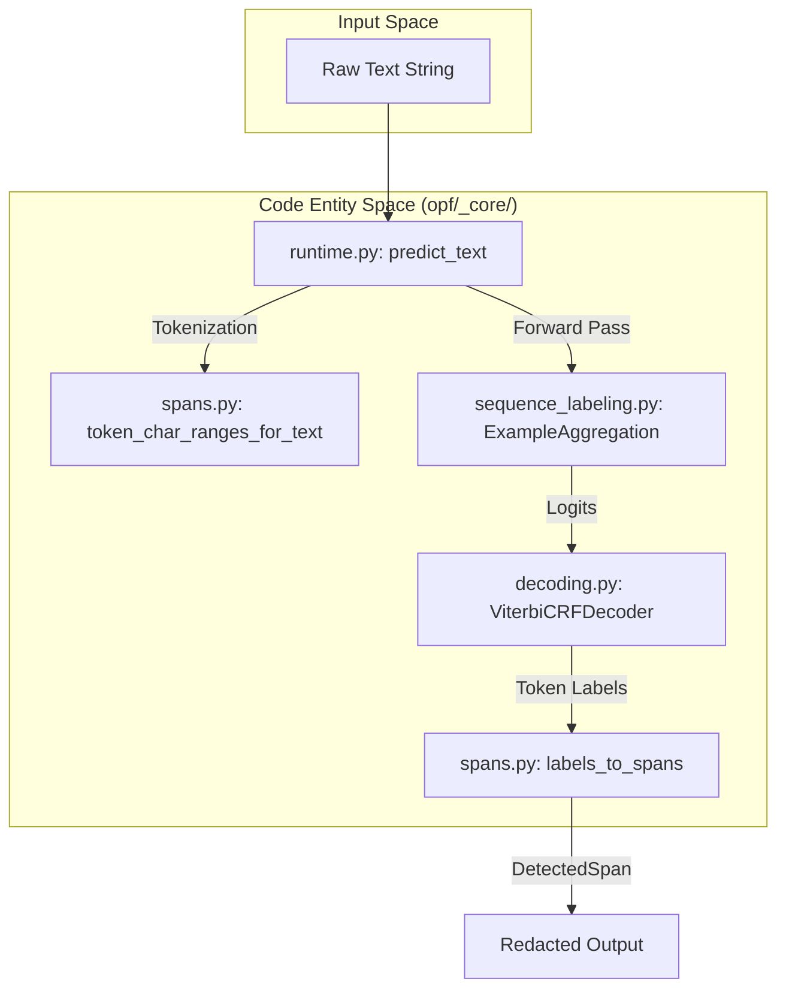
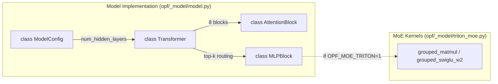

<!-- source: DeepWiki mcp.deepwiki.com · repo openai/privacy-filter · page 8 Glossary · fetched 2026-10-26 -->

# Glossary

Relevant source files

The following files were used as context for generating this wiki page:

- [EVAL_AND_OUTPUT_MODES.md](EVAL_AND_OUTPUT_MODES.md)
- [FINETUNING.md](FINETUNING.md)
- [OUTPUT_SCHEMAS.md](OUTPUT_SCHEMAS.md)
- [README.md](README.md)
- [opf/_common/constants.py](opf/_common/constants.py)
- [opf/_common/label_space.py](opf/_common/label_space.py)
- [opf/_core/decoding.py](opf/_core/decoding.py)
- [opf/_core/sequence_labeling.py](opf/_core/sequence_labeling.py)
- [opf/_core/spans.py](opf/_core/spans.py)
- [opf/_model/model.py](opf/_model/model.py)

This page provides definitions for codebase-specific terms, abbreviations, and domain concepts used within the OpenAI Privacy Filter (OPF). It serves as a technical reference for engineers to map conceptual logic to specific implementation details in the code.

## Core Concepts

### BIOES Tagging
A labeling convention used for token-level classification to represent spans. 
*   **B (Begin)**: The first token of a multi-token span.
*   **I (Inside)**: Any intermediate token of a multi-token span.
*   **E (End)**: The final token of a multi-token span.
*   **S (Single)**: A span consisting of exactly one token.
*   **O (Outside)**: Background tokens that do not belong to any privacy category.

The model expands every privacy category (e.g., `private_person`) into these four boundary markers (e.g., `B-private_person`, `I-private_person`, etc.) plus the global `O` class [opf/_common/label_space.py:77-85]().

### Banded Attention
A variation of the attention mechanism where each token only attends to a fixed-size local neighborhood (a "band") rather than the entire sequence. In OPF, this is implemented as a bidirectional banded attention with a default band size of 128, resulting in an effective context window of 257 tokens (128 left + 1 self + 128 right) [README.md:104-105]().

### Sparse Mixture of Experts (MoE)
The feed-forward component of the transformer blocks. Instead of a single dense MLP, the model contains 128 experts. For every token, a router selects the top-4 experts to process the hidden state [README.md:113-117]().

---

## Technical Terms & Components

### Label Space
The set of privacy categories and their corresponding token-level classes. The system supports versioned taxonomies (v2, v4, v7) and custom user-defined ontologies [opf/_common/label_space.py:16-73]().

### Viterbi Decoding
A constrained decoding procedure used to ensure that the predicted token-level labels form valid BIOES sequences (e.g., an `I-` tag cannot follow an `O` tag). The `ViterbiCRFDecoder` uses transition bias parameters to calibrate the model's sensitivity [opf/_core/decoding.py:132-142]().

### Example Aggregation
Because long texts are processed in overlapping windows, a single token may receive multiple logit predictions. The `ExampleAggregation` class accumulates these scores using `logsumexp` to produce a final consensus prediction for each token [opf/_core/sequence_labeling.py:51-58]().

### Operating Point
A set of transition biases (e.g., `transition_bias_background_to_start`) that tune the precision/recall tradeoff of the model. These are typically stored in a `viterbi_calibration.json` file [opf/_core/decoding.py:18-26]().

---

## Data Flow: Text to Redacted Spans

The following diagram bridges the natural language concepts to the specific code entities responsible for the transformation.

**Text Processing Pipeline**

Sources: [opf/_core/runtime.py:1-50](), [opf/_core/spans.py:49-52](), [opf/_core/sequence_labeling.py:51-58](), [opf/_core/decoding.py:132-142](), [opf/_core/spans.py:124-130]()

---

## Model Architecture Mapping

This diagram maps the high-level transformer components to the implementation classes and configuration parameters.

**Transformer Component Map**

Sources: [opf/_model/model.py:209-220](), [opf/_model/model.py:1005-1010](), [opf/_model/model.py:770-775](), [opf/_model/model.py:900-910](), [opf/_model/triton_moe.py:1-20]()

---

## Glossary Table

| Term | Definition | Code Pointer |
| :--- | :--- | :--- |
| `OPF_CHECKPOINT` | Env var defining the directory for model weights and config. | [opf/_common/constants.py:7-8]() |
| `O` Class | The "Outside" or background class for non-sensitive tokens. | [opf/_common/label_space.py:7-8]() |
| `typed` Mode | Output mode that preserves specific category names (e.g., `private_person`). | [EVAL_AND_OUTPUT_MODES.md:7-9]() |
| `redacted` Mode | Output mode that collapses all categories into a single `<REDACTED>` tag. | [EVAL_AND_OUTPUT_MODES.md:15-17]() |
| `LabelInfo` | Dataclass holding resolved mappings between tokens and span labels. | [opf/_core/sequence_labeling.py:16-26]() |
| `Window` | A fixed-size segment of tokens (default 2048) sent to the model. | [opf/_core/sequence_labeling.py:39-48]() |
| `MXFP4` | Microscaling 4-bit floating point format used for weight quantization. | [opf/_model/weights.py:1-20]() |
| `YaRN` | Positional embedding scaling used to extend context length. | [opf/_model/model.py:209-230]() |
| `SwiGLU` | The activation function used within the MLP/MoE blocks. | [opf/_model/model.py:900-905]() |

Sources: [opf/_common/constants.py:1-25](), [opf/_common/label_space.py:1-15](), [EVAL_AND_OUTPUT_MODES.md:1-20](), [opf/_core/sequence_labeling.py:1-60](), [opf/_model/weights.py:1-50](), [opf/_model/model.py:200-950]()