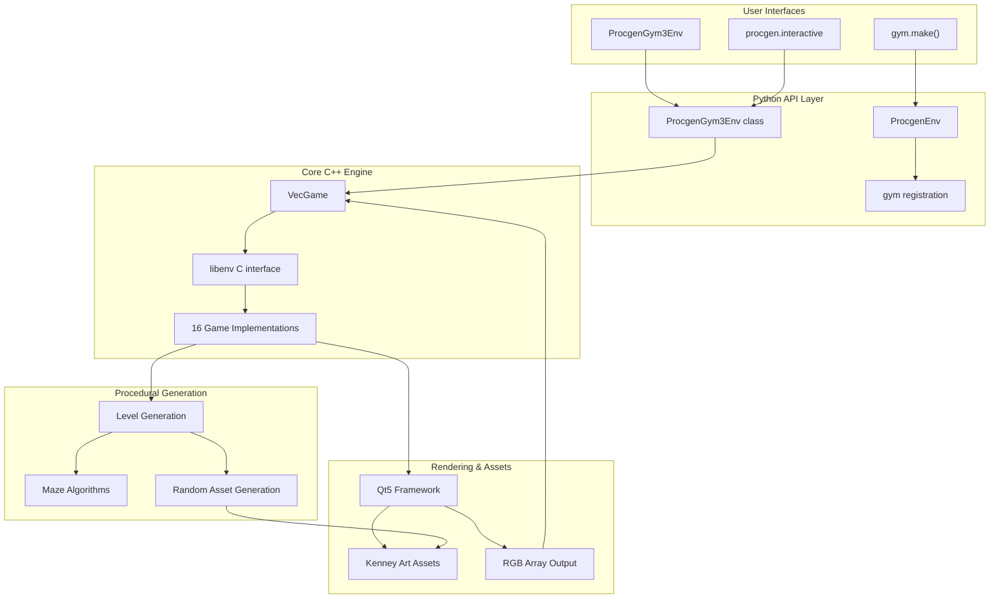
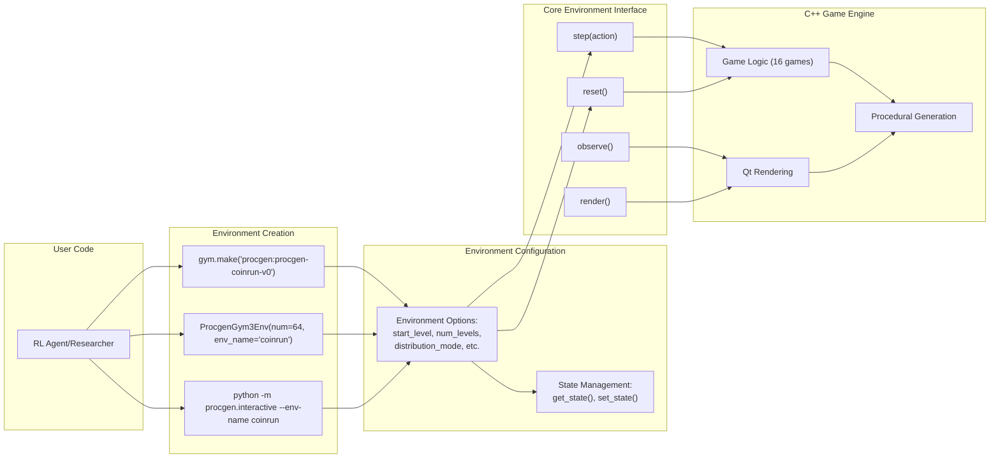
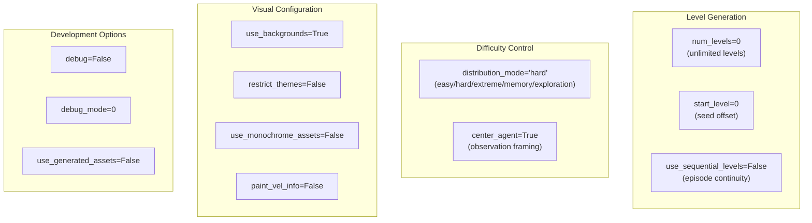

<!-- source: DeepWiki mcp.deepwiki.com · repo openai/procgen · page 1 Overview · fetched 2026-10-26 -->

# Overview

Relevant source files

The following files were used as context for generating this wiki page:

- [CHANGES.md](CHANGES.md)
- [LICENSE](LICENSE)
- [README.md](README.md)

## Purpose and Scope

The Procgen Benchmark is a suite of 16 procedurally-generated reinforcement learning environments designed to measure sample efficiency and generalization in RL agents. This repository provides high-performance C++ implementations of these environments with Python bindings, supporting both traditional `gym` and vectorized `gym3` interfaces.

This document provides a high-level overview of the Procgen system architecture, its key components, and how they interact. For detailed installation instructions, see [Installation](#2.1). For information about the build system, see [Build System](#3). For development setup and contribution guidelines, see [Development](#5).

Sources: [README.md:1-280]()

## System Architecture

The Procgen system follows a multi-layered architecture with a high-performance C++ core, Python bindings, and multiple user interfaces:

The system is designed with performance as a primary concern, achieving thousands of steps per second on a single CPU core through its C++ implementation and efficient vectorized operations.

Sources: [README.md:7-8](), [README.md:201-202]()

## Environment Creation and Usage Flow

The following diagram illustrates how user code interacts with Procgen environments, showing the key classes and methods involved:

The system supports multiple configuration options that affect environment behavior, including difficulty levels (`distribution_mode`), level generation (`start_level`, `num_levels`), and visual rendering (`use_backgrounds`, `use_monochrome_assets`).

Sources: [README.md:64-76](), [README.md:134-147](), [README.md:166-178]()

## Key Components

### Game Environments

Procgen includes 16 distinct procedurally-generated environments, each implementing unique gameplay mechanics:

| Environment | Core Mechanic | Key Features |
|-------------|---------------|--------------|
| `coinrun` | Platformer | Dodge obstacles, collect coin |
| `bigfish` | Growth game | Eat smaller fish, avoid larger ones |
| `bossfight` | Shooter | Defeat boss with timed vulnerability |
| `maze` | Navigation | Find cheese in procedural maze |
| `heist` | Puzzle | Collect keys, unlock doors |
| `jumper` | Open world platformer | Find carrot with compass guidance |

The complete list of 16 environments covers diverse gameplay patterns to thoroughly test RL agent capabilities across different domains.

Sources: [README.md:104-122]()

### Performance Characteristics

- **Speed**: Thousands of environment steps per second on single CPU core
- **Platforms**: Windows 10, macOS 10.14+, Linux (manylinux2010)
- **Python**: 3.7-3.10 (64-bit only)
- **CPU Requirements**: AVX instruction set support
- **Memory**: Efficient C++ implementation with minimal overhead

Sources: [README.md:17](), [README.md:21-36]()

### Environment Options

The system provides extensive configuration through environment options:

These options allow researchers to create controlled experimental conditions and adjust environment complexity for different research needs.

Sources: [README.md:134-147]()

## Build and Distribution System

Procgen uses a sophisticated multi-platform build system:

- **Python Packaging**: `cibuildwheel` for cross-platform wheel generation
- **C++ Compilation**: CMake build system with Qt5 static linking
- **CI/CD**: GitHub Actions for automated building and PyPI publishing
- **Asset Management**: Kenney art assets with comprehensive licensing tracking

The build system handles the complexity of compiling Qt5 from source and linking it statically with the C++ game implementations, enabling distribution of self-contained Python wheels.

Sources: [README.md:185-199]()

## Repository Structure

The codebase is organized into several key areas:

- **C++ Games**: Individual game implementations in `src/games/`
- **Python Bindings**: Python interfaces and gym registration
- **Build System**: CMake configuration and packaging scripts
- **Assets**: Game art and licensing documentation
- **CI/CD**: GitHub Actions workflows for automated builds

For detailed information about specific subsystems, see [Core Architecture](#4), [Build System](#3), and [Asset Library](#6.1).

Sources: [README.md:207-210]()

---

