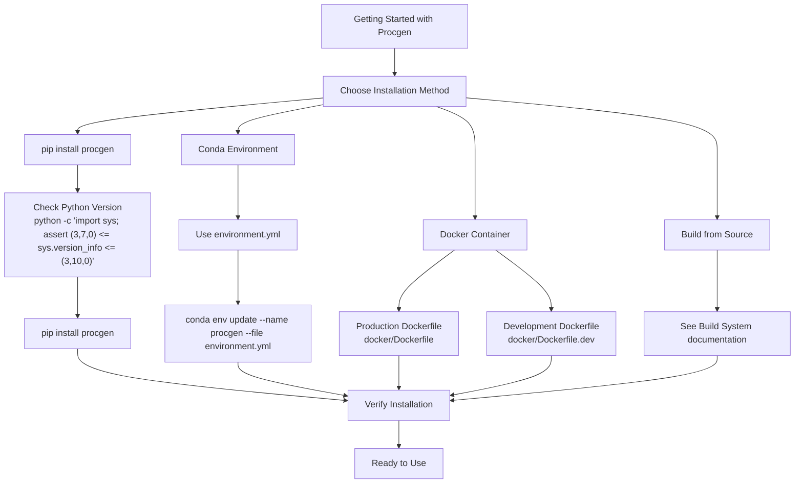
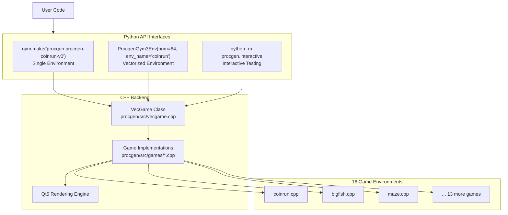
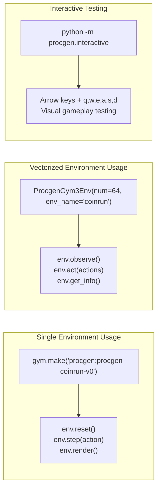

<!-- source: DeepWiki mcp.deepwiki.com · repo openai/procgen · page 2 Getting Started · fetched 2026-10-26 -->

# Getting Started

<details>
<summary>Relevant source files</summary>

The following files were used as context for generating this wiki page:

- [README.md](README.md)
- [docker/Dockerfile](docker/Dockerfile)
- [environment.yml](environment.yml)

</details>


This document provides an introduction to installing and using the Procgen Benchmark environments. It covers the basic installation options and initial usage patterns to get you started with the 16 procedurally generated reinforcement learning environments.

For detailed installation instructions including building from source, see [Installation](#2.1). For comprehensive usage examples and environment configuration options, see [Basic Usage](#2.2).

## Overview

Procgen Benchmark is a suite of 16 procedurally generated gym environments designed to measure sample efficiency and generalization in reinforcement learning. The environments are implemented in C++ for high performance (thousands of steps per second) and expose both traditional gym and vectorized gym3 interfaces.

### Installation Pathways



Sources: [README.md:38-55](), [README.md:185-199](), [docker/Dockerfile:1-5](), [environment.yml:1-16]()

### Core API Interfaces



Sources: [README.md:64-76](), [README.md:200-202]()

## System Requirements

Before installation, verify your system meets the requirements:

| Component | Requirement |
|-----------|-------------|
| **Python Version** | 3.7, 3.8, 3.9, or 3.10 (64-bit) |
| **Operating System** | Windows 10, macOS 10.14+, Linux (manylinux2010) |
| **CPU Architecture** | Must support AVX instruction set |

**Python Version Check:**
```bash
python -c "import sys; assert (3,7,0) <= sys.version_info <= (3,10,0), 'python is incorrect version'; print('ok')"
python -c "import platform; assert platform.architecture()[0] == '64bit', 'python is not 64-bit'; print('ok')"
```

Sources: [README.md:21-36](), [README.md:40-46]()

## Quick Installation

The fastest way to get started is using pip:

```bash
pip install procgen
```

If you encounter version compatibility errors, upgrade pip first:
```bash
pip install --upgrade pip
```

Sources: [README.md:48-54]()

## Basic Verification

After installation, verify Procgen is working correctly:

**Test Interactive Mode:**
```bash
python -m procgen.interactive --env-name coinrun
```

**Test Gym Interface:**
```python
import gym
env = gym.make("procgen:procgen-coinrun-v0")
```

**Test Gym3 Interface:**
```python
from procgen import ProcgenGym3Env
env = ProcgenGym3Env(num=1, env_name="coinrun")
```

Sources: [README.md:56-76]()

## Environment Interfaces

### Usage Patterns by Interface Type



Sources: [README.md:64-76](), [README.md:96-100]()

## Docker Quick Start

For containerized environments, Procgen includes Docker configurations:

**Production Container:**
```bash
docker build docker --tag procgen
docker run --rm -it procgen python3 -m procgen.examples.random_agent_gym
```

**Development Container:**
```bash
docker build . --tag procgen --file docker/Dockerfile.dev
docker run --rm -it procgen python -c "from procgen import ProcgenGym3Env; env = ProcgenGym3Env(num=1, env_name='coinrun'); print(env.observe())"
```

Sources: [README.md:78-92](), [docker/Dockerfile:1-5]()

## Available Environments

Procgen includes 16 different game environments, each with unique mechanics and challenges:

| Environment | Type | Key Features |
|-------------|------|--------------|
| `coinrun` | Platformer | Simple platformer with obstacles and enemies |
| `bigfish` | Survival | Eat smaller fish, avoid larger ones |
| `maze` | Navigation | Navigate procedurally generated mazes |
| `bossfight` | Combat | Destroy boss starship with shield mechanics |
| `caveflyer` | Flight | Navigate cave networks with asteroids-style movement |

*Complete environment descriptions available in the main documentation*

Sources: [README.md:104-122]()

## Next Steps

After completing basic installation and verification:

1. **Detailed Installation Options** - See [Installation](#2.1) for conda environments, building from source, and troubleshooting
2. **Comprehensive Usage Guide** - See [Basic Usage](#2.2) for environment configuration, rendering options, and state management
3. **Development Setup** - See [Development Environment](#5.1) for contributing to Procgen or creating custom environments

## Key Configuration Notes

- **Reproducibility**: Use specific version pinning (`pip install procgen==0.x.x`) for reproducible experiments
- **Performance**: Environments run on CPU only - no GPU required
- **Threading**: Each environment instance should only be used from a single thread
- **Default Settings**: Environments default to `distribution_mode="hard"` and 64x64x3 RGB observations

Sources: [README.md:181-183](), [README.md:96-100](), [README.md:143]()

---

