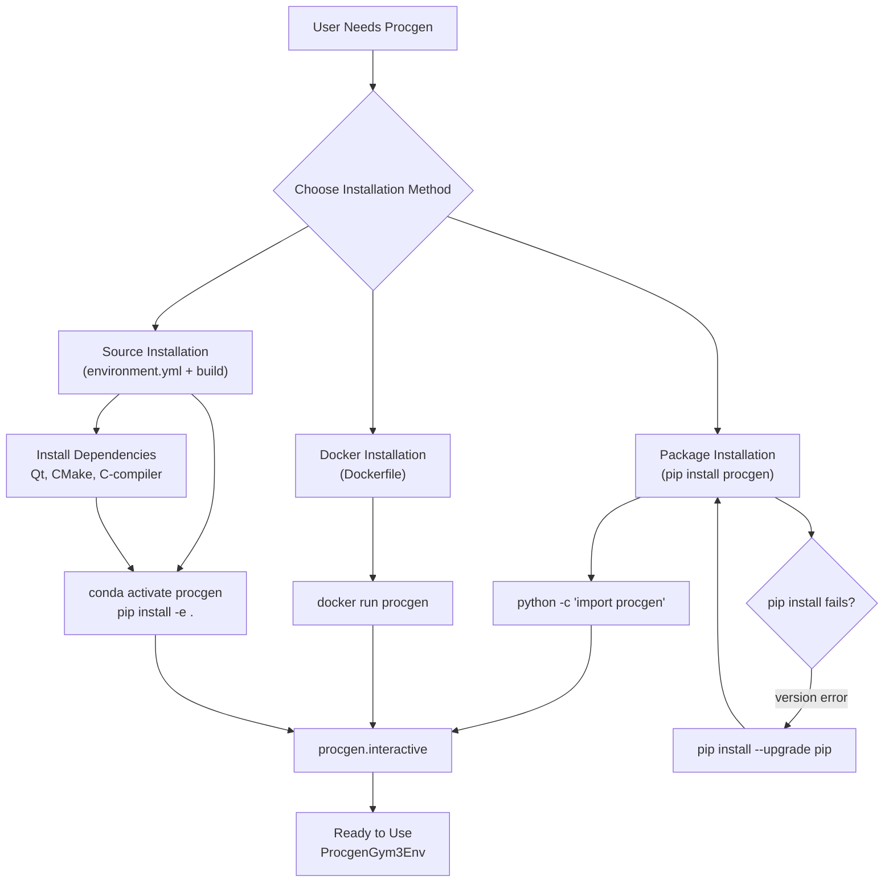
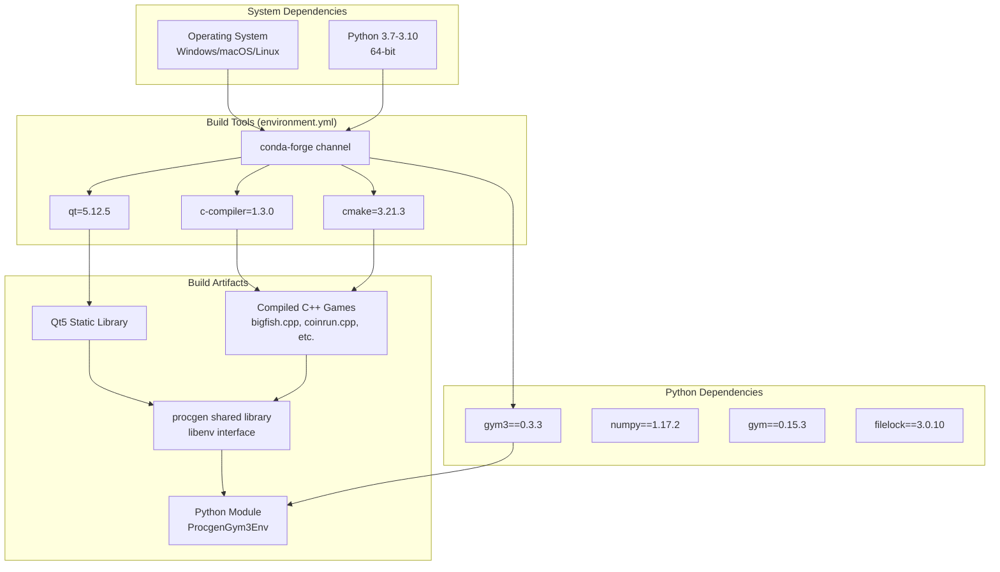

<!-- source: DeepWiki mcp.deepwiki.com · repo openai/procgen · page 2.1 Installation · fetched 2026-10-26 -->

# Installation

<details>
<summary>Relevant source files</summary>

The following files were used as context for generating this wiki page:

- [README.md](README.md)
- [docker/Dockerfile](docker/Dockerfile)
- [environment.yml](environment.yml)
- [procgen-build/requirements.txt](procgen-build/requirements.txt)

</details>


This document provides comprehensive installation instructions for the Procgen Benchmark suite. It covers three primary installation methods: package installation via pip (recommended for most users), Docker-based installation, and source installation for development purposes.

For information about basic usage after installation, see [Basic Usage](#2.2). For details about the build system and compilation process, see [Build System](#3).

## System Requirements

Before installing Procgen, verify that your system meets the following requirements:

| Component | Requirement |
|-----------|-------------|
| **Operating System** | Windows 10, macOS 10.14+ (Mojave/Catalina), Linux (manylinux2010) |
| **Python Version** | 3.7, 3.8, 3.9, or 3.10 (64-bit only) |
| **CPU Architecture** | x86_64 with AVX instruction set support |
| **Memory** | Minimum 2GB RAM recommended |

Use these commands to verify your Python installation meets the requirements:

```bash
# Verify Python version (3.7-3.10)
python -c "import sys; assert (3,7,0) <= sys.version_info <= (3,10,0), 'python is incorrect version'; print('ok')"

# Verify 64-bit architecture
python -c "import platform; assert platform.architecture()[0] == '64bit', 'python is not 64-bit'; print('ok')"
```

Sources: [README.md:40-46]()

## Installation Methods Overview



Sources: [README.md:38-199](), [docker/Dockerfile:1-5](), [environment.yml:1-16]()

## Package Installation (Recommended)

The simplest installation method uses pre-compiled wheels from PyPI. This method is recommended for users who want to use Procgen environments without modifying the source code.

### Step 1: Install Package

```bash
pip install procgen
```

If you encounter a version compatibility error, upgrade pip first:

```bash
pip install --upgrade pip
pip install procgen
```

### Step 2: Verify Installation

Test the installation with the interactive environment:

```bash
python -m procgen.interactive --env-name coinrun
```

This launches an interactive `coinrun` environment where you can test controls using arrow keys and action keys (q, w, e, a, s, d).

Sources: [README.md:48-62]()

## Docker Installation

Docker provides an isolated environment that eliminates system dependency issues. Two Docker configurations are available: production and development.

### Production Docker Setup

For running Procgen with minimal dependencies:

```bash
# Build the production container
docker build docker --tag procgen

# Run a test agent
docker run --rm -it procgen python3 -m procgen.examples.random_agent_gym
```

### Development Docker Setup

For building from source within Docker:

```bash
# Build development container with source compilation
docker build . --tag procgen --file docker/Dockerfile.dev

# Test the compiled environment
docker run --rm -it procgen python -c "from procgen import ProcgenGym3Env; env = ProcgenGym3Env(num=1, env_name='coinrun'); print(env.observe())"
```

The production `Dockerfile` installs the pre-built package, while `Dockerfile.dev` compiles from source with all build dependencies.

Sources: [README.md:78-92](), [docker/Dockerfile:1-5]()

## Source Installation

Source installation is required for users who want to modify environments, create new environments, or contribute to the project. This method involves compiling the C++ game implementations with Qt5 rendering.

### Dependency Architecture



Sources: [environment.yml:1-16](), [README.md:185-202]()

### Step 1: Clone Repository

```bash
git clone git@github.com:openai/procgen.git
cd procgen
```

### Step 2: Create Conda Environment

```bash
conda env update --name procgen --file environment.yml
conda activate procgen
```

The `environment.yml` file specifies:
- `python=3.7.3` - Base Python version
- `c-compiler=1.3.0` - Cross-platform C++ compiler
- `cmake=3.21.3` - Build system generator  
- `qt=5.12.5` - Qt5 GUI framework for rendering
- Python packages: `gym3`, `numpy`, `gym`, `filelock`

### Step 3: Build and Install

```bash
pip install -e .
```

This command triggers the build process which:
1. Compiles Qt5 static libraries
2. Uses CMake to build C++ game implementations
3. Links games into a shared library with `libenv` interface
4. Installs Python bindings

### Step 4: Verify Source Installation

```bash
# Test programmatic access
python -c "from procgen import ProcgenGym3Env; ProcgenGym3Env(num=1, env_name='coinrun')"

# Test interactive environment
python -m procgen.interactive
```

### Platform-Specific Requirements

**Windows**: Requires Visual Studio 16 2019 for C++ compilation.

**macOS/Linux**: Uses system GCC/Clang compilers specified in `environment.yml`.

Sources: [README.md:185-199](), [environment.yml:4-15]()

## Installation Verification

After installation via any method, verify that Procgen is working correctly:

### Import Test

```python
# Test core imports
from procgen import ProcgenGym3Env
import gym

# Create vectorized environment
env = ProcgenGym3Env(num=1, env_name="coinrun")
obs = env.observe()
print(f"Observation shape: {obs['rgb'].shape}")

# Create gym environment  
gym_env = gym.make("procgen:procgen-coinrun-v0")
```

### Interactive Test

```bash
python -m procgen.interactive --env-name coinrun
```

Expected output: A game window opens showing the `coinrun` environment with keyboard controls enabled.

### Performance Test

```python
from procgen import ProcgenGym3Env
import time

env = ProcgenGym3Env(num=64, env_name="coinrun")
start_time = time.time()

for _ in range(1000):
    env.act(env.get_random_actions())
    
steps_per_second = 64000 / (time.time() - start_time)
print(f"Performance: {steps_per_second:.0f} steps/second")
```

Expected performance: Several thousand steps per second on a single CPU core.

Sources: [README.md:64-76](), [README.md:156-164]()

## Troubleshooting

### Common Installation Issues

| Error | Cause | Solution |
|-------|-------|---------|
| `Could not find a version that satisfies the requirement procgen` | Outdated pip version | `pip install --upgrade pip` |
| `python is incorrect version` | Unsupported Python version | Install Python 3.7-3.10 64-bit |
| `Qt build failed` | Missing C++ compiler | Install Visual Studio 2019 (Windows) or check `environment.yml` dependencies |
| Import errors after source install | Incomplete build | Re-run `pip install -e .` and check for build errors |

### Version Pinning

For reproducible experiments, pin to a specific version:

```bash
pip install procgen==0.10.7
```

Check your installed version:

```bash
pip show procgen
```

### Thread Safety Notes

- Each environment instance should only be used from a single thread
- Set `num_threads=0` for fork safety, though Qt5 is not guaranteed to be fork-safe
- Create environments after forking or avoid forking entirely

Sources: [README.md:180-184]()

---

