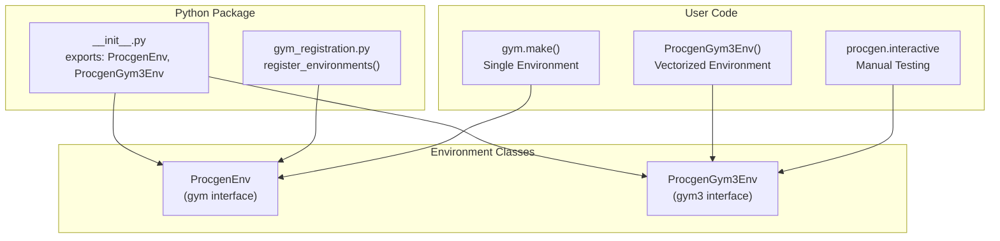
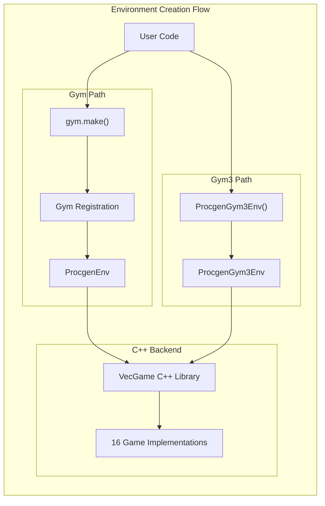
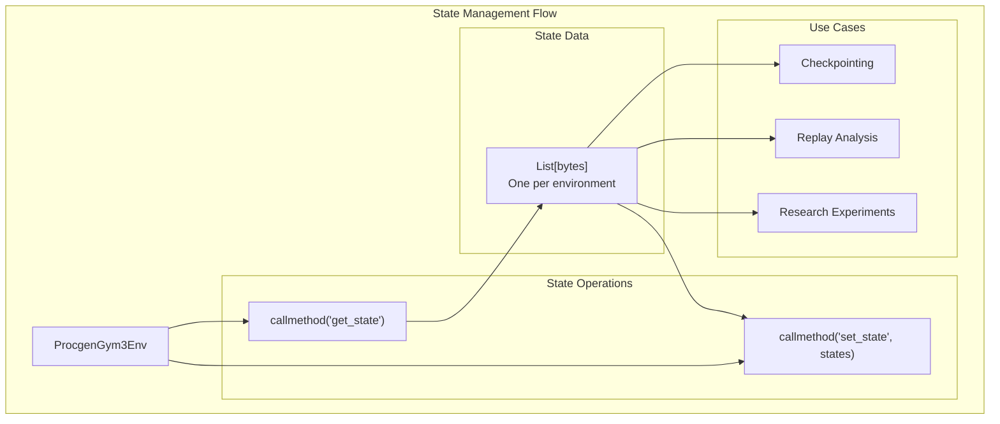

<!-- source: DeepWiki mcp.deepwiki.com · repo openai/procgen · page 2.2 Basic Usage · fetched 2026-10-26 -->

# Basic Usage

<details>
<summary>Relevant source files</summary>

The following files were used as context for generating this wiki page:

- [README.md](README.md)
- [procgen/__init__.py](procgen/__init__.py)

</details>


This page covers how to create and interact with Procgen environments using the provided Python interfaces. It demonstrates the two primary ways to use Procgen: through the standard gym interface for single environments and the gym3 interface for vectorized environments.

For installation instructions, see [Installation](#2.1). For detailed information about the 16 available game environments, see [Game Environments](#4.1).

## Environment Interfaces

Procgen provides two main interfaces for creating and interacting with procedurally generated environments:

| Interface | Class | Use Case | Vectorization |
|-----------|-------|----------|---------------|
| **Gym** | `ProcgenEnv` | Single environment, standard gym API | No |
| **Gym3** | `ProcgenGym3Env` | Multiple environments, vectorized operations | Yes |



**Environment Interface Architecture**

*Sources: [procgen/__init__.py:7-12](), [README.md:64-76]()*

## Creating Environments

### Gym Interface (Single Environment)

The gym interface provides the standard OpenAI Gym API for single environment instances:

```python
import gym
env = gym.make("procgen:procgen-coinrun-v0")
```

All 16 environments follow the naming pattern `"procgen:procgen-{env_name}-v0"` where `{env_name}` is one of: `bigfish`, `bossfight`, `caveflyer`, `chaser`, `climber`, `coinrun`, `dodgeball`, `fruitbot`, `heist`, `jumper`, `leaper`, `maze`, `miner`, `ninja`, `plunder`, `starpilot`.

### Gym3 Interface (Vectorized Environment)

The gym3 interface allows running multiple environment instances in parallel:

```python
from procgen import ProcgenGym3Env
env = ProcgenGym3Env(num=1, env_name="coinrun")
```

The `num` parameter specifies how many environment instances to run in parallel. For training, you typically use values like `num=64` or higher.



**Environment Creation and Backend Integration**

*Sources: [README.md:64-76](), [procgen/__init__.py:7-12]()*

## Interactive Testing

For manual testing and exploration, use the interactive mode:

```bash
python -m procgen.interactive --env-name coinrun
```

Controls:
- **Movement**: Arrow keys (left/right/up/down)
- **Actions**: q, w, e, a, s, d (environment-dependent actions)
- **Display**: Episode return shown in lower left, level completion status at episode end

*Sources: [README.md:56-62]()*

## Basic Environment Interaction

### Standard Gym Workflow

```python
import gym

# Create environment
env = gym.make("procgen:procgen-coinrun-v0")

# Reset to get initial observation
obs = env.reset()

# Take actions in environment
for step in range(1000):
    action = env.action_space.sample()  # Random action
    obs, reward, done, info = env.step(action)
    
    if done:
        obs = env.reset()
```

### Gym3 Vectorized Workflow

```python
from procgen import ProcgenGym3Env

# Create vectorized environment
env = ProcgenGym3Env(num=4, env_name="coinrun")

# Get initial observations
obs = env.observe()

# Take actions across all environments
for step in range(1000):
    actions = [env.action_space.sample() for _ in range(4)]
    env.act(actions)
    obs, rewards, dones = env.observe()
```

## Environment Configuration

Both interfaces support extensive configuration options through constructor parameters:

| Parameter | Type | Default | Description |
|-----------|------|---------|-------------|
| `start_level` | int | 0 | Lowest seed for level generation |
| `num_levels` | int | 0 | Number of unique levels (0 = unlimited) |
| `distribution_mode` | str | "hard" | Difficulty: "easy", "hard", "extreme", "memory", "exploration" |
| `use_backgrounds` | bool | True | Enable/disable background graphics |
| `center_agent` | bool | True | Center observations on agent |
| `paint_vel_info` | bool | False | Paint velocity info in corner |

### Gym Configuration Example

```python
import gym
env = gym.make(
    "procgen:procgen-coinrun-v0",
    start_level=0,
    num_levels=1,
    distribution_mode="easy"
)
```

### Gym3 Configuration Example

```python
from procgen import ProcgenGym3Env
env = ProcgenGym3Env(
    num=8,
    env_name="coinrun",
    start_level=0,
    num_levels=100,
    distribution_mode="hard"
)
```

*Sources: [README.md:132-147](), [README.md:148-164]()*

## Environment State Management

The gym3 interface supports saving and restoring environment state, useful for research applications:

```python
from procgen import ProcgenGym3Env

env = ProcgenGym3Env(num=1, env_name="coinrun")

# Save current state
states = env.callmethod("get_state")

# ... perform actions ...

# Restore saved state
env.callmethod("set_state", states)
```

The `get_state()` method returns a list of byte strings representing the state of each environment in the vectorized setup.



**State Management Operations in Gym3 Interface**

*Sources: [README.md:166-177]()*

## Observation and Action Spaces

### Observation Space
- **Format**: RGB pixel arrays
- **Shape**: `(64, 64, 3)` for gym interface
- **Gym3**: Dictionary space with pixels under `"rgb"` key
- **Data Type**: numpy arrays with uint8 values (0-255)

### Action Space
- **Type**: `Discrete(15)` - button combinations
- **Mapping**: Defined in [procgen/env.py]()
- **Rate**: Expected human play rate is 15 Hz

*Sources: [README.md:96-100]()*

## Thread Safety and Performance Notes

- Each environment instance should only be used from a single thread
- The library is not fork-safe unless `num_threads=0` is set
- No GPU required - all computation runs on CPU
- High performance: thousands of steps per second on single core

*Sources: [README.md:181-183]()*

---

