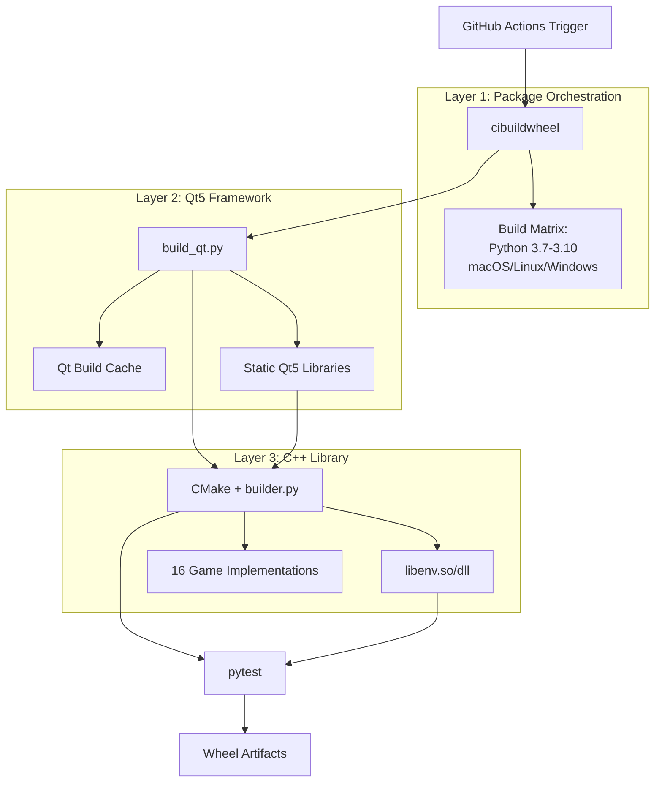
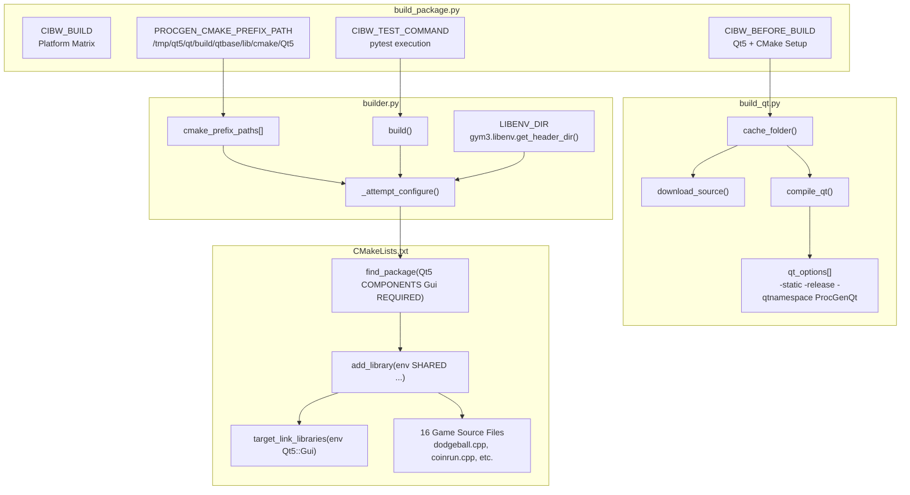
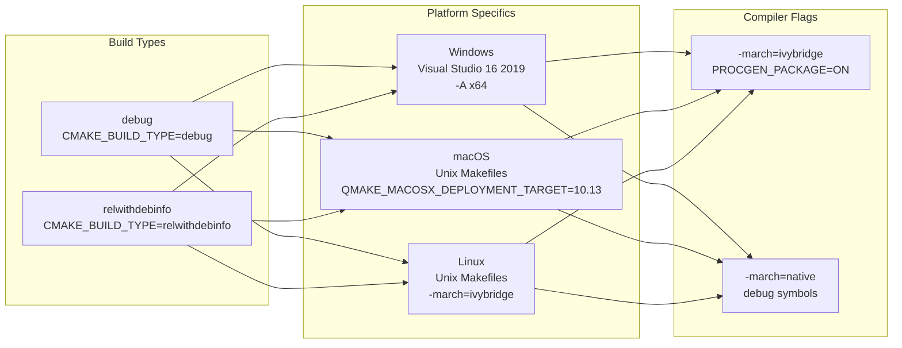
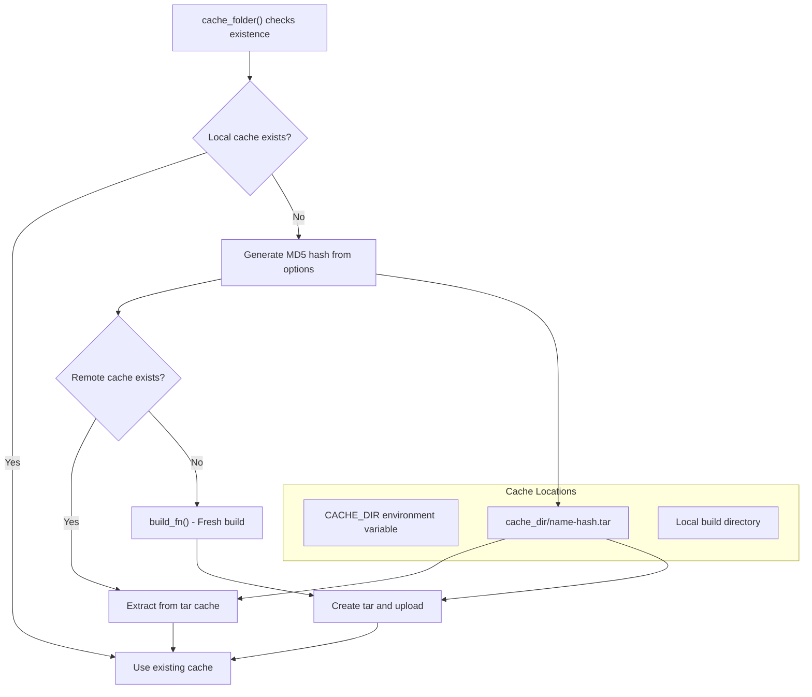
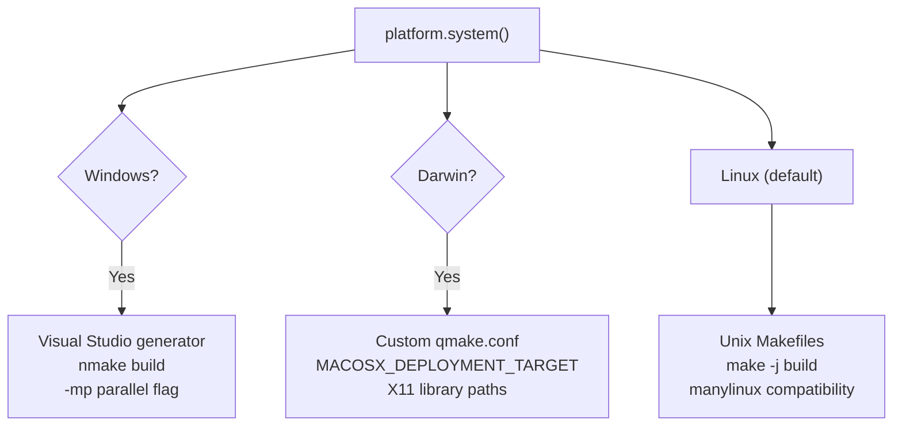

<!-- source: DeepWiki mcp.deepwiki.com · repo openai/procgen · page 3 Build System · fetched 2026-10-26 -->

# Build System

Relevant source files

The following files were used as context for generating this wiki page:

- [procgen-build/procgen_build/build_package.py](procgen-build/procgen_build/build_package.py)
- [procgen-build/procgen_build/build_qt.py](procgen-build/procgen_build/build_qt.py)
- [procgen/CMakeLists.txt](procgen/CMakeLists.txt)
- [procgen/builder.py](procgen/builder.py)

The Procgen build system is a multi-layered architecture that orchestrates the compilation of C++ game environments, Qt5 framework dependencies, and Python package distribution across multiple platforms. This system combines Python packaging tools (`cibuildwheel`), Qt5 static compilation, and CMake-based C++ library building to produce platform-specific wheels for distribution.

For information about development environment setup, see [Development Environment](#5.1). For details about the CI/CD pipeline automation, see [CI/CD Pipeline](#5.3).

## Build Architecture Overview

The build system operates in three distinct layers that execute sequentially during package creation. Each layer has specific responsibilities and dependencies on the previous layer's outputs.

**Build Pipeline Flow**

Sources: [procgen-build/procgen_build/build_package.py:10-44](), [procgen-build/procgen_build/build_qt.py:56-166](), [procgen/builder.py:95-148]()

## Component Dependencies

The build system's components have specific dependencies and interfaces that must be maintained across all supported platforms.

**Component Interaction Diagram**

Sources: [procgen-build/procgen_build/build_package.py:11-24](), [procgen-build/procgen_build/build_qt.py:18-46](), [procgen/CMakeLists.txt:40-78](), [procgen/builder.py:52-93]()

## Build Artifacts and Outputs

The build system produces several key artifacts that are used in different contexts:

| Artifact | Location | Purpose | Created By |
|----------|----------|---------|------------|
| `qt5/` source cache | `/tmp/qt5/qt/` or `CACHE_DIR` | Cached Qt5 source to avoid repeated git clones | `build_qt.py:cache_folder()` |
| Static Qt5 libraries | `/tmp/qt5/qt/build/qtbase/lib/` | Platform-specific Qt5 static libraries | `build_qt.py:compile_qt()` |
| `libenv` shared library | `.build/{build_type}/` | C++ game environments compiled library | `builder.py:build()` |
| Platform wheels | `wheelhouse/` | Distributable Python packages | `build_package.py:cibuildwheel` |

**Build Type Configuration**

Sources: [procgen/builder.py:102-147](), [procgen/CMakeLists.txt:15-37](), [procgen-build/procgen_build/build_qt.py:109-164]()

## Cache Management System

The build system implements a sophisticated caching mechanism to avoid rebuilding expensive components like Qt5 across multiple builds.

**Cache Strategy**

Sources: [procgen-build/procgen_build/build_qt.py:18-46]()

## Platform-Specific Build Configuration

Each platform requires specific configuration to ensure consistent builds across the supported matrix.

| Platform | Generator | Qt Configuration | Special Handling |
|----------|-----------|------------------|------------------|
| **Windows** | `Visual Studio 16 2019 -A x64` | `-mp` for parallel build | `nmake` instead of `make` |
| **macOS** | `Unix Makefiles` | Custom `qmake.conf` with deployment target 10.13 | X11 library paths |
| **Linux** | `Unix Makefiles` | Standard Unix configuration | `manylinux` wheel compatibility |

**Platform Detection Logic**

Sources: [procgen/builder.py:66-76](), [procgen-build/procgen_build/build_qt.py:109-164](), [procgen/CMakeLists.txt:22-37]()

## Process Safety and Concurrency

The build system implements multiple layers of process safety to handle concurrent builds and avoid race conditions.

- **File Locking**: `filelock.FileLock(".build-lock")` prevents multiple processes from building simultaneously
- **Global Build Tracking**: `global_builds` set tracks completed builds within a single process
- **Thread Safety**: `global_build_lock` threading lock for process-level coordination
- **Build Directory Isolation**: Each build type gets its own directory (`.build/debug`, `.build/relwithdebinfo`)

Sources: [procgen/builder.py:16-17](), [procgen/builder.py:106-117]()

---

