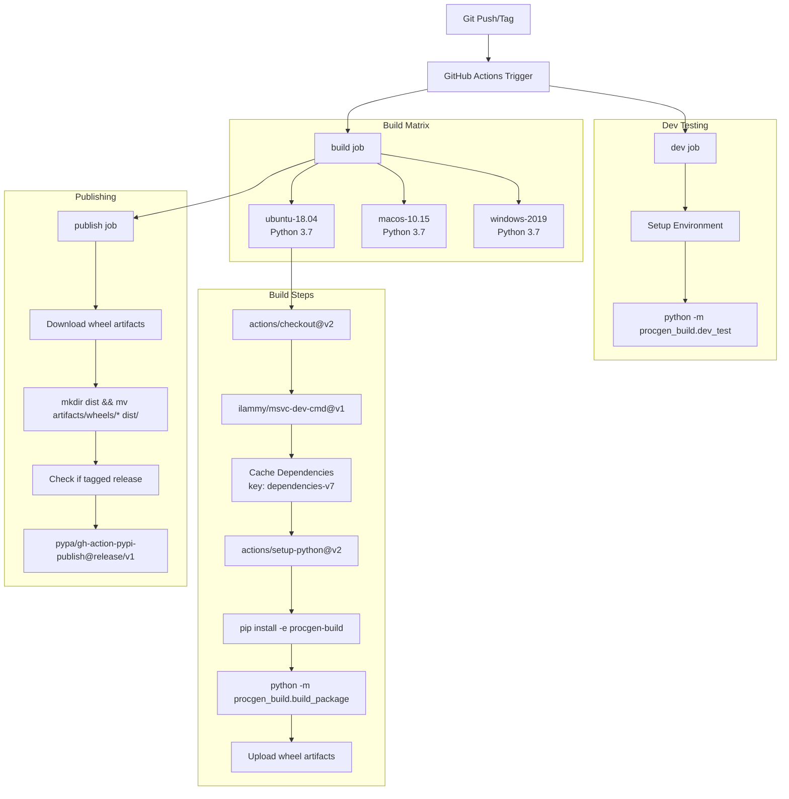
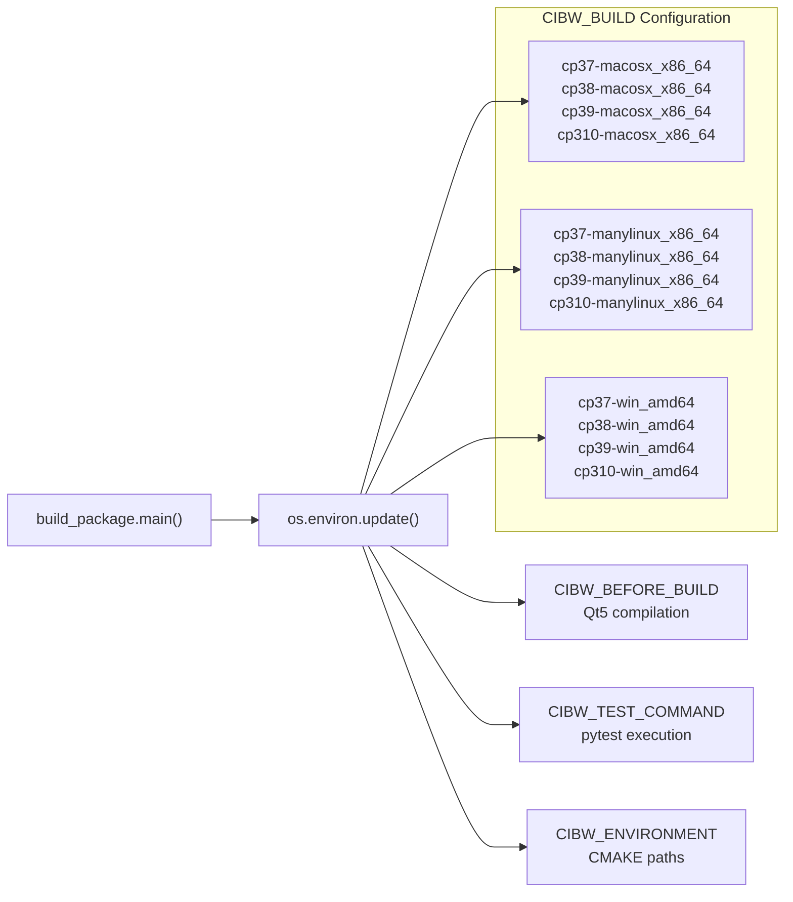
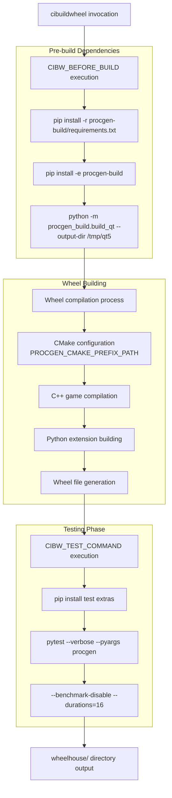
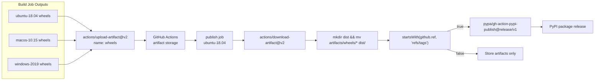

<!-- source: DeepWiki mcp.deepwiki.com · repo openai/procgen · page 3.1 Python Package Build · fetched 2026-10-26 -->

# Python Package Build

<details>
<summary>Relevant source files</summary>

The following files were used as context for generating this wiki page:

- [.github/workflows/main.yml](.github/workflows/main.yml)
- [procgen-build/procgen_build/build_package.py](procgen-build/procgen_build/build_package.py)
- [procgen-build/setup.py](procgen-build/setup.py)

</details>


This page documents the Python package build system for Procgen, which uses `cibuildwheel` to create cross-platform wheels for distribution. This system orchestrates the compilation of C++ game environments, Qt framework integration, and Python package assembly into distributable wheels.

For information about the underlying Qt framework compilation, see [Qt Framework Build](#3.2). For details about the C++ library compilation process, see [C++ Library Build](#3.3).

## Overview

The Procgen Python package build system uses `cibuildwheel` to create platform-specific wheels across multiple operating systems and Python versions. The build process is orchestrated through GitHub Actions and integrates Qt framework compilation, C++ library building, and Python packaging into a single automated pipeline.

The build system produces wheels for:
- **Operating Systems**: Ubuntu 18.04, macOS 10.15, Windows 2019
- **Python Versions**: 3.7, 3.8, 3.9, 3.10
- **Architectures**: x86_64 (Linux/macOS), amd64 (Windows)

Sources: [.github/workflows/main.yml:1-102](), [procgen-build/procgen_build/build_package.py:1-45]()

## CI/CD Pipeline Integration

The Python package build integrates with the GitHub Actions workflow through a multi-job pipeline that separates building, development testing, and publishing phases.

### Build Pipeline Architecture



Sources: [.github/workflows/main.yml:5-46](), [.github/workflows/main.yml:48-72](), [.github/workflows/main.yml:74-102]()

## Build Configuration Matrix

The build system uses a strategic matrix configuration to ensure comprehensive platform coverage while maintaining build efficiency.

| Component | Configuration | Purpose |
|-----------|---------------|---------|
| **Operating Systems** | `ubuntu-18.04`, `macos-10.15`, `windows-2019` | Cross-platform wheel generation |
| **Python Versions** | `3.7` (primary), `3.8`, `3.9`, `3.10` (via cibuildwheel) | Multi-version compatibility |
| **Architecture** | `x64` (setup-python), `x86_64`/`amd64` (cibuildwheel) | 64-bit platform support |
| **Failure Strategy** | `fail-fast: false` | Complete matrix execution |

The matrix balances coverage with build time by using Python 3.7 for the initial GitHub Actions setup while delegating multi-version builds to `cibuildwheel`.

Sources: [.github/workflows/main.yml:9-14](), [.github/workflows/main.yml:52-56]()

## Cibuildwheel Configuration

The core build logic resides in the `build_package.py` module, which configures `cibuildwheel` through environment variables to orchestrate the complex build process.

### Build Target Specification



The `CIBW_BUILD` environment variable specifies the exact wheel targets, using CPython interpreter tags combined with platform identifiers.

Sources: [procgen-build/procgen_build/build_package.py:10-24]()

### Build Process Environment Variables

| Variable | Value | Purpose |
|----------|-------|---------|
| `CIBW_BUILD` | Platform-specific Python tags | Defines which wheels to build |
| `CIBW_BEFORE_BUILD` | `pip install ... && python -m procgen_build.build_qt` | Qt compilation before wheel build |
| `CIBW_TEST_COMMAND` | `pytest --pyargs procgen` | Validates built wheels |
| `CIBW_ENVIRONMENT` | `PROCGEN_CMAKE_PREFIX_PATH=/tmp/qt5/...` | CMake configuration paths |
| `CACHE_DIR` | Platform-specific cache paths | Dependency caching location |

Sources: [procgen-build/procgen_build/build_package.py:14-20](), [procgen-build/procgen_build/build_package.py:32-37]()

## Build Process Steps

The build process follows a carefully orchestrated sequence that integrates multiple build systems and validates the results.

### Detailed Build Flow



Sources: [procgen-build/procgen_build/build_package.py:14-18](), [procgen-build/procgen_build/build_package.py:39-40]()

## Platform-Specific Configurations

The build system adapts to different platforms through conditional environment variable configuration and caching strategies.

### Linux-Specific Configuration

On Linux systems, the build process includes additional environment variable passing and cache directory mapping to support containerized builds:

```python
if platform.system() == "Linux":
    if "GITHUB_REF" in os.environ:
        # GitHub reference for version tagging
        os.environ["CIBW_ENVIRONMENT"] += " GITHUB_REF=" + os.environ["GITHUB_REF"]
    # Container cache directory mapping
    os.environ["CIBW_ENVIRONMENT"] += f" CACHE_DIR=/host{os.getcwd()}/cache"
else:
    # Direct cache directory for macOS/Windows
    os.environ["CACHE_DIR"] = os.path.join(os.getcwd(), "cache")
```

Sources: [procgen-build/procgen_build/build_package.py:25-37]()

### Dependency Management

The `procgen_build` package itself has minimal dependencies focused on build tooling:

| Dependency | Version | Purpose |
|------------|---------|---------|
| `cmake` | 3.21.3 | Cross-platform C++ build system |
| `gym3` | 0.3.0 | Required by procgen/build.py |
| `cibuildwheel` | 2.3.1 | Multi-platform wheel builder |

Sources: [procgen-build/setup.py:7-12](), [procgen-build/procgen_build/build_package.py:39]()

## Testing and Validation

The build system includes comprehensive testing to ensure wheel quality and functionality across all target platforms.

### Test Configuration

The testing phase uses the `CIBW_TEST_COMMAND` to validate each built wheel through pytest execution with specific flags optimized for CI environments:

- `--verbose`: Detailed test output
- `--benchmark-disable`: Skip performance benchmarks
- `--durations=16`: Show slowest 16 tests
- `--pyargs procgen`: Test installed package rather than source

Sources: [procgen-build/procgen_build/build_package.py:18]()

## Artifact Generation and Publishing

The build pipeline produces wheel artifacts that are collected, stored, and conditionally published to PyPI based on git tag triggers.

### Artifact Flow



The publishing process only triggers for tagged releases, ensuring that development builds remain as artifacts without affecting the public package repository.

Sources: [.github/workflows/main.yml:42-46](), [.github/workflows/main.yml:82-102]()

---

