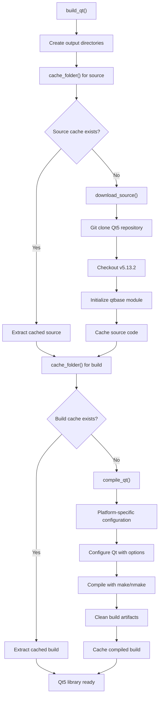
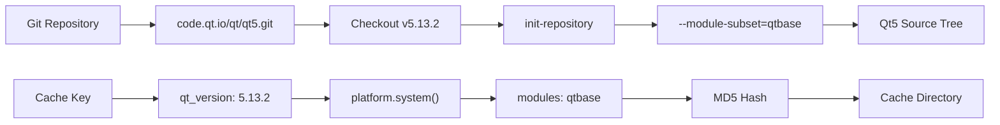
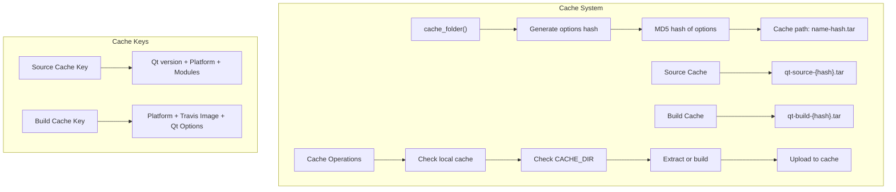
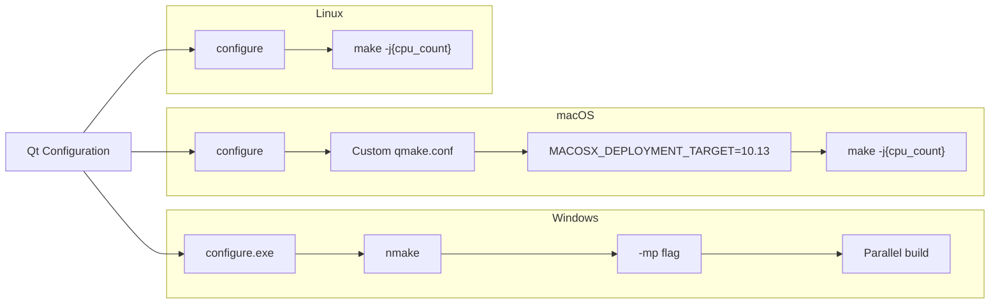
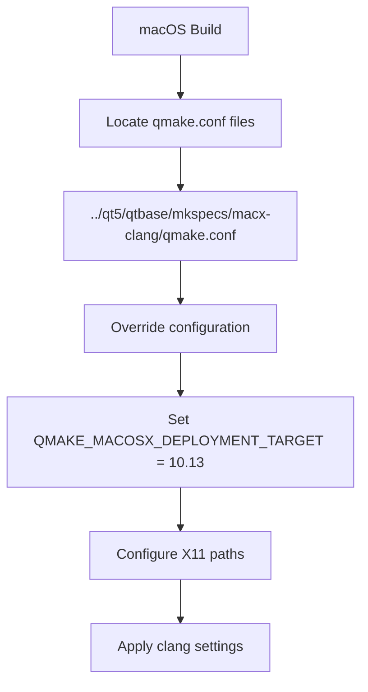
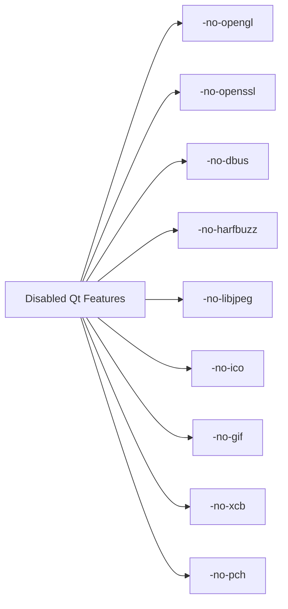
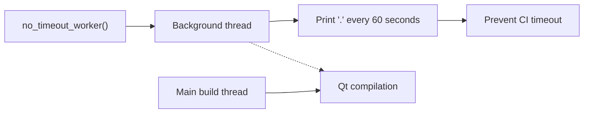
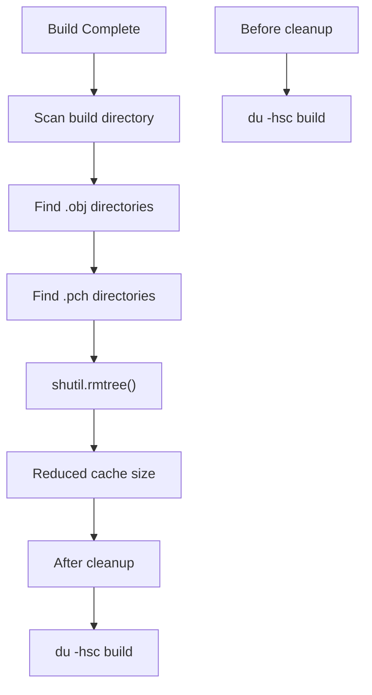
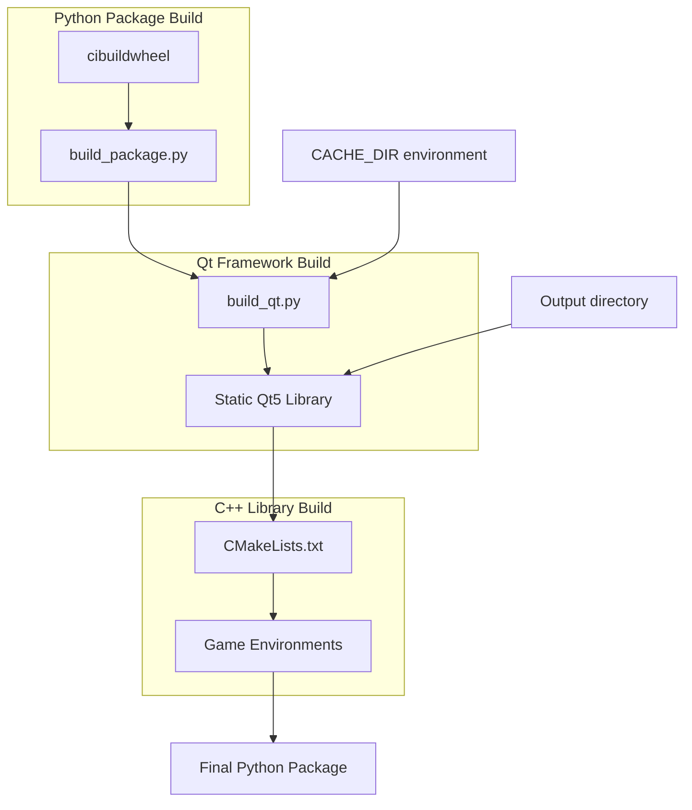

<!-- source: DeepWiki mcp.deepwiki.com · repo openai/procgen · page 3.2 Qt Framework Build · fetched 2026-10-26 -->

# Qt Framework Build

Relevant source files

The following files were used as context for generating this wiki page:

- [procgen-build/procgen_build/build_qt.py](procgen-build/procgen_build/build_qt.py)
- [procgen-build/procgen_build/common.py](procgen-build/procgen_build/common.py)

This document covers the Qt5 framework build system used by Procgen. The Qt build process creates a statically-linked Qt5 library that provides the GUI rendering capabilities for the game environments. For information about the overall Python package build pipeline, see [Python Package Build](#3.1). For details about the C++ game library compilation, see [C++ Library Build](#3.3).

## Overview

The Qt framework build system downloads, configures, and compiles Qt5 from source with specific optimizations for the Procgen use case. The build produces a static Qt5 library with a custom namespace to avoid symbol conflicts, and includes comprehensive caching mechanisms to reduce build times across different platforms.

## Build Process Flow

The Qt build process follows a structured workflow that handles source acquisition, configuration, compilation, and caching:

### Qt Build Workflow

Sources: [procgen-build/procgen_build/build_qt.py:56-166]()

### Source Code Management

The system uses Git to acquire Qt5 source code with specific module selection:

Sources: [procgen-build/procgen_build/build_qt.py:68-77]()

## Caching System

The build system implements a two-tier caching mechanism to optimize build times:

### Cache Architecture

The `cache_folder()` function provides transparent caching with the following behavior:

| Cache State | Action |
|-------------|---------|
| Local directory exists | Use existing build |
| Cache file exists | Extract from cache |
| No cache available | Build from source and cache result |

Sources: [procgen-build/procgen_build/build_qt.py:18-45]()

## Platform-Specific Configuration

The Qt build process adapts to different platforms with specific configurations:

### Platform Build Matrix

### macOS-Specific Modifications

The build system modifies the macOS Qt configuration to ensure compatibility:

Sources: [procgen-build/procgen_build/build_qt.py:116-145]()

## Qt Configuration Options

The build uses specific Qt configuration options optimized for Procgen's requirements:

### Core Configuration

| Option | Purpose |
|--------|---------|
| `-static` | Static linking to avoid runtime dependencies |
| `-qtnamespace ProcGenQt` | Custom namespace to prevent symbol conflicts |
| `-nomake examples,tests,tools` | Exclude unnecessary components |
| `-no-avx2, -no-avx512` | Disable advanced CPU instructions for compatibility |

### Disabled Features

The build explicitly disables features not required by Procgen:

Sources: [procgen-build/procgen_build/build_qt.py:79-108]()

## Build Optimization

The system includes several optimizations to reduce build time and output size:

### Timeout Prevention

A background thread prevents CI/CD timeouts during long builds:

### Artifact Cleanup

Post-build cleanup removes intermediate files to reduce cache size:

Sources: [procgen-build/procgen_build/build_qt.py:50-54](), [procgen-build/procgen_build/build_qt.py:157-163]()

## Integration Points

The Qt build integrates with the broader Procgen build system through several mechanisms:

### Build System Integration

The Qt build outputs a static library that the C++ build system links against, enabling the rendering capabilities required by the game environments.

Sources: [procgen-build/procgen_build/build_qt.py:56-173](), [procgen-build/procgen_build/common.py:6-17]()

---

