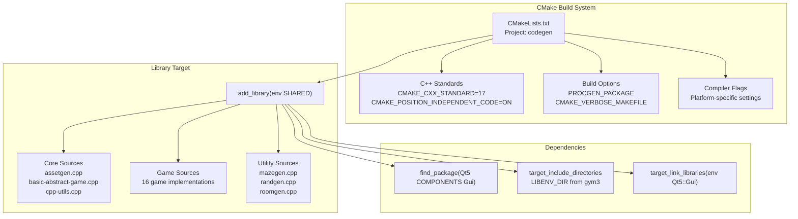
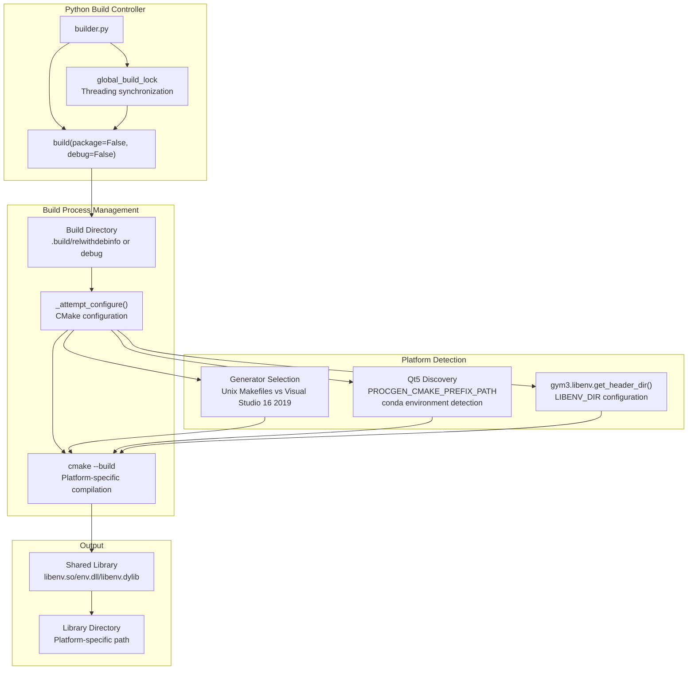
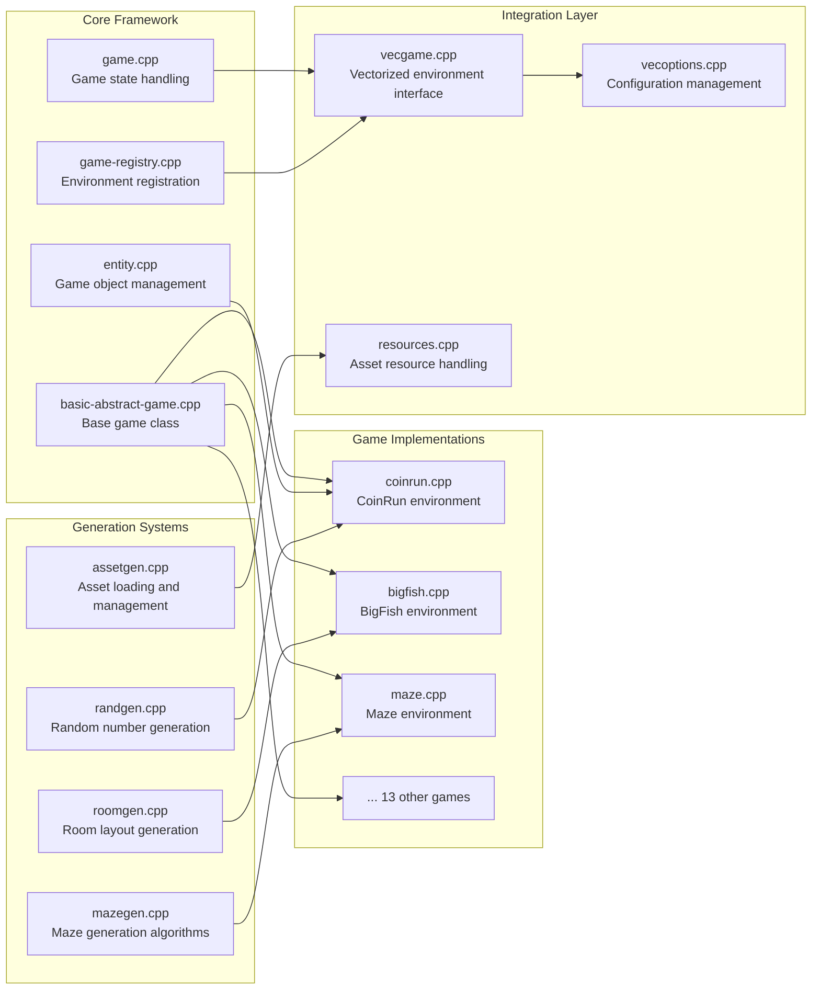
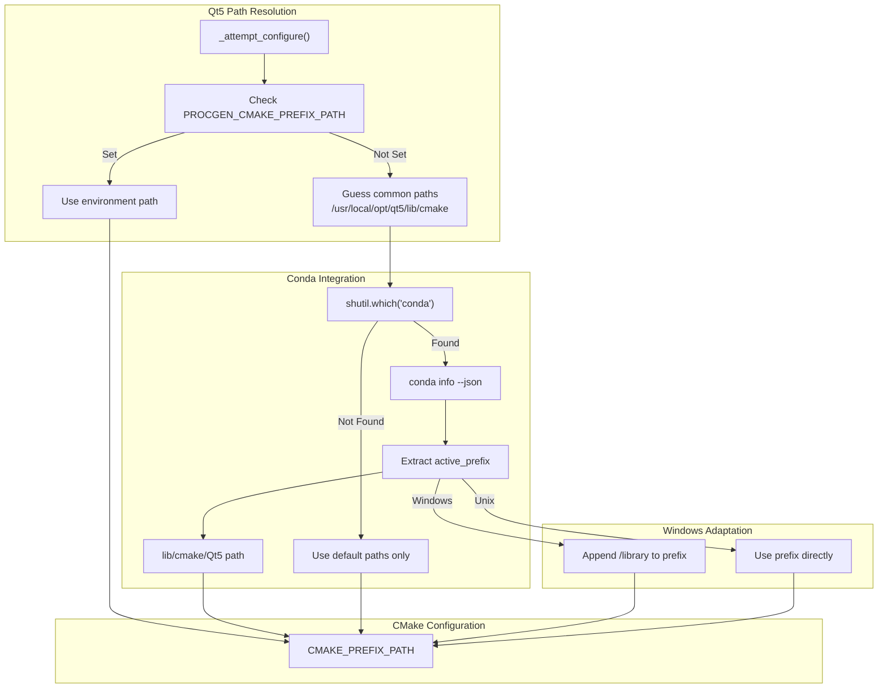
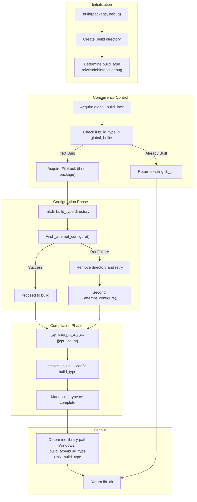

<!-- source: DeepWiki mcp.deepwiki.com · repo openai/procgen · page 3.3 C++ Library Build · fetched 2026-10-26 -->

# C++ Library Build

Relevant source files

The following files were used as context for generating this wiki page:

- [procgen/CMakeLists.txt](procgen/CMakeLists.txt)
- [procgen/builder.py](procgen/builder.py)

This page documents the CMake-based build system that compiles the core C++ game environments into a shared library. The build system handles compilation of 16 procedurally generated game implementations, links them with Qt5 for rendering, and creates the `env` shared library that serves as the foundation for Python bindings.

For information about the overall Python package build process, see [Python Package Build](#3.1). For details about Qt5 framework compilation, see [Qt Framework Build](#3.2).

## Build System Overview

The C++ library build consists of two main components: the CMake configuration that defines the library structure and compilation settings, and the Python build orchestrator that manages the build process across platforms.

### CMake Configuration Structure

**Sources:** [procgen/CMakeLists.txt:1-78]()

### Build Orchestration Architecture

**Sources:** [procgen/builder.py:95-148]()

## Game Implementation Structure

The shared library contains implementations for all 16 Procgen game environments, organized in a modular architecture.

### Game Source Organization

| Game Category | Source Files | Key Features |
|---------------|--------------|--------------|
| **Action Games** | `dodgeball.cpp`, `bossfight.cpp`, `ninja.cpp` | Fast-paced gameplay mechanics |
| **Platformers** | `coinrun.cpp`, `coinrun_old.cpp`, `jumper.cpp`, `leaper.cpp` | Platform navigation challenges |
| **Navigation** | `maze.cpp`, `heist.cpp`, `caveflyer.cpp` | Pathfinding and exploration |
| **Collection** | `bigfish.cpp`, `fruitbot.cpp`, `plunder.cpp` | Resource gathering mechanics |
| **Precision** | `climber.cpp`, `miner.cpp`, `starpilot.cpp` | Fine motor control requirements |
| **Chase** | `chaser.cpp` | Pursuit and evasion dynamics |

### Core Game Architecture

**Sources:** [procgen/CMakeLists.txt:42-73]()

## Platform-Specific Build Configuration

The build system adapts to different operating systems and development environments through conditional compilation settings.

### Compiler Configuration Matrix

| Platform | Generator | Compiler Flags | Optimization |
|----------|-----------|----------------|--------------|
| **macOS/Linux** | Unix Makefiles | `-Werror -Wextra -Wall` | `-march=ivybridge` (package) / `-march=native` (dev) |
| **Windows** | Visual Studio 16 2019 | `-D_CRT_SECURE_NO_WARNINGS` | Architecture: x64 |
| **All Platforms** | - | `-fno-omit-frame-pointer` | Frame pointers for profiling |

### Qt5 Discovery Process

**Sources:** [procgen/builder.py:52-92]()

## Build Process Flow

The complete build process involves configuration, compilation, and output management with error handling and retry logic.

### Build Execution Pipeline

**Sources:** [procgen/builder.py:95-148]()

### Error Handling and Recovery

The build system includes robust error handling with automatic retry mechanisms:

- **Configuration Failures**: If initial CMake configuration fails, the system removes the build directory and retries once ([procgen/builder.py:124-131]())
- **Process Safety**: Uses `global_build_lock` to prevent concurrent builds in the same process ([procgen/builder.py:16-17]())
- **File Locking**: Prevents multiple processes from building simultaneously using `filelock.FileLock` ([procgen/builder.py:114-116]())
- **Verbose Output**: Controlled by the `package` parameter for detailed build logging ([procgen/builder.py:92]())

The build system integrates with gym3's libenv through the `LIBENV_DIR` CMake variable, ensuring proper header inclusion for the vectorized environment interface ([procgen/builder.py:83]()).

**Sources:** [procgen/builder.py:20-50](), [procgen/CMakeLists.txt:75-78]()

---

