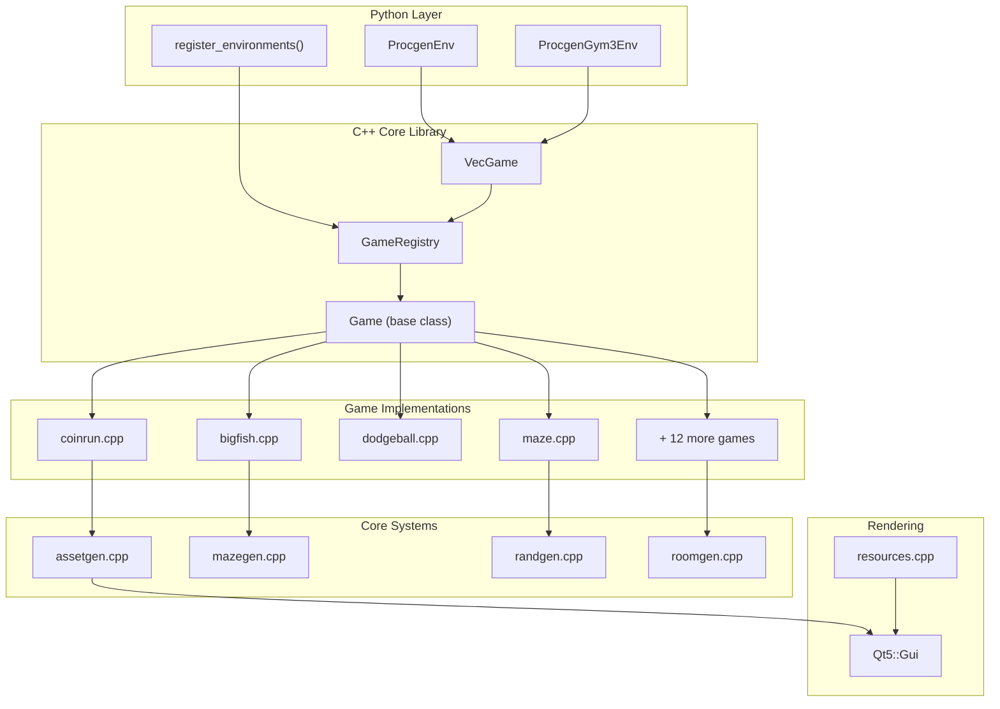
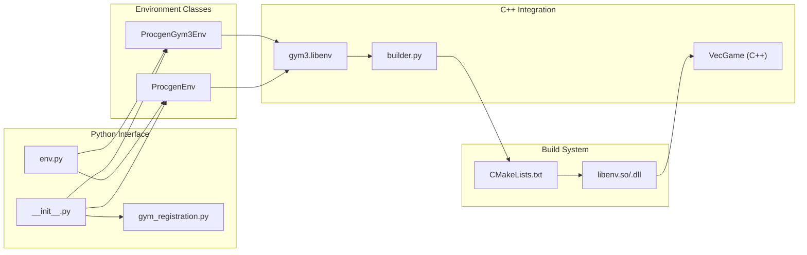
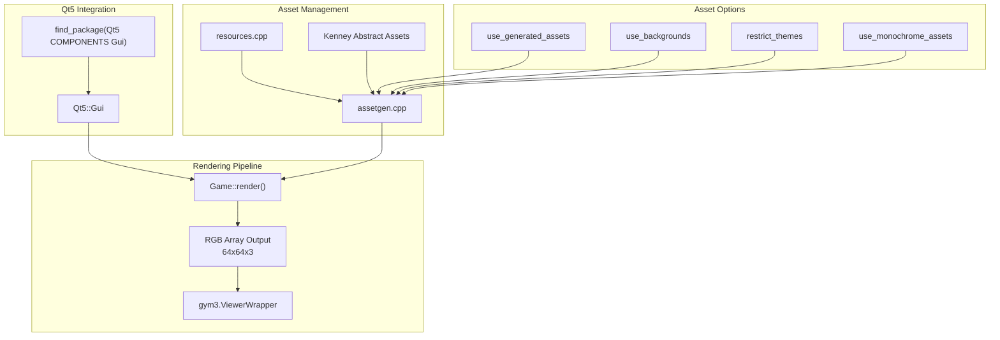
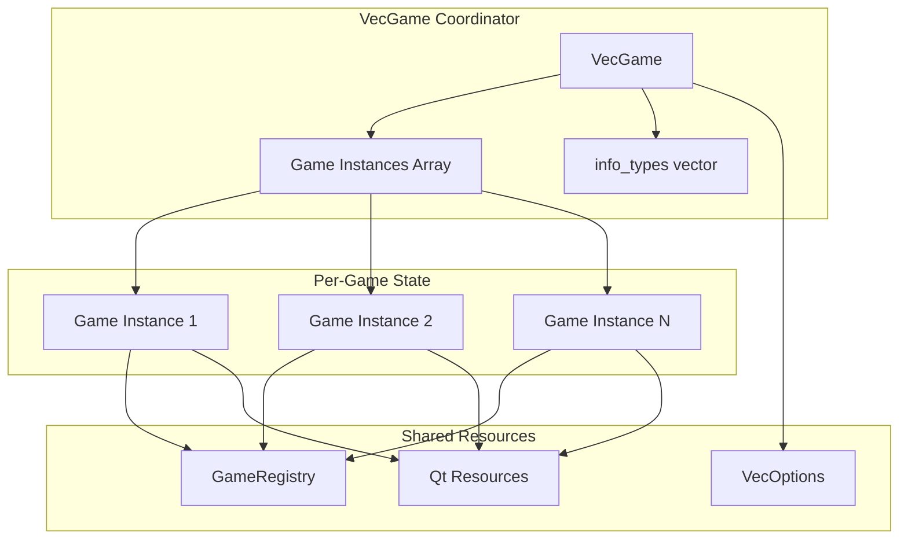

<!-- source: DeepWiki mcp.deepwiki.com · repo openai/procgen · page 4 Core Architecture · fetched 2026-10-26 -->

# Core Architecture

Relevant source files

The following files were used as context for generating this wiki page:

- [README.md](README.md)
- [procgen/CMakeLists.txt](procgen/CMakeLists.txt)
- [procgen/__init__.py](procgen/__init__.py)
- [procgen/builder.py](procgen/builder.py)

This page provides a technical deep-dive into the core architecture of the Procgen Benchmark system, focusing on the C++ game engine, Python integration layer, and the overall system design that enables high-performance procedural environment generation. For information about the build process, see [Build System](#3). For details about individual game implementations, see [Game Environments](#4.1). For Python API documentation, see [Python API](#4.2).

## System Overview

The Procgen architecture is built around a high-performance C++ core that implements 16 procedurally generated games, with Python bindings that expose both traditional OpenAI Gym and vectorized Gym3 interfaces. The system is designed for reinforcement learning research requiring fast, reproducible, and customizable environments.

Sources: [procgen/__init__.py:7-8](), [procgen/CMakeLists.txt:42-73]()

## C++ Core Architecture

The C++ core implements a modular game engine with shared infrastructure for procedural generation, rendering, and environment management. All games inherit from a common base class and integrate with the vectorized environment system.

```mermaid
graph TD
    subgraph "Environment Management"
        VECGAME["VecGame<br/>vecgame.cpp"]
        VECOPTIONS["VecOptions<br/>vecoptions.cpp"]
    end
    
    subgraph "Game Framework"
        GAME["Game<br/>game.cpp"]
        BASICGAME["BasicAbstractGame<br/>basic-abstract-game.cpp"]
        ENTITY["Entity<br/>entity.cpp"]
    end
    
    subgraph "16 Game Implementations"
        COINRUN_CPP["coinrun.cpp"]
        BIGFISH_CPP["bigfish.cpp"]
        BOSSFIGHT_CPP["bossfight.cpp"]
        CAVEFLYER_CPP["caveflyer.cpp"]
        CLIMBER_CPP["climber.cpp"]
        CHASER_CPP["chaser.cpp"]
        DODGEBALL_CPP["dodgeball.cpp"]
        FRUITBOT_CPP["fruitbot.cpp"]
        HEIST_CPP["heist.cpp"]
        JUMPER_CPP["jumper.cpp"]
        LEAPER_CPP["leaper.cpp"]
        MAZE_CPP["maze.cpp"]
        MINER_CPP["miner.cpp"]
        NINJA_CPP["ninja.cpp"]
        PLUNDER_CPP["plunder.cpp"]
        STARPILOT_CPP["starpilot.cpp"]
    end
    
    subgraph "Procedural Generation"
        MAZEGEN_CPP["mazegen.cpp"]
        RANDGEN_CPP["randgen.cpp"] 
        ROOMGEN_CPP["roomgen.cpp"]
    end
    
    subgraph "Asset & Rendering"
        ASSETGEN_CPP["assetgen.cpp"]
        RESOURCES_CPP["resources.cpp"]
        CPPUTILS["cpp-utils.cpp"]
    end
    
    VECGAME --> VECOPTIONS
    VECGAME --> GAME
    
    GAME --> BASICGAME
    BASICGAME --> ENTITY
    
    GAME --> COINRUN_CPP
    GAME --> BIGFISH_CPP
    GAME --> BOSSFIGHT_CPP
    GAME --> CAVEFLYER_CPP
    GAME --> CLIMBER_CPP
    GAME --> CHASER_CPP
    GAME --> DODGEBALL_CPP
    GAME --> FRUITBOT_CPP
    GAME --> HEIST_CPP
    GAME --> JUMPER_CPP
    GAME --> LEAPER_CPP
    GAME --> MAZE_CPP
    GAME --> MINER_CPP
    GAME --> NINJA_CPP
    GAME --> PLUNDER_CPP
    GAME --> STARPILOT_CPP
    
    COINRUN_CPP --> RANDGEN_CPP
    MAZE_CPP --> MAZEGEN_CPP
    HEIST_CPP --> ROOMGEN_CPP
    
    GAME --> ASSETGEN_CPP
    ASSETGEN_CPP --> RESOURCES_CPP
    RESOURCES_CPP --> CPPUTILS
```

Sources: [procgen/CMakeLists.txt:50-66](), [procgen/CMakeLists.txt:44-72]()

### Game Registration System

The game registry provides dynamic game instantiation and management through a centralized registration system. Each game registers itself with the `GameRegistry` using factory patterns.

| Component | File | Purpose |
|-----------|------|---------|
| `GameRegistry` | `game-registry.cpp` | Central registration and factory system |
| `VecGame` | `vecgame.cpp` | Vectorized environment coordinator |
| `Game` | `game.cpp` | Base class for all game implementations |
| `VecOptions` | `vecoptions.cpp` | Configuration management |

Sources: [procgen/CMakeLists.txt:49](), [procgen/CMakeLists.txt:71-72]()

## Python Integration Layer  

The Python layer provides two main interfaces: `ProcgenEnv` for traditional Gym compatibility and `ProcgenGym3Env` for vectorized environments. Both interfaces communicate with the C++ core through the `gym3.libenv` protocol.

Sources: [procgen/__init__.py:7-12](), [procgen/builder.py:11]()

### Build Integration

The `builder.py` module manages the compilation of the C++ library and provides process-safe building with dependency resolution for Qt5 and CMake.

| Function | Purpose |
|----------|---------|
| `build()` | Main build orchestration with lock management |
| `_attempt_configure()` | CMake configuration with Qt5 path detection |
| `chdir()` | Context manager for directory changes |
| `check()` | Process result validation and error handling |

Sources: [procgen/builder.py:95-147]()

## Rendering and Asset System

The rendering system uses Qt5 for cross-platform graphics with a resource management system that supports both human-designed and procedurally generated assets.

Sources: [procgen/CMakeLists.txt:40](), [procgen/CMakeLists.txt:77](), [procgen/CMakeLists.txt:44](), [procgen/CMakeLists.txt:70]()

## Environment Lifecycle

The environment lifecycle manages game instantiation, state management, and the observation-action loop through the vectorized environment system.

### Core Lifecycle Components

| Phase | C++ Component | Python Interface |
|-------|---------------|------------------|
| Initialization | `VecGame` constructor | `ProcgenGym3Env.__init__()` |
| Game Selection | `GameRegistry::make_game()` | `env_name` parameter |
| Level Generation | `Game::game_init()` | `start_level`, `num_levels` |
| Observation | `Game::observe()` | `env.observe()` |
| Action Processing | `Game::step()` | `env.act()` |
| State Management | `Game::get_state()` | `env.callmethod("get_state")` |

### Vectorization Architecture

The `VecGame` class coordinates multiple game instances within a single process, enabling high-throughput training:

Sources: [procgen/CMakeLists.txt:71](), [procgen/CMakeLists.txt:72](), [procgen/CMakeLists.txt:49]()

---

