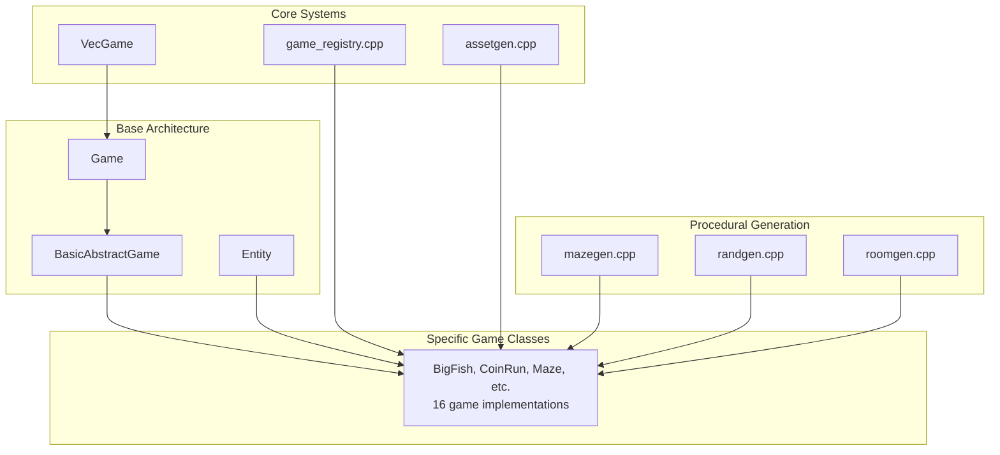
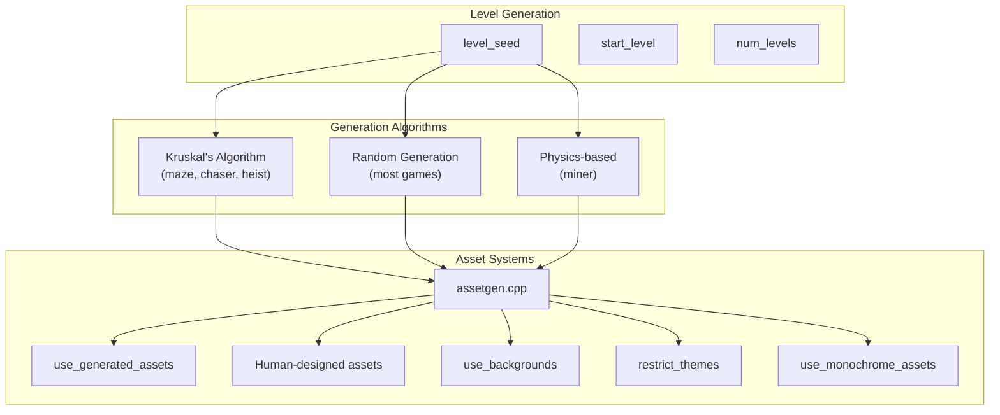
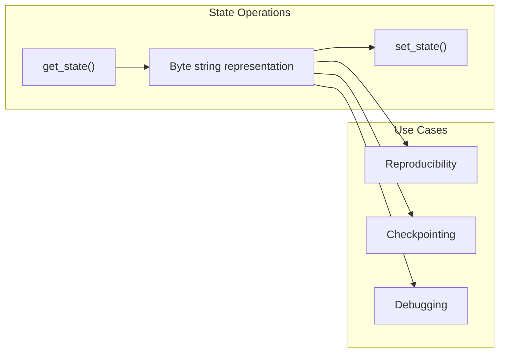

<!-- source: DeepWiki mcp.deepwiki.com · repo openai/procgen · page 4.1 Game Environments · fetched 2026-10-26 -->

# Game Environments

<details>
<summary>Relevant source files</summary>

The following files were used as context for generating this wiki page:

- [README.md](README.md)
- [procgen/CMakeLists.txt](procgen/CMakeLists.txt)

</details>


This document provides a comprehensive overview of the 16 procedurally generated game environments that form the core of the Procgen Benchmark. It covers the technical implementation of each game, the common architectural patterns they share, and the procedural generation systems that power them.

For information about the Python API interfaces that expose these environments, see [Python API](#4.2). For details about the build system that compiles these C++ games, see [C++ Library Build](#3.3).

## Environment Overview

The Procgen Benchmark consists of 16 distinct game environments, each implemented as a separate C++ class that inherits from a common base game architecture. These environments span multiple genres including platformers, maze games, action games, and puzzle games, providing diverse challenges for reinforcement learning agents.

### Game Environment Registry

```mermaid
graph TB
    subgraph "Game Registration System"
        GameRegistry["GameRegistry"]
        RegisterGame["register_game()"]
    end
    
    subgraph "Individual Game Implementations"
        BigFish["BigFish"]
        BossFight["BossFight"] 
        CaveFlyer["CaveFlyer"]
        Chaser["Chaser"]
        Climber["Climber"]
        CoinRun["CoinRun"]
        Dodgeball["Dodgeball"]
        FruitBot["FruitBot"]
        Heist["Heist"]
        Jumper["Jumper"]
        Leaper["Leaper"]
        Maze["Maze"]
        Miner["Miner"]
        Ninja["Ninja"]
        Plunder["Plunder"]
        StarPilot["StarPilot"]
    end
    
    subgraph "Source Files"
        bigfish_cpp["src/games/bigfish.cpp"]
        bossfight_cpp["src/games/bossfight.cpp"]
        caveflyer_cpp["src/games/caveflyer.cpp"]
        chaser_cpp["src/games/chaser.cpp"]
        climber_cpp["src/games/climber.cpp"]
        coinrun_cpp["src/games/coinrun.cpp"]
        dodgeball_cpp["src/games/dodgeball.cpp"]
        fruitbot_cpp["src/games/fruitbot.cpp"]
        heist_cpp["src/games/heist.cpp"]
        jumper_cpp["src/games/jumper.cpp"]
        leaper_cpp["src/games/leaper.cpp"]
        maze_cpp["src/games/maze.cpp"]
        miner_cpp["src/games/miner.cpp"]
        ninja_cpp["src/games/ninja.cpp"]
        plunder_cpp["src/games/plunder.cpp"]
        starpilot_cpp["src/games/starpilot.cpp"]
    end
    
    GameRegistry --> RegisterGame
    
    BigFish --> RegisterGame
    BossFight --> RegisterGame
    CaveFlyer --> RegisterGame
    Chaser --> RegisterGame
    Climber --> RegisterGame
    CoinRun --> RegisterGame
    Dodgeball --> RegisterGame
    FruitBot --> RegisterGame
    Heist --> RegisterGame
    Jumper --> RegisterGame
    Leaper --> RegisterGame
    Maze --> RegisterGame
    Miner --> RegisterGame
    Ninja --> RegisterGame
    Plunder --> RegisterGame
    StarPilot --> RegisterGame
    
    BigFish --- bigfish_cpp
    BossFight --- bossfight_cpp
    CaveFlyer --- caveflyer_cpp
    Chaser --- chaser_cpp
    Climber --- climber_cpp
    CoinRun --- coinrun_cpp
    Dodgeball --- dodgeball_cpp
    FruitBot --- fruitbot_cpp
    Heist --- heist_cpp
    Jumper --- jumper_cpp
    Leaper --- leaper_cpp
    Maze --- maze_cpp
    Miner --- miner_cpp
    Ninja --- ninja_cpp
    Plunder --- plunder_cpp
    StarPilot --- starpilot_cpp
```



Sources: [README.md:102-122](), [procgen/CMakeLists.txt:50-66]()

## Technical Architecture

### Game Class Hierarchy



Sources: [procgen/CMakeLists.txt:42-73]()

## Game Categories

The 16 environments can be categorized by their core gameplay mechanics and technical implementations:

### Platformer Games

| Game | Description | Key Mechanics |
|------|-------------|---------------|
| `coinrun` | Simple platformer with coin collection goal | Platform jumping, obstacle avoidance |
| `climber` | Vertical platformer with star collection | Climbing mechanics, flying enemies |
| `jumper` | Open-world platformer with double jumping | Double jump, compass navigation |
| `ninja` | Platformer with projectile mechanics | Charged jumping, throwing stars |

### Maze and Navigation Games

| Game | Description | Key Mechanics |
|------|-------------|---------------|
| `maze` | Traditional maze navigation | Kruskal's algorithm generation |
| `chaser` | Pac-Man inspired maze game | Enemy AI, power-ups, vulnerability states |
| `heist` | Lock-and-key maze puzzle | Key collection, multi-colored locks |

### Action and Shooter Games

| Game | Description | Key Mechanics |
|------|-------------|---------------|
| `starpilot` | Side-scrolling shooter | Projectile targeting, multiple enemy types |
| `bossfight` | Starship boss battle | Shield mechanics, pattern-based attacks |
| `dodgeball` | Room-based combat | Ball throwing, enemy AI |
| `plunder` | Naval combat | Timer mechanics, friendly fire penalties |

### Specialized Games

| Game | Description | Key Mechanics |
|------|-------------|---------------|
| `bigfish` | Growth-based survival | Size-based collision detection |
| `caveflyer` | Cave navigation | Asteroids-style movement |
| `fruitbot` | Scrolling collection game | Positive/negative rewards |
| `leaper` | Frogger-inspired crossing | Multiple hazard types |
| `miner` | Boulder Dash mechanics | Gravity physics, digging |

Sources: [README.md:104-122]()

## Common Technical Systems

### Observation Space

All games share a consistent observation space:

```
RGB Array: (64, 64, 3)
Action Space: Discrete(15)
Step Rate: 15 Hz (human equivalent)
```

### Action Space Encoding

The 15-action discrete space represents button combinations defined in the core environment system:

```mermaid
graph LR
    subgraph "Button Combinations"
        NoOp["0: No Operation"]
        Left["1: Left"]
        Right["2: Right"] 
        Up["3: Up"]
        Down["4: Down"]
        LeftUp["5: Left + Up"]
        RightUp["6: Right + Up"]
        LeftDown["7: Left + Down"]
        RightDown["8: Right + Down"]
        Action1["9: Action Button"]
        LeftAction1["10: Left + Action"]
        RightAction1["11: Right + Action"]
        UpAction1["12: Up + Action"]
        DownAction1["13: Down + Action"]
        Reserved["14: Reserved"]
    end
```



Sources: [README.md:98]()

### Procedural Generation Pipeline



Sources: [README.md:134-147](), [procgen/CMakeLists.txt:44,67-69]()

## Environment Configuration Options

The games support extensive configuration through environment options:

### Core Level Control
- `start_level`: Lowest seed for level generation
- `num_levels`: Number of unique levels (0 = unlimited)
- `use_sequential_levels`: Linear progression through levels

### Difficulty and Variants
- `distribution_mode`: `"easy"`, `"hard"`, `"extreme"`, `"memory"`, `"exploration"`

### Visual and Asset Options
- `use_generated_assets`: Random vs human-designed assets
- `use_backgrounds`: Enable/disable backgrounds
- `restrict_themes`: Single theme constraint
- `use_monochrome_assets`: Simplified visual representation

### Debug and Development
- `debug_mode`: Custom debugging flag
- `paint_vel_info`: Velocity information overlay
- `center_agent`: Agent-centered vs full-level view

Sources: [README.md:132-147]()

## State Management and Serialization

Games support full state serialization through the `VecGame` interface:



Sources: [README.md:166-178]()

## Known Environment Issues

Several games have documented edge cases that are preserved for reproducibility:

| Game | Issue | Frequency | Impact |
|------|-------|-----------|---------|
| `bigfish` | Player can become trapped at borders | Occasional | Episode continues but progress blocked |
| `caveflyer` | Player spawns next to enemy | ~0.5% of levels | Immediate death regardless of action |
| `jumper` | Player spawns on enemy/goal | ~7% of levels | Single-step episode termination |
| `miner` | Unsolvable configurations | Low probability | Diamond or exit unreachable |

Sources: [README.md:123-131]()

---

