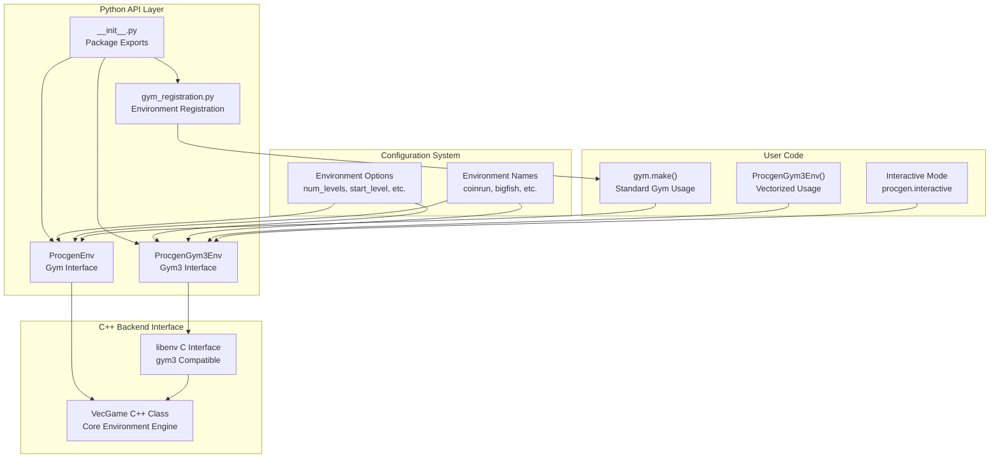
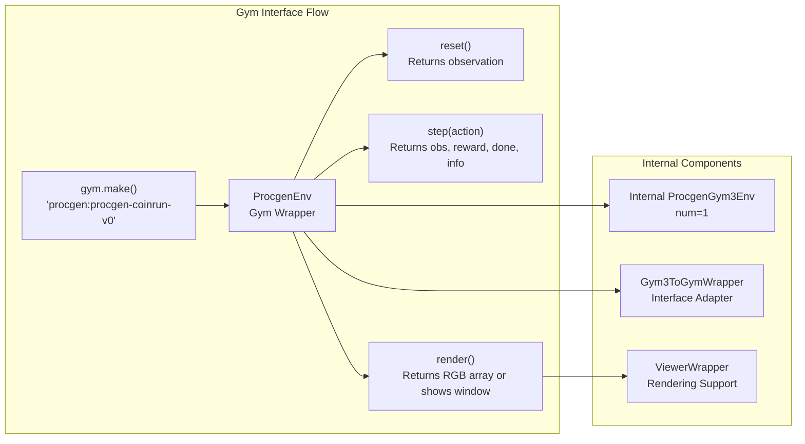
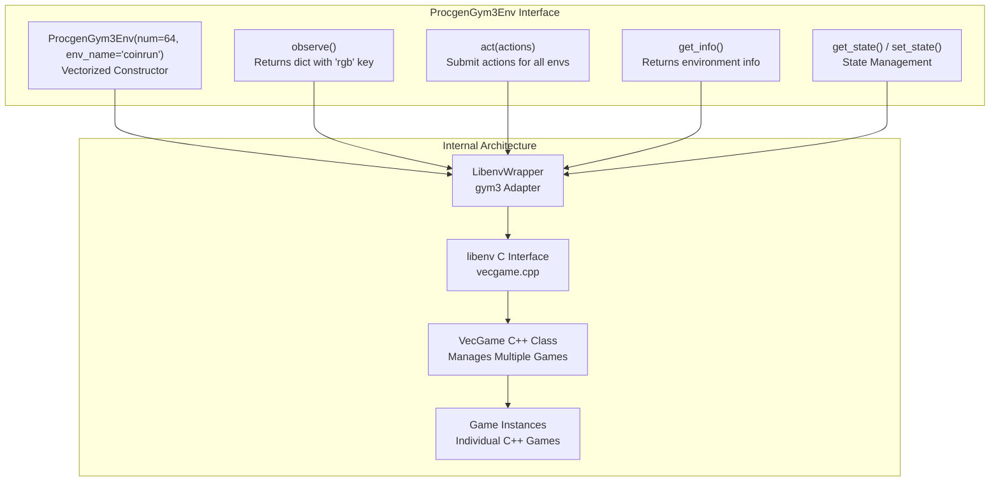
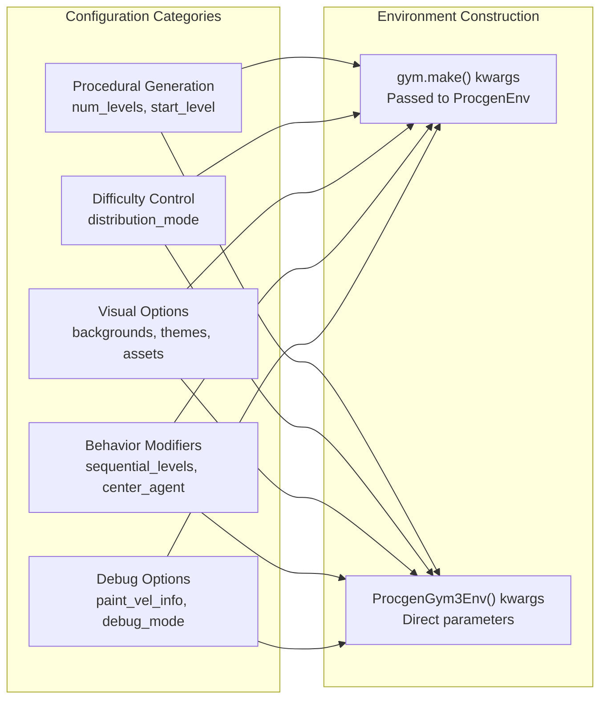
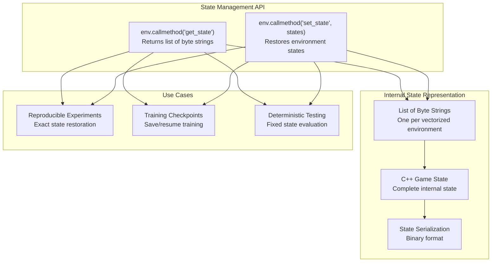
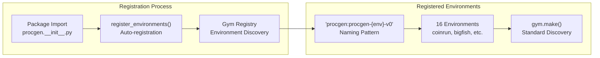

<!-- source: DeepWiki mcp.deepwiki.com · repo openai/procgen · page 4.2 Python API · fetched 2026-10-26 -->

# Python API

<details>
<summary>Relevant source files</summary>

The following files were used as context for generating this wiki page:

- [README.md](README.md)
- [procgen/__init__.py](procgen/__init__.py)

</details>


This document covers the Python API layer that provides high-level interfaces for interacting with Procgen environments. The Python API consists of two main environment classes that wrap the underlying C++ game implementations with standardized reinforcement learning interfaces.

For information about the underlying C++ game implementations, see [Game Environments](#4.1). For details about setting up a development environment to work with these APIs, see [Development Environment](#5.1).

## Overview

The Procgen Python API provides two primary environment classes that serve as the main entry points for researchers and developers:

- `ProcgenEnv`: A gym-compatible interface for single environments
- `ProcgenGym3Env`: A vectorized gym3 interface for running multiple environments in parallel

Both classes are exported from the main package and provide access to all 16 procedurally generated game environments through a unified configuration system.



Sources: [procgen/__init__.py:1-12](), [README.md:64-76]()

## Environment Classes

### ProcgenEnv (Gym Interface)

The `ProcgenEnv` class provides a standard OpenAI Gym interface for individual Procgen environments. This interface is designed for compatibility with existing gym-based reinforcement learning code.



The gym interface supports standard gym functionality with some Procgen-specific behaviors:

- **Observation Space**: Box space with shape (64, 64, 3) containing RGB pixel data
- **Action Space**: Discrete(15) representing different button combinations
- **Rendering**: Supports both `rgb_array` and `human` render modes
- **Early Reset Restriction**: Early calls to `reset()` are disallowed due to the underlying gym3 adapter

Sources: [README.md:64-69](), [README.md:96-101](), [README.md:154-156]()

### ProcgenGym3Env (Gym3 Interface)

The `ProcgenGym3Env` class provides a vectorized gym3 interface that can run multiple environment instances in parallel. This is the primary interface for high-performance training scenarios.



Key features of the gym3 interface:

- **Vectorization**: Run multiple environments simultaneously with `num` parameter
- **Observation Format**: Dictionary space with RGB data under `"rgb"` key
- **State Management**: Full save/load capability for environment states
- **Performance**: Direct C++ backend access for maximum throughput
- **Flexible Configuration**: All environment options available at construction

Sources: [README.md:71-76](), [README.md:157-162](), [README.md:167-177]()

## Configuration Options

Both environment classes accept a comprehensive set of configuration options that control procedural generation, difficulty, and visual appearance:

| Option | Type | Default | Description |
|--------|------|---------|-------------|
| `env_name` | str | Required | Environment name or comma-separated list |
| `num_levels` | int | 0 | Number of unique levels (0 = unlimited) |
| `start_level` | int | 0 | Lowest seed for level generation |
| `distribution_mode` | str | "hard" | Difficulty variant: "easy", "hard", "extreme", "memory", "exploration" |
| `paint_vel_info` | bool | False | Paint velocity info in top left corner |
| `use_generated_assets` | bool | False | Use randomly generated assets |
| `center_agent` | bool | True | Center observations on agent vs full level |
| `use_sequential_levels` | bool | False | Sequential level progression without episode end |
| `use_backgrounds` | bool | True | Use designed backgrounds vs black |
| `restrict_themes` | bool | False | Use single theme vs multiple themes |
| `use_monochrome_assets` | bool | False | Use monochromatic rectangles vs designed assets |



Sources: [README.md:132-147](), [README.md:148-153](), [README.md:157-162]()

## State Management

The gym3 interface provides comprehensive state management capabilities through the `get_state()` and `set_state()` methods. This functionality enables:

- **Reproducible Experiments**: Save exact environment states for later replay
- **Checkpoint and Resume**: Save training checkpoints including environment state
- **Deterministic Testing**: Load specific states for consistent evaluation
- **State Analysis**: Examine environment states for debugging and research



Sources: [README.md:166-177]()

## Environment Registration

The environment registration system automatically registers all Procgen environments with the gym registry, enabling discovery through standard gym mechanisms:



The registration system:

- **Automatic Registration**: All environments registered on package import
- **Consistent Naming**: Follows `procgen:procgen-{env_name}-v0` pattern
- **Gym Integration**: Full compatibility with gym environment discovery
- **Version Management**: Supports versioned environment specifications

Sources: [procgen/__init__.py:7-11](), [README.md:64-69]()

## Interactive Mode

The package includes an interactive mode for manual environment testing and visualization:

```bash
python -m procgen.interactive --env-name coinrun
```

This mode provides:
- **Manual Control**: Keyboard input for environment interaction
- **Real-time Rendering**: Visual feedback for environment behavior
- **Performance Metrics**: Display of episode return and completion status
- **Development Tool**: Quick testing of environment modifications

Sources: [README.md:56-62](), [README.md:252-254]()

---

