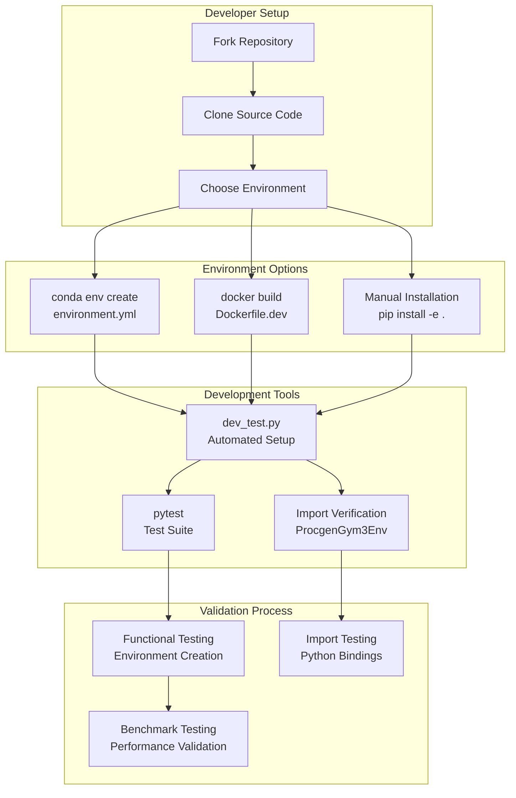
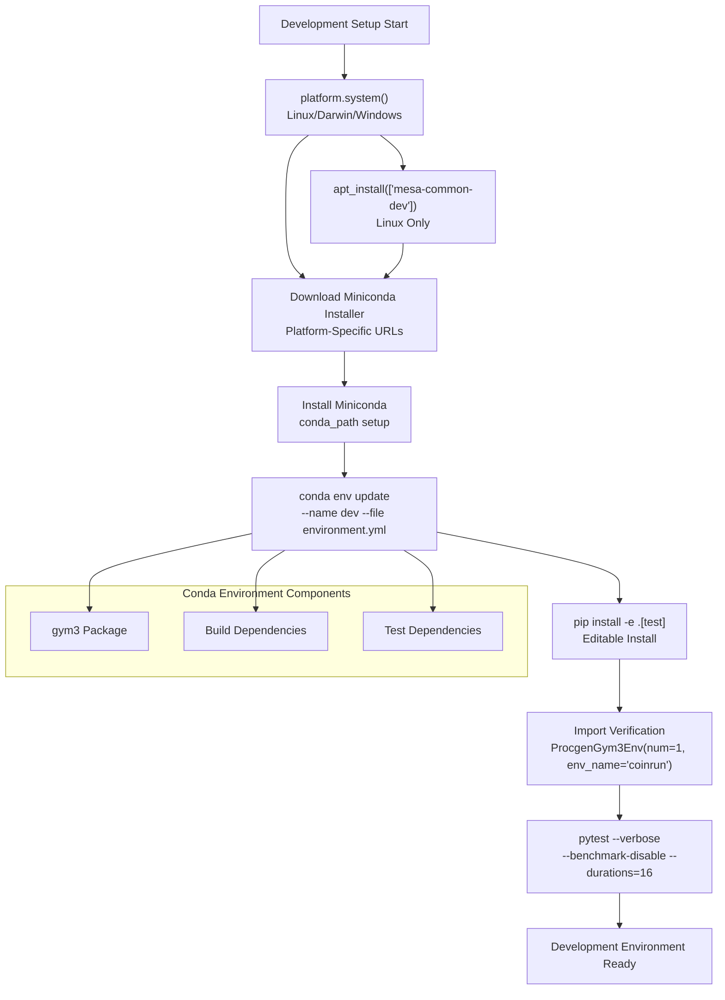

<!-- source: DeepWiki mcp.deepwiki.com · repo openai/procgen · page 5 Development · fetched 2026-10-26 -->

# Development

<details>
<summary>Relevant source files</summary>

The following files were used as context for generating this wiki page:

- [CONTRIBUTING.md](CONTRIBUTING.md)
- [docker/Dockerfile.dev](docker/Dockerfile.dev)
- [procgen-build/procgen_build/dev_test.py](procgen-build/procgen_build/dev_test.py)

</details>


This document provides guidance for developers who want to contribute to or extend the Procgen benchmark codebase. It covers the development environment setup, testing procedures, and contribution workflow. For specific installation instructions intended for end users, see [Installation](#2.1). For detailed information about the CI/CD pipeline automation, see [CI/CD Pipeline](#5.3).

## Development Workflow Overview

The Procgen development process follows a fork-based model with emphasis on reproducibility and minimal impact on training results. The workflow integrates conda environment management, automated testing, and cross-platform validation.

**Development Workflow Architecture**


Sources: [CONTRIBUTING.md:1-7](), [docker/Dockerfile.dev:1-11](), [procgen-build/procgen_build/dev_test.py:18-51]()

## Development Environment Setup Process

The development environment setup process is automated through the `dev_test.py` script, which handles conda installation, dependency management, and verification testing across multiple platforms.

**Development Environment Setup Flow**


Sources: [procgen-build/procgen_build/dev_test.py:18-51](), [docker/Dockerfile.dev:6-11]()

## Key Development Components

### Environment Configuration Files

| File | Purpose | Key Dependencies |
|------|---------|------------------|
| `environment.yml` | Conda environment specification | gym3, build tools, test frameworks |
| `docker/Dockerfile.dev` | Development container setup | Ubuntu 18.04, miniconda, mesa-common-dev |
| `setup.py` | Python package configuration | CMake, Qt build dependencies |

### Development Testing Infrastructure

The `dev_test.py` module provides automated development environment setup and validation:

**Core Functions:**
- `apt_install()` - Manages Linux system dependencies [procgen-build/procgen_build/dev_test.py:9-16]()
- `main()` - Orchestrates complete development setup [procgen-build/procgen_build/dev_test.py:18-51]()
- `run_in_conda_env()` - Executes commands in conda environment [procgen-build/procgen_build/dev_test.py:40-41]()

**Platform-Specific Installers:**
- Linux: `Miniconda3-py37_4.9.2-Linux-x86_64.sh`
- macOS: `Miniconda3-py37_4.9.2-MacOSX-x86_64.sh`  
- Windows: `Miniconda3-py37_4.9.2-Windows-x86_64.exe`

Sources: [procgen-build/procgen_build/dev_test.py:22-31]()

### Verification Testing

Development setup includes automated verification through import testing and functional validation:

```python
# Import verification command executed in dev_test.py
python -c "from procgen import ProcgenGym3Env; ProcgenGym3Env(num=1, env_name='coinrun')"
```

This verification ensures:
- Python bindings are correctly built
- `ProcgenGym3Env` class is importable
- Basic environment creation functions
- C++ library linking is successful

Sources: [procgen-build/procgen_build/dev_test.py:46](), [docker/Dockerfile.dev:11]()

## Testing and Validation Process

The development testing process uses `pytest` with specific configuration for benchmark and duration tracking:

**Test Execution Configuration:**
- `--verbose` - Detailed test output
- `--benchmark-disable` - Skip performance benchmarks during development
- `--durations=16` - Report 16 slowest tests

**Test Validation Sequence:**
1. `pip show gym3` - Verify gym3 dependency installation
2. `pip install -e .[test]` - Install package in editable mode with test dependencies
3. Import verification of `ProcgenGym3Env` 
4. Full pytest suite execution

Sources: [procgen-build/procgen_build/dev_test.py:44-47]()

## Docker Development Environment

The `Dockerfile.dev` provides a containerized development environment based on Ubuntu 18.04:

**Container Setup Process:**
1. Base image: `ubuntu:bionic-20191202`
2. System dependencies: `ca-certificates`, `curl`, `build-essential`, `mesa-common-dev`, `libglu1-mesa-dev`
3. Miniconda installation and environment setup
4. Editable package installation with `pip install -e /procgen`
5. Import verification test

This container approach ensures consistent development environments across different host systems.

Sources: [docker/Dockerfile.dev:1-11]()

## Contributing Guidelines

The Procgen project follows strict contribution policies focused on experimental reproducibility:

**Key Contribution Principles:**
- **Minimal Changes**: Avoid modifications that impact training results
- **Fork-Based Development**: Encouraged for custom modifications
- **Bug Reporting**: Include `level_seed` for reproducible bug reports
- **Platform Support**: Report installation issues on supported platforms

**Restricted Contributions:**
- PRs adding new functionality are unlikely to be accepted
- Changes affecting training results should be avoided
- Modifications should maintain experimental comparability

**Recommended Approach:**
- Fork the repository for custom modifications
- Use Travis CI setup for creating custom packages
- Report reproducible bugs through issue tracker

Sources: [CONTRIBUTING.md:1-7]()

---

