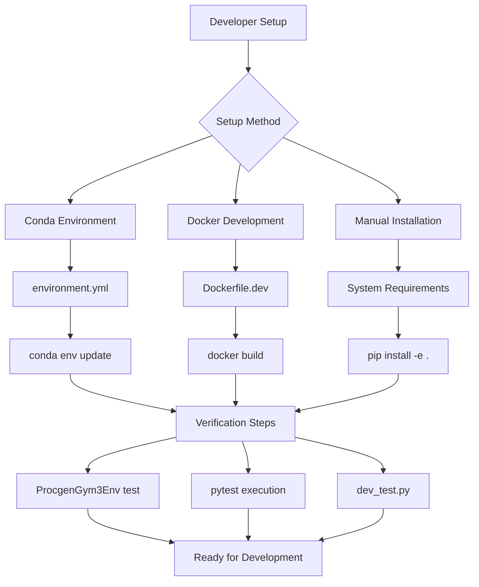
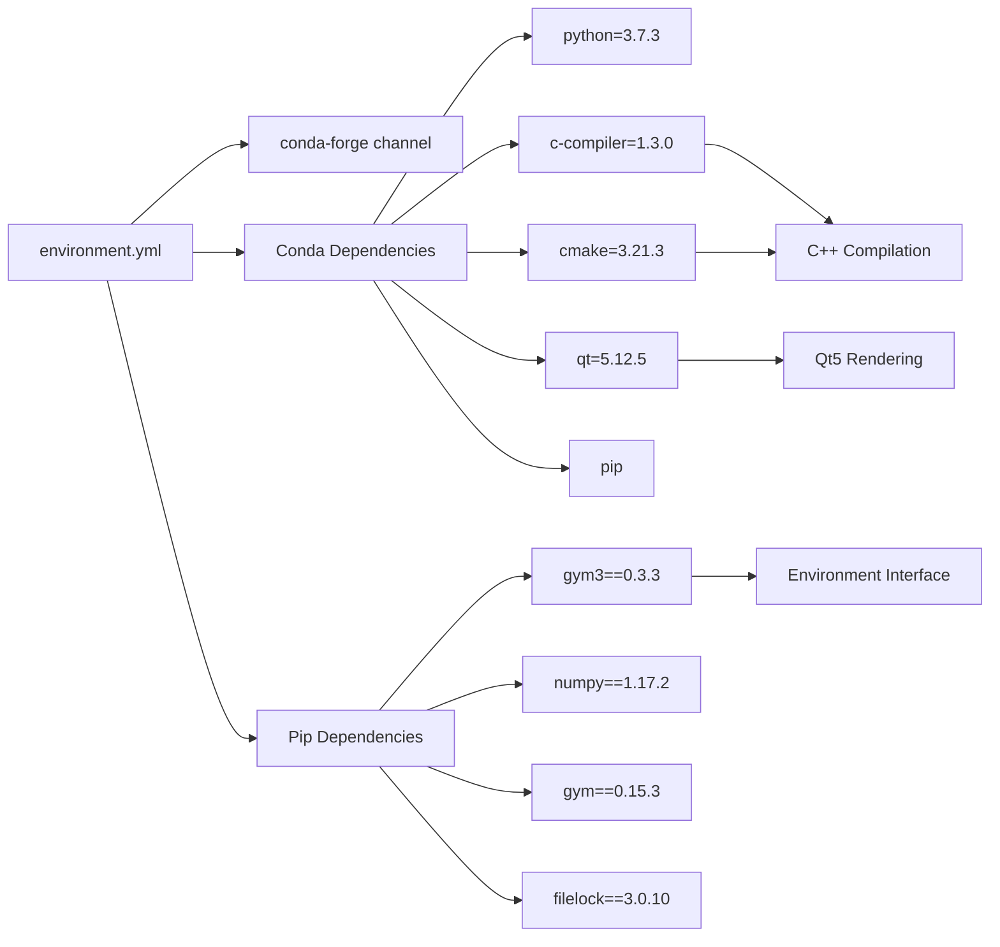

<!-- source: DeepWiki mcp.deepwiki.com · repo openai/procgen · page 5.1 Development Environment · fetched 2026-10-26 -->

# Development Environment

<details>
<summary>Relevant source files</summary>

The following files were used as context for generating this wiki page:

- [docker/Dockerfile.dev](docker/Dockerfile.dev)
- [environment.yml](environment.yml)
- [procgen-build/procgen_build/dev_test.py](procgen-build/procgen_build/dev_test.py)

</details>


This page covers setting up a local development environment for working on the Procgen codebase. It includes installation of dependencies, environment configuration, and verification steps to ensure a functional development setup.

For information about contribution policies and procedures, see [Contributing Guidelines](#5.2). For details about the automated build and test pipeline, see [CI/CD Pipeline](#5.3). For comprehensive build system documentation, see [Build System](#3).

## Prerequisites

The Procgen development environment requires several system-level dependencies and tools. The core requirements include:

| Component | Purpose | Version Requirement |
|-----------|---------|-------------------|
| Python | Runtime environment | 3.7.3+ |
| C++ Compiler | Building C++ game implementations | GCC/Clang/MSVC |
| CMake | Build system configuration | 3.21.3+ |
| Qt5 | GUI framework for rendering | 5.12.5+ |
| Mesa | OpenGL development libraries (Linux) | Latest |

### Development Environment Setup Flow



Sources: [docker/Dockerfile.dev:1-11](), [environment.yml:1-16](), [procgen-build/procgen_build/dev_test.py:18-51]()

## Conda Environment Setup

The recommended development setup uses conda to manage dependencies and ensure consistent environments across platforms. The conda configuration is defined in `environment.yml`.

### Conda Dependencies



Sources: [environment.yml:1-16]()

### Setup Commands

To create the development environment:

```bash
conda env create -f environment.yml
conda activate dev
pip install -e .
```

The `dev_test.py` script automates this process across platforms using the `conda env update --name dev --file environment.yml` command for environment setup.

Sources: [procgen-build/procgen_build/dev_test.py:43]()

## Docker Development Setup

For containerized development, the `Dockerfile.dev` provides a complete Ubuntu-based development environment. This approach ensures consistent dependencies across different host systems.

### Container Configuration

The Docker setup follows these steps:

1. **Base Image**: `ubuntu:bionic-20191202`
2. **System Dependencies**: Installs essential build tools and OpenGL libraries
3. **Miniconda Installation**: Downloads and installs Python package manager
4. **Environment Creation**: Uses `environment.yml` for consistent dependency versions
5. **Source Installation**: Installs Procgen in development mode with `pip install -e /procgen`

### Docker Build Process

```bash
docker build -f docker/Dockerfile.dev -t procgen-dev .
docker run -it procgen-dev bash
```

The container automatically verifies the installation by importing and creating a `ProcgenGym3Env` instance.

Sources: [docker/Dockerfile.dev:1-11]()

## Development Environment Verification

### Automated Verification Script

The `dev_test.py` script provides comprehensive environment validation across Linux, macOS, and Windows platforms. The verification process includes:

| Step | Command | Purpose |
|------|---------|---------|
| Package Check | `pip show gym3` | Verify gym3 installation |
| Development Install | `pip install -e .[test]` | Install Procgen in editable mode |
| Import Test | `ProcgenGym3Env(num=1, env_name='coinrun')` | Verify core functionality |
| Test Suite | `pytest --verbose --benchmark-disable` | Run comprehensive tests |

### Platform-Specific Setup

The `dev_test.py` script handles platform differences:

- **Linux**: Installs `mesa-common-dev` using `apt_install()` function
- **macOS/Windows**: Downloads platform-specific Miniconda installers
- **Windows**: Uses executable installer with silent installation flags

### Verification Commands

```python
# Core import verification
from procgen import ProcgenGym3Env
env = ProcgenGym3Env(num=1, env_name='coinrun')

# Test execution
pytest --verbose --benchmark-disable --durations=16 .
```

Sources: [procgen-build/procgen_build/dev_test.py:44-47]()

## Development Workflow

### Environment Activation

After setup completion, activate the development environment:

```bash
conda activate dev
```

### Editable Installation

Install Procgen in development mode to enable real-time code changes:

```bash
pip install -e .
```

This creates symbolic links allowing immediate testing of code modifications without reinstallation.

### Testing Workflow

The development environment supports multiple testing approaches:

1. **Quick Verification**: Import `ProcgenGym3Env` and create environment instances
2. **Unit Tests**: Execute `pytest` with verbose output and timing information
3. **Integration Tests**: Run `dev_test.py` for complete environment validation

### Dependency Management

Environment dependencies are centrally managed through:

- **Conda Dependencies**: System-level packages in `environment.yml`
- **Python Dependencies**: Package requirements in `setup.py` and `environment.yml`
- **Build Dependencies**: CMake and Qt requirements for C++ compilation

Sources: [environment.yml:1-16](), [procgen-build/procgen_build/dev_test.py:40-47]()

---

