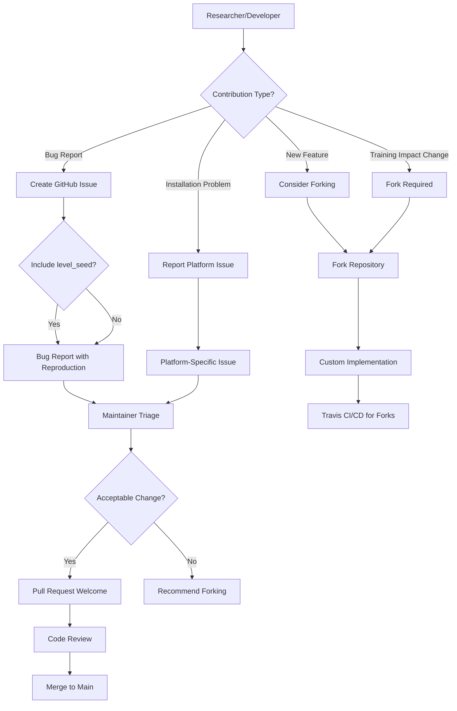
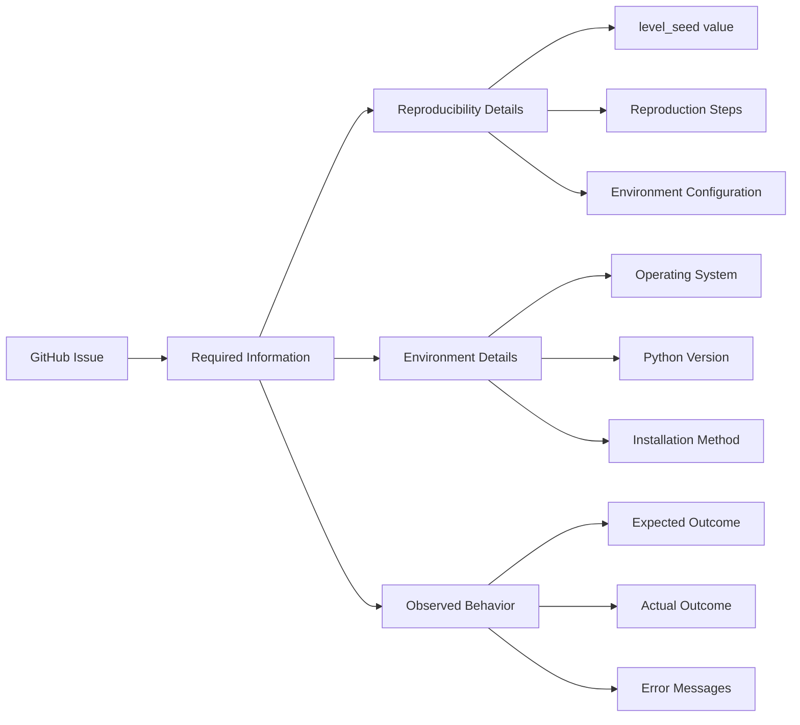
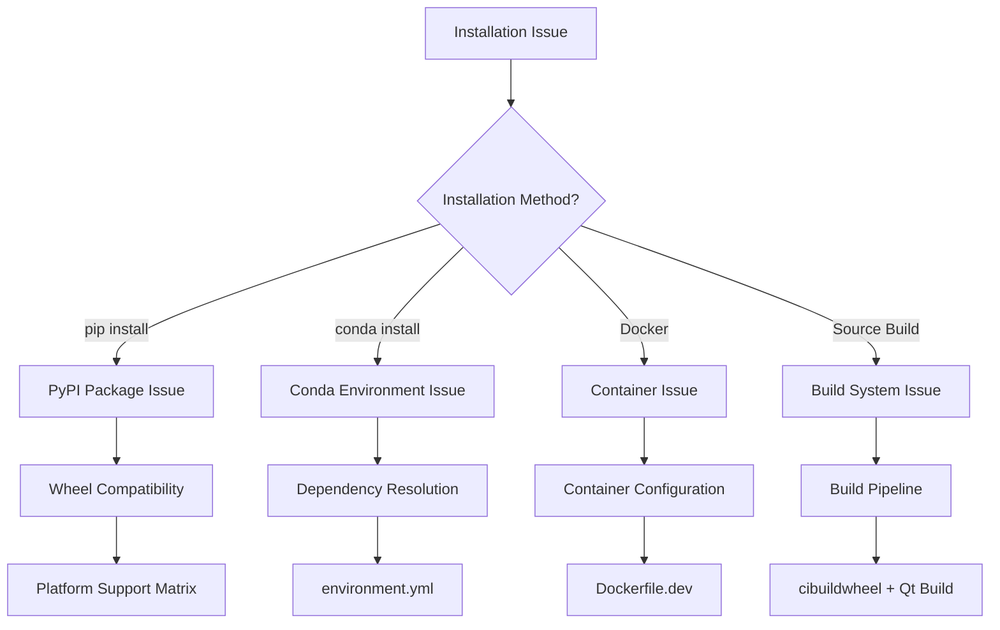
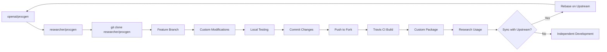
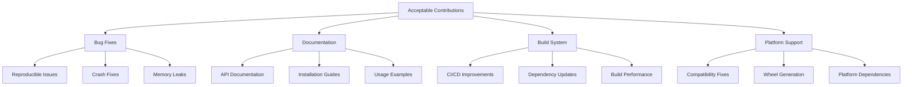
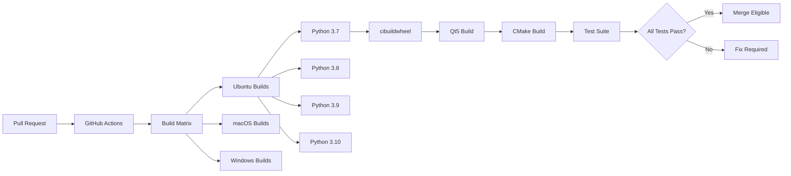

<!-- source: DeepWiki mcp.deepwiki.com · repo openai/procgen · page 5.2 Contributing Guidelines · fetched 2026-10-26 -->

# Contributing Guidelines

<details>
<summary>Relevant source files</summary>

The following files were used as context for generating this wiki page:

- [.gitignore](.gitignore)
- [CONTRIBUTING.md](CONTRIBUTING.md)

</details>


This document outlines the policies and procedures for contributing to the Procgen Benchmark project. It covers the project's contribution philosophy, reporting procedures, and recommended development approaches for extending Procgen functionality.

For information about setting up a development environment, see [Development Environment](#5.1). For details about the automated build and testing infrastructure, see [CI/CD Pipeline](#5.3).

## Contribution Philosophy

The Procgen Benchmark prioritizes **experimental reproducibility** and **research stability** over feature expansion. This research-oriented approach shapes all contribution policies and procedures.

### Core Principles

| Principle | Description | Impact |
|-----------|-------------|--------|
| **Experimental Stability** | Avoid changes affecting training results | Enables comparison with previous research |
| **Reproducibility Focus** | Maintain deterministic behavior via level seeds | Supports scientific reproducibility |
| **Minimal Surface Area** | Resist feature additions | Reduces maintenance burden and complexity |
| **Fork-Friendly Architecture** | Support custom modifications via forking | Enables researcher customization without upstream changes |

### Contribution Workflow



**Contributing Workflow Process**
Sources: [CONTRIBUTING.md:1-7]()

## Bug Reporting Procedures

### Required Information for Bug Reports

When reporting bugs through the GitHub issue tracker, provide the following information:



**Bug Report Information Requirements**
Sources: [CONTRIBUTING.md:3]()

### Level Seed Requirements

For issues involving specific environment behavior, always include the `level_seed` parameter that reproduces the problem:

```python
# Example bug reproduction with level_seed
import procgen
env = procgen.ProcgenEnv(num_envs=1, env_name="coinrun", level_seed=12345)
# Issue occurs with this specific seed
```

The `level_seed` ensures deterministic environment generation, enabling maintainers to reproduce the exact conditions that triggered the bug.

Sources: [CONTRIBUTING.md:3]()

## Installation and Platform Issues

### Supported Platform Issues

Report installation or runtime problems on any supported platform through the issue tracker. Include:

| Category | Required Details |
|----------|------------------|
| **Operating System** | Version, architecture (x86_64, arm64) |
| **Python Environment** | Version, virtual environment type |
| **Installation Method** | pip, conda, Docker, source build |
| **Build Dependencies** | Qt5, CMake, compiler versions |
| **Error Output** | Complete error messages and stack traces |

### Installation Methods Context



**Installation Issue Classification**
Sources: [CONTRIBUTING.md:3]()

## Fork-Based Development Model

### When to Fork

The project encourages forking for most customization needs:

| Change Type | Recommendation | Rationale |
|-------------|----------------|-----------|
| **New Features** | Fork Required | Keeps upstream minimal |
| **Training Result Changes** | Fork Required | Preserves experimental reproducibility |
| **Game Modifications** | Fork Required | Maintains benchmark consistency |
| **Custom Environments** | Fork Required | Avoids upstream complexity |
| **Research Customizations** | Fork Required | Enables specialized workflows |

### Fork Development Workflow



**Fork-Based Development Process**
Sources: [CONTRIBUTING.md:7]()

### Packaging Support for Forks

The build system supports fork-specific packaging through Travis CI integration:

- **Automated Builds**: Travis CI configured for fork repositories
- **Custom Packages**: Generate fork-specific wheel packages  
- **Multi-Platform**: Same build matrix as upstream (Ubuntu/macOS/Windows)
- **Dependency Management**: Inherits Qt5 and C++ build pipeline

Sources: [CONTRIBUTING.md:7]()

## Acceptable Contribution Types

### Encouraged Contributions



**Acceptable Contribution Categories**
Sources: [CONTRIBUTING.md:3]()

### Discouraged Contributions

| Contribution Type | Status | Alternative |
|-------------------|--------|-------------|
| **New Game Environments** | Unlikely Acceptance | Fork and extend |
| **API Changes** | Requires Strong Justification | Fork for custom APIs |
| **Training Algorithm Modifications** | Not Accepted | Research in fork |
| **Rendering Changes** | Likely Rejected | Custom rendering in fork |
| **Performance Optimizations** | Case-by-Case | Benchmark impact carefully |

Sources: [CONTRIBUTING.md:5]()

## Development Integration

### CI/CD Considerations

When contributing fixes or improvements, ensure compatibility with the existing CI/CD pipeline:



**CI/CD Integration for Contributors**  
Sources: [CONTRIBUTING.md:1-7](), [.gitignore:1-107]()

### Testing Requirements

Contributions must pass the existing test suite without introducing regressions:

- **Environment Creation**: All 16 games must instantiate correctly
- **Deterministic Behavior**: Level seeds must produce consistent results
- **Multi-Platform**: Tests must pass on all supported platforms
- **Memory Management**: No memory leaks in C++ components

For information about running tests locally, see [Development Environment](#5.1).

Sources: [CONTRIBUTING.md:5]()

---

