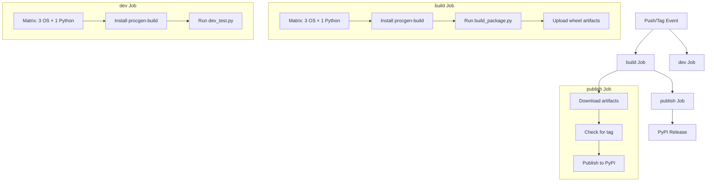
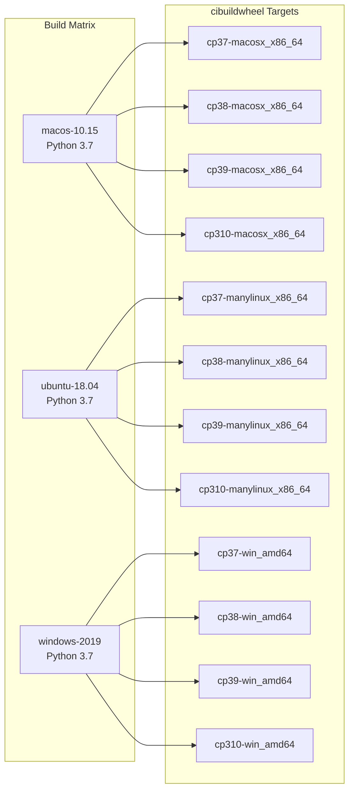
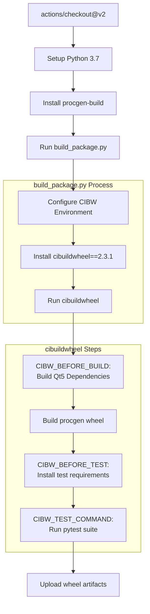
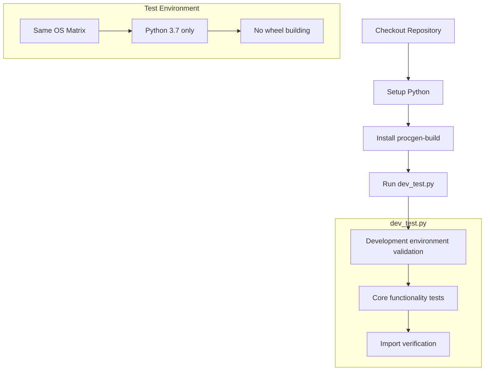
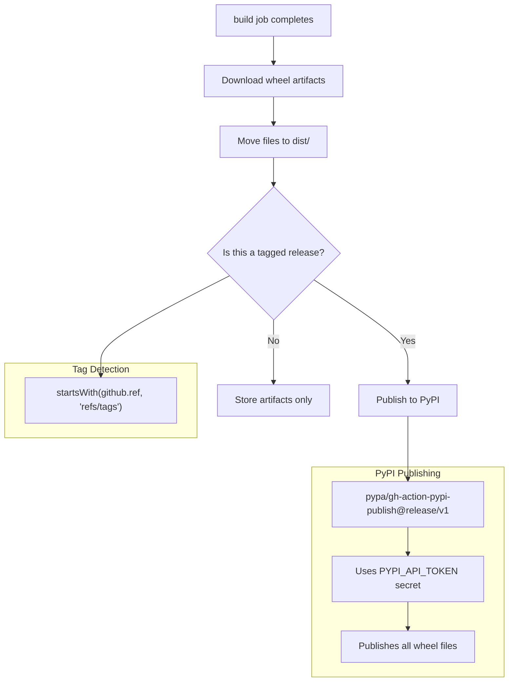
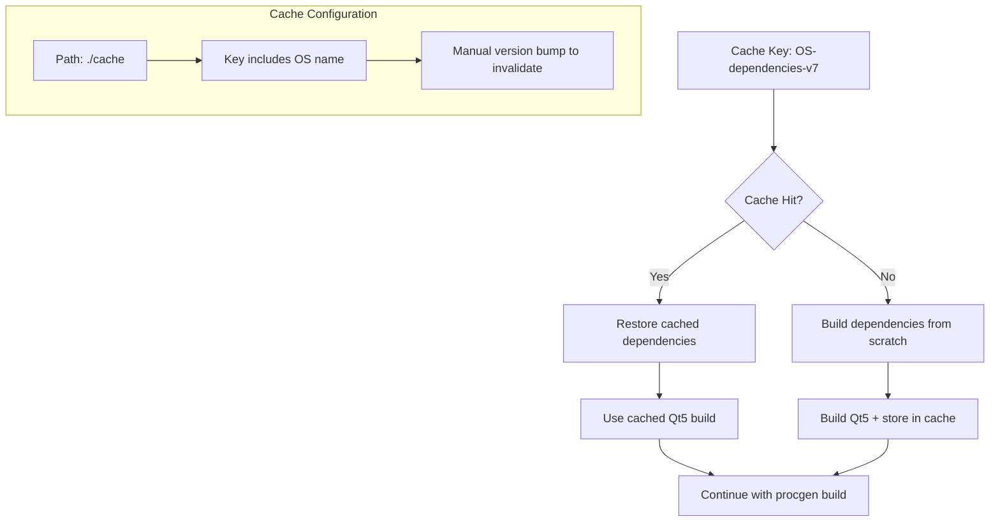
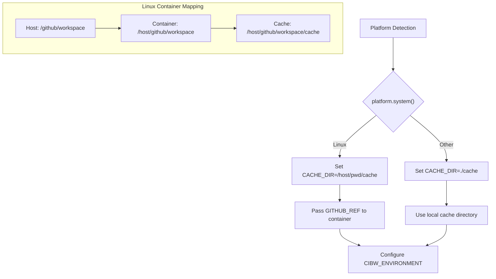

<!-- source: DeepWiki mcp.deepwiki.com · repo openai/procgen · page 5.3 CI/CD Pipeline · fetched 2026-10-26 -->

# CI/CD Pipeline

Relevant source files

The following files were used as context for generating this wiki page:

- [.github/workflows/main.yml](.github/workflows/main.yml)
- [procgen-build/procgen_build/build_package.py](procgen-build/procgen_build/build_package.py)
- [procgen-build/procgen_build/key.json.enc](procgen-build/procgen_build/key.json.enc)

This document covers the automated build, test, and release pipeline for the Procgen Benchmark project. The CI/CD system handles cross-platform wheel building, testing, and publishing to PyPI using GitHub Actions and cibuildwheel.

For information about setting up a local development environment, see [Development Environment](#5.1). For contribution guidelines and development workflows, see [Contributing Guidelines](#5.2).

## Pipeline Overview

The CI/CD pipeline consists of three main jobs that work together to ensure code quality and automate releases:

**Pipeline Job Structure**

The pipeline runs three parallel jobs on every push, with publishing conditional on tags.

Sources: [.github/workflows/main.yml:1-102]()

## Build Matrix Configuration

The pipeline uses a comprehensive build matrix to ensure cross-platform compatibility:

| Component | Configuration |
|-----------|---------------|
| **Operating Systems** | `ubuntu-18.04`, `macos-10.15`, `windows-2019` |
| **Python Version** | `3.7` (for CI, but builds wheels for 3.7-3.10) |
| **Architecture** | `x64` only |
| **Failure Strategy** | `fail-fast: false` (continue other builds if one fails) |

The `build` job creates wheels for multiple Python versions using cibuildwheel:

**Multi-Platform Wheel Building**

Each OS builds wheels for all supported Python versions (3.7-3.10) on that platform.

Sources: [.github/workflows/main.yml:7-14](), [procgen-build/procgen_build/build_package.py:13]()

## Build Process

The build process uses cibuildwheel to handle the complex multi-platform compilation:

**cibuildwheel Configuration Details**

The build process is configured through environment variables in `build_package.py`:

| Variable | Purpose |
|----------|---------|
| `CIBW_BUILD` | Specifies target platforms and Python versions |
| `CIBW_BEFORE_BUILD` | Builds Qt5 static libraries before wheel building |
| `CIBW_TEST_COMMAND` | Runs comprehensive pytest suite on built wheels |
| `CIBW_ENVIRONMENT` | Sets `PROCGEN_CMAKE_PREFIX_PATH` for Qt5 location |

Sources: [.github/workflows/main.yml:36-46](), [procgen-build/procgen_build/build_package.py:10-44]()

## Development Testing

The `dev` job provides lightweight testing across platforms without the overhead of wheel building:

**Development Testing Strategy**

The dev job runs in parallel with the build job to provide faster feedback on basic functionality.

Sources: [.github/workflows/main.yml:48-72]()

## Publishing Workflow

The publish job handles automated releases to PyPI:

**Publishing Strategy**

| Condition | Action |
|-----------|--------|
| **Regular Push** | Build and test wheels, store as artifacts |
| **Tagged Push** | Build, test, and publish wheels to PyPI |
| **Test PyPI** | Disabled due to PEP 440 local version identifier issues |

Sources: [.github/workflows/main.yml:74-102]()

## Dependency Caching

The pipeline implements intelligent caching to reduce build times:

**Cache Management**

The cache stores expensive-to-build dependencies like Qt5 libraries across CI runs.

Sources: [.github/workflows/main.yml:20-28]()

## Platform-Specific Configuration

Different platforms require specialized handling:

| Platform | Special Requirements |
|----------|---------------------|
| **Windows** | `ilammy/msvc-dev-cmd@v1` for Visual Studio environment |
| **Linux** | Container-based builds with `/host` path mapping |
| **macOS** | Standard Unix-style builds |

**Environment Variable Handling**

**Cross-Platform Environment Setup**

Platform-specific environment configuration ensures consistent builds across operating systems.

Sources: [.github/workflows/main.yml:17-18](), [.github/workflows/main.yml:59-60](), [procgen-build/procgen_build/build_package.py:25-38]()

---

