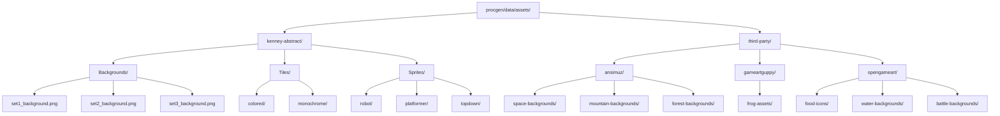
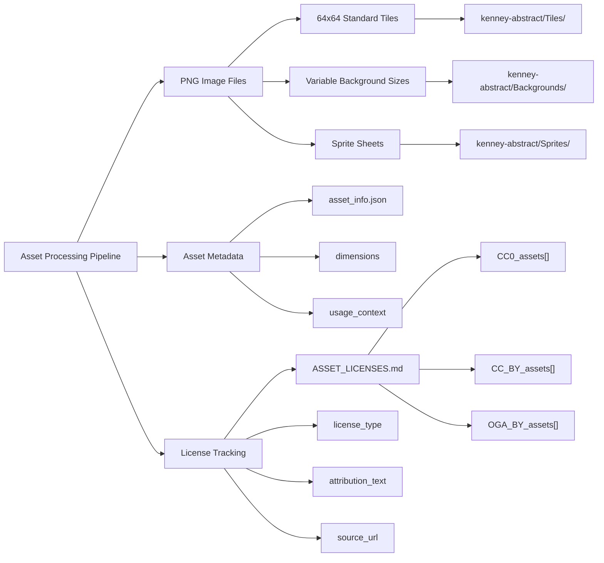
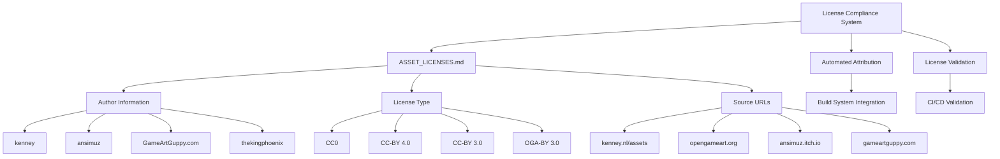

<!-- source: DeepWiki mcp.deepwiki.com · repo openai/procgen · page 6 Reference · fetched 2026-10-26 -->

# Reference

Relevant source files

The following files were used as context for generating this wiki page:

- [ASSET_LICENSES.md](ASSET_LICENSES.md)
- [LICENSE](LICENSE)
- [procgen/data/assets/kenney-abstract/Backgrounds/set1_background.png](procgen/data/assets/kenney-abstract/Backgrounds/set1_background.png)

This document provides comprehensive reference documentation for the Procgen Benchmark, covering asset libraries, licensing information, and technical specifications. This includes detailed information about game assets, their licensing requirements, file formats, and the internal package structure.

For installation and basic usage information, see [Getting Started](#2). For development environment setup, see [Development Environment](#5.1). For build system details, see [Build System](#3).

## Asset Organization and Structure

The Procgen asset system is organized around a structured directory hierarchy that supports the 16 different game environments. Assets are primarily sourced from Kenney's abstract art collections and various open-source contributors.

### Asset Directory Structure

Sources: [procgen/data/assets/kenney-abstract/Backgrounds/set1_background.png:1-1](), [ASSET_LICENSES.md:1-85]()

### Asset Categories and Usage

| Asset Type | Primary Source | License Type | Game Usage |
|------------|---------------|--------------|------------|
| Abstract Backgrounds | Kenney | CC0 | All environments |
| Abstract Tiles | Kenney | CC0 | Platformer games |
| Abstract Sprites | Kenney | CC0 | Character sprites |
| Space Backgrounds | ansimuz, Rawdanitsu | CC0/CC-BY | `starpilot`, `bigfish` |
| Forest Backgrounds | ansimuz | CC-BY 4.0 | `ninja`, `maze` |
| Water Backgrounds | Multiple authors | CC0/CC-BY | `heist`, `plunder` |
| Food Icons | thekingphoenix | CC0 | `coinrun`, `caveflyer` |
| Frog Assets | GameArtGuppy.com | CC-BY 4.0 | `frogs` |

Sources: [ASSET_LICENSES.md:2-85]()

## Licensing Framework

The Procgen project implements a multi-tiered licensing system to accommodate various asset sources while maintaining legal compliance and attribution requirements.

### License Categories

```mermaid
graph TB
    A["Procgen Licensing System"] --> B["Core Codebase"]
    A --> C["Asset Libraries"]
    
    B --> D["MIT License"]
    D --> E["OpenAI Copyright 2019"]
    
    C --> F["CC0 Public Domain"]
    C --> G["CC-BY Attribution Required"]
    C --> H["OGA-BY OpenGameArt License"]
    
    F --> I["kenney.nl assets"]
    F --> J["thekingphoenix food icons"]
    F --> K["ansimuz space backgrounds"]
    F --> L["Multiple water backgrounds"]
    
    G --> M["ansimuz mountain/forest"]
    G --> N["GameArtGuppy frog assets"]
    G --> O["davis123 topdown backgrounds"]
    G --> P["Alucard background sets"]
    
    H --> Q["CraftPix.net backgrounds"]
    
    D --> R["Commercial Use Allowed"]
    D --> S["Modification Allowed"]
    D --> T["Distribution Allowed"]
    
    F --> U["No Attribution Required"]
    F --> V["Commercial Use Allowed"]
    
    G --> W["Attribution Required"]
    G --> X["Commercial Use Allowed"]
    
    H --> Y["OpenGameArt Attribution"]
    H --> Z["Commercial Use Allowed"]
```

Sources: [LICENSE:1-21](), [ASSET_LICENSES.md:1-85]()

### Attribution Requirements

The following table details specific attribution requirements for non-CC0 assets:

| Asset Source | License | Attribution Format | Required Text |
|--------------|---------|-------------------|---------------|
| ansimuz mountain backgrounds | CC-BY 4.0 | Link to source | `ansimuz.itch.io/mountain-dusk-parallax-background` |
| ansimuz forest backgrounds | CC-BY 4.0 | Link to source | `ansimuz.itch.io/parallax-forest` |
| GameArtGuppy frog assets | CC-BY 4.0 | Link to source | `gameartguppy.com/shop/frog-lilypad/` |
| davis123 topdown backgrounds | CC-BY 3.0 | OpenGameArt link | `opengameart.org/content/backgrounds-topdown-games` |
| CraftPix.net assets | OGA-BY 3.0 | OpenGameArt attribution | `CraftPix.net 2D Game Assets` |

Sources: [ASSET_LICENSES.md:23-77]()

## Technical Specifications

### Asset File Formats and Standards

Sources: [procgen/data/assets/kenney-abstract/Backgrounds/set1_background.png:1-1](), [ASSET_LICENSES.md:1-85]()

### Asset Resolution and Loading

| Specification | Value | Description |
|---------------|-------|-------------|
| Standard Tile Size | 64x64 pixels | Used for character sprites and environment tiles |
| Background Resolution | Variable | Typically 256x256 to 512x512 for tiled backgrounds |
| Color Depth | 32-bit RGBA | PNG format with alpha channel support |
| Asset Loading | Runtime | Assets loaded dynamically based on game selection |
| Caching Strategy | Memory-based | Assets cached in memory during environment lifecycle |

Sources: [procgen/data/assets/kenney-abstract/Backgrounds/set1_background.png:4-4]()

### License Compliance Implementation

The project implements license compliance through structured documentation and automated tracking:

Sources: [ASSET_LICENSES.md:1-85]()

## Core License Information

### Primary Codebase License

The Procgen Benchmark is released under the MIT License:

**Copyright**: OpenAI (2019)  
**License Type**: MIT  
**Commercial Use**: Permitted  
**Modification**: Permitted  
**Distribution**: Permitted  
**Patent Use**: Not explicitly granted  
**Private Use**: Permitted  

**Warranty Disclaimer**: The software is provided "AS IS" without warranty of any kind.

Sources: [LICENSE:1-21]()

### Asset License Summary

| License Type | Asset Count | Commercial Use | Attribution Required |
|--------------|-------------|----------------|---------------------|
| CC0 Public Domain | ~45 assets | Yes | No |
| CC-BY 3.0 | ~8 assets | Yes | Yes |
| CC-BY 4.0 | ~4 assets | Yes | Yes |
| OGA-BY 3.0 | ~6 assets | Yes | Yes (OpenGameArt format) |

The majority of assets use CC0 licensing, eliminating attribution requirements while maintaining full commercial usability. This design choice supports the project's goal of providing a ready-to-use benchmarking environment for research and commercial applications.

Sources: [ASSET_LICENSES.md:1-85]()

---

