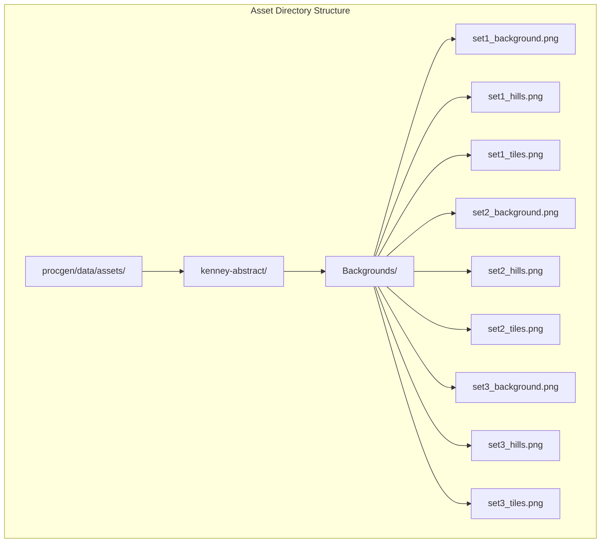
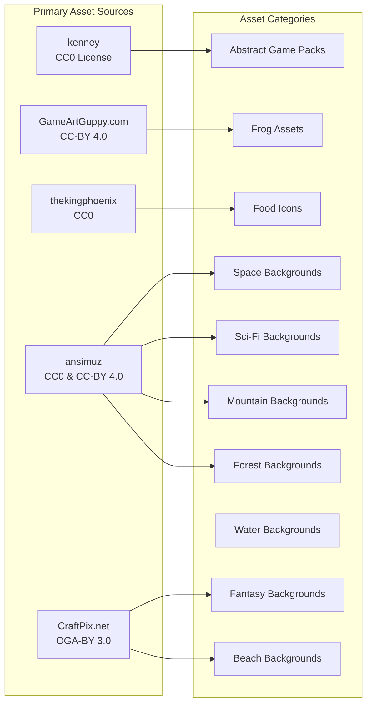
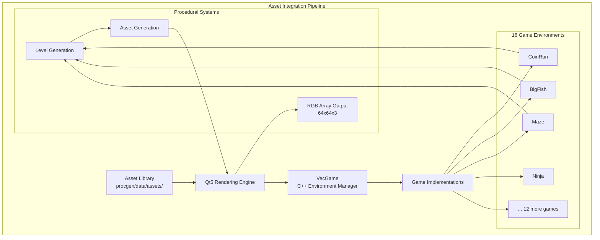

<!-- source: DeepWiki mcp.deepwiki.com · repo openai/procgen · page 6.1 Asset Library · fetched 2026-10-26 -->

# Asset Library

Relevant source files

The following files were used as context for generating this wiki page:

- [ASSET_LICENSES.md](ASSET_LICENSES.md)
- [procgen/data/assets/kenney-abstract/Backgrounds/set1_background.png](procgen/data/assets/kenney-abstract/Backgrounds/set1_background.png)
- [procgen/data/assets/kenney-abstract/Backgrounds/set1_hills.png](procgen/data/assets/kenney-abstract/Backgrounds/set1_hills.png)
- [procgen/data/assets/kenney-abstract/Backgrounds/set1_tiles.png](procgen/data/assets/kenney-abstract/Backgrounds/set1_tiles.png)
- [procgen/data/assets/kenney-abstract/Backgrounds/set2_background.png](procgen/data/assets/kenney-abstract/Backgrounds/set2_background.png)
- [procgen/data/assets/kenney-abstract/Backgrounds/set2_hills.png](procgen/data/assets/kenney-abstract/Backgrounds/set2_hills.png)
- [procgen/data/assets/kenney-abstract/Backgrounds/set2_tiles.png](procgen/data/assets/kenney-abstract/Backgrounds/set2_tiles.png)
- [procgen/data/assets/kenney-abstract/Backgrounds/set3_background.png](procgen/data/assets/kenney-abstract/Backgrounds/set3_background.png)
- [procgen/data/assets/kenney-abstract/Backgrounds/set3_hills.png](procgen/data/assets/kenney-abstract/Backgrounds/set3_hills.png)
- [procgen/data/assets/kenney-abstract/Backgrounds/set3_tiles.png](procgen/data/assets/kenney-abstract/Backgrounds/set3_tiles.png)

This document covers the comprehensive asset management system used by Procgen environments, including the organization, licensing, and integration of visual assets within the 16 procedurally generated games. The asset library provides the foundational visual elements that are combined with procedural generation algorithms to create diverse game environments.

For information about how these assets are integrated into the build system, see [Build System](#3). For details about legal compliance and licensing requirements, see [Legal and Licensing](#6.2).

## Asset Organization Structure

The Procgen asset library is organized in a hierarchical directory structure within the `procgen/data/assets/` directory. The primary asset collection consists of abstract art assets from Kenney, supplemented by additional themed collections from various contributors.

Sources: [procgen/data/assets/kenney-abstract/Backgrounds/set1_background.png](), [procgen/data/assets/kenney-abstract/Backgrounds/set1_hills.png](), [procgen/data/assets/kenney-abstract/Backgrounds/set1_tiles.png](), [procgen/data/assets/kenney-abstract/Backgrounds/set2_background.png](), [procgen/data/assets/kenney-abstract/Backgrounds/set2_hills.png](), [procgen/data/assets/kenney-abstract/Backgrounds/set2_tiles.png](), [procgen/data/assets/kenney-abstract/Backgrounds/set3_background.png](), [procgen/data/assets/kenney-abstract/Backgrounds/set3_hills.png](), [procgen/data/assets/kenney-abstract/Backgrounds/set3_tiles.png]()

## Licensing Framework

The asset library operates under a comprehensive licensing system that tracks the origin, author, and usage rights for each asset collection. This ensures legal compliance and proper attribution across all 16 Procgen environments.

### License Categories

| License Type | Usage Rights | Attribution Required | Commercial Use |
|--------------|--------------|---------------------|----------------|
| CC0 | Public Domain | No | Yes |
| CC-BY 3.0 | Attribution Required | Yes | Yes |
| CC-BY 4.0 | Attribution Required | Yes | Yes |
| OGA-BY 3.0 | OpenGameArt Attribution | Yes | Yes |

### Asset Sources and Licensing

Sources: [ASSET_LICENSES.md:1-85]()

## Asset Categories and Specifications

### Background Asset Sets

The Kenney abstract collection provides three distinct background sets, each containing coordinated visual elements for different game themes:

| Asset Set | Components | File Pattern | Dimensions |
|-----------|------------|--------------|------------|
| Set 1 | Background, Hills, Tiles | `set1_*.png` | 256x256 |
| Set 2 | Background, Hills, Tiles | `set2_*.png` | 256x256 |
| Set 3 | Background, Hills, Tiles | `set3_*.png` | 256x256 |

Each set provides:
- **Background**: Base environmental imagery
- **Hills**: Terrain and landscape elements  
- **Tiles**: Modular building blocks for level construction

### Specialized Asset Collections

Beyond the core Kenney collection, the asset library includes specialized assets for specific game scenarios:

- **Frog Assets**: Character sprites for amphibian-themed games
- **Food Icons**: Collectible item representations
- **Environmental Backgrounds**: Diverse themed environments (space, forest, underwater, etc.)
- **Battle Backgrounds**: Combat-focused environmental themes

Sources: [ASSET_LICENSES.md:2-85](), [procgen/data/assets/kenney-abstract/Backgrounds/set1_background.png](), [procgen/data/assets/kenney-abstract/Backgrounds/set2_background.png](), [procgen/data/assets/kenney-abstract/Backgrounds/set3_background.png]()

## Integration with Game Systems

The asset library integrates with Procgen's core rendering and procedural generation systems through Qt5-based rendering pipeline and the C++ game implementations.

Sources: Based on system architecture context and asset file locations

## Asset Management and Compliance

### License Tracking System

The `ASSET_LICENSES.md` file serves as the central registry for all asset licensing information, containing:

- **Author Attribution**: Original creator identification
- **License Type**: Specific license variant (CC0, CC-BY, OGA-BY)
- **Source URLs**: Original download locations and license texts
- **Usage Scope**: Applicable games and implementation contexts

### Compliance Requirements

For each licensed asset, the system maintains:

1. **Attribution Records**: Author and source information
2. **License Compliance**: Usage restrictions and requirements
3. **Distribution Rights**: Commercial and non-commercial usage permissions
4. **Modification Rights**: Asset adaptation and derivative work permissions

### Asset Verification Process

The licensing framework supports:
- Automated license validation during build processes
- Source verification through maintained URLs
- Attribution generation for distribution packages
- Compliance reporting for legal requirements

Sources: [ASSET_LICENSES.md:1-85]()

## Technical Implementation Details

### Asset Loading and Processing

Assets are processed through the Qt5 rendering system during environment initialization:

1. **Asset Discovery**: Files located in `procgen/data/assets/` directory structure
2. **Format Processing**: PNG images loaded through Qt5 image handling
3. **Memory Management**: Assets cached for efficient runtime access
4. **Rendering Integration**: Assets composited with procedural elements

### Asset Resolution and Scaling

The system handles multiple asset resolutions:
- **Base Resolution**: 256x256 pixel standard for background elements
- **Output Resolution**: Scaled to 64x64x3 RGB arrays for RL training
- **Quality Preservation**: Anti-aliasing and filtering during downscaling
- **Performance Optimization**: Asset pre-processing during build phase

Sources: Based on PNG file analysis and system integration patterns

---

